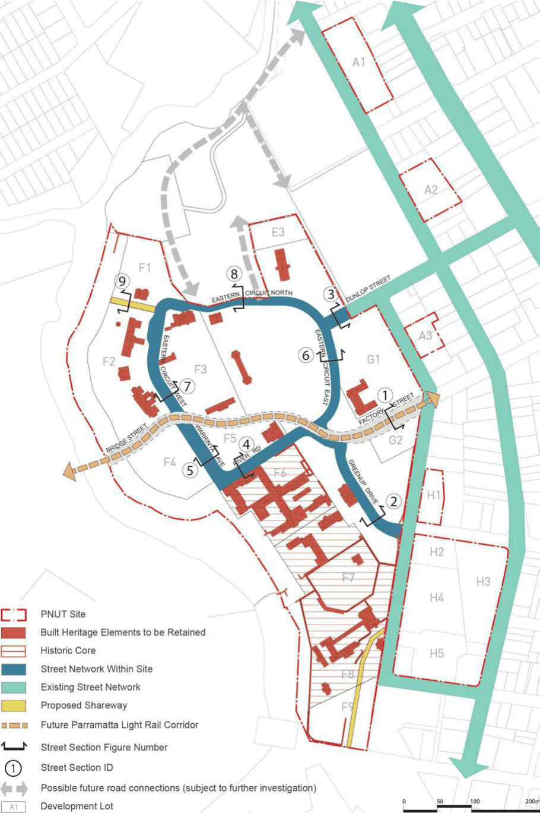
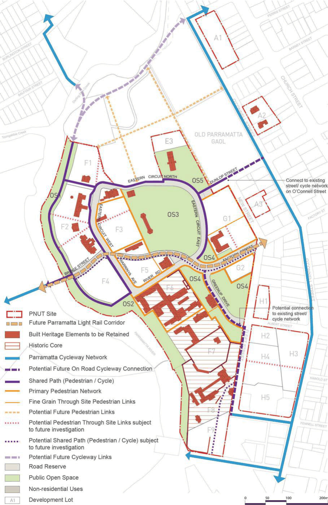

#### 8.2.2.5 SITE ACCESS, CIRCULATION AND CONNECTIVITY

Objectives

O.01 Encourage walking and cycling within and through the site by providing safe and legible pedestrian, cycle and shared paths.

O.02 Provide for safe, clear and legible pedestrian, cycle and vehicular movements within the site and connecting to surrounding areas.

O.03 Provide for opportunities for future integration with adjoining land and connections to regional open space and cycle networks.

O.04 Provide regional pedestrian and cycleway connections on the site to facilitate east- west and north-south movements.

O.05 Accommodate potential public transport access through the PNUT. O.06 Provide new connections through development lots to respond to heritage buildings and landscapes, improve through block connections and better links to regional connections.

Controls

C.01 Create new site vehicular and pedestrian access points at Factory Street and Dunlop Street. C.02 Enhance east-west and north-south connectivity and permeability which prioritise pedestrians and cyclists.

C.03 Establish a clear site circulation loop based on the existing street pattern centred on the existing oval.

C.04 Incorporate a cycleway system within and through the site that connects with the broader Parramatta cycle network.

C.05 Provide a network that can be expanded into surrounding lands. C.06 Pedestrian and cycle paths will be provided to best practice design, but may require the provision of narrower paths where constrained by topography, heritage or ecological considerations.

C.07 Opportunities for future provision of pathways along the riparian corridor between Lots F4 and

F9 should be explored in the future subject to ecological and heritage considerations.

C.08 Opportunities for future provision of a north-south extension of the Parramatta River cycleway adjacent to Lots F7 and F8, and future river crossings to Parramatta Park (to the west) should be explored subject to recognised heritage and ecological constraints.

C.09 Development Applications are for pedestrian and cycle connections are consistent with Figures

8.2.2.5.1 to 8.2.2.6.9.

C.10 Future paths are to facilitate a network of shared (pedestrian and cyclists) use paths whilst minimising the extent of new paved surfaces.

C.11 Paving treatments are to be consistent with the PNUT Public Domain Plan.

PARRAMATTA NORTH URBAN TRANSFORMATION PRECINCT

> [Picture on page 102: a picture, saved as a picture (images/part-08-centres-precincts-special-character-areas-specific-page-102-2.gif, 150 dpi).]

Figure 8.2.2.5.1 - Street Network

PARRAMATTA NORTH URBAN TRANSFORMATION PRECINCT

> [Picture on page 103: a picture, saved as a picture (images/part-08-centres-precincts-special-character-areas-specific-page-103-2.gif, 150 dpi).]

Figure 8.2.2.5.2 - Indicative Pedestrian and Cycle Network

PARRAMATTA NORTH URBAN TRANSFORMATION PRECINCT
