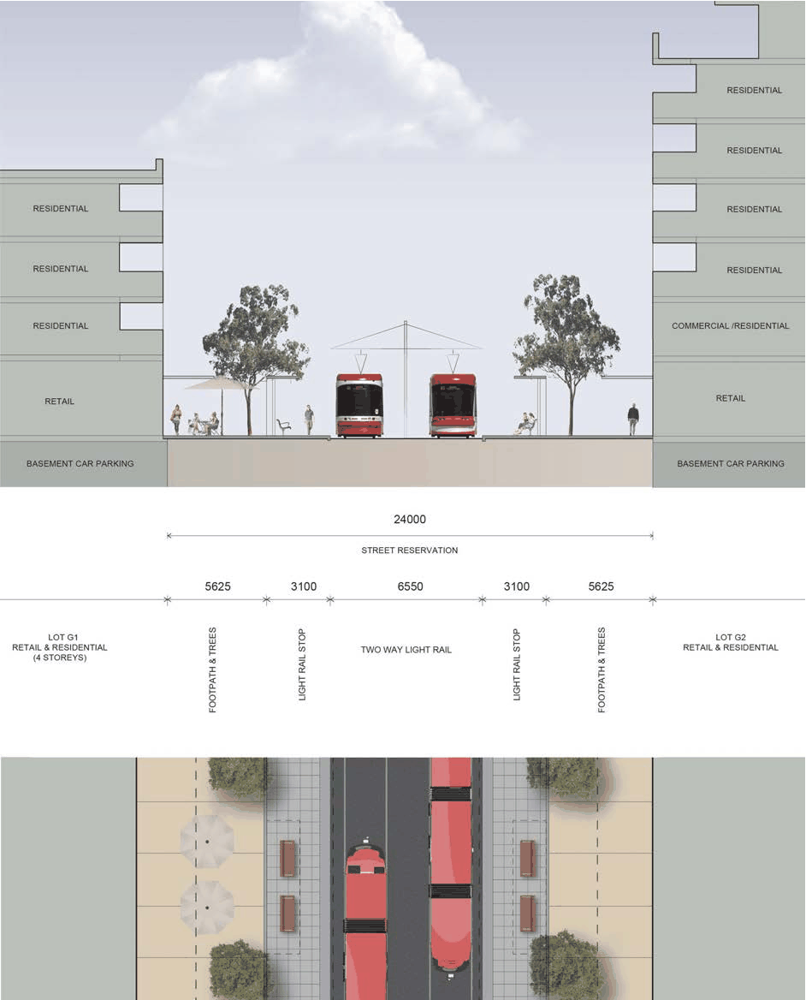
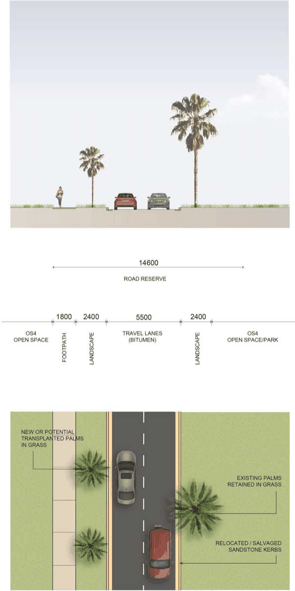
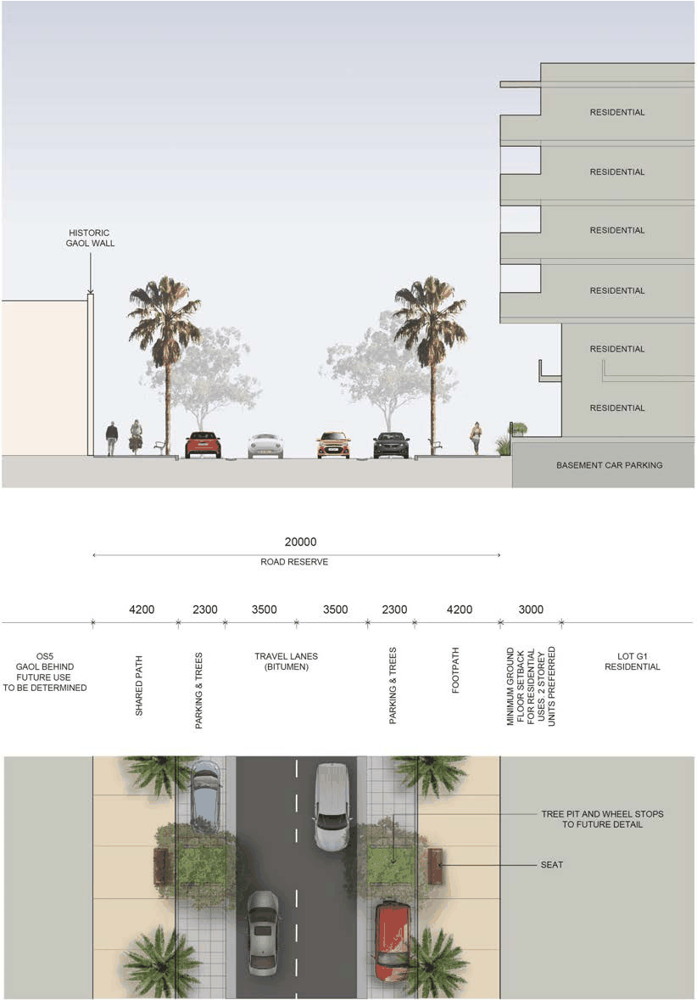
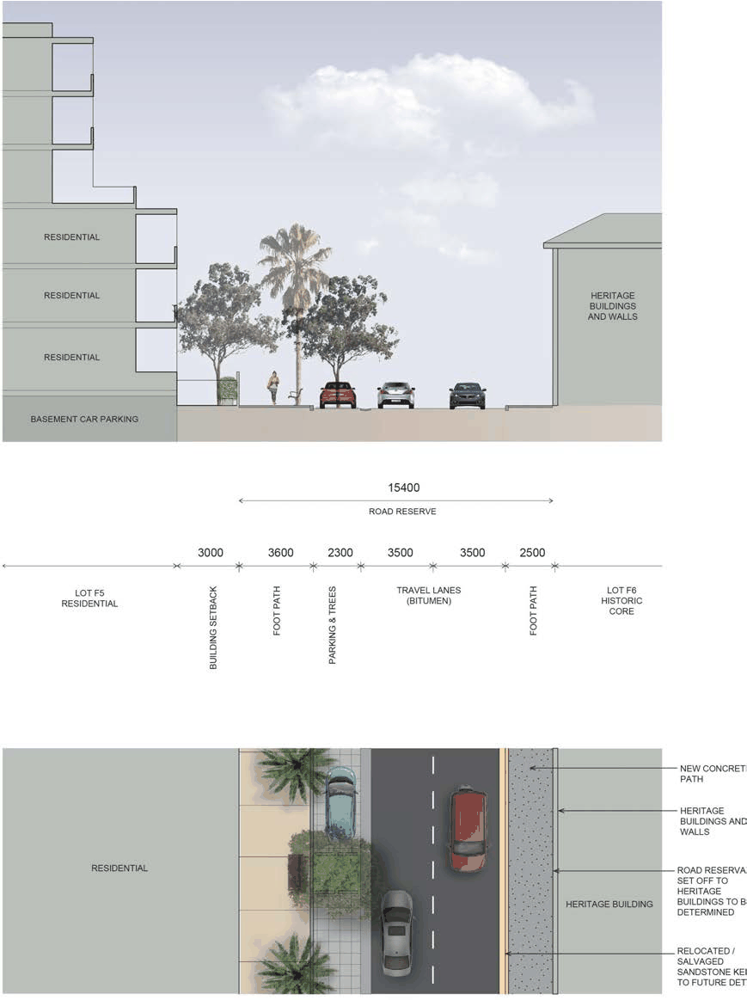
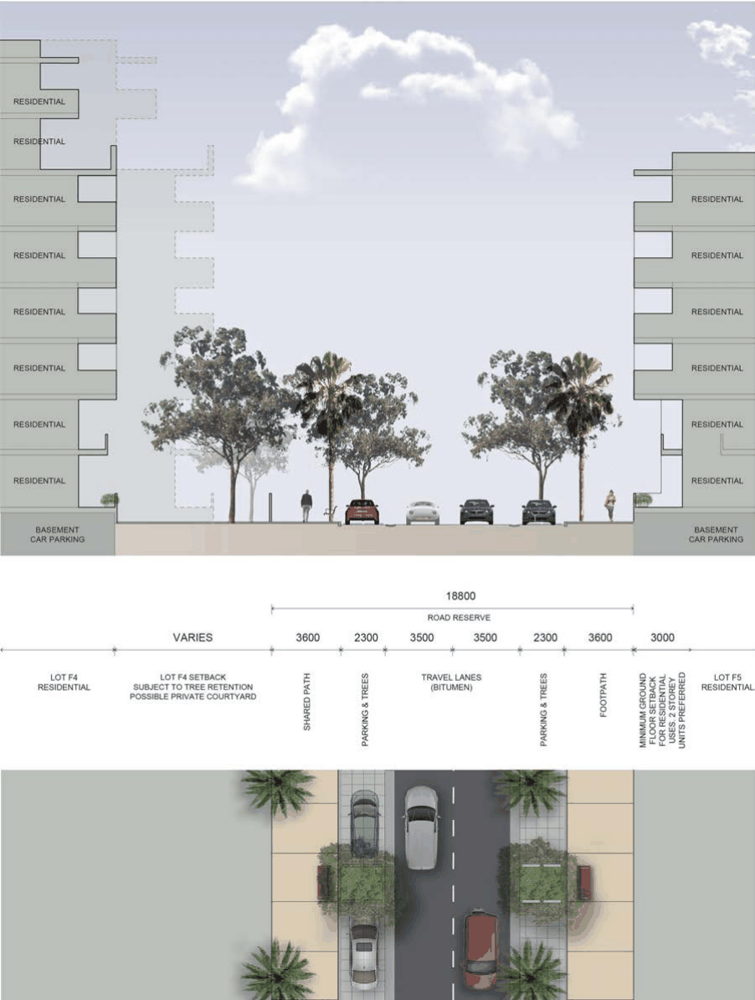
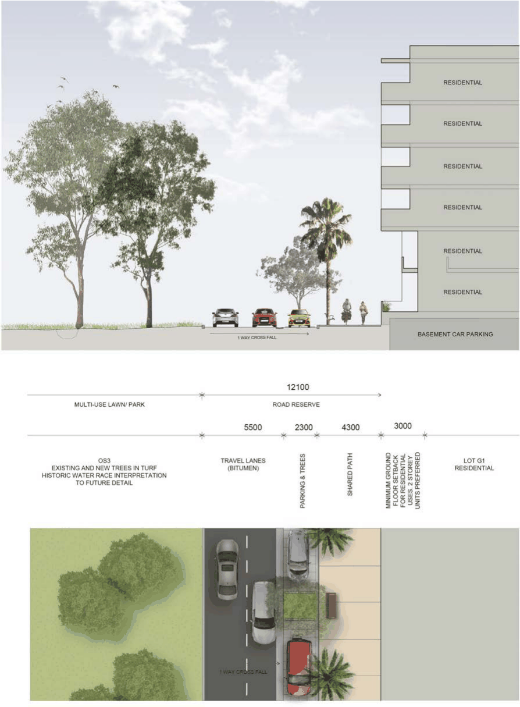
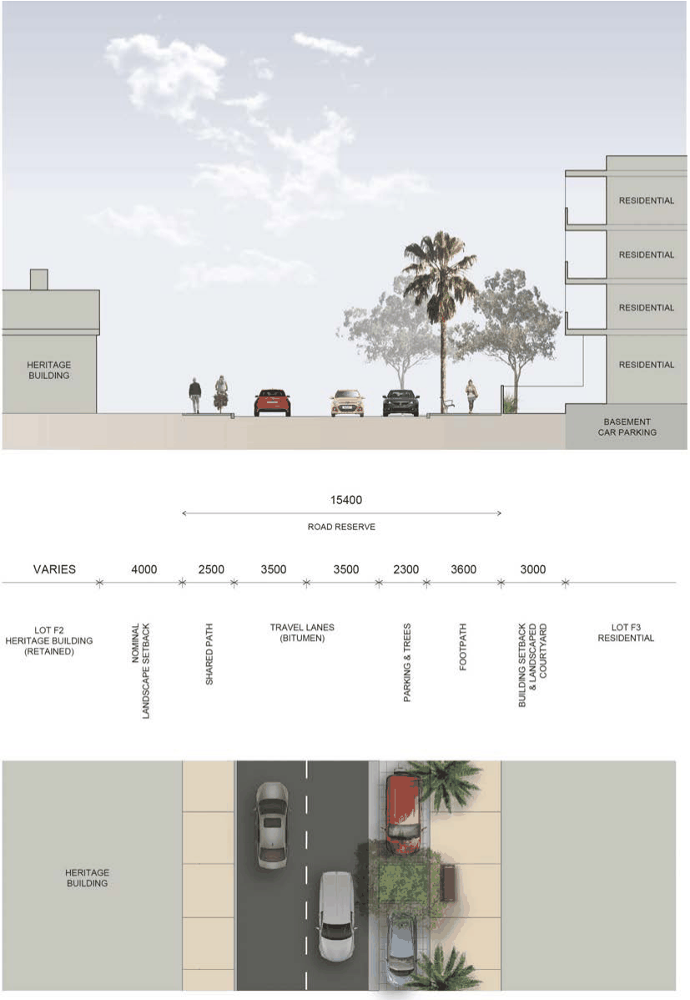
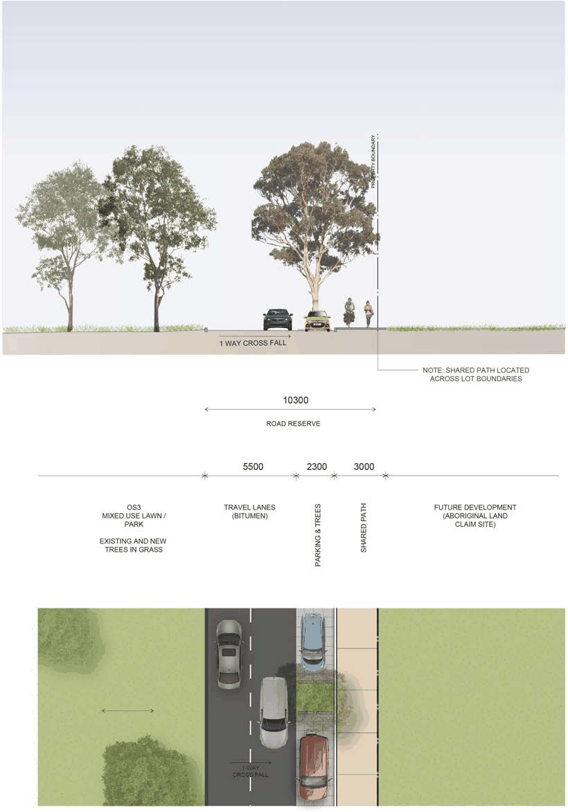
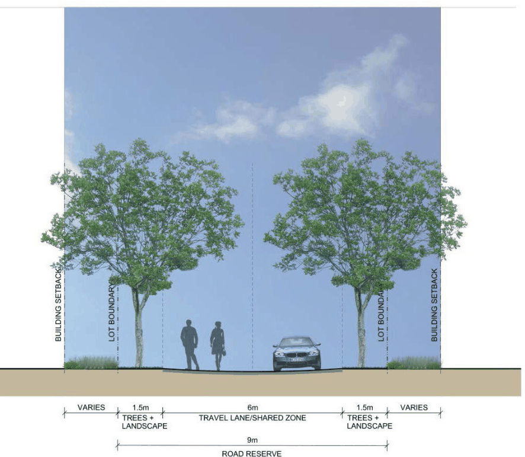

#### 8.2.2.6 STREET NETWORK

Objectives

O.01 Provide a street network that responds to the heritage constraints of the site as well as the existing street network and development pattern.

O.02 Restrict car parking in order to minimise traffic congestion and visual impacts and encourage transport use by means other than private vehicles.

O.03 Maximise the legibility of the street layout by establishing a clear hierarchy of streets, and protecting heritage places and structures.

O.04 Provide significant street tree planting to achieve shady streets for pedestrians. O.05 Provide a street network which responds to the Parramatta Light Rail Network.

Controls

C.01 Detailed design and implementation of new streets are to have regard to the site’s heritage values and constraints.

C.02 Significant road alignments are to have regard to the Parramatta North Historic Sites Consolidated Conservation Management Plan.

C.03 Retention, repair and reuse of significant sandstone kerbing is to be consistent with the requirements of the Parramatta North Historic Sites Consolidated Conservation Management Plan and the PNUT Public Domain Plan.

C.04 Development Applications for street network are to be in accordance with the Street Types at Figure 8.2.2.5.1. Any proposed variations must demonstrate that:

• The proposed changes meet the Objectives for this Section.

• Appropriate connections are provided within the site and opportunities for connections are provided to surrounding areas.

C.05 New and upgraded streets are to be consistent with the indicative street sections at Figures

8.2.2.6.1 to 8.2.2.6.9 and the Public Domain Plan.

C.06 New and upgraded streets are as per Austroads Pavement Design Guide, subject to an assessment of any site-specific design requirements or constraints.

PARRAMATTA NORTH URBAN TRANSFORMATION PRECINCT

> [Picture on page 105: a picture, saved as a picture (images/part-08-centres-precincts-special-character-areas-specific-page-105-2.gif, 150 dpi).]

Figure 8.2.2.6.1 - Typical street section 1 – Factory Street

PARRAMATTA NORTH URBAN TRANSFORMATION PRECINCT

> [Picture on page 106: a picture, saved as a picture (images/part-08-centres-precincts-special-character-areas-specific-page-106-2.gif, 150 dpi).]

Figure 8.2.2.6.2 - Typical street section 2 – Greenup Drive

PARRAMATTA NORTH URBAN TRANSFORMATION PRECINCT

> [Picture on page 107: a picture, saved as a picture (images/part-08-centres-precincts-special-character-areas-specific-page-107-2.gif, 150 dpi).]

Figure 8.2.2.6.3 - Typical street section 3 – Dunlop Street

PARRAMATTA NORTH URBAN TRANSFORMATION PRECINCT

> [Picture on page 108: a picture, saved as a picture (images/part-08-centres-precincts-special-character-areas-specific-page-108-2.gif, 150 dpi).]

Figure 8.2.2.6.4 - Typical street section 4 – River Road

PARRAMATTA NORTH URBAN TRANSFORMATION PRECINCT

> [Picture on page 109: a picture, saved as a picture (images/part-08-centres-precincts-special-character-areas-specific-page-109-2.gif, 150 dpi).]

Figure 8.2.2.6.5 - Typical street section 5 – Warrinya Avenue

PARRAMATTA NORTH URBAN TRANSFORMATION PRECINCT

> [Picture on page 110: a picture, saved as a picture (images/part-08-centres-precincts-special-character-areas-specific-page-110-2.gif, 150 dpi).]

Figure 8.2.2.6.6 - Typical street section 6 – East Circuit (east)

PARRAMATTA NORTH URBAN TRANSFORMATION PRECINCT

> [Picture on page 111: a picture, saved as a picture (images/part-08-centres-precincts-special-character-areas-specific-page-111-2.gif, 150 dpi).]

Figure 8.2.2.6.7 - Typical street section 7 – East Circuit (west)

PARRAMATTA NORTH URBAN TRANSFORMATION PRECINCT

> [Picture on page 112: a picture, saved as a picture (images/part-08-centres-precincts-special-character-areas-specific-page-112-2.gif, 150 dpi).]

Figure 8.2.2.6.8 - Typical street section 8 – East Circuit (north)

PARRAMATTA NORTH URBAN TRANSFORMATION PRECINCT

> [Picture on page 113: a picture, saved as a picture (images/part-08-centres-precincts-special-character-areas-specific-page-113-2.gif, 150 dpi).]

Figure 8.2.2.6.9 - Typical shared street section 9
