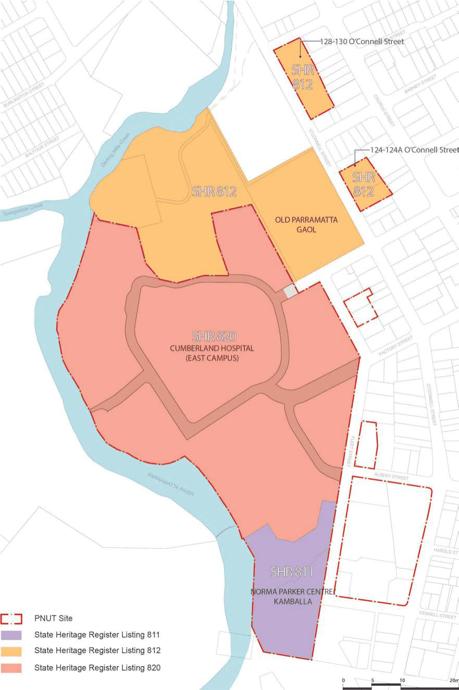
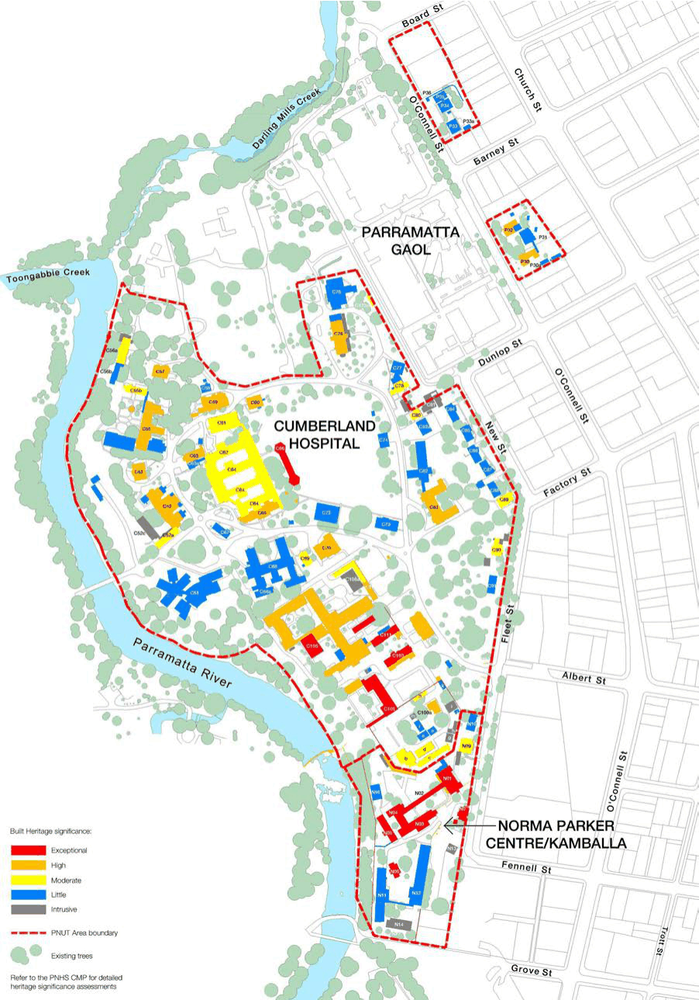
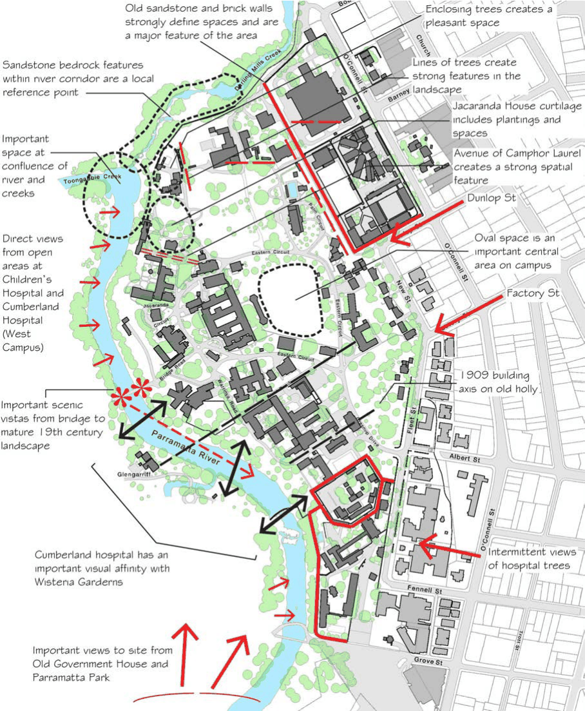
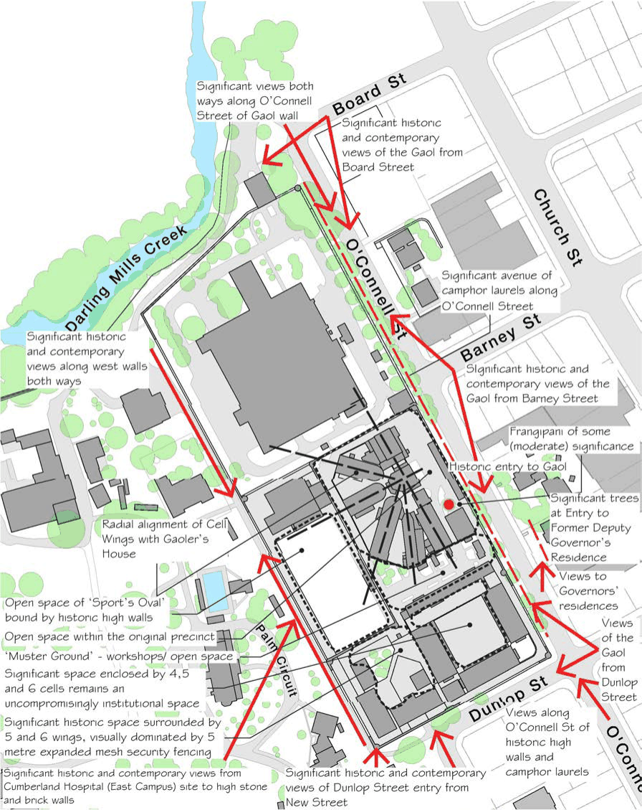
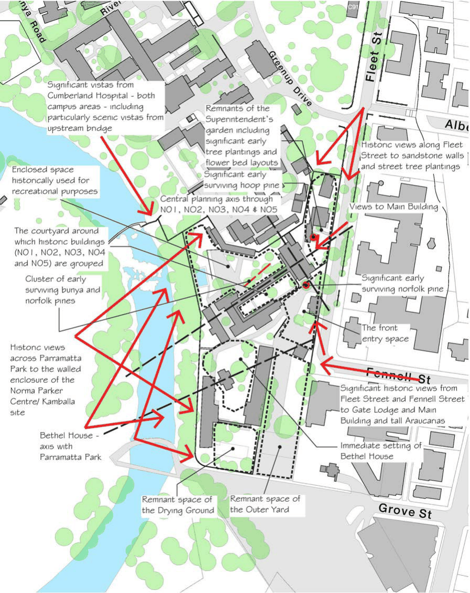

#### 8.2.2.9 HERITAGE

The Parramatta North Urban Transformation (PNUT) incorporates a substantial part of the Parramatta North Historic Sites (PNHS)—namely the Cumberland Hospital (East Campus) site and Norma Parker Centre/Kamballa site. These sites are listed on the Parramatta LEP 2023 and the State Heritage Register (as identified on Figure 8.2.2.9.1) because of their exceptional heritage significance to the people of Parramatta and New South Wales.

The Female Factory/Lunatic Asylum Precinct of the Cumberland Hospital (East Campus) site and all of the Norma Parker Centre/Kamballa site are also included in the nomination of the ‘Former Female Factory Precinct, Parramatta’ to be included in the National Heritage List administered under the Commonwealth Environment Protection and Biodiversity Conservation Act 1999. The PNUT is located adjacent to the World Heritage Listed Old Government House and Domain precinct. Therefore, any development proposals for the PNUT will require statutory consent from the City of Parramatta Council and the NSW Government. Referral may also be required to the Commonwealth Government.

The Parramatta North Historic Sites Consolidated Conservation Management Plan (the PNHS CMP) has been prepared to assist current and future owners, managers and other site users with the ongoing management of the heritage values of the PNHS. The PNHS CMP has been endorsed by the Heritage Council of NSW and all development for the PNUT will be required to comply with its principles, polices and guidelines.

The PNHS CMP comprises three (3) parts that should be read in conjunction with each other:

• Part A – Overview Report provides an overview history and significance of the PNHS and establishes the over-arching principles, policies and guidelines that apply across all three

PARRAMATTA NORTH URBAN TRANSFORMATION PRECINCT

sites. It also provides analysis of Aboriginal archaeology and cultural heritage values, historical (non-Aboriginal) archaeology and the broader cultural landscape of the PNHS.

• Part B – Significance Assessments comprises three separate reports providing historical analysis and assessment of the heritage significance for the Cumberland Hospital (East Campus) site, Parramatta Gaol site and Norma Parker Centre/Kamballa site.

• Part C – Lot Specific Guidelines includes a detailed heritage assessment of the components within each management lot and/or precinct and provides specific conservation and development guidelines for those components.

The Part C guidelines for each Development Lot will be required to be prepared and endorsed by the Heritage Council of NSW prior to lodgement of the relevant Development Application.

Development within each Development Lot is to be consistent with the principles, policies and guidelines contained within the Parramatta North Historic Sites Consolidated Conservation Management Plan (PNHS CMP). It is noted that the PNHS CMP does not apply to Lots A3 and H1-H5.

PARRAMATTA NORTH URBAN TRANSFORMATION PRECINCT

> [Picture on page 117: a picture, saved as a picture (images/part-08-centres-precincts-special-character-areas-specific-page-117-2.gif, 150 dpi).]

Figure 8.2.2.9.1 - State Heritage Register Listing Boundaries

PARRAMATTA NORTH URBAN TRANSFORMATION PRECINCT

#### 8.2.2.9.1 ABORIGINAL ARCHAEOLOGY AND CULTURAL HERITAGE

The PNUT is of high significance to the Aboriginal community and has the potential to contain significant evidence of Aboriginal occupation. The PNUT area is a place of potential significance relating to the long association of Aboriginal people with the Parramatta region, and is of contemporary significance due to the incarceration of Aboriginal people at the Roman Catholic Orphan School, Girls Industrial School, Norma Parker Centre/Kamballa and the adjacent Parramatta Gaol.

Objective

O.01 Ensure adequate protection and best-practice management of Aboriginal archaeology and cultural heritage within the PNUT.

Controls

C.01 Development within the PNUT is to be undertaken consistent with the requirements of the Parramatta North Historic Sites Consolidated Conservation Management Plan (PNHS CMP). An Aboriginal Heritage Assessment and Aboriginal Heritage Impact Permit (AHIP) may be required.

C.02 Future Development Applications are to incorporate interpretation of Aboriginal history, significance and occupation of the PNUT consistent with the requirements of the PNHS Heritage Interpretation Strategy.

C.03 State significant archaeology shall be confirmed through archaeological test excavation and be managed in accordance with the PNHS CMP.

#### 8.2.2.9.2 CULTURAL LANDSCAPES

The PNUT contains significant cultural landscapes that include significant building layouts, spaces, built landscape elements and plantings.

Objectives

O.01 Protect and appropriately manage the significant European cultural landscapes within the PNUT including layouts, spaces and hard landscaping elements.

O.02 Retain and conserve significant trees and minimise the number of trees removed to facilitate new development. Removal of trees is subject to due consideration of development alternatives and mitigation strategies consistent with the PNHS CMP and the PNUT Canopy Replenishment Strategy.

O.03 Retain and conserve the character of the significant cultural landscapes consistent with the PNHS CMP.

O.04 Protect significant views to and from the PNUT and significant views within the site consistent with the PNHS CMP.

O.05 Protect views identified as important for the adjacent Old Government House and Domain precinct as defined in the Development in Parramatta City and the Impact on Old Government

PARRAMATTA NORTH URBAN TRANSFORMATION PRECINCT

House and Domain’s World and National Heritage Listed Values, Planisphere 2012 Report – views 4, 10, 11 and 16.

Controls

C.01 New developments are to identify and respond to an appropriate setting (curtilage) of existing heritage buildings as identified in Section 8.2.2.10 of this DCP, and as documented in PNHS CMP.

C.02 New developments that contain significant trees are to submit an arboricultural impact assessment and tree protection plan that identifies the current condition, potential impacts, mitigation strategies and short and long term management requirements for the trees. The assessment is to be prepared in accordance with current best-practice and any vegetation management requirements of Section 5.3.4 – Tree and Vegetation Preservation of this DCP.

C.03 Significant tree plantings identified for retention are to be managed consistent with best-practice maintenance requirements and the staged replacement of the trees and the PNUT Canopy Replenishment Strategy.

C.04 Future development is to minimise impacts on and conserve the sandstone walls and kerbs on both sides of Fleet Street. Any removed elements are to be salvaged and securely stored for potential reuse in maintenance and repair of the walls.

C.05 Any new development must allow interpretation of the heritage significance of the site, consistent with the requirements of the PNHS Heritage Interpretation Strategy.

C.06 Existing sandstone kerbs impacted by public domain or future lot development must be salvaged for re-use on-site.

C.07 Sandstone kerbing must be used (or re-used) to repair or reconstruct:

• the sandstone kerbs along Greenup Drive and River Road.

• the sandstone kerbs within the roadways of the Hospital for the Insane Precinct (F1 and F2).

• in the vicinity of the Recreation Hall/Chapel (E3).

• retained sections along Eastern Circuit.

C.08 Sandstone kerbing must be considered for use/re-use:

• to assist with the re-instatement of Dunlop Street and/or Factory Street.

• repair or re-construct existing sandstone kerbs on Fleet Street.

C.09 Where the salvaged sandstone is unsuitable for re-use as sandstone kerbing, opportunities to incorporate the stone into the public domain landscape (such as seating, path/garden edging) and/or site interpretation must be explored.

C.10 Existing or salvaged sandstone kerbing shall be used within the Historic Core (Lots F6, F7 and F8) where appropriate.

PARRAMATTA NORTH URBAN TRANSFORMATION PRECINCT

#### 8.2.2.9.3 BUILT HERITAGE

The PNHS incorporates a number of built heritage elements of cultural heritage significance. The PNHS CMP provides the assessed levels of heritage significance of buildings and structures as either exceptional, high, moderate or little significance or that are intrusive (refer Figure 8.2.2.9.6.1). The PNHS CMP also provides guidance for the conservation of these buildings and structures.

Objectives

O.01 Protect the heritage significance of the PNHS within the PNUT. O.02 Conserve the significant buildings and structures within the PNUT that demonstrate the significant heritage values of the PNHS and adapt them for appropriate new uses.

O.03 Ensure that new development responds to the retained heritage buildings and structures within and in the immediate vicinity of the PNHS consistent with the Parramatta North Historic Sites Consolidated Conservation Management Plan (PNHS CMP).

Controls

C.01 The assessment of the conservation of buildings and structures is to be consistent with their assessed levels of heritage significance (refer Figure 8.2.2.9.3.1) and guidelines as described in Policy 20 of Part A of the PNHS CMP and Inventory Sheets contained in Part B of the PNHS CMP.

C.02 Sensitive adaptive re-use of heritage buildings is encouraged. New uses must be compatible with the heritage significance of the place and be undertaken in accordance with the PNHS CMP and best-practice guidelines including New Uses for Heritage Places: guidelines for the adaption of historic buildings and sites, prepared by the Heritage Council of NSW and RAIA (now Australian Institute of Architects) in 2008.

C.03 New buildings must be consistent with best-practice guidelines including Design in Context: Guidelines for infill development in the historic environment, prepared by the NSW Heritage Office (now Heritage Division, Office of Environment and Heritage) and RAIA (now Australian Institute of Architects) in 2005.

C.04 Proposed works to heritage buildings and structures within the PNUT and new development in the vicinity of heritage buildings is to be consistent with the requirements of the PNHS CMP.

C.05 A Heritage Impact Statement is to be prepared by a suitably qualified heritage expert as part of any Development Application within the PNUT. The Heritage Impact Statement is to be prepared consistent with the current best- practice and is to address:

• The heritage significance of the building or structure and its contribution to the heritage significance of the PNHS area.

• The options that were considered when arriving at a preferred development and the reasons for choosing the preferred option.

• The impact of the proposed development on the heritage significance of the building or structure, other buildings within the vicinity and the significance of the broader PNHS.

PARRAMATTA NORTH URBAN TRANSFORMATION PRECINCT

• The compatibility of the development with the policies and guidelines contained within the PNHS CMP.

• Landscape heritage assessment which includes impact of development on the immediate and whole of historic landscape character, including important views.

C.06 As required by the PNHS CMP, where the Development Application proposes the full or substantial demolition of a building, approval is required under Section 57(2) or Section 60 of the Heritage Act 1977 and under the provisions of the Parramatta LEP 2023.

C.07 Where the Development Application proposes the full or substantial demolition of a building, a Heritage Impact Statement must address Policy 20 and 49 of the PNHS Conservation Management Plan – Part A Overview Report and demonstrate that:

• there is no prudent or feasible alternative.

• demolition would result in no or minimal impacts, including cumulative impacts, on the heritage significance of the place or the wider PNHS.

• demolition would be of overall benefit to the heritage significance of the place and the wider PNHS. The Development Application is to include a report from a suitably qualified structural engineer if the demolition is proposed on the basis of poor structural condition. Building and structures approved for demolition should be archivally recorded prior to any works. A survey of all the building and structures proposed for demolition should be undertaken to identify any building materials that have potential for re-use in the repair of significant buildings or structures and/or that may be of interpretative value and should be considered for incorporation into the upgrading of the open space areas.

C.08 Future Development Applications are to incorporate interpretation of the history and heritage significance of significant buildings and structures consistent with the requirements of the PNHS Heritage Interpretation Strategy.

PARRAMATTA NORTH URBAN TRANSFORMATION PRECINCT

> [Picture on page 122: a picture, saved as a picture (images/part-08-centres-precincts-special-character-areas-specific-page-122-2.gif, 150 dpi).]

Figure 8.2.2.9.3.1 - Built Heritage Significance (Source: PNHS CMP)

PARRAMATTA NORTH URBAN TRANSFORMATION PRECINCT

#### 8.2.2.9.4 HISTORICAL (NON-ABORIGINAL) ARCHAEOLOGY

There is a substantial and significant archaeological resource within the PNUT. Archaeological investigations and assessment will be required to guide development in some areas and inform the management of specific elements of archaeology.

The Parramatta North Historic Sites Consolidated Conservation Management Plan (PNHS CMP) has been prepared to guide development so that it avoids, minimises or mitigates impacts on significant archaeology. The PNHS CMP provides general archaeology management recommendations as well as more specific requirements for each of the development lots within the PNUT.

It is recommended that archaeology of State and potentially National heritage significance is identified, acknowledged, managed and retained in situ, however any impacts or removal of objects will be subject to a merit-based assessment, taking into consideration the archaeological significance and intactness.

Objectives

O.01 Ensure adequate protection and appropriate management of the significant archaeological resource within the PNUT.

O.02 Ensure that archaeology of local, state and potential National significance is retained in situ, wherever possible, and be interpreted within new development.

Controls

C.01 Excavation within the PNUT area is to be consistent with the requirements of the PNHS CMP. Further archaeological investigation and assessment may be required to inform future development on the PNUT.

C.02 Prior to the commencement of any works involving excavation, any required applications for approval to undertake the works under the Heritage Act 1977 are to be submitted to the Heritage Division, Office of Environment and Heritage.

C.03 New developments must allow interpretation of relevant significant archaeological resources of the PNUT. The interpretation must be consistent with the requirements of the PNUT Heritage Interpretation Strategy.

#### 8.2.2.9.5 KEY VIEWS, LANDMARKS AND AXES

The PNUT as a site of historic significance includes many landmarks, view corridors, vistas and planning axes that must be considered in the renewal. These views and vistas include views within the PNUT, views from the PNUT and views to the PNUT, particularly from Parramatta Park.

Objectives

O.01 Ensure significant views and vistas to, from and within the PNUT are protected and enhanced. O.02 Ensure new development has regard to the views and vistas relating to the location, siting and design of new development.

PARRAMATTA NORTH URBAN TRANSFORMATION PRECINCT

Controls

C.01 Development within the PNUT is to protect and enhance the views, vistas and view axes identified in Figure 8.2.2.9.5.1 to 8.2.2.9.5.3.

C.02 New services infrastructure must be located underground to avoid visual impacts on significant cultural landscape, in particular the curtilage and wider setting of significant buildings and structures, open space areas, cultural plantings and views.

C.03 Development must respect and protect the important views from the World Heritage listed Old Government House and Domain Precinct as defined in the Development in Parramatta City of the Impact on Old Government House and Domain’s, Planisphere 2012.

PARRAMATTA NORTH URBAN TRANSFORMATION PRECINCT

> [Picture on page 125: a picture, saved as a picture (images/part-08-centres-precincts-special-character-areas-specific-page-125-2.gif, 150 dpi).]

Figure 8.2.2.9.5.1 - Key Views, Landmarks and View Axes (Source: PNHS CMP)

PARRAMATTA NORTH URBAN TRANSFORMATION PRECINCT

> [Picture on page 126: a picture, saved as a picture (images/part-08-centres-precincts-special-character-areas-specific-page-126-2.gif, 150 dpi).]

Figure 8.2.2.9.5.2 - Key Views, Landmarks and View Axes (Source: PNHS CMP)

PARRAMATTA NORTH URBAN TRANSFORMATION PRECINCT

> [Picture on page 127: a picture, saved as a picture (images/part-08-centres-precincts-special-character-areas-specific-page-127-2.gif, 150 dpi).]

Figure 8.2.2.9.5.3 - Key Views, Landmarks and View Axes (Source: PNHS CMP)
