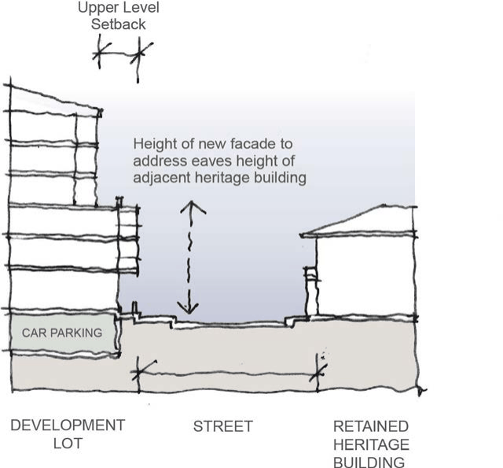
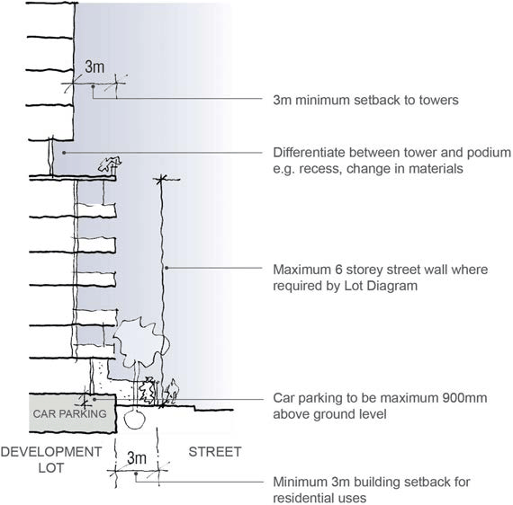

#### 8.2.2.10 DEVELOPMENT AND DESIGN

This Section provides general development and design controls for future developments. The development and design controls relate to site landscaped area, building separation, building articulation, building location and floor plate sizes. These general controls are to be read in conjunction with the Development Lot Controls – Individual Section of this DCP. The PNUT development lots are identified in Figure 8.2.2.12.1. Design guidelines for each of the development lots are provided at Figures

8.2.2.12.1.1 to Figure 8.2.2.12.15.1.

PARRAMATTA NORTH URBAN TRANSFORMATION PRECINCT

Where there is any inconsistency, the individual development lot controls will prevail over these general development and design controls.

Note: Development must comply with the controls set out below and any relevant controls in Parramatta DCP 2023. Where there is any inconsistency Part 8 will prevail.

#### 8.2.2.10.1 BUILT FORM AND MASSING

Objectives

O.01 Ensure that high levels of residential amenity are achieved. O.02 Provide for appropriate separation of buildings to provide opportunities for solar access, natural ventilation, privacy control and provision of outlooks.

O.03 Ensure new buildings respond to and respect the existing heritage buildings, structures and landscapes.

O.04 Ensure development floor plate sizes and building footprints are not excessive. O.05 Provide adequate opportunities for landscaping.

Controls

C.01 Each development lot identified at Figure 8.2.2.12.1 and where it may be possible, is to include landscaping to complement the landscaping provided in the public domain.

C.02 Development lots that include residential accommodation, must provide deep soil landscape on all front, side and rear boundary setbacks as shown in the Individual Development Lot Figures.

C.03 New buildings should not be longer than 45 metres in length. C.04 Where buildings cannot demonstrate a maximum of 45 metres in length, building facades must be articulated ‘breaks’ in the building form.

C.05 The maximum floorplates for tower buildings of more than 12 storeys is 850m² (gross building area).

8.2.2.10.2 RELATIONSHIP BETWEEN NEW DEVELOPMENT & EXISTING BUILT FORM

Controls

C.01 The design, orientation and arrangement of built form and landscape elements is to capture river views, respect key axes, relationships to open spaces and enhance the setting of the cultural heritage.

C.02 The design of new buildings must respect the scale, design and materials of the culturally significant buildings and structures within the PNHS sites. The siting of new buildings must

PARRAMATTA NORTH URBAN TRANSFORMATION PRECINCT

recognise the heritage significance and values of the sites and must not intrude on important views and vistas across the site.

C.03 The overall form and design of any new buildings must have regard to the palette of materials that already exist on-site. Architectural forms must be simple and direct, and new buildings must be of a high-quality contemporary design.

C.04 There should be a considered relationship between the existing environment (built and landscape) and new development through the appropriate use of materials, colour, built form and urban character.

> [Picture on page 129: a picture, saved as a picture (images/part-08-centres-precincts-special-character-areas-specific-page-129-10.gif, 150 dpi).]

Figure 8.2.2.10.2.1 - Relationship with heritage buildings

C.05 New buildings adjacent to retained heritage buildings and structures should not encroach into the heritage curtilage. Note that this relationship could be across subdivision and allotment boundaries. New buildings should include an alignment of street wall heights, increased upper-level setbacks and façade articulation to minimise potential visual impacts, as demonstrated at Figure 8.2.2.10.2.1.

C.06 The detailed design and articulation of facades must reflect the character of the site as comprising of a series of discrete buildings within a landscape setting.

C.07 Where gable or hipped roofs are proposed, the angle of the pitch must be compatible with the adjacent heritage building.

C.08 All new service elements such as aerials, vent pipes, hot water services, solar collectors or heating panels, plant equipment, air-conditioning units, telecommunications and satellite equipment and the like located on the building must be fully integrated in the design of the building and concealed from public view.

PARRAMATTA NORTH URBAN TRANSFORMATION PRECINCT

C.09 Any new addition to heritage buildings is appropriate only where they facilitate the use of the building. New additions to retained heritage buildings and structures may be permissible within the heritage curtilage should be designed to minimise adverse impacts on their heritage significance, with careful consideration to siting, form, scale, height and materials.

#### 8.2.2.10.3 IMPORTANT CORNERS

Control

C.01 Important corners require distinctive architectural treatment and must be articulated and expressed volumetrically, addressing both streets and façades. This can be created through emphasis, articulation, splayed treatments, use of materials/colour, height and/or other means.

#### 8.2.2.10.4 EXISTING AND NEW VEGETATION

Controls

C.01 Significant trees and landscape elements must be retained and incorporated in new development.

C.02 New landscaping is to be consistent with the Parramatta North Historic Sites Consolidated Conservation Management Plan (PNHS CMP) and PNUT Canopy Replenishment Strategy.

C.03 Developments are to consider and reflect the site’s historic planting regimes and species in the layout and specification of future landscape designs.

C.04 Landscapes nearest the light rail corridor should minimise understorey planting in order to maximise sight lines for pedestrians crossing the corridor and clearly delineating safe spaces from the light rail hazard zone.

C.05 Development Applications must be accompanied by a Landscape Plan which details vegetation and trees to be removed, retained and new plantings. An indicative plant schedule nominating species, number and size should be included.

C.06 Removal of trees may be allowed subject to a merit-based assessment of development alternatives and opportunities to replace significant trees with identical or comparable species to enhance the landscape character consistent with the PNHS CMP and the PNUT Canopy Replenishment Strategy.

C.07 New developments must retain and conserve significant trees, and minimise the number of trees removed to facilitate new development. Removal of trees is allowed subject to due consideration of development alternatives and mitigation strategies.

C.08 Significant tree plantings identified for retention are to be managed in accordance with best-practice maintenance requirements and the staged replacement of the trees and the PNUT Canopy Replenishment Strategy.

PARRAMATTA NORTH URBAN TRANSFORMATION PRECINCT

#### 8.2.2.10.5 IMPORTANT INTERFACE WITH PUBLIC OPEN SPACE

Controls

C.01 Where buildings have an important relationship with public open space, ensure they address the public open spaces to achieve good passive surveillance, high-quality presentation, active open spaces and maximise visual connections. Direct pedestrian and visual connections between buildings (including retained heritage buildings) and open space areas are to be encouraged.

C.02 Where private open space is located adjacent to public open space or the public domain, appropriate edge treatments are to be provided to maintain a clear hierarchy of spatial separation, whilst also achieving design integration.

C.03 Where private open space forms part of the curtilage and landscape setting of a heritage building, any landscape treatment, such as planting, structures or fencing must be designed and located to respect the significance of the building a minimise heritage and visual impacts in accordance with the PNHS CMP.

C.04 Development shall respect and contribute to the open landscape and park-like character of the precinct.

C.05 Walls and fences must contribute to visual amenity and provide safety/security to residents. The design of these elements must positively contribute to the public domain and be in keeping with the historic character of retained building and the landscape.

C.06 Fencing and boundary delineation must be integrated with the building and landscape design through the use of compatible materials and detailing.

C.07 Development must demonstrate a careful selection of appropriate materials for boundary treatments. Brick, sandstone, rendered masonry low walling, transparent or semi-transparent fencing with soft landscape elements is preferrable. No replica fence types, sheet metal or wire fencing shall be used. Landscaping is encouraged where there are changes in level.

C.08 Raised walls or terraces to streets should be softened by the use of planters. C.09 Fencing around heritage buildings should not obstruct or detract from the principal views of the building.

C.10 Interface between public open space and Parramatta Light Rail Corridor to be designed in consultation with Council and Transport for NSW to ensure safety, accessibility and visual amenity.

#### 8.2.2.10.6 STREET WALLS AND PODIUMS

Controls

C.01 Street walls of new developments are to present a human scale urban edge to the public domain and ensure consistent scale across separate development lots.

PARRAMATTA NORTH URBAN TRANSFORMATION PRECINCT

C.02 Where towers are required to be setback from podiums, they must be differentiated by a change of material and/or architectural wall expression.

C.03 The maximum podium height is 6 storeys. Above the podium a minimum 3 metre setback is required as shown in Figure 8.2.2.10.7.1.

C.04 Where the proposed building interfaces with a heritage building or existing urban development, a lower street wall height is required (refer to Figure 8.2.2.10.2.1 – Relationship to Heritage Building).

#### 8.2.2.10.7 SETBACKS

Controls

C.01 Setbacks between new developments and to heritage buildings must be sympathetically treated and be free of and not compromised through provision of services and structures, such as substations, air conditioning units and hydrants.

C.02 Building and tower setbacks are not to be overhung by significant built form and be consistent with the design principles and controls set out in each of the Individual Development Lot controls.

C.03 A minimum street level building alignment setback of 3 metres is required for buildings with a residential ground floor use as shown in Figure 8.2.2.10.7.1, unless otherwise specified on the Development Lot Control – Individual Section of this DCP.

C.04 A 0 metre lot street building alignment setback is permissible for buildings with a commercial, retail or main street frontage, unless otherwise specified on the Development Lot Control – Individual Section of this DCP.

C.05 Ground floor apartments must have individual access from the public domain or through site links. New ground floor apartments to be elevated above street level (maximum 900mm) to allow for privacy, transition and basement parking partial ventilation, where setback from street.

C.06 Podium and tower levels must provide a mix of private courtyards, communal landscaped open space and resident amenities.

PARRAMATTA NORTH URBAN TRANSFORMATION PRECINCT

> [Picture on page 133: a picture, saved as a picture (images/part-08-centres-precincts-special-character-areas-specific-page-133-2.gif, 150 dpi).]

Figure 8.2.2.10.7.1 - Typical Street wall heights and tower setbacks

#### 8.2.2.10.8 THROUGH SITE LINKS

Controls

C.01 Through site links are to provide pedestrian permeability through large sites as shown at Figure 8.2.2.5.2.

C.02 Through site links must be generously sized, have direct connections, and include allowance for significant landscaping.

C.03 Through site links are to incorporate active ground floor uses such as residential building entries, community and/or retail uses.

C.04 Through site links are to be at natural ground level and be fully open to the sky with no building elements above.

C.05 Through site links are to be accessible to the public at all times. C.06 The required through site links have been identified where necessary in the detailed Development Lot Controls in this DCP.

C.07 Through site links to be dedicated to the City of Parramatta Council are not to be located over a basement.

C.08 Additional through site links can be provided through detailed design development if required.

PARRAMATTA NORTH URBAN TRANSFORMATION PRECINCT

#### 8.2.2.10.9 EXTERNAL MATERIALS

Controls

C.01 The site requires a limited materials and colour palette to achieve a cohesive built form related to the retained historic built legacy, which includes an established tradition of building in sandstone and red brick.

C.02 Materials must be selected that contribute to the building’s sustainability performance, thermal comfort for internal users and the public domain and durability.

C.03 For ground plane or podium levels opposite or adjacent to heritage buildings, materials must be selected to consider the visual characteristics and significance of the heritage buildings. Reference must be made to the PNHS CMP.

C.04 A sample board showing colours and finishes must be submitted as part of any Development Application.

C.05 The colour of external facades of the ground plane or podium levels is to be predominantly sandstone and/or mid-to-darker red/earth tones. Lighter sandstone/beige/grey on rendered or painted lightweight areas may be used to articulate the façade. Accent colours may be used on incidental or detailed elements such as sunshades, blade walls, shutters etc.

C.06 Highly coloured, reflective or white facades are not appropriate materials and must not be approved.

C.07 Precast concrete is not to be used as the primary façade material unless there is acceptable articulation, surface treatment, and integration with other architectural elements.

#### 8.2.2.10.10 STREET ADDRESSES

Controls

C.01 All new buildings and reused heritage buildings must demonstrate clear and logical public street addresses. Development must provide simple and clear public entries to all buildings for pedestrians.

C.02 Careful consideration is to be given to the proposed location of letter boxes, entry signage and garbage collection points to ensure clear and logical locations whilst minimising the adverse visual impact on the public domain and any adjacent heritage buildings or structures.

C.03 Garbage collection points must be located, wherever achievable, in basement carparks.
