#### 8.2.2.12 DEVELOPMENT LOT CONTROLS – INDIVIDUAL

This Section sets out the objectives, principles and design controls for all individual development lots including setbacks, maximum height, important corners, relationship to heritage buildings and open space, tree retentions, cross-site links and preferred vehicle and pedestrian access locations.

Development within each Development Lot is to be consistent with the principles, policies and guidelines contained within the Parramatta North Historic Sites Consolidated Conservation Management Plan (PNHS CMP) including the Part C Lot-Specific Guidelines. It is noted that the PNHS CMP does not apply to Lots A3, H1-H5.

PARRAMATTA NORTH URBAN TRANSFORMATION PRECINCT

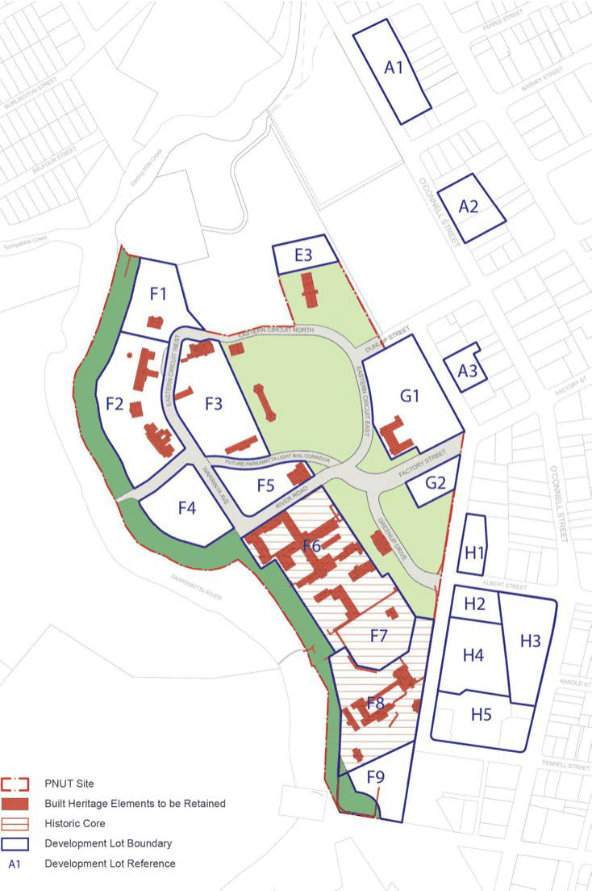

> [Picture on page 137: a picture, saved as a picture (images/part-08-centres-precincts-special-character-areas-specific-page-137-2.gif, 150 dpi).]

Figure 8.2.2.12.1 - Development Lot identification plan

#### 8.2.2.12.1 LOT A1

Objectives

O.01 Development is to integrate with existing adjoining urban development. O.02 Development is to respond to views to the historic walls of Parramatta Gaol.

PARRAMATTA NORTH URBAN TRANSFORMATION PRECINCT

Controls

C.01 The built form must positively address the O’Connell/Board Streets corner and step down in scale towards the Parramatta Gaol site. There is potential to activate the ground floor with non-residential uses particularly at the corner location (refer Figure 8.2.2.12.1.1).

C.02 New buildings must provide building setbacks which respond to existing building setbacks and provide adequate transition to existing built forms.

C.03 Any taller built form must be located in the north western corner (corner of Board Street and O’Connell Street) to minimise potential impacts on surrounding development.

C.04 Basement parking may extend beyond the building footprint subject to an assessment of the landscape impacts and demonstration that areas available for deep soil planting are maximised wherever possible.

C.05 Development must demonstrate compliance with the built form controls indicated on Figure 8.2.2.12.1.1.

C.06 New buildings to provide a maximum 6 storey street wall height where fronting Board Street and O’Connell Street.

C.07 New buildings to provide a minimum 3 metre building setback to Board Street and O’Connell Street.

PARRAMATTA NORTH URBAN TRANSFORMATION PRECINCT

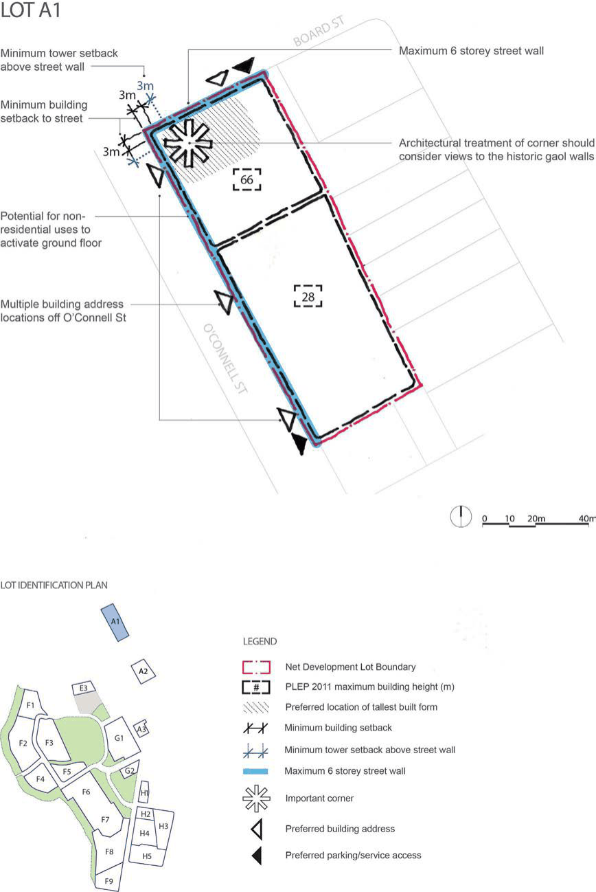

> [Picture on page 139: a picture, saved as a picture (images/part-08-centres-precincts-special-character-areas-specific-page-139-2.gif, 150 dpi).]

Figure 8.2.2.12.1.1 - Development Lot A1

PARRAMATTA NORTH URBAN TRANSFORMATION PRECINCT

#### 8.2.2.12.2 LOT A2

Objectives

O.01 The former Governor’s and Deputy Governor’s Residences (Buildings P30 and P32) and their landscape setting must be conserved and adapted consistent with the Parramatta North Historic Sites Consolidated Conservation Management Plan (PNHS CMP).

O.02 Development is to integrate positively with the former Governor’s and Deputy Governor’s Residences (Buildings P30 and P32) and their landscape setting consistent with the PNHS CMP.

Controls

C.01 The former Governor’s and Deputy Governor’s Residences (Buildings P30 and P32) and their landscape setting must be conserved and adapted as an integral part of the development of Lot A2 consistent with the PNHS CMP.

C.02 New development must be consistent with the requirements of the PNHS CMP and best practice guidelines including Design in Context 2005, to respect the heritage buildings, to provide a considered transition and connection to the existing buildings, and be sympathetic in scale, form and the use of materials.

C.03 New development on Lot A2 must be of an architectural design and character that respects the former Governor’s Residence and Deputy Governor’s Residence when viewed from O’Connell Street and allows them to continue to be read as discrete buildings.

C.04 New development on Lot A2 must be located to the rear of the heritage buildings and address the open space between the two buildings.

C.05 The built form of the new development must step down in height between the two heritage buildings to the central open space area.

C.06 The main pedestrian access to the new building must be through the central front courtyard space.

C.07 Development must demonstrate compliance with the built form controls indicated on Figure 8.2.2.12.2.1.

C.08 New development is to provide a minimum 6 metre side boundary setback and demonstrate that the proposed built form satisfactorily addresses the scale of adjacent development.

C.09 New development is to provide a minimum building setback of 6 metres from Buildings P30 and P32.

C.10 New development located between Buildings P30 and P32 must respond in height and proportion to these significant heritage buildings.

C.11 No structures shall be located in the area of open landscape in front of buildings P30 and P32. C.12 Driveway access to the on-site car parking must utilise the existing driveway access. Opportunities to minimise the driveway widths shall be considered.

C.13 Basement car parking must not adversely impact significant vegetation, and any at grade car parking must be located to the rear of Buildings P30 and P32 as shown in Figure 8.2.2.12.2.1.

PARRAMATTA NORTH URBAN TRANSFORMATION PRECINCT

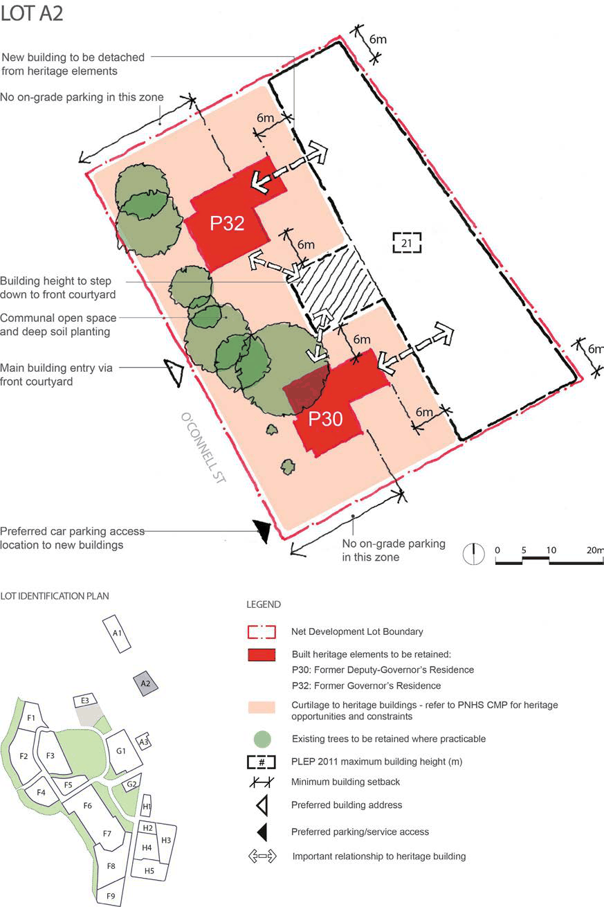

> [Picture on page 141: a picture, saved as a picture (images/part-08-centres-precincts-special-character-areas-specific-page-141-2.gif, 150 dpi).]

Figure 8.2.2.12.2.1 - Development Lot A2

PARRAMATTA NORTH URBAN TRANSFORMATION PRECINCT

#### 8.2.2.12.3 LOT A3

Objectives

O.01 Development is to integrate with the form and scale of surrounding development. O.02 Development is to transition to the adjoining urban development.

Controls

C.01 New development must provide building setbacks which respond to the adjacent existing built form.

C.02 New development must provide a landscaped front setback to enhance the amenity of the New Street streetscape.

C.03 Development must demonstrate compliance with the built form controls indicated on Figure 8.2.2.12.3.1.

C.04 A 6 metre building setback is required to New Street to reinforce existing building setbacks in the street.

PARRAMATTA NORTH URBAN TRANSFORMATION PRECINCT

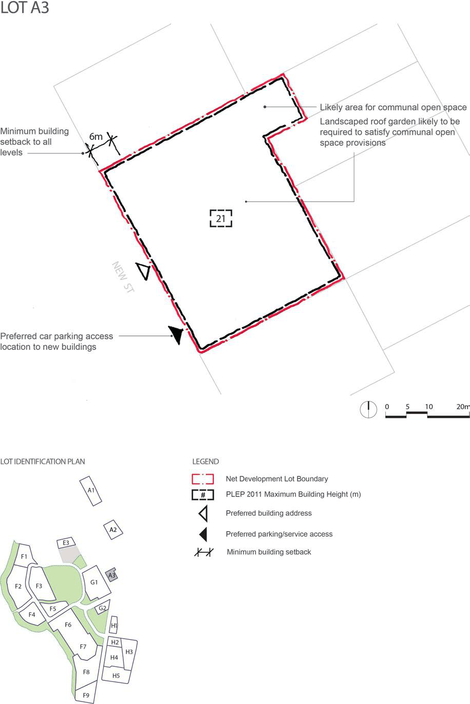

> [Picture on page 143: a picture, saved as a picture (images/part-08-centres-precincts-special-character-areas-specific-page-143-2.gif, 150 dpi).]

Figure 8.2.2.12.3.1 - Development Lot A3

PARRAMATTA NORTH URBAN TRANSFORMATION PRECINCT

#### 8.2.2.12.4 LOT E3

Objectives

O.01 The Recreation Hall (Building C75) and its landscape setting must be conserved and adapted consistent with the Parramatta North Historic Sites Consolidated Conservation Management Plan (PNHS CMP).

O.02 Development must respect the setting and curtilage of the significant Recreation Hall (Building C75) consistent with the PNHS CMP.

O.03 Development must not compromise the community access and future use of the Recreation Hall.

Controls

C.01 New development must respect the heritage significance and landscape setting of the Recreation Hall and Parramatta Gaol walls consistent with the PNHS CMP.

C.02 New development must provide building setbacks which respond to the context and provide adequate transition to existing built form.

C.03 New development within E3 must be of an architectural design and character that respects the Recreation Hall (Building C75) and its curtilage and Parramatta Gaol.

C.04 The built form of the new development must respond to the heights of the adjacent to the Recreation Hall (Building C75) and Parramatta Gaol.

C.05 New development must respond sympathetically to and interpret the archaeological remains (if any) of the Mill Race including any additional significant archaeological remains in this allotment.

C.06 New development must make provision to utilise the future vehicular access routes which may service the potential development of lands to the north and west of the development lot.

C.07 Development must demonstrate compliance with the built form controls indicated on Figure 8.2.2.12.4.1.

C.08 Building height is to reduce to the southern and eastern elevation to respond to the relationship with the Recreation Hall and Parramatta Gaol.

C.09 The permanent address and long term road access for new development is be provided through future public road access to the site from the north.

C.10 If development occurs prior to the delivery of future public roads on land to the north, temporary road access arrangements will be required to be provided on the existing driveway access west of the Recreation Hall. Temporary road access should not adversely impact on existing heritage structures or buildings.

C.11 Development shall retain significant trees on the site as identified in Figure 8.2.2.12.4.1. C.12 New development to provide a minimum setback of 15 metres from the northern elevation of the Recreation Hall (Building C75)

PARRAMATTA NORTH URBAN TRANSFORMATION PRECINCT

C.13 New structures must not be located in the area between Eastern Circuit (north) and Recreation Hall (Building C75).

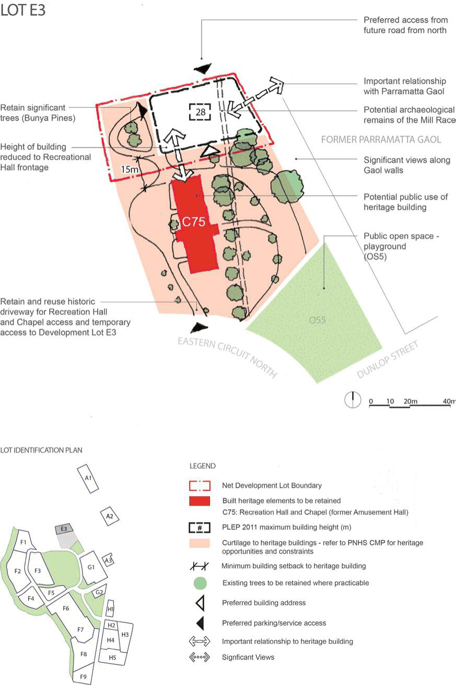

> [Picture on page 145: a picture, saved as a picture (images/part-08-centres-precincts-special-character-areas-specific-page-145-4.gif, 150 dpi).]

Figure 8.2.2.12.4.1 - Development Lot E3

PARRAMATTA NORTH URBAN TRANSFORMATION PRECINCT

#### 8.2.2.12.5 LOT F1

Objectives

O.01 Jacaranda House (Building C57) and its landscape setting must be conserved and adapted consistent with the Parramatta North Historic Sites Consolidated Conservation Management Plan (PNHS CMP).

O.02 Development must be undertaken consistent with the PNHS CMP requirements for Jacaranda House (Building C57).

O.03 Development is to accommodate public access from Eastern Circuit West to the Riparian Corridor.

O.04 Development is to enhance the visual, pedestrian and landscape interface with the Riparian Corridor.

Controls

C.01 Jacaranda House (Building C57) and its landscaped setting must be conserved and adapted as an integral part of the development of Lot F1.

C.02 New development must respect the heritage significance and landscape setting of Jacaranda House (Building 57).

C.03 New development within F1 must be of an architectural design and character that respects the heritage significance and landscape setting of Jacaranda House (Building C57).

C.04 New development must be located to the northern and western boundaries with any taller built form located on the north eastern corner to minimise overshadowing Jacaranda House and the landscaped forecourt.

C.05 New development must provide building setbacks which respond to the context and provide adequate transition to existing built form.

C.06 New development must respond to its prominent location on the Parramatta River foreshore and maximise the provision of pedestrian links between Lot F1 and the river corridor.

C.07 New development must provide generous landscaped courtyards within the setback zone abutting the river corridor with direct pedestrian access to O/S1.

C.08 New development must respond sympathetically to the archaeological remains (if any) of Marsden’s Mill, including any additional significant archaeological remains in this allotment.

C.09 New development in F1 must be designed to minimise impact on the significant view from Governor Phillip’s landing place at the confluence of Darling Mills Creek, Toongabbie Creek and the Parramatta River.

C.10 New development in F1 must be designed to allow for retention of the avenue of trees. C.11 Development must demonstrate compliance with the built form controls indicated on Figure 8.2.2.12.5.2.

PARRAMATTA NORTH URBAN TRANSFORMATION PRECINCT

C.12 New development shall provide a minimum 12 metre setback from the western building edge of Building C57. This setback shall be kept clear and not be compromised through the provision of services and structures.

C.13 New development shall provide a minimum of 6 metres setback to the shared access way on the southern boundary.

C.14 A minimum 3 metre landscaped setback is to be provided to the Riparian Corridor as shown on Figure 8.2.2.12.5.1 and 8.2.2.12.5.2.

C.15 The built form of the new development must step down in height in response to Jacaranda House (Building C57).

C.16 The design for new buildings in F1 must include clear and legible pedestrian and servicing access.

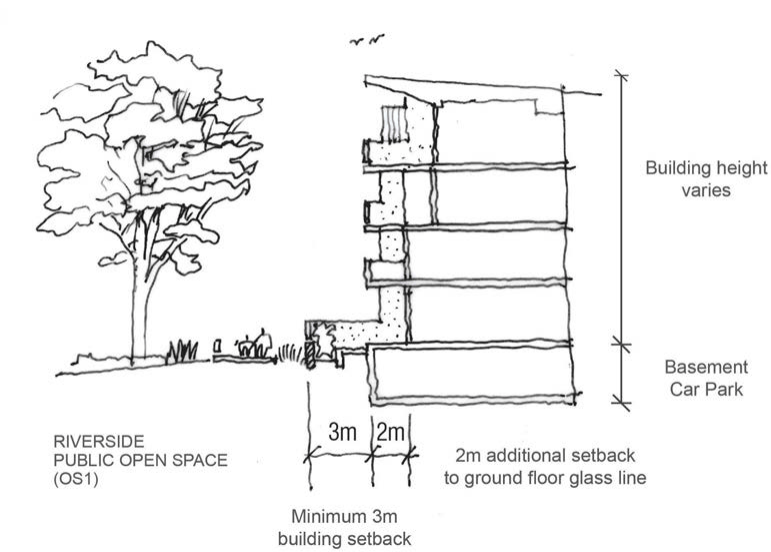

> [Picture on page 147: a picture, saved as a picture (images/part-08-centres-precincts-special-character-areas-specific-page-147-13.gif, 150 dpi).]

Figure 8.2.2.12.5.1 - Typical Riverside Section

PARRAMATTA NORTH URBAN TRANSFORMATION PRECINCT

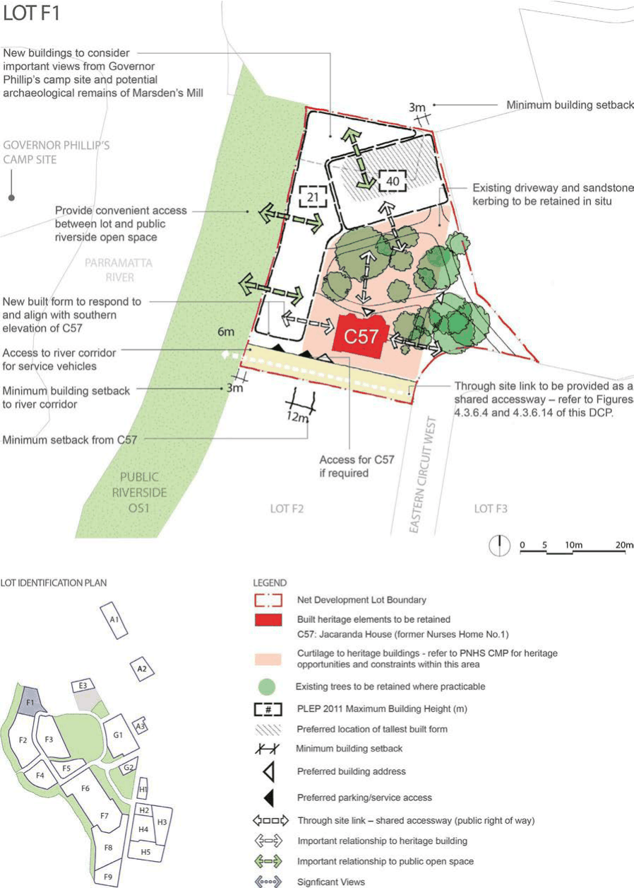

> [Picture on page 148: a picture, saved as a picture (images/part-08-centres-precincts-special-character-areas-specific-page-148-2.gif, 150 dpi).]

Figure 8.2.2.12.5.2 - Development Lot F1

PARRAMATTA NORTH URBAN TRANSFORMATION PRECINCT

#### 8.2.2.12.6 LOT F2

Objectives

O.01 The former Male and Female Admissions Wards and the former Administration Block (Buildings C52, C53 and C55) and their landscape settings must be conserved and adapted consistent with the Parramatta North Historic Sites Consolidated Conservation Management Plan (PNHS CMP).

O.02 Development is to be undertaken consistent with the PNHS CMP requirements for the former Male and Female Admissions Wards and the former Administration Block (Buildings C52, C53 and C55)

O.03 New development must retain the visual connections and respect the views, context and relationships between the heritage buildings (Buildings C52, C53 and C55) the river and associated riparian corridor, and the PNUT.

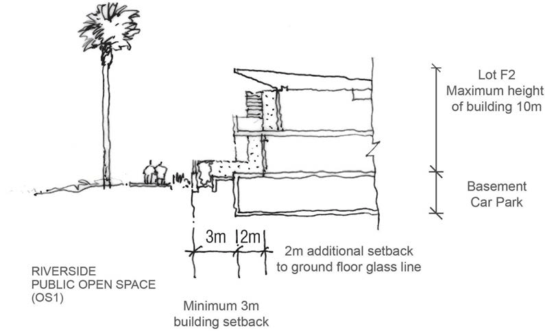

> [Picture on page 149: a picture, saved as a picture (images/part-08-centres-precincts-special-character-areas-specific-page-149-14.gif, 150 dpi).]

Figure 8.2.2.12.6.1 - Typical Riverside Section

Controls

C.01 The former Male and Female Admissions Wards and the former Administration Block (Buildings C52, C53 and C55) and their landscape settings must be conserved and adapted as an integral part of the development of Lot F2, consistent with the PNHS CMP.

C.02 New development must be consistent with the requirements of the PNHS CMP and best practice guidelines including Design in Context 2005, to respect the heritage buildings, to provide a considered transition and connection to the existing buildings, and be sympathetic in scale, form and the use of materials.

C.03 New development must be consistent with the requirements of the PNHS CMP, be designed as ‘pavilions’ to respect the heritage buildings and be sympathetic in scale, form and the use of materials.

PARRAMATTA NORTH URBAN TRANSFORMATION PRECINCT

C.04 New buildings must be sited to address the adjacent public open space and pedestrian through-site links.

C.05 New development must provide generous landscaped ground level courtyards opening onto the Riverside corridor.

C.06 The design for new buildings in F2 must include clear and legible pedestrian and servicing access from adjacent streets.

C.07 Development must demonstrate compliance with the built form controls indicated on Figure 8.2.2.12.7.1.

C.08 New development is to provide a minimum building setback of 6 metres from Buildings C52 and C55.

C.09 A minimum 3 metre landscaped setback to the Riparian Corridor is to be provided, and a recessed 2 metre setback is to be provided to the ground floor glazing line as shown in Figure 8.2.2.12.6.1.

C.10 The width of the new pavilion style buildings must not exceed the dimensions shown in Figure 8.2.2.12.6.2.

C.11 New development must allow two pedestrian through-site links as indicated on Figure 8.2.2.12.6.2.

C.12 No new structures are permitted in the courtyard areas to the west of C52, C53 and C55. C.13 The preferred parking/service access is to be designed in consultation with Transport for NSW to ensure the safe and efficient operation of the Parramatta Light Rail.

PARRAMATTA NORTH URBAN TRANSFORMATION PRECINCT

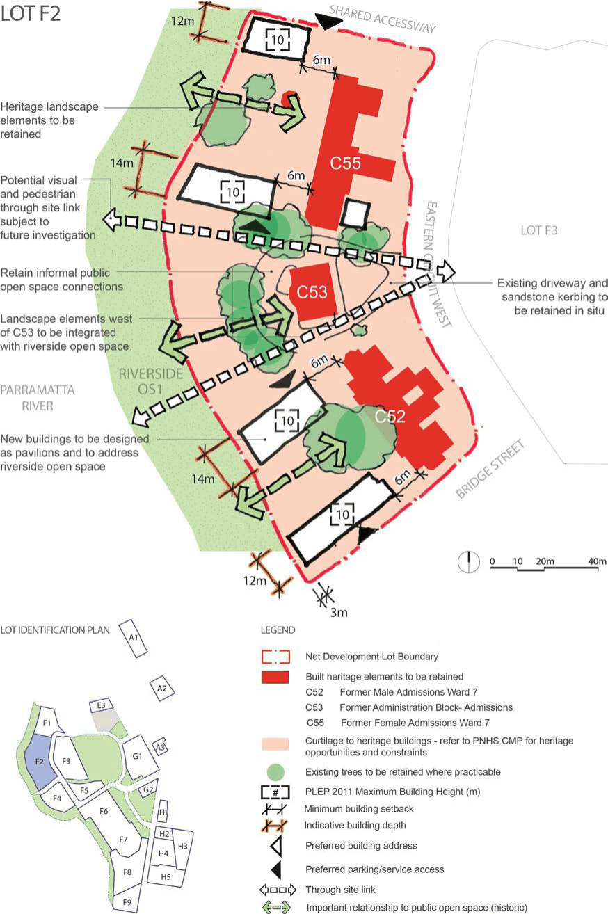

> [Picture on page 151: a picture, saved as a picture (images/part-08-centres-precincts-special-character-areas-specific-page-151-2.gif, 150 dpi).]

Figure 8.2.2.12.6.2 - Development Lot F2

PARRAMATTA NORTH URBAN TRANSFORMATION PRECINCT

#### 8.2.2.12.7 LOT F3

Objectives

O.01 The former Female Asylum Kitchen Block and shelter shed and the former Male Asylum Hospital and Kitchen (Buildings C59, C59a, C63 and C65) and their landscape settings must be conserved and adapted consistent with the Parramatta North Historic Sites Consolidated Conservation Management Plan (PNHS CMP).

O.02 Development must be consistent with the PNHS CMP requirements for former Female Asylum Kitchen Block and shelter shed and the former Male Asylum Hospital and Kitchen (Buildings C59, C59a, C63 and C65) and their landscape settings.

O.03 Development must address the open space to the east and the street (Eastern Circuit West) to the west.

O.04 Development must accommodate east west through site pedestrian links to connect Open Space 3, Lot F2 and the Riparian Corridor.

Controls

C.01 The former Female Asylum Kitchen Block and shelter shed and the former Male Asylum Hospital and Kitchen (Buildings C59, C59a, C63 and C65) and their landscape settings must be conserved and adapted as an integral part of the development of Lot F3.

C.02 New development within F3 must be of an architectural design and character that respects the heritage significance and landscape setting of the heritage buildings (Buildings C59, C59a, C63 and C65).

C.03 New development must provide building setbacks which respond to the context and provide adequate transition to existing built form.

C.04 The built form of the new development should step down in height adjacent to the heritage buildings (Buildings C59, C59a, C63 and C65).

C.05 Any taller built form should be located in the eastern portion of the lot to minimise solar access impacts to the public domain.

C.06 New development must provide an articulated edge and an activated and pedestrianised relationship between the eastern edge of Lot F3 and adjoining open space and Cricket Pavilion (Building C66) consistent with Figure 8.2.2.12.7.1.

C.07 Development must include visual connections to the open space on the western edge of Lot F3.

PARRAMATTA NORTH URBAN TRANSFORMATION PRECINCT

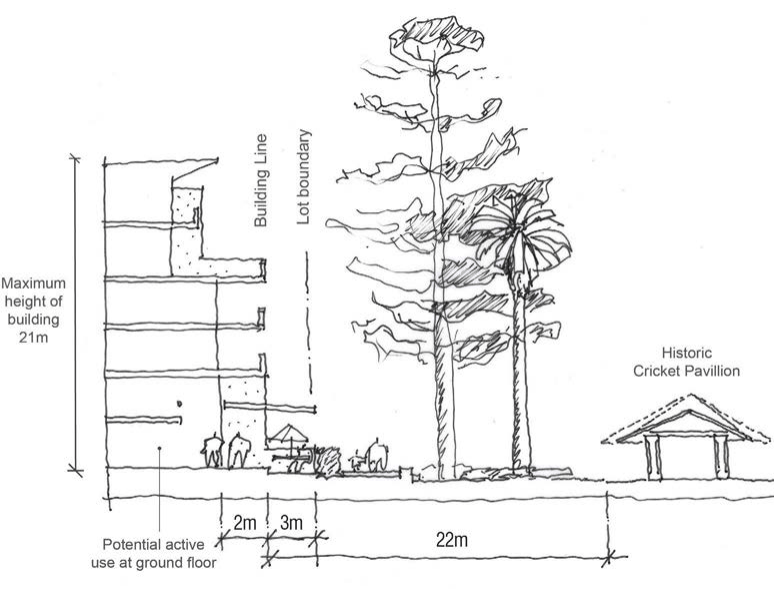

> [Picture on page 153: a picture, saved as a picture (images/part-08-centres-precincts-special-character-areas-specific-page-153-2.gif, 150 dpi).]

Figure 8.2.2.12.7.1 - Lot F3 and Open Space 3 Section

C.08 Development must demonstrate compliance with the built form controls indicated on Figure 8.2.2.12.7.2.

C.09 Vehicular access must be provided from Eastern Circuit West. C.10 New development must provide a minimum 22 metre setback from the Cricket Pavilion (C66) located within the open space to the east.

C.11 New development shall provide a minimum setback of 12 metres from heritage buildings C59 and C65.

C.12 New development shall provide a minimum setback of 6 metres from heritage building C63. C.13 Building setbacks between the southern elevation of C63 and new development must be provided to retain the significant trees on-site.

C.14 A minimum 3 metre landscaped building setback from the Lot boundary, with a recessed 2 metre setback to the glass line must be provided at ground floor along the eastern edge of the development facing the open space and Cricket Pavilion (C66) as shown on Figure 8.2.2.12.7.1 and 8.2.2.12.7.2.

C.15 Interface between new development and the Parramatta Light Rail Corridor is to be designed in consultation with Council and Transport for NSW to ensure safety for pedestrians, accessibility and visual amenity.

PARRAMATTA NORTH URBAN TRANSFORMATION PRECINCT

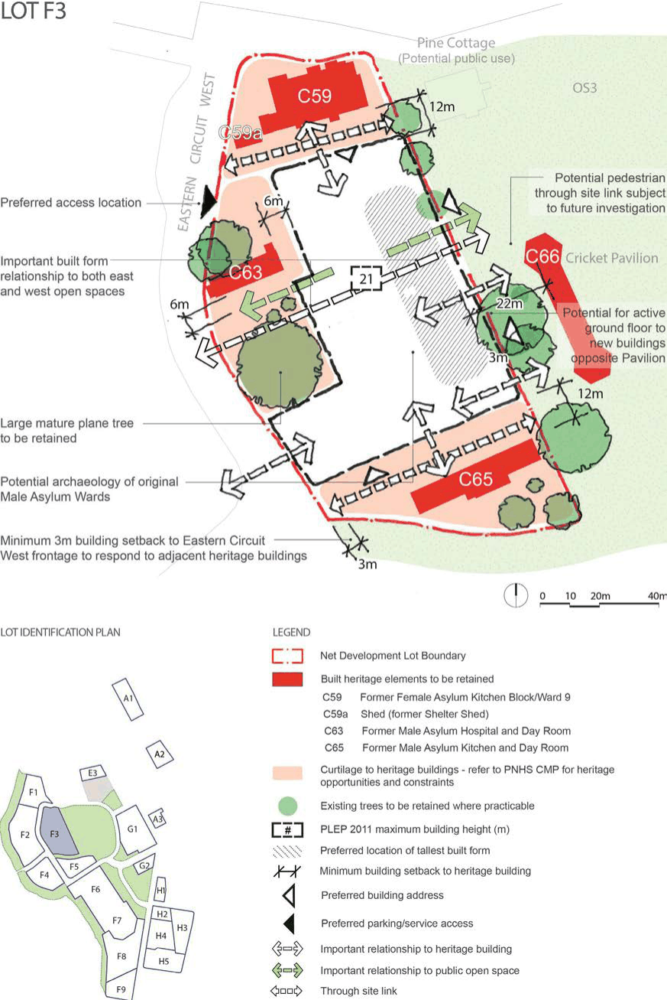

> [Picture on page 154: a picture, saved as a picture (images/part-08-centres-precincts-special-character-areas-specific-page-154-2.gif, 150 dpi).]

Figure 8.2.2.12.7.2 - Development Lot F3

PARRAMATTA NORTH URBAN TRANSFORMATION PRECINCT

#### 8.2.2.12.8 LOT F4

Objectives

O.01 Development is to integrate and enhance the interface with the Riparian Corridor. O.02 Development is to address Bridge Street and Warrinya Avenue. O.03 Development is to retain and incorporate significant vegetation.

Controls

C.01 The large stand of mature figs and other plantings are to be retained and incorporated within communal open space. Views to the figs from within new development is encouraged.

C.02 New development must maximise views towards the riparian corridor public open space. C.03 The tallest buildings must define Warrinya Avenue and be setback in part to retain identified trees to be retained.

C.04 New development must provide generous landscaped ground level courtyards opening onto the Riverside corridor to maximise this interface.

C.05 New buildings must step down in height to the Riparian Corridor. C.06 New development must respond sympathetically to the archaeological remains (if any) of Charles Smith’s Farm, including any additional significant archaeological remains in this allotment.

C.07 Development must demonstrate compliance with the built form controls indicated on Figure 8.2.2.12.8.1.

C.08 Buildings are to be setback 3 metres from the river corridor boundary and be consistent with Figure 8.2.2.12.8.1.

C.09 Buildings to provide a minimum setback from Warrinya Avenue and Bridge Street of between 3 and 8 metres or as required to preserve significant trees as indicated on Figure 8.2.2.12.8.1. Buildings shall not encroach on the tree canopy.

C.10 Preferred parking /service access is to be designed in consultation with Transport for NSW to ensure the safe and efficient operation of the Parramatta Light Rail.

PARRAMATTA NORTH URBAN TRANSFORMATION PRECINCT

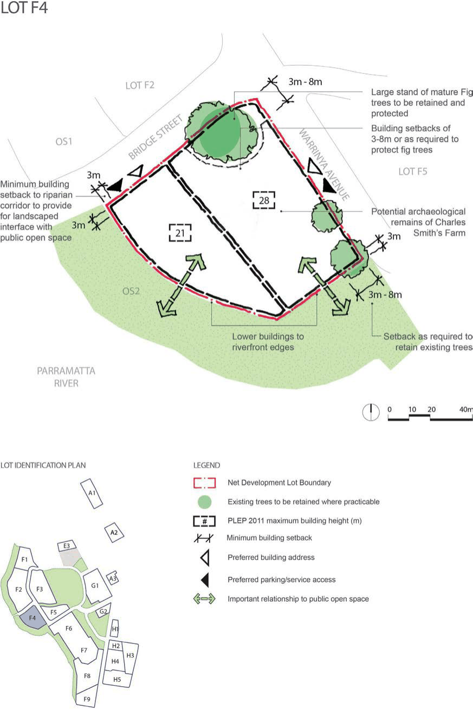

> [Picture on page 156: a picture, saved as a picture (images/part-08-centres-precincts-special-character-areas-specific-page-156-2.gif, 150 dpi).]

Figure 8.2.2.12.8.1 - Development Lot F4

PARRAMATTA NORTH URBAN TRANSFORMATION PRECINCT

#### 8.2.2.12.9 LOT F5

Objectives

O.01 The former Staff Dining Room and Kitchen (Building C70) and its landscape setting must be conserved and adapted consistent with the Parramatta North Historic Sites Consolidated Conservation Management Plan (PNHS CMP)

O.02 New development must be consistent with the requirements of the PNHS CMP for the former Staff Dining Room and Kitchen (Building C70) and its landscape setting and the adjacent Historic Core.

Controls

C.01 The former Staff Dining Room and Kitchen (Building C70) and its landscape setting must be conserved and adapted as an integral part of Lot F5.

C.02 New development must be of an architectural design and character that respects the heritage significance and landscape setting of the heritage building.

C.03 New development must provide building setbacks which respond to the context and provide adequate transition to existing built form.

C.04 The built form/envelopes of the new development must step down in height adjacent to the heritage building within the Lot (C70) and the adjacent Historic Core.

C.05 New development must be aligned to the two streets and reduced in height along the River Road frontage to minimise visual impacts on the heritage buildings and walls of the Historic Core.

C.06 The design and treatment of new buildings must have regard to the adjoining planned light rail route to the north.

C.07 New development must respond sympathetically to the archaeological remains (if any) of Charles Smith’s Farm and Mrs Bett’s House, including any additional significant archaeological remains in this allotment.

C.08 Development must demonstrate compliance with the built form controls indicated on Figure 8.2.2.12.9.1.

C.09 A minimum 12 metre wide cross-site pedestrian link is to be provided to conserve the setting of

C70 (refer to the PNHS CMP).

C.10 A maximum 3 storey street wall is to be provided to River Road with a 4 metre setback for the upper levels to respond to the historic building C106.

C.11 The tower setback of new buildings shall respond to the historic building C70. C.12 The building alignment of new buildings is to reflect the C70 building alignment along River Road.

C.13 Buildings are to be setback a minimum of 3 metres to the River Road frontage.

PARRAMATTA NORTH URBAN TRANSFORMATION PRECINCT

C.14 Buildings may have a 0 metre setback on Warrinya Avenue. The ground floor is to be recessed by 3 metres to allow courtyard areas. Double storey residential units are preferred on the ground floor.

C.15 The adaptative reuse of C70 must facilitate public pedestrian access within its curtilage and remain free of fencing or barriers wherever possible.

C.16 Interface between new development and the Parramatta Light Rail Corridor is to be designed in consultation with Council and Transport for NSW to ensure safety for pedestrians, accessibility and visual amenity.

PARRAMATTA NORTH URBAN TRANSFORMATION PRECINCT

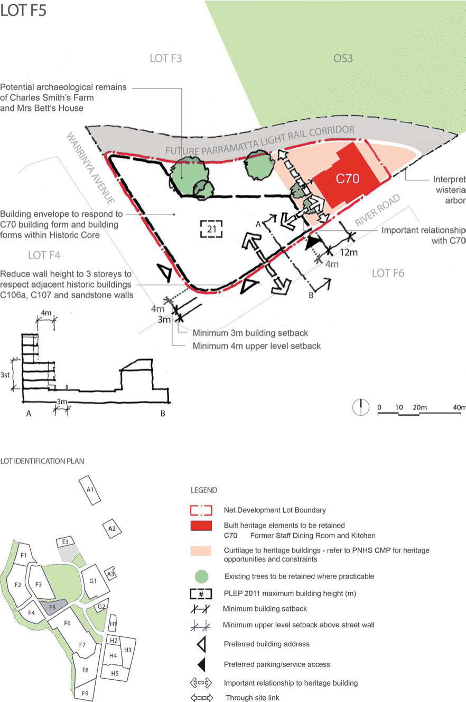

> [Picture on page 159: a picture, saved as a picture (images/part-08-centres-precincts-special-character-areas-specific-page-159-2.gif, 150 dpi).]

Figure 8.2.2.12.9.1 - Development Lot F5

PARRAMATTA NORTH URBAN TRANSFORMATION PRECINCT

#### 8.2.2.12.10 LOTS F6, F7 AND F8 (HISTORIC CORE)

Objectives

O.01 All significant elements within the Historic Core must be conserved and adapted consistent with the Parramatta North Historic Sites Consolidated Conservation Management Plan (PNHS CMP).

O.02 Any new development must be consistent with the PNHS CMP for the Historic Core, including heritage interpretation.

O.03 Any new development must respond to the significant archaeological resource to ensure this resource is managed and retained in situ and interpreted.

O.04 Any new development must facilitate public access and pedestrian connections.

Controls

C.01 All significant elements within the Historic Core must be conserved and adapted to sustainable long-term new uses.

C.02 Any new development within the Historic Core is limited to new buildings and structures that are required to support the appropriate and sustainable long-term non-residential use(s) of the significant elements within the Historic Core.

C.03 New development within the Historic Core must be of an architectural design and character that respects the heritage significance and landscape setting of the Historic Core.

C.04 New development must provide building setbacks which respond to the context and provide adequate transition to existing built form.

C.05 New development, including new uses must respond sympathetically to the archaeology of the Historic Core, including any additional significant archaeological remains in this allotment.

C.06 New development must include opportunities for heritage interpretation consistent with the PNUT Heritage Interpretation Strategy.

C.07 New development must include opportunities for through site links and pedestrian access through the Historic Core consistent with the PNHS CMP.

C.08 Any new buildings must demonstrate accordance with the PNHS CMP. C.09 Development must demonstrate compliance with controls as indicated on Figures 8.2.2.12.10.1 and 8.2.2.12.10.2.

C.10 Any new buildings must demonstrate design excellence by having regard to Clause 6.13 (4) of the Parramatta LEP 2023.

C.11 A minimum 6 metre setback to the south of Bethel House (N06) is to be maintained to any lot boundary.

C.12 The treatment and use of the courtyard areas between historic buildings and structures are to conserve the visual relationship between buildings and facilitate pedestrian activity and activation and reuse of historic buildings.

C.13 Vehicular access and above ground parking should be minimised within the Historic Core.

PARRAMATTA NORTH URBAN TRANSFORMATION PRECINCT

C.14 Any new development or adaptive reuse of buildings within the Historic Core must demonstrate consideration of its impact on or by the Grey-headed Flying Fox (GHFF) colony location and be consistent with the ecological protection and management requirements of the site.

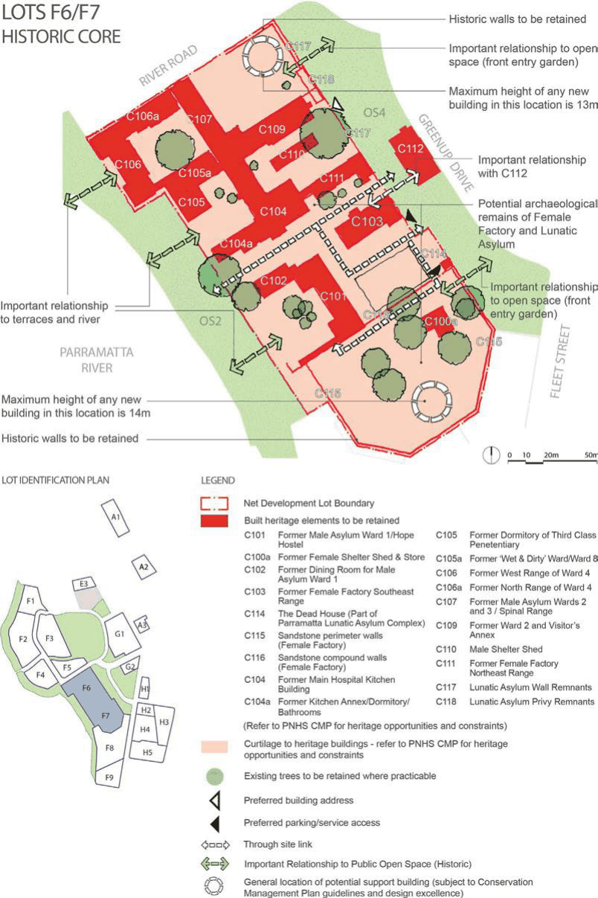

> [Picture on page 161: a picture, saved as a picture (images/part-08-centres-precincts-special-character-areas-specific-page-161-5.gif, 150 dpi).]

Figure 8.2.2.12.10.1 – Lots F6/F7

PARRAMATTA NORTH URBAN TRANSFORMATION PRECINCT

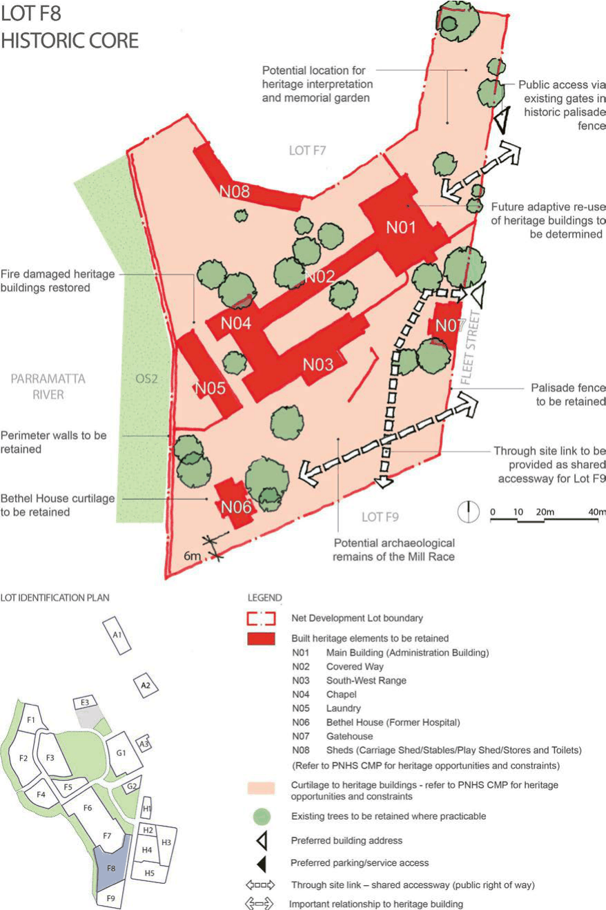

> [Picture on page 162: a picture, saved as a picture (images/part-08-centres-precincts-special-character-areas-specific-page-162-2.gif, 150 dpi).]

Figure 8.2.2.12.10.2 – Development Lot F8

PARRAMATTA NORTH URBAN TRANSFORMATION PRECINCT

#### 8.2.2.12.11 LOT F9

Objectives

O.01 Any development is to be consistent with the requirements of the Parramatta North Historic Sites Consolidated Conservation Management Plan (PNHS CMP), particularly for the curtilage of Bethel House.

O.02 Views from Fennel Street looking west towards Bethel House and the Parramatta River foreshore and beyond must be maintained.

Controls

C.01 No new development must be located within the curtilage of Bethel House. C.02 Any new development must be located in the south eastern portion of Lot F9 and must step down in scale to the north.

C.03 The development potential of the western part of Lot F9 is impacted by the existing endangered Grey-headed Flying Fox (GHFF) colony location. Future development must be consistent with the ecological protection and management requirements of the site.

C.04 Views directly down Fennell Street into the Historic Core must be retained at the northern extent of the site. Oblique views into the site from Fleet Street must be retained.

C.05 New development must consider views from the World Heritage listed Old Government House and Domain precinct.

C.06 A north – south cycling and pedestrian link is to be provided to ensure between Fleet Street, the Parramatta Stadium area and Parramatta Park via the existing pedestrian bridge.

C.07 Development must demonstrate compliance with controls as indicated on Figure 8.2.2.12.11.1. C.08 Any boundary to Lot F8 is to be a minimum of 6 metres south of Bethel House. C.09 A minimum building setback of 4 metres to the southern boundary is to be provided. C.10 Significant vegetation south of the Bethel House curtilage shall be retained as shown in Figure

8.2.2.12.11.1 and treated with appropriate supplementary landscaping.

C.11 New development shall address the new pedestrian through-site link. C.12 New development must demonstrate that adequate vehicular access is provided through Lot

F8 to the north or Eels Place to the south.

PARRAMATTA NORTH URBAN TRANSFORMATION PRECINCT

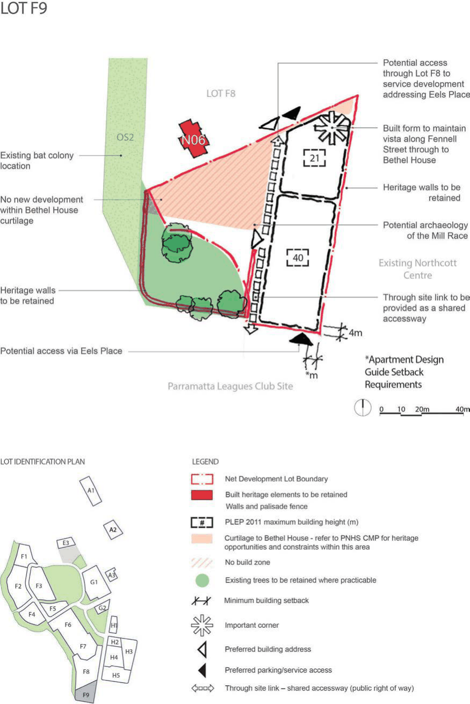

> [Picture on page 164: a picture, saved as a picture (images/part-08-centres-precincts-special-character-areas-specific-page-164-2.gif, 150 dpi).]

Figure 8.2.2.12.11.1 – Development Lot F9

PARRAMATTA NORTH URBAN TRANSFORMATION PRECINCT

#### 8.2.2.12.12 LOT G1

Objectives

O.01 The former Nurses Home (Building C83) and its landscape setting must be conserved and adapted consistent with the Parramatta North Historic Sites Consolidated Conservation Management Plan (PNHS CMP).

O.02 New development must be consistent with the requirements of the PNHS CMP for the former Nurses Home (Building C83) and its landscape setting.

O.03 New development must provide a neighbourhood retail and commercial precinct located on Factory Street.

O.04 New development must accommodate the planned light rail route access into the site via Factory Street.

Controls

C.01 The former Nurses Home (Building C83) and its landscape setting must be conserved and adapted as an integral part of Lot G1.

C.02 New development within G1 must be of an architectural design and character that respects the heritage significance and landscape setting of the heritage building (C83) and the adjacent Parramatta Gaol.

C.03 New development must create a new neighbourhood retail precinct for the PNUT area and have an urban character.

C.04 The new neighbourhood retail precinct must allow for and integrate with the planned light rail route along Factory Street.

C.05 New development must provide building and tower setbacks which provide adequate transition to existing built form.

C.06 The surrounding public domain shall be of high-quality and allow for wide footpaths and the establishment of street trees.

C.07 The built form/envelopes of the new development must step down in height adjacent to the Nurses Home (Building C83) and the pedestrian through-site link.

C.08 New development must provide a publicly accessible east-west through site pedestrian link. C.09 New development must locate retail and/or active uses along the Factory Street frontages and the through-site link.

C.10 Any taller built form must be located to reinforce the New Street alignment and the built form/envelope must step down in height towards the historic Parramatta Gaol and Factory Street.

C.11 No vehicular access must be provided from Dunlop Street or Eastern Circuit East. Vehicular access is preferred from New Street.

C.12 Active retail frontages along Factory Street must include weather protection in the form of awnings and/or colonnade treatments.

PARRAMATTA NORTH URBAN TRANSFORMATION PRECINCT

C.13 Basement parking may extend beyond the building footprint subject to an assessment of the landscape impacts and demonstration that areas available for deep soil planting are maximised wherever possible.

C.14 Development must demonstrate compliance with controls as indicated on Figure 8.2.2.12.12.1. C.15 A 0 metre building setback is required where active commercial/retail uses are proposed along Factory Street, as indicated on Figure 8.2.2.6.1.

C.16 Active commercial/retail uses must provide awnings and designed to make allowance for the full extent of mature street tree canopies.

C.17 Development along Dunlop Street must:

• Provide a 0 metre building setback only where the provision of a minimum 4.2 metre footpath is provided in accordance with Figure 8.2.2.6.3 – Typical Street Section 3 – Dunlop Street.

• Recess 3 metres at ground floor to allow courtyard areas. Double storey residential units are preferred.

C.18 Development along Eastern Circuit East must:

• Provide a 0 metre building setback, only where the provision of a minimum 4.3 metre footpath is provided in accordance with Figure 8.2.2.6.6 – Typical Street Section 6 – East Circuit (East).

• Recess 3 metres at ground floor to allow courtyard areas. Double storey residential units are preferred.

C.19 Where the minimum footpath standards cannot be meet along Dunlop Street and Eastern Circuit East, the building setback control shall be consistent with the 3 metre building setback control in Section 8.2.2.10 of this DCP.

C.20 Development along New Street must provide a 3 metre building setback. C.21 A link from the East-West Link is to be provided to connect to Factory Street within the curtilage of the Nurses Home.

C.22 A 16 metre wide east-west cross-site pedestrian link from New Street to Eastern Circuit East is to be provided. This must be open to the sky.

C.23 A minimum 16 metre setback is to be provided between the Nurses Home (Building C83) and any new building.

C.24 The adaptive reuse of the Nurses Home (Building C83) must facilitate pedestrian public access within its curtilage (to the North, West and South) and remain free of fencing or barriers wherever possible. No above ground parking is allowed.

PARRAMATTA NORTH URBAN TRANSFORMATION PRECINCT

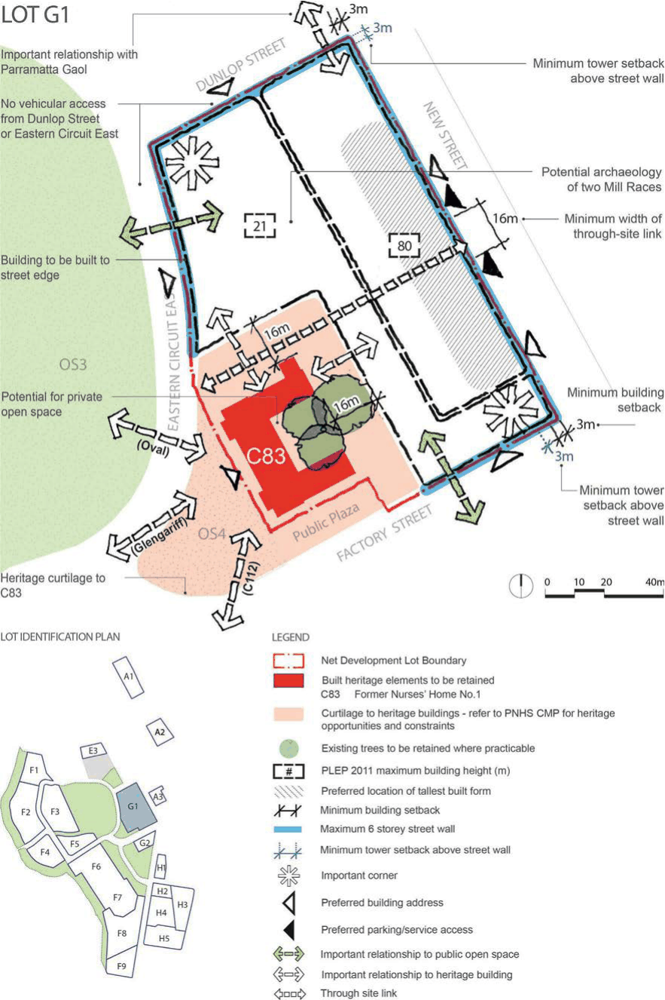

> [Picture on page 167: a picture, saved as a picture (images/part-08-centres-precincts-special-character-areas-specific-page-167-2.gif, 150 dpi).]

Figure 8.2.2.12.12.1 – Development Lot G1

PARRAMATTA NORTH URBAN TRANSFORMATION PRECINCT

#### 8.2.2.12.13 LOT G2

Objectives

O.01 New development should facilitate a neighbourhood retail and commercial precinct on Factory Street.

O.02 New development should improve the quality of the interface with the adjoining open space.

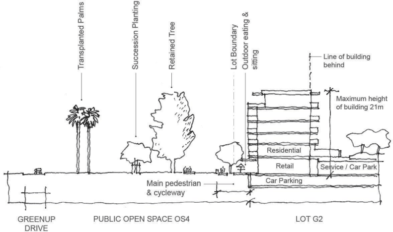

> [Picture on page 168: a picture, saved as a picture (images/part-08-centres-precincts-special-character-areas-specific-page-168-7.gif, 150 dpi).]

Figure 8.2.2.12.13.1 – Lot G2 interface with open space

Controls

C.01 New development must define street edges and the Factory Street entry point to the PNUT. C.02 Any taller built form must be located to reinforce the north eastern corner and the built form must step down to reduce overshadowing on the Public Open Space (OS4).

C.03 New development must create a new neighbourhood retail precinct for the PNUT area and have an urban character.

C.04 The new neighbourhood retail precinct must allow for and integrate with the planned light rail route along Factory Street.

C.05 Setbacks to the open space are to include landscaped courtyards and/or active uses. C.06 Basement parking may extend beyond the building footprint subject to an assessment of the landscape impacts and demonstration that areas available for deep soil planting are maximised wherever possible.

C.07 Development must demonstrate compliance with controls as indicated on Figures 8.2.2.12.13.1 and 8.2.2.12.13.2.

C.08 New development must provide active retail frontages to Factory Street and Fleet Street. C.09 CA 0 metre building setback is allowed where active commercial/retail uses are proposed along Factory Street, as indicated on Figure 8.2.2.6.1.

PARRAMATTA NORTH URBAN TRANSFORMATION PRECINCT

C.10 Vehicular access is to be from Fleet Street to avoid disrupting the Factory Street retail frontage. C.11 New development to provide a minimum 3 metre upper level building setback to street frontages and rear and side boundaries.

C.12 The western edge of the new built form must align with the western façade of the Nurses Home across Factory Street.

C.13 New development must maximise the interface with the Public Open Space (OS4) provide active ground level frontages and opportunities for casual surveillance from apartment building facades (refer to Figure 8.2.2.12.13.1).

C.14 New development must demonstrate, through design testing, that overshadowing impacts to open space are minimised.

PARRAMATTA NORTH URBAN TRANSFORMATION PRECINCT

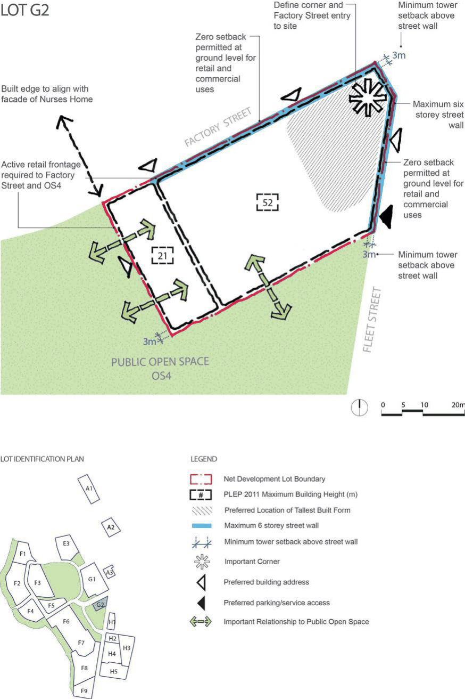

> [Picture on page 170: a picture, saved as a picture (images/part-08-centres-precincts-special-character-areas-specific-page-170-2.gif, 150 dpi).]

Figure 8.2.2.12.13.2 – Development Lot G2

PARRAMATTA NORTH URBAN TRANSFORMATION PRECINCT

#### 8.2.2.12.14 LOT H1

Objectives

O.01 Development is to retain and respond to the historic Quarry Face and retain the early sandstone walling along Fleet and Albert Streets.

O.02 Development is to integrate and transition to surrounding urban development.

Controls

C.01 New development within H1, H2, H3, H4 and H5 must retain the sandstone quarry face and early sandstone walls to Fleet and Albert Streets.

C.02 New buildings must be designed to interpret the change in level and allow some views of the quarry face from within the lot and from the Albert Street steps.

C.03 Any taller built form must be located in the southern portion of the lot to reinforce the Fleet Street/Albert Street corner with heights transitioning down to adjacent existing development to the north.

C.04 Development must demonstrate compliance with controls as indicated on Figure 8.2.2.12.14.1. Setbacks C.05 New development must provide building setbacks which respond to the context and provide adequate transition to existing built form.

C.06 Buildings are to be setback a minimum of 4 metres from Fleet Street. C.07 Buildings are to be setback a minimum of 6 metres from Albert Street. C.08 The 4 metre building setback from Fleet Street is required to provide landscaped courtyards to ground floor units and the 6 metre building setback to Albert Street is to respond to the landscape quality of that street.

PARRAMATTA NORTH URBAN TRANSFORMATION PRECINCT

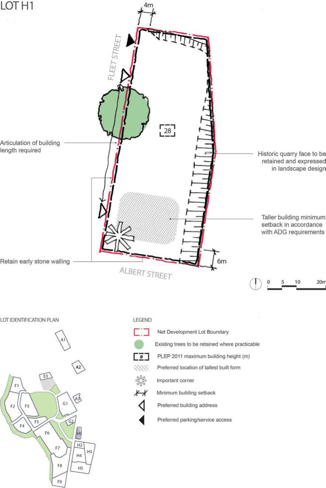

> [Picture on page 172: a picture, saved as a picture (images/part-08-centres-precincts-special-character-areas-specific-page-172-2.gif, 150 dpi).]

Figure 8.2.2.12.14.1 – Development Lot H1

PARRAMATTA NORTH URBAN TRANSFORMATION PRECINCT

#### 8.2.2.12.15 LOTS H2-H5

Objectives

O.01 Development is to integrate and transition to surrounding urban development. O.02 Development is to respond to and retain the historic Quarry Face.

Controls

C.01 New development within H1, H2, H3, H4 and H5 must retain the sandstone quarry face and early sandstone walls to Fleet and Albert Streets.

C.02 New development must be designed to interpret the change in level and allow some views of the quarry face from within the lots and from the Albert Street steps.

C.03 New development must provide building setbacks which respond to the context and provide adequate transition to existing built form.

C.04 New development may include a pedestrian through-site link connecting O’Connell Street with Fleet Street and transitioning across the quarry face.

C.05 New development within the lots must comprise a series of high-quality apartment buildings with a diversity of scale and architectural character.

C.06 Low rise buildings (6 storeys maximum) must define the external street edges with the exception of Albert Street where 8 storey buildings may be developed.

C.07 Tall buildings must be located internally and minimise overshadowing to existing and new development. Towers must be expressed above 6 storey podiums, which must define public and communal spaces.

C.08 All new buildings to have addresses and lobbies with access to a public street or through site link.

C.09 Development fronting Fleet Street must respect the visual relationship with the Historic Core to the west.

C.10 Development must demonstrate compliance with controls as indicated on Figure 8.2.2.12.15.1. C.11 A cross-site pedestrian link is to be provided centrally between O’Connell Street and Fleet Street to align with Harold Street.

C.12 A minimum 4 metre building setback to Fleet Street is to be provided. C.13 A minimum 6 metre building setback to Albert, O’Connell and Fennel Streets is to be provided. C.14 All new buildings are to address public streets.

PARRAMATTA NORTH URBAN TRANSFORMATION PRECINCT

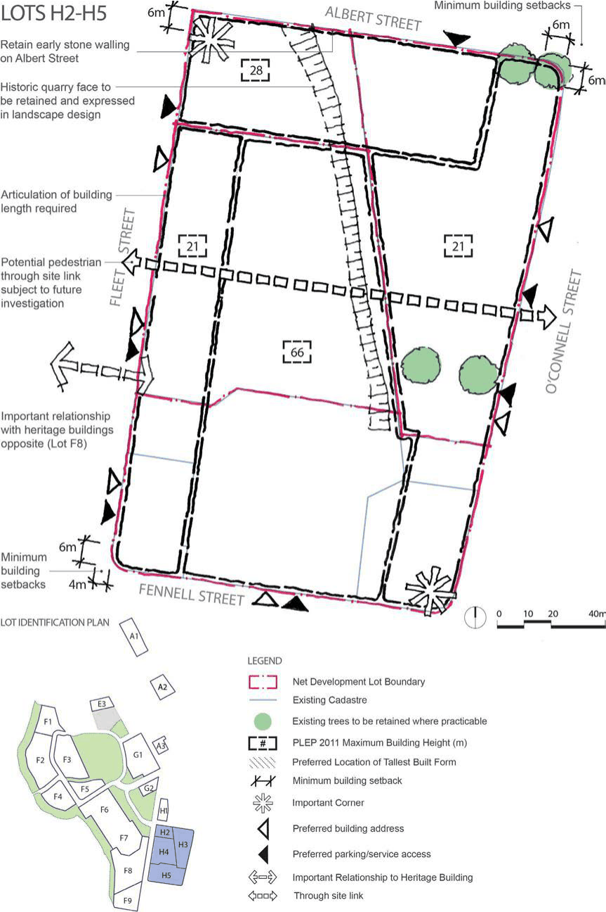

> [Picture on page 174: a picture, saved as a picture (images/part-08-centres-precincts-special-character-areas-specific-page-174-2.gif, 150 dpi).]

Figure 8.2.2.12.15.1 – Development Lots H2 – H5

GRANVILLE LOCAL CENTRE
