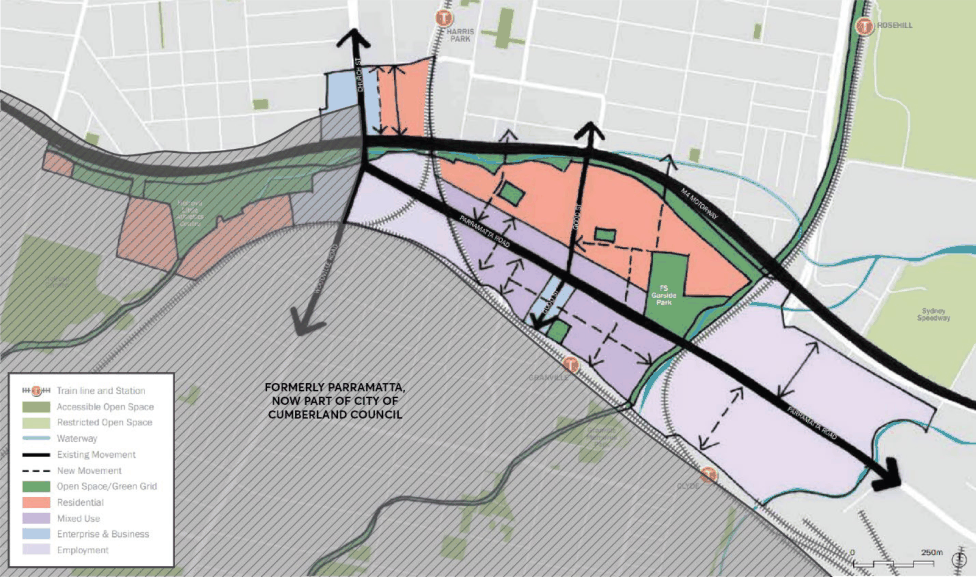

#### 8.2.3 GRANVILLE LOCAL CENTRE

In November 2016, the NSW Government released the Parramatta Road Corridor Urban Transformation Strategy (PRCUTS). The PRCUTS sets the long term vision and framework to support co-ordinated employment and housing growth in the Corridor in response to significant transport and infrastructure investment, economic and demographic shifts, and industrial and technological advances. Granville has been identified as one of the eight precincts along the corridor that has been earmarked for renewal because of its unique access to jobs, transport, infrastructure and services, and its ability to accommodate new development in a balanced way.

Granville Local Centre is proposed to be a vibrant place with a mix of new housing, shops and commercial spaces north of the railway line. Good Street will be the Precinct’s main street, extending from the existing Town Centre of Granville on the southern side of the railway line, and will also include protection of the fine grain development pattern and delivery of a high-quality public domain. Opportunities for residential, retail and commercial development will be integrated with the existing public transport facilities, capitalising use of the Granville Railway Station and Granville Bus Interchange.

The provisions of this Section of this DCP apply to development within Granville Local Centre (shown in Figure 8.2.3.1). This Section should be read in conjunction with Section 8.5 of this DCP which provides for additional development controls of specific sites within Granville Local Centre.

> [Picture on page 175: a picture, saved as a picture (images/part-08-centres-precincts-special-character-areas-specific-page-175-21.gif, 150 dpi).]

Figure 8.2.3.1 – Granville Local Centre (PRCUTS)

GRANVILLE LOCAL CENTRE

Objectives

O.01 Develop a mixed use core of retail, residential and business at the transport node serving the precinct, centred around Good Street, Cowper Street and Rowell Street, and extends to the north side of Parramatta Road.

O.02 Ensure new development within the mixed use core provides active ground floor uses to increase vibrancy, safety, use and interest of the area,

O.03 Preserve and improve significant open space areas within the precinct. O.04 Maximise pedestrian links and connectivity through new laneways and through site links.

Control

C.01 New development is to be consistent with the Parramatta Road Corridor Urban Transformation Strategy: Planning and Design Guidelines unless otherwise detailed in this Section.

GRANVILLE LOCAL CENTRE
