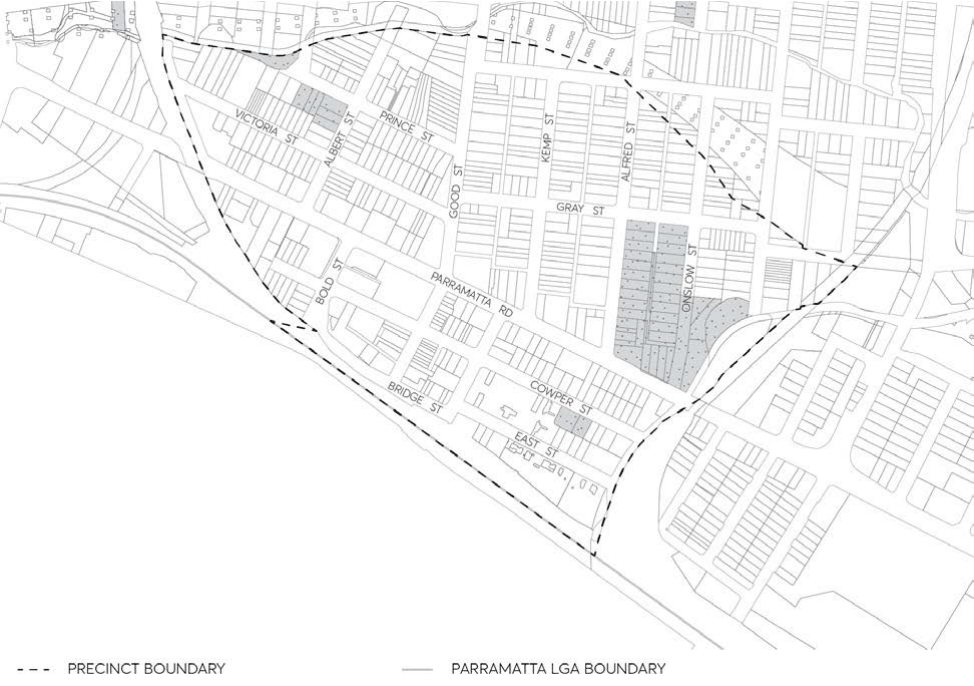
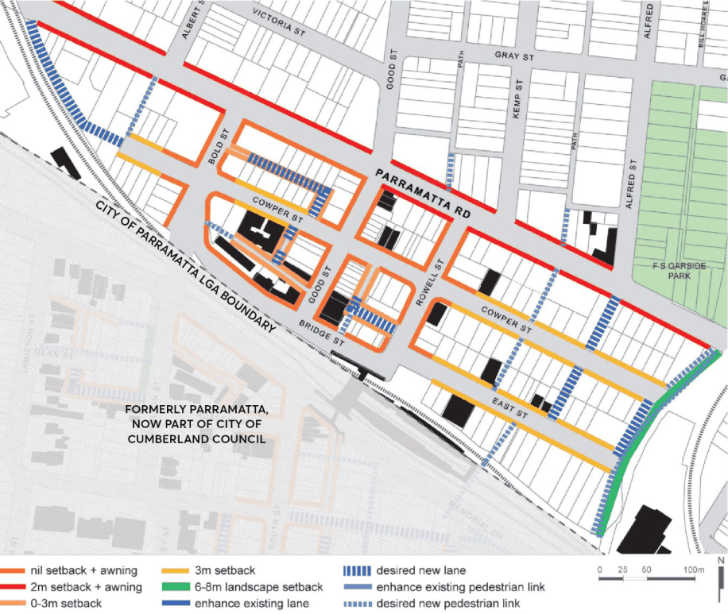
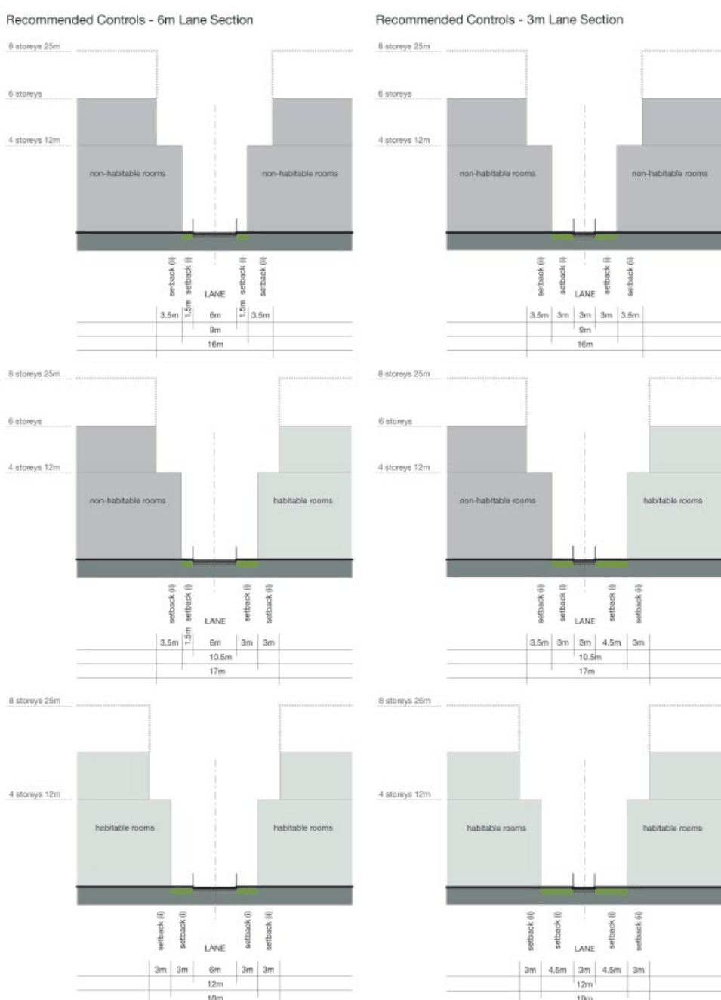
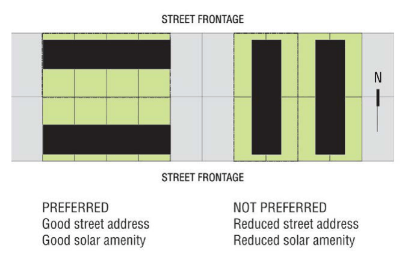

#### 8.2.3.1 GRANVILLE TOWN CENTRE

#### 8.2.3.1.1 DESIRED FUTURE CHARACTER

The Granville Town Centre precinct continues to be a vibrant place with a variety of activities within and surrounding the centre. This is achieved through a mix of uses, building heights and densities to support the role and function of Granville. Throughout the precinct, new development will retain and enhance the heritage character of the precinct. Specific characteristics for parts of the town centre are detailed below.

Parramatta Road Corridor: Parramatta Road accommodates non-residential development including business and office uses, light industries and specialised ‘retail’ developments that require large floor plates. New development is set back from the roadway to improve pedestrian amenity.

Mixed use development: is located between the railway line and Cowper Street with increased height limits and floor space ratios permitted on larger sites. The amalgamation of lots is required to achieve the maximum building heights and floor space ratios prescribed in the Parramatta LEP

2023\. Where the required site amalgamation does not occur, reduced building heights and floor space ratios apply (refer to the Parramatta LEP 2023). The prescribed maximum floor space ratios may not be wholly achievable on all sites due to urban design considerations or site configuration. Residential development is located away from Parramatta Road to minimise adverse amenity impacts. The interface between development along Parramatta Road and residential development to the rear is carefully designed to ensure that privacy and visual amenity are managed and protected.

Retail Centre: New development in the main retail precincts north of the railway line is consistent with the scale and fine grain form of existing development. Active ground level frontages are provided, with at grade pedestrian access. The existing street pattern, including rear lanes, is retained to reflect the main streets’ historical context. Shop top housing is encouraged and set back from the street alignment in order to respect pedestrian scale of the existing streetscape.

This Section is to be read in conjunction with Section 8.2.3 Granville Local Centre and Section

8.5 of this DCP which provides for additional development controls of specific sites within Granville.

GRANVILLE LOCAL CENTRE

> [Picture on page 178: a picture, saved as a picture (images/part-08-centres-precincts-special-character-areas-specific-page-178-2.gif, 150 dpi).]

Figure 8.2.3.1.1.1 – Granville Town Centre

Objectives

In addition to general objectives listed in Part 8 of this DCP, specific objectives of this precinct are identified below. O.01 Ensure that new development provides a strong interface to Granville Railway Station, Parramatta Road and Good Street.

O.02 Ensure that new development responds well to existing heritage items. O.03 Ensure new development within the mixed use area provides active ground floor uses to increase the safety, use and interest of the area.

O.04 Ensure new buildings within the mixed use area provide articulation and an attractive composition of building elements.

O.05 Enhance residential amenity through provision of landscaping and communal open space at ground level.

O.06 Ensure an appropriate height transition of building heights to maintain amenity of adjacent development.

Investigation Areas

a) As shown in Figure 8.2.3.1.1.2, Council will investigate the potential for redevelopment of the bus interchange and car park to provide for a mix of community, residential and commercial uses.

GRANVILLE LOCAL CENTRE

b) Council will investigate the block bound by Railway Parade and Mary Street as shown in Figure 8.2.3.1.1.1. Development in this location will need to respect the significance of the existing heritage items and heritage conservation areas in relation to scale, character, form, siting, material, colour and detailing. In addition, the proportion and massing of buildings is to relate favourably to that of existing building patterns in the street.

Controls

Pedestrian Connections and Laneways C.01 New pedestrian connections, roads and laneways should be provided in accordance with Figure 8.2.3.1.1.2. Where a development provides for public access connections, a variation to Council’s floor space ratio control can be sought in accordance with C.02 below.

C.02 Where a development provides for dedication of land to Council for the purposes of providing public access and the construction of the access way, Council may consider increasing the maximum floor space ratio. As a guide, the maximum floor space ratio may be increased by the equivalent area represented by 50% of the land area to be dedicated to Council for the public access. The site area may include the area of land to be dedicated to Council for the purpose of the floor space ratio calculation. The proposed variation to floor space is to be addressed under Clause 4.6 ‘Exceptions to development standards’ in the Parramatta LEP 2023.

C.03 New road connections and laneways should be provided to improve through block connections, remove dead end streets, extend existing connections, improve serviceability of retail development and improve the interface to the railway line.

C.04 New street links are to match the width of the existing public road that it forms and extension

of. New laneways are to have a minimum width of 6 metres.

C.05 New pedestrian links are to improve through block connections and provide better links to and from Granville Railway Station.

C.06 New pedestrian connections are to have a minimum width of 3 metres and are to be consistent in width for their full length.

Setbacks C.07 Front building setbacks are to be in accordance with Figure 8.2.3.1.1.2 and any additional controls set out below:

a) For development along Parramatta Road, setbacks shown in Figure 8.2.3.1.1.2 apply to the first 4 storeys (15 metres) of development. An additional 3 metre upper level setback applies to any portion of development above 4 storeys (15 metres) in height.

b) For development along Good Street, setbacks shown in Figure 8.2.3.1.1.2 apply to the first 3 storeys of development. Remaining storeys are to be set back an additional 3 metres. Balconies are not to encroach the upper level setback area.

c) For development in the MU1 Mixed Use Zone with frontage to Mary Street the front setback to be between 5 and 9 metres.

d) For development in the MU1 Mixed Use zone between Parramatta Road and the railway line, setbacks shown in Figure 8.2.3.1.1.2 apply to the first 4 storeys (15 metres) of

GRANVILLE LOCAL CENTRE

development. An additional 3 metre upper level setback applies to any portion of development above 4 storeys (15 metres) in height.

C.08 Side and rear building setbacks are to be in accordance with Figure 8.2.3.1.1.2 and the below controls:

Rear Setbacks

a) E1 Local Centre Zone A zero rear setback is allowable for development in the E1 Local Centre Zone.

b) MU1 Mixed Use Zone A minimum rear setback of 9 metres is required for development up to 25 metres in height. A minimum rear setback of 12 metres is required for development above 25 metres.

c) E3 Productivity Support Zone A minimum rear setback of 4 metres is required.

Side Setbacks

a) E1 Local Centre Zone A zero side setback is allowable for development up to 4 storeys (15 metres) in height, except where the development addresses a lane.

b) MU1 Mixed Use Zone A zero side setback is allowable for development up to 4 storeys (15 metres) in height, except where the development addresses a lane.

c) For any portion of development above 4 storeys (15 metres) in height, a minimum side setback of 9 metres is required for habitable rooms and a minimum side setback of 6.5 metres is required for non-habitable rooms.

d) E3 Productivity Support Zone A zero side setback is allowable for development up to 6 storeys (21 metres) in height. Side Setbacks (Addressing Lanes)

e) Where lanes are indicated in Figure 8.2.3.1.1.2 (see Front Setbacks above), half of the width of the lane is to be provided by each adjoining property. For passive surveillance and a high-quality public domain, continuous full length blank walls are discouraged to lanes. Streetscape setbacks to lanes are shown in Figure 8.2.3.1.1.3. For visual and acoustic privacy the following additional setbacks are required. 6 Metre Wide Lanes

f) Development up to 4 storeys (12 metres) in height are to be setback a minimum of 1.5 metres from the lane where there are non-habitable rooms and setback a minimum 3 metres where there are habitable rooms.

g) For the portion of development above 4 storeys (15 metres) but less than 25 metres, a minimum 3.5 metre setback to the lane is required for non-habitable rooms and a minimum 6 metre setback to the lane is required for habitable rooms. 3 Metre Wide Lanes

GRANVILLE LOCAL CENTRE

h) For privacy of buildings up to 4 storeys a minimum 3 metre setback to the lane is required for non-habitable rooms and a minimum 4.5 metre setback to the lane is required for habitable rooms.

i) For the portion of development above 4 storeys (15 metres) but less than 25 metres, a minimum 5 metre setback to the boundary is required for non- habitable rooms and a minimum 7.5 metre setback for habitable rooms.

C.09 To achieve a continuous street edge development in the E1 Local Centre zone should have a nil side setback where it will not have a detrimental impact upon adjoining development.

C.10 Building setbacks to existing and desired laneways should be designed to activate the laneway while still allowing for the servicing needs of development.

C.11 Where development proposes of adjoins residential development greater than 2 storeys in height, building separation requirements prescribed by the Apartment Design Guide published by the NSW Department of Planning and Environment should be achieved.

C.12 The building separation distances between buildings on the same site are not to be less than those required between buildings on adjoining sites.

Site Frontage C.13 The minimum site frontage for development in MU1 Mixed Use zone or E3 Productivity Support zone on land between Parramatta Road and the railway line is to be in accordance with the following table: Table 8.2.3.1.1 – Minimum site frontage

| Site area | <950m² | 950m² -2100m² | >2100m² – 3200m² | >3200m² |
|---|---|---|---|---|
| Minimum frontage (m) | 24 | 30 | 45 | 60 |

Land Amalgamation C.14 The preferred pattern of land amalgamation is to be side by side to maximise lineal street frontage and to encourage east west built form for good solar access, as shown in Figure 8.2.3.1.1.4.

Landscaping and Deep Soil C.15 In the E3 Productivity Support zone along Parramatta Road, a minimum of 20% of the site is to be a deep soil zone.

C.16 In the MU1 Mixed Use zone between Parramatta Road and railway line, a minimum of 30% of the site is to be a deep soil zone, and not less than 40% of the site is to be landscaped.

C.17 The required deep soil areas are to be predominantly located at the rear of the site to provide a landscape corridor and visual screening between buildings.

C.18 Where a front building setback is required as shown in Figure 8.2.3.1.1.2 (with the exception of Parramatta Road), the front setback area is to be landscaped. Provision of street trees is required in this area.

C.19 For development fronting Parramatta Road, the setback area is to form an extension of the footway. Landscape planting including street trees is encouraged.

GRANVILLE LOCAL CENTRE

For Land at 2-22 William Street, communal open space and landscaping is to be provided at ground level where possible. Development between Parramatta Road and Railway Line C.20 Residential and commercial apartments are to be designed to enable casual surveillance of public spaces.

C.21 For development greater than 15 metres in height, buildings with large floor plates, must be expressed as separate building elements.

C.22 For development greater than 15 metres in height the horizontal dimension of any building façade must not exceed 35 metres.

C.23 For development greater than 15 metres in height the maximum floor plate area of a non-residential buildings is 480m², with a maximum depth of 25 metres.

C.24 For commercial buildings, the maximum building depth is 25 metres. C.25 Use light wells and courtyards to improve internal building amenity and cross ventilation. C.26 The roof forms of all buildings are to add interest to the skyline.

> [Picture on page 182: a picture, saved as a picture (images/part-08-centres-precincts-special-character-areas-specific-page-182-16.gif, 150 dpi).]

Figure 8.2.3.1.1.2 - Building Setbacks, Pedestrian Links and Laneways

GRANVILLE LOCAL CENTRE

> [Picture on page 183: a picture, saved as a picture (images/part-08-centres-precincts-special-character-areas-specific-page-183-2.gif, 150 dpi).]

Figure 8.2.3.1.1.3 – Lane and Street Sections

GRANVILLE LOCAL CENTRE

> [Picture on page 184: a picture, saved as a picture (images/part-08-centres-precincts-special-character-areas-specific-page-184-2.gif, 150 dpi).]

Figure 8.2.3.1.1.4 – Preferred Street Frontage condition Development at 2- 22 William Street, Granville

C.27 Storeys above the first four storeys of the proposed development shall have an additional 3.1 metres upper level rear setback and the proposed development’s rear building setback (facing the low density residential area) is to be a minimum of 9 metres (without the rear existing laneway).

C.28 The proposed development at 2-22 William Street, is to be not more than 5 storeys.

CAMELLIA AND RYDALMERE
