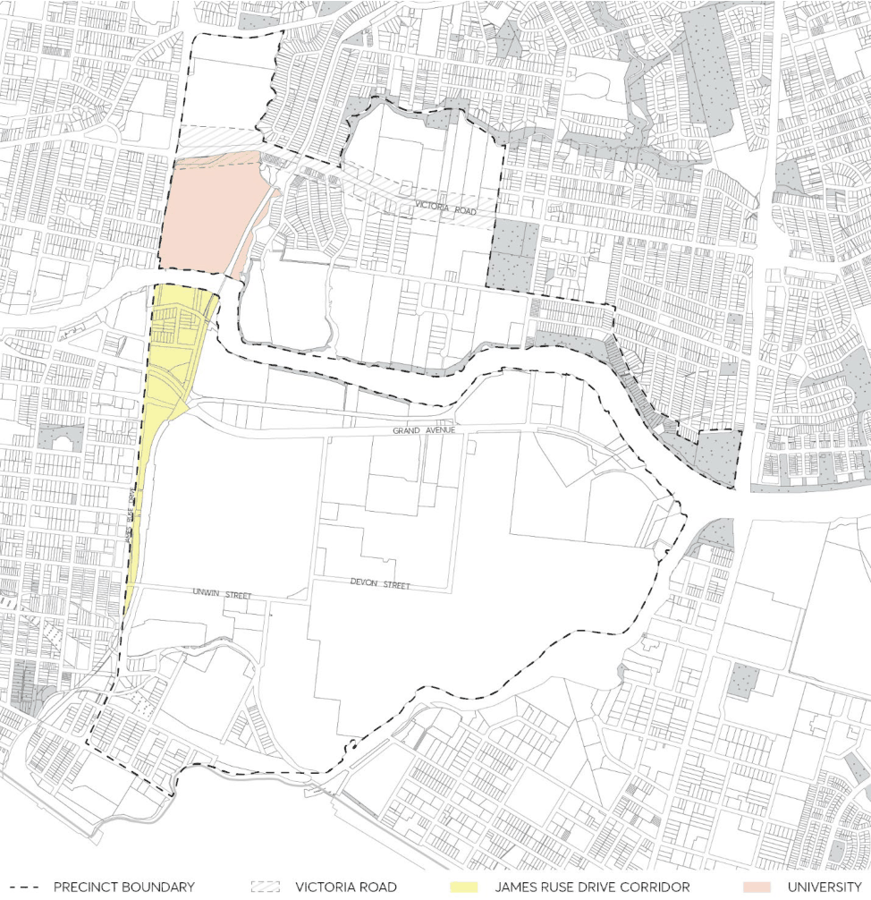

#### 8.2.4 CAMELLIA AND RYDALMERE

#### 8.2.4.1 DESIRED FUTURE CHARACTER

Camellia is a significant industrial hub, containing heavy industries such as the Shell Oil Refinery. It also contains sporting and convention sites at Rosehill Gardens and the Parramatta Raceway. The use of land for these purposes is expected to continue, as major destinations for visitors, tourists and the wider business community.

Rydalmere is defined by its wide range of complementary uses and functions that support the Parramatta central business district. Rydalmere is particularly notable because of the steadily expanding university campus (University of Western Sydney) and the adjoining light industrial uses.

Future development opportunities that mutually support the employment, industrial, educational and research functions of this precinct will be encouraged.

New industrial developments comply with stringent environmental controls, and operate sustainably. Council favours new industrial developments that improve water quality, the environment around the Parramatta River and the foreshore. A concerted effort is made to create pedestrian links along the Parramatta foreshore.

The Parramatta River corridor is enhanced as the major natural asset of the area, characterised by a healthy river and foreshore that provides public access opportunities while protecting vegetated riparian areas with appropriate setbacks. Parts 5.3.2 and 2.9 of this DCP are important controls for protecting and managing the river and the public domain.

Properties adjoining the foreshore address the aquatic gateway to Parramatta, with buildings displaying a high level of urban design quality and the less visually attractive elements of industrial development being screened by appropriate landscaping.

CAMELLIA AND RYDALMERE

> [Picture on page 186: a picture, saved as a picture (images/part-08-centres-precincts-special-character-areas-specific-page-186-2.gif, 150 dpi).]

Figure 8.2.4.1 – Camellia and Rydalmere

General Objectives

O.01 Protect and support one of Sydney’s significant industrial and educational hubs. O.02 Create a vibrant, attractive and mutually supportive industrial, educational and research precinct.

O.03 Maintain and improve existing access to major public transport links outside the area. O.04 Encourage industrial development that is innovative and incorporates into its business best practice environmental management.

CAMELLIA AND RYDALMERE

O.05 Require development along the foreshore to be of a scale and character that is in keeping with its foreshore location, protection and enhancement of the unique visual and ecological qualities of the waterways and foreshore.

O.06 Improve the access and circulation for local traffic flows accessing the employment areas while protecting the level of service of James Ruse Drive and Victoria Road.

O.07 Improve public access along the foreshore to create a regional pedestrian and open space network.

O.08 Conserve and enhance identified views and encourage the conservation and adaptive reuseof heritage items within the Camellia and Rydalmere Precincts and wider community use andaccess of these assets.

O.09 Maximise opportunities for new development to support tourism as well as the racing industry. O.10 Require industry to operate using best practice environmental management techniques. O.11 Minimise energy and resource use and reduce impact to off-site air quality or disturbance by noise, odour, dust, water, soil and contamination.
