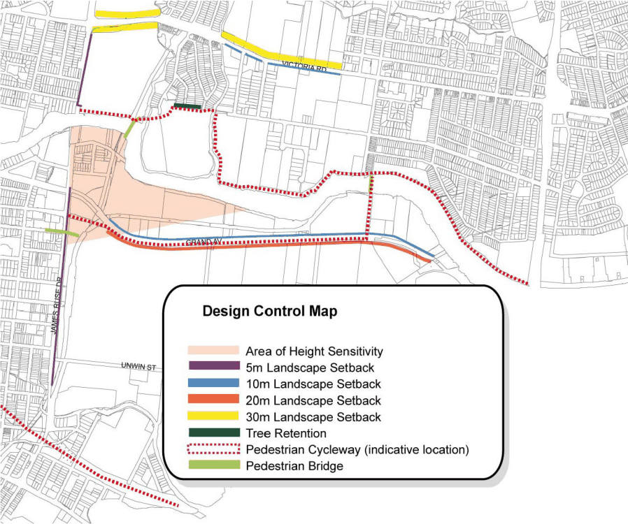

#### 8.2.4.3 LANDSCAPING

Objectives

O.01 Enhance the appearance of these precincts and the setting of heritage items or areas, particularly from the waterway, major thoroughfares, and any other public places.

O.02 Protect and enhance the riparian ecosystem along the Parramatta River and its tributaries. O.03 Improve environmental performance, particularly in terms of water management, pollution control, the natural environment, biodiversity, energy efficiency and transport management.

O.04 provide for recreational use of the foreshore and establishment of paths for walking and cycling where these will not diminish natural values.

Controls

C.01 Development must improve the foreshore landscape so that locally native vegetation and natural geomorphology are preserved, restored and extended and in accordance with any Government-adopted catchment strategies.

C.02 Any fencing is to be set back from the property boundary and screened in front by locally native and local provenance trees and shrubs.

C.03 Except where identified as culturally significant heritage landscape, the proposed landscaping is to be consist of plants that are local to the area, especially for the foreshore of the Parramatta River and tributaries, and of local provenance, and are to be planted in an appropriate vegetation sequence.

C.04 Open storage areas, material handling areas and car parking are to be located away from any boundaries that border on public areas, particularly the foreshore of the Parramatta River and its tributaries, and major transport routes.

C.05 Vegetated buffers are to be provided around areas of open storage or material handling, to soften the visual impacts and reduce dust and stormwater runoff.

C.06 Redevelopment of land adjacent to waterways must make provision for landscaped corridors that enhance the natural values of the foreshore ecosystem.

C.07 The landscape setbacks along major streets and riparian vegetation along the rivers and creeks are to be in accordance with the Camellia and Rydalmere Precinct Design Control Map, with the exception of any riparian vegetation area along the Parramatta River for the University of Western Sydney site, which may be varied provided there is a Conservation Management Plan for the site and the redevelopment achieves all the outcomes specified for the University Special Area.

C.08 A landscape management plan and strategy is to be developed to ensure continuity and attractiveness of landscaping.

CAMELLIA AND RYDALMERE

> [Picture on page 189: a picture, saved as a picture (images/part-08-centres-precincts-special-character-areas-specific-page-189-2.gif, 150 dpi).]

Figure 8.2.4.3.1 – Camellia and Rydalmere Design Control Map
