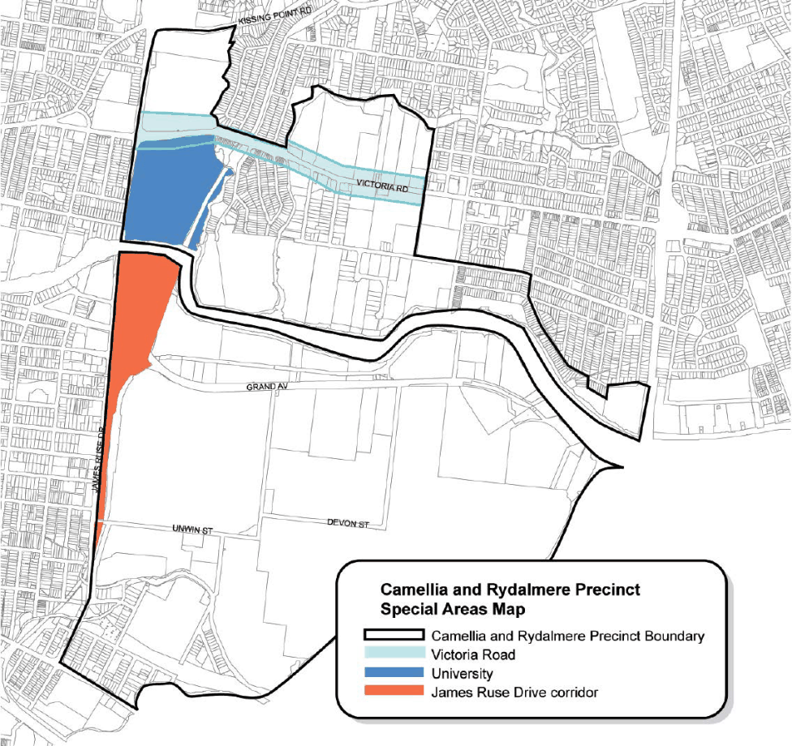

#### 8.2.4.7 SPECIAL AREAS

> [Picture on page 192: a picture, saved as a picture (images/part-08-centres-precincts-special-character-areas-specific-page-192-3.gif, 150 dpi).]

Figure 8.2.4.7.1 – Special Areas

#### 8.2.4.7.1 THE JAMES RUSE DRIVE CORRIDOR SPECIAL AREA

James Ruse Drive will be an attractive gateway thoroughfare to Parramatta supporting institutional uses, accommodation for visitors and business-related uses. The road will continue to be a significant regional transport artery. The corridor will be defined by well-designed buildings situated behind a significant landscaped frontage where possible, access to sites will be via adjoining local roads. View corridors will be retained to significant heritage buildings and the surrounding ridge lines.

CAMELLIA AND RYDALMERE

Controls

C.01 Development must contribute to a strong, unified and visually attractive character for James Ruse Drive, enhancing its role as an important gateway to Parramatta.

C.02 Best available construction materials, design techniques, finishes and interior layouts should be used to minimise the potential environmental impacts arising from James Ruse Drive and the rail line.

C.03 Development has vehicular access via local roads and not directly off James Ruse Drive. C.04 Management of the traffic impacts of development on James Ruse Drive. C.05 Integration of development with public transport. C.06 Land within proximity of the proposed Sydney West metro station is to be developed with consideration of the following:

• The impact of the development on the delivery of the Sydney West Metro Link.

• The impact of the proposed Sydney West Metro link on the development.

• The integration and interface between the development and any proposed station.

• The provisions of any relevant planning and development principles produced by Sydney Metro or its equivalent.

• The potential for land use to respond to the Sydney West Metro link in the future (e.g. maintain large development parcels without further subdivision in the short term).

C.07 New development along this corridor needs to be carefully planned and based on the following design principles:

• improve interaction with surrounding streets and parks for improved passive surveillance and improved urban form.

• create permeable spaces that foster pedestrian movement throughout the site for workers and people visiting the site.

• where permitted, retail areas should address, and be directly accessible from surrounding public uses, streets or the foreshore.

• modulate buildings to improve views into the site from the river and James Ruse Drive.

• underground car parking should be encouraged to create a better street address, allow more trees to act as shade and improve amenity and to create a linear form to be more easily crossed by pedestrians.

C.08 Any development undertaken for Rosehill Racecourse, will require the preparation of a detailed structure plan prepared by the proponent. Emphasis of the Structure Plan should be on meeting key tourism objectives, improving the physical appearance of development along James Ruse Drive, and to demonstrate positive measures to manage traffic issues and encourage public transport use.

#### 8.2.4.7.2 THE VICTORIA ROAD SPECIAL AREA

CAMELLIA AND RYDALMERE

Victoria Road will continue to be a significant gateway to Parramatta. The amenity and appearance of the area will be enhanced by high-quality buildings, landscaping and public domain improvements. The high exposure offered by the location will strengthen the employment area. The area will focus on innovative and emerging technologies for production. The road will cater for access by public transport and significant freight and private transport movements.

Controls

C.01 Buildings must have high-quality finishes where visible from the street and a high-quality frontage with landscaping.

C.02 Signage has a high standard and provides clear information as to the use of the land, the street address and clearly marked entrance and exit ways and is of a scale and nature sympathetic to the building form.

C.03 Where a property adjoins a natural waterway, the land is revegetated with locally native flora where possible and any area adjacent to the foreshore is maintained so as to limit run-off and such areas are considered for outdoor recreation or lunch areas.

C.04 The landscape setbacks shown on the Design Control Map in this Section are to be met.

#### 8.2.4.7.3 THE UNIVERSITY SPECIAL AREA

The University, comprising an area of historical significance set by the Parramatta River, will continue to be developed as a key centre of learning for Western Sydney. Heritage buildings and their settings will be preserved and adaptively reused as modern educational facilities. New development will ensure that glimpses of the heritage buildings from Victoria Road and James Ruse Drive will be maintained. Where appropriate, public pedestrian access and cycleway linkages along the river and between hinterland and the river, and recreation opportunities, will be pursued and implemented while protecting the riparian vegetation with appropriate setbacks along the Parramatta River. Opportunities for improving access to water based transport will be pursued. The bushland east of the railway line will be retained. The Parramatta River and Vineyard Creek foreshores will be enhanced with vegetation locally native to the area through bush regeneration, except where exotic species have been identified for retention through a conservation management plan, while conserving significant and historic views from and to heritage items situated along the Parramatta River.

Controls

C.01 Development must conserve and enhance items of heritage significance consistent with a Conservation Management Plan for the area.

C.02 Development must respect, conserve and respond to key views identified in that Plan.

CAMELLIA AND RYDALMERE

C.03 Development must protect and enhance cultural plantings and native bushland and other natural features along the foreshore.

C.04 Development must provide for public access along the foreshore. C.05 The scale and character of the development must recognise and complement the unique visual qualities of the site.

C.06 Development should integrate with the public transport network and facilitate access for pedestrians and cyclists to the site and, where appropriate, through the site.

C.07 The siting and design of the development must minimise adverse effects from adjoining land uses, including noise from James Ruse Drive.

C.08 Development must enhance the key approach routes to Parramatta, being James Ruse Drive, Victoria Road, the rail line and Parramatta River.

NEWINGTON LOCAL CENTRE
