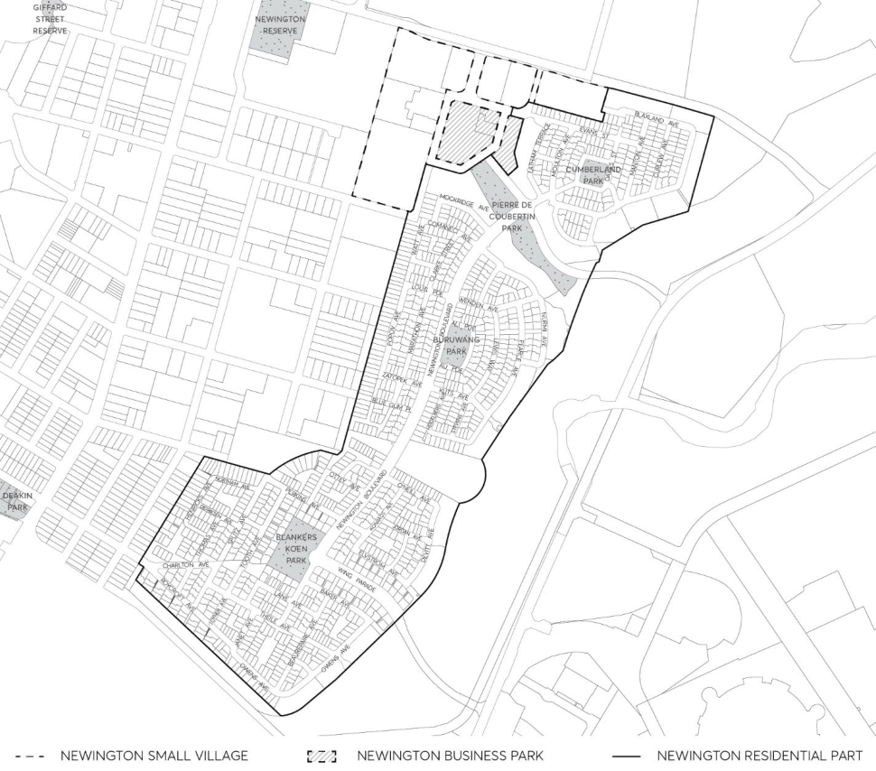

#### 8.2.5 NEWINGTON LOCAL CENTRE

Newington Local Centre has a long history of Aboriginal, early colonial, and government uses. The precinct was later used as the site of Sydney’s athlete village during the 2000 Sydney Olympic Games. At the time, this precinct was the largest solar-powered suburb in the world, with solar panels and water recycling facilities to service the village. These facilities are still used today.

This Section outlines specific provisions for Newington Small Village, Business Park, and Residential Precinct, as shown in Figure 8.2.5.1, and must be read in conjunction with any relevant Parts of the Parramatta DCP 2023. Where there are inconsistencies between the controls contained within this Section and other controls within this DCP, these controls prevail to the extent of the inconsistency.

> [Picture on page 196: a picture, saved as a picture (images/part-08-centres-precincts-special-character-areas-specific-page-196-12.gif, 150 dpi).]

Figure 8.2.5.1 – Newington Local Centre

NEWINGTON LOCAL CENTRE
