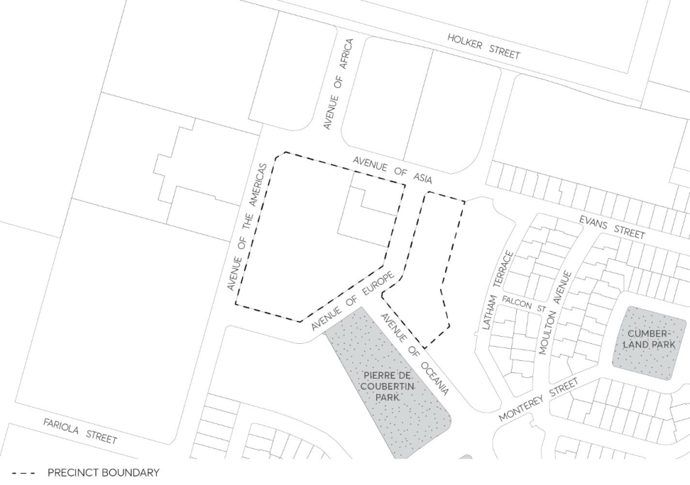

#### 8.2.5.1 NEWINGTON SMALL VILLAGE

This Section applies to Newington Small Village, as shown in Figure 8.2.5.1.1, which is zoned E1 Local Centre under the Parramatta LEP 2023. The development controls for these sites apply in addition to the development controls presented in previous Sections of this Part. Where there are inconsistencies between the controls contained within this Section and other controls within this DCP, these controls prevail to the extent of the inconsistency.

> [Picture on page 197: a picture, saved as a picture (images/part-08-centres-precincts-special-character-areas-specific-page-197-8.gif, 150 dpi).]

Figure 8.2.5.1.1 – Newington Small Village

Controls

Site coverage C.01 A maximum site coverage of 80% shall be permitted on site. Figure 8.2.5.1.1 - Newington Small Village Setbacks C.02 The following setbacks shall apply:

• Setback from residential areas shall be 3-6 metres.

• Setback from Newington Business Park shall be 1 metre.

• Setback to retail front shall be 3.5 metres. Loading areas

NEWINGTON LOCAL CENTRE

C.03 Loading areas shall be screened from public roads and public access areas. C.04 Active and defined frontages C.05 Entrances and windows shall be located on the ground floor of the building to face the public domain and created visual surveillance.

C.06 Buildings on street corners or the interface with public space shall emphasise the corner by appropriate architectural treatment.

Materials C.07 All building materials used shall be durable, low maintenance and of high-quality. Pedestrian amenity C.08 Public pedestrian networks within sites shall provide solar, wind and rain protection using a colonnade, an awning or other appropriate shading devices.

Architectural elements C.09 Awnings/colonnades in buildings shall be designed to a height of 3.5 metres. C.10 Signage shall be located below the awning height of a building. Parking rates In addition to the general parking requirements in Part 6 – Traffic and Transport of the Parramatta DCP 2023, parking controls below are to be applied to the Newington Small Village. Where there is an inconsistency, the parking controls below prevail. Bicycle Parking C.11 Bicycle parking requirement is 1 bicycle space per 300m² of retail space. Car Parking C.12 Minimum of 1 car space per 38m² GFA

NEWINGTON LOCAL CENTRE
