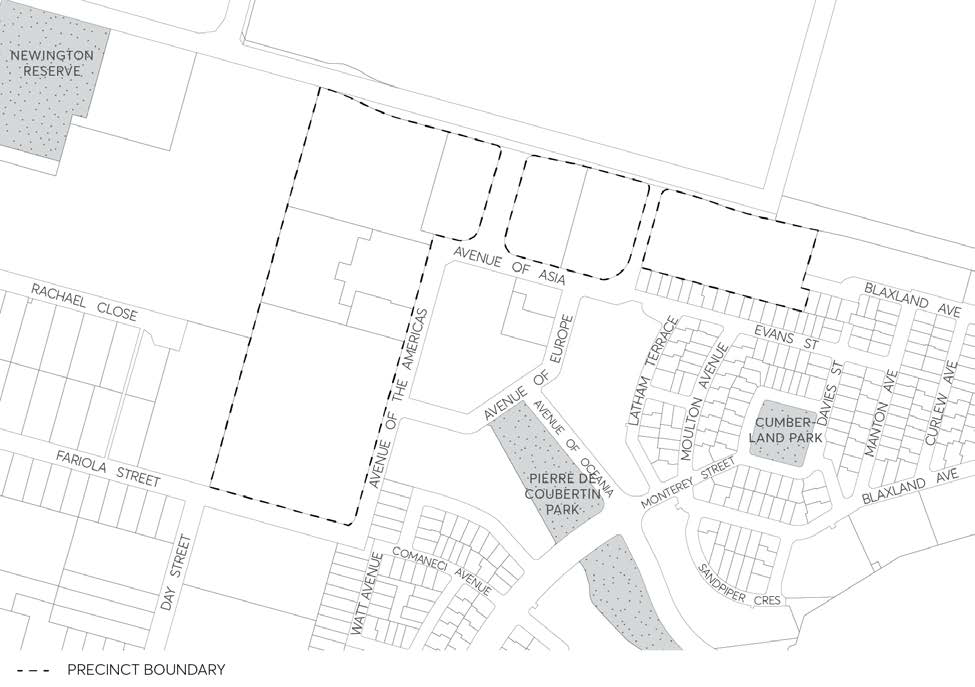

#### 8.2.5.2 NEWINGTON BUSINESS PARK PRECINCT

This Section contains specific provisions for the Newington Business Park, as shown in Figure 8.2.5.2.1, which is zoned E3 Productivity Support under Parramatta LEP 2023. This Section applies in addition to the provisions held in Part 2 – Design in Context and Part 4 – Non-Residential Development of this DCP. Where there is any inconsistency between this Section and Parts 2 and 4, the provisions in this Section prevail to the extent of the inconsistency.

> [Picture on page 199: a picture, saved as a picture (images/part-08-centres-precincts-special-character-areas-specific-page-199-8.gif, 150 dpi).]

Figure 8.2.5.2.1 – Newington Business Park

#### 8.2.5.2.1 ECOLOGICALLY SUSTAINABLE DEVELOPMENT REQUIREMENTS

Controls

C.01 Stairwells shall be positioned to create a stack effect to enhance natural ventilation and remove warm summer air from upper floors.

C.02 Plant types shall be selected so as not to overshadow potential location of rooftop solar collectors.

C.03 Refer to Part 5 – Environmental Management of this DCP for other development controls for energy efficiency and water conservation.

NEWINGTON LOCAL CENTRE

Landscaping C.04 Plant species that are drought tolerant or will require minimal watering once established shall be used.

C.05 Water-conserving landscape practices shall be applied where possible, including soil amendment, mulch, irrigation zoning, limited turf areas, planting in relation to micro-climate, water scheduling and selection of plants with water needs that match site rainfall and drainage conditions.

C.06 No imported topsoil shall be used. Stockpile and rehabilitate existing topsoil on site. C.07 Landscape plant species used in the public domain shall be predominantly native, including local indigenous species.

C.08 Native ground covers and grasses shall be used in lieu of turf where practicable.

#### 8.2.5.2.2 URBAN DESIGN

Objectives

O.01 Maximise the exposure of active zones to ensure an active streetscape. O.02 Reduce the impact of large building mass and service areas.

Controls

C.01 Where appropriate, street corners and main entry points shall be emphasised by appropriate architectural treatment.

C.02 Setbacks shall be designed to provide for a street edge defined by built form and landscape treatment, with minimum setbacks to active façade zones, and increased setbacks to solid walls.

C.03 Streetscapes shall be treated as active zones. Where possible, entry and office facades shall be orientated to the street. Other façade zones, such as setback solid walls, shall be treated with landscape areas to provide shade and amenity as well as visual interest to the streetscape.

C.04 Where buildings are setback to allow for car parking at entry zones, street edges shall be designed with permeable landscape buffers to permit street address/exposure, whilst maintaining defined edges.

Site coverage C.05 The total site coverage shall not exceed 60% of the area of the allotment. C.06 Building setbacks: Holker Street:

4 metres minimum

Main access street (linking Holker Street 5 metres minimum and Village Centre Boulevard):

NEWINGTON LOCAL CENTRE

Village Centre Boulevard and other streets: 1 metre minimum to active façade zones (ie.

office, showroom, etc.) 2 metre minimum to other façade zones

Awnings, sunshading etc, shall be excluded from setbacks listed above.

Service areas C.07 Service areas generally shall not detract from the character of the public street. Loading docks and access points to service areas shall be via the side or rear of the building or be appropriately treated by building or landscape means.

Landscape C.08 10% of the site area shall be soft landscaping. Architectural Elements C.09 Building facades and/or landscape treatment shall create a defined edge to the Newington Small Village boulevard and primary public streets.

C.10 Identification signs shall be integrated with the building design or within the landscape zone not higher than 2.4 metres above ground. All signage shall be permitted to be illuminated as per the relevant Australian Standards.

#### 8.2.5.2.3 BICYCLE PARKING RATES

In addition to the general parking requirements in Part 6 – Traffic and Transport of this DCP, parking controls below are to be applied to the Newington Business Park. Where there is an inconsistency, the parking controls below prevail. C.01 1 bicycle space/1,000m² (GFA) is to be provided.

NEWINGTON LOCAL CENTRE
