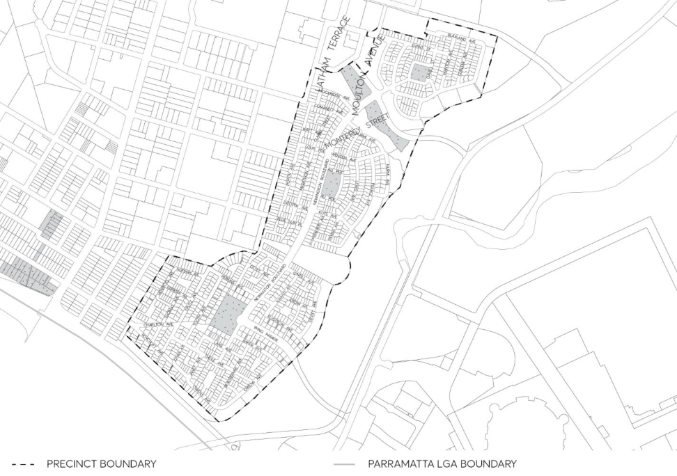
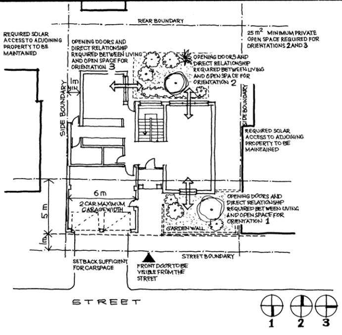
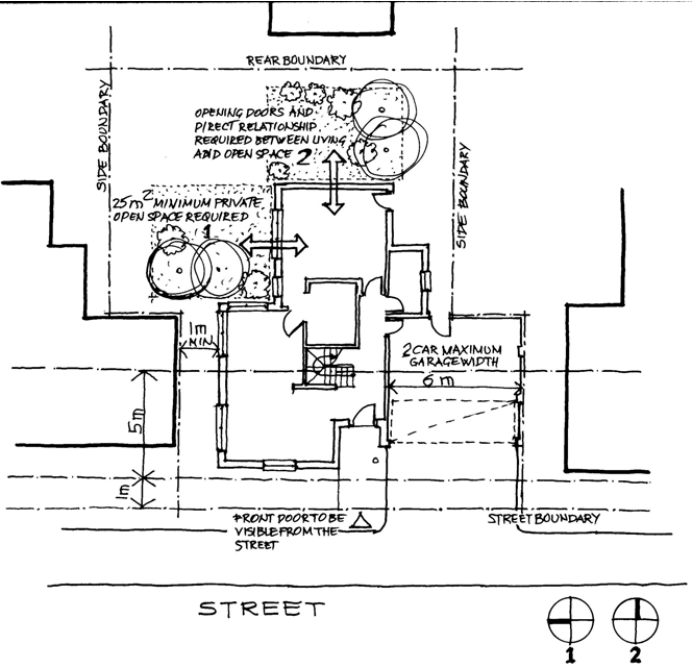
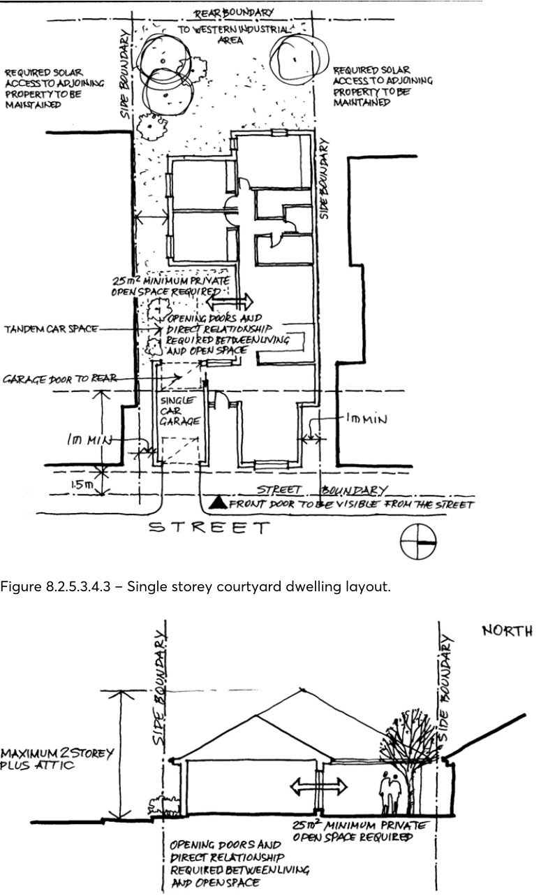
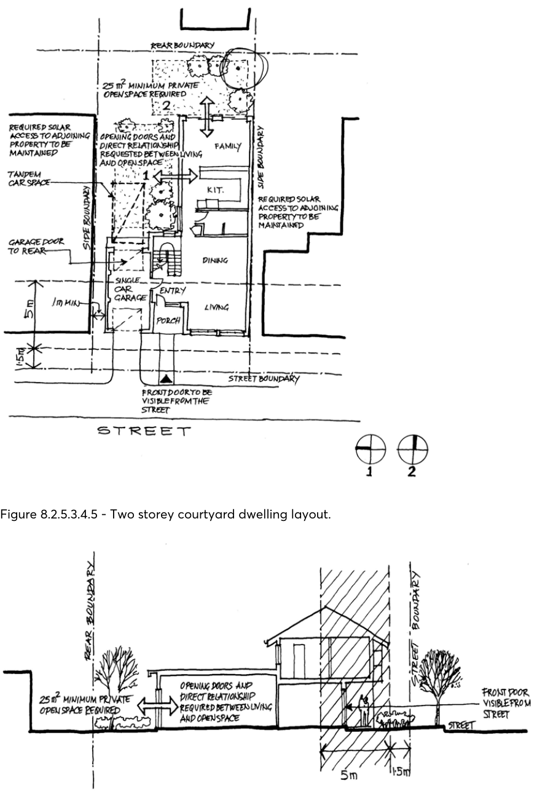
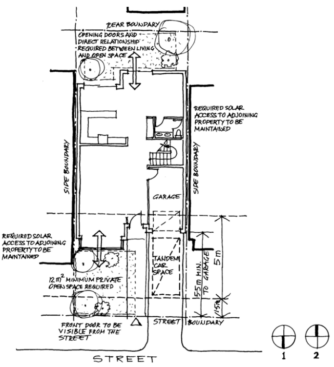
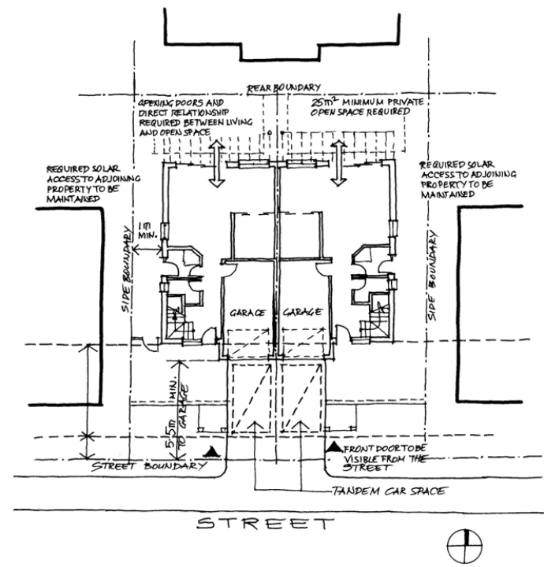
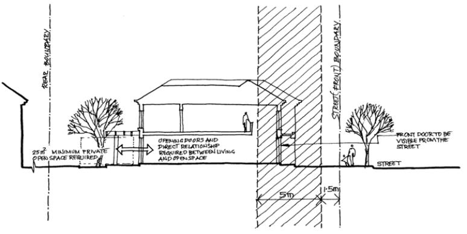
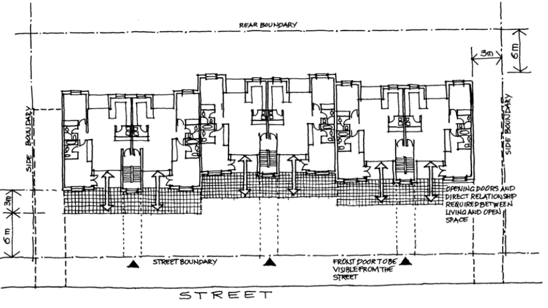
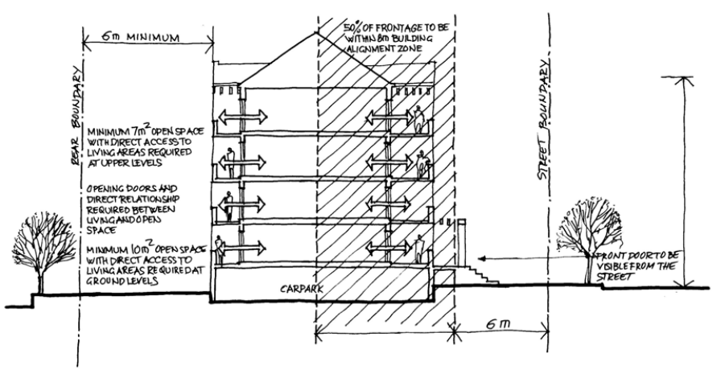

#### 8.2.5.3 NEWINGTON RESIDENTIAL PRECINCT

This Section applies to the Newington residential precinct as shown in Figure 8.2.5.3.1, specifically to land zoned R3 Medium Density Residential and R4 High Density Residential under Parramatta LEP 2023.

> [Picture on page 202: a picture, saved as a picture (images/part-08-centres-precincts-special-character-areas-specific-page-202-5.gif, 150 dpi).]

Figure 8.2.5.3.1 - Newington residential precinct

Objective

O.01 Ensure that the Newington residential precinct: „

• is pleasurable to live in and creates enjoyable urban places.

• maintains a high level of amenity. „

• contributes to the overall street locality and streetscape. „

• minimises the impact on the environment. „

• optimises use of the land. „

• responds appropriately to allotment size, location, opportunities and constraints.

NEWINGTON LOCAL CENTRE

#### 8.2.5.3.1 GENERAL CONTROLS

This Section applies to single lot housing types such as detached, semi-detached (town house), attached (terrace house), courtyard dwellings and residential flat buildings.

Objectives

O.01 Ensure that development provides a degree of consistency to establish the neighbourhood character of the precinct.

O.02 Ensure that the appearance of the development is of high visual quality and enhances and addresses the street.

O.03 Ensure that the form, scale and height of proposed development protects the amenity of adjoining properties and the locality.

O.04 Ensure that the form, scale and height of the proposed development responds appropriately to site characteristics.

O.05 Ensure that the development is designed, detailed and finished to provide an appropriate scale to the street.

O.06 Ensure that new development relates well to surrounding development. O.07 Ensure that when ‘built out’ the precinct provides a high-quality sustainable environment.

Controls

C.01 All buildings shall address the street. C.02 Where a building has two street frontages, it shall address the primary (major) street. C.03 Stepped building arrangements may be encouraged where narrow lot types reinforce the street. C.04 Entrances to residential flat buildings shall be clear and legible from the street. C.05 The storey height shall be controlled in residential areas to avoid overshadowing of neighbouring private open spaces.

C.06 Car court arrangements shall ensure that a minimum of 60% of dwellings have garages at rear. C.07 Where private open space is located on the street frontage, 2 metre walls shall be permitted for a maximum of 60% of frontage.

C.08 Driveways and high fences shall be paired where possible. Stormwater drainage C.09 Applicants shall consult the Part 5 – Environmental Management of this DCP for Stormwater Drainage.

Waste C.10 Applicants shall consult the Section 5.4.9 of this DCP for waste requirements. Landscaping

NEWINGTON LOCAL CENTRE

C.11 Table 8.2.5.3.1.1 below lists the plant species to be used in the private domain for single lot housing and residential flat buildings. Table 8.2.5.3.1.1 – Plant species to be used in the private domain

|  |  | Indigenous | Invasive | Allergenic | Bird attracting |
|---|---|---|---|---|---|
| TREES |  |  |  |  |  |
| Acacia elata | Cedar Wattle | x |  | x | x |
| Acacia glaucesens | Coast Myall | x |  | x |  |
| Acmena smithii | Lilly Pilly | x |  |  | x |
| Allocasuarina glauca | Swamp Oak | x |  | x |  |
| Angophora floribunda | Rough Barked Apple | x |  |  | x |
| Banksia serrata | Old Man Banksia | x |  |  | x |
| Callicoma serratifolia | Black Wattle | x |  |  |  |
| Ceratopetalum apetalum | Coachwood | x |  |  |  |
| Eleaocarpus reticulatus | Blueberry Ash | x |  |  | x |
| Eucalyptus citriodora | Lemon Scented Gum | x |  |  |  |
| Eucalyptus maculata | Spotted Gum | x |  |  | x |
| Eucalyptus scoparia | Tallangatta White Gum | x |  |  |  |
| Eucalyptus sideroxylon | Mugga Ironbank | x |  |  | x |
| Livistona australis | Cabbage Tree Palm | x |  |  | x |
| Melia azedarach | White Cedar | x |  | x |  |
| Pittosporum revolutum | Yellow Pittosporum | x |  |  | x |
| Pittosporum undualtum | Sweet Pittosporum | x |  |  | x |
| Syncarpia glomulifera | Turpentine | x |  |  |  |
| TALL SHRUBS |  |  |  |  |  |
| Backhousia myrtifolia | Lemon Ironwood | x |  | x |  |
| Banksia ericifolia | Heath Banksia | x |  | x |  |
| Banksia integrifolia | Coast Banksia | x |  | x |  |
| Baurea rubioides | Dog Rose | x |  |  |  |
| Ceratopetalum gummife | NSW Christmas Bush | x |  | x |  |
| Grevillea banksii | Banks Grevillea | x |  | x |  |
| Grevillea hookeriana | Toothbrush Grevillea | x |  | x |  |
| Hakea salicifolia | Willow Leaved Hakea | x |  | x |  |
| Leptospermum laevigatu | Coast Tea Tree | x |  |  |  |
| Melaleuca armillaris | Bracelet Honey Myrtle | x |  | x |  |

NEWINGTON LOCAL CENTRE

|  |  | Indigenous | Invasive | Allergenic | Bird attracting |
|---|---|---|---|---|---|
| Melaleuca nesophila | Honey Myrtle | x |  | x |  |
| Shrubs |  |  |  |  |  |
| Boronia serrulata | Native rose | x |  | x |  |
| Correa reflexa | Native Fuschia | x |  |  |  |
| Epacris pulchella | Coral Heath | x |  |  |  |
| Erisotemon australasius | Waxflower | x |  | x |  |
| Grevillea ‘Robyn Gordon’ | Grevillea | x | x | x |  |
| Grevillea sericea | Pink Spider Flower | x | x | x |  |
| Westringia fruticosa | Coast Rosemary | x |  |  |  |
| GROUND COVERS |  |  |  |  |  |
| Acacia suaveolens | Sweet Scented Wattle | x |  | x |  |
| Cissus antartica | Grape Ivy | x |  |  |  |
| Hardenbergia violacea | Native Sarspirella | x | x |  |  |
| Hibbertia scandens | Gold Guinea Flower | x |  |  |  |
| Kennedia rubicunda | Dusky Coral Pea | x | x |  |  |
| Kenzea ‘Badja Carpet’ | Badja Carpet | x |  | x |  |
| Muehlenbeckia axillaris | Wire Plant | x | x |  |  |
| Myoporum parvifolium | Creeping Boobialla | x |  |  |  |
| Viola hederacaea | Native Violet | x |  |  |  |
| GRASSES |  |  |  |  |  |
| Cyperus gracilis | Dwarf Umbrella Grass | x |  |  |  |
| Dianella revoluta | Flax Lily | x |  | x |  |
| FERNS |  |  |  |  |  |
| Adantum aethipoicum | Maidenhair Fern | x |  |  |  |
| Asplenium australasicu | Birds Nest Fern | x |  |  |  |
| Blechnum nudum | Hard Tree Fern | x |  |  |  |
| Culcita dubia | False Bracken | x |  |  |  |
| Cyathea cooperi | Coopers Tree Fern | x |  |  |  |
| Doodia aspera | Rasp Fern | x |  |  |  |
| Pleris spp | Jungle Brake | x |  |  |  |
| Todea barbera | King Fern | x |  |  |  |

| Accent plants for dramatic foliage effect | Innovative use of materials in softscape | Private |
|---|---|---|
| Anigosanthos flavidus | Kangaroo Paw |  |
| Apinia caeruiea | Native Ginger | x |

NEWINGTON LOCAL CENTRE

| Araucaria cuninghamii | Norfolk Island Pine |  |
|---|---|---|
| Cordyiine stricta | Erect Palm Lily | x |
| Crinum pedunculatum | River Lily | x |
| Curculigo capitulata | Weevil Lily | x |
| Dendrobium speciosum | Native Orchid | x |
| Dicksonia antartica | Soft Tree Fern | x |
| Doryanthes excelsa | Gymea Lily | x |
| Gahnia sieberiana | Slender Saw Sedge |  |
| Heimholtzia glaberrima | Stream Lily | x |
| Livistona chinensis | Cabbage Tree Palm | x |
| Lomandra longifolia | Mat Rush |  |
| Macrozamia communis | Burrawang | x |
| Vitextrifolia ‘Purpurea’ |  |  |
| Xanthorrhoea australis | Grass Tree |  |

| Australian native plants for special effect | Unique showcase of native Australian plants | Private |
|---|---|---|
| Acmena smithii | Blue Lilly Pilly | x |
| Aiphitonia excelsa | Red Ash | x |
| Amaianthus populifolius | Bleeding Heart | x |
| Archontophoenix alexan | Alexander Palm | x |
| Archontophoenix cunnin | Bangalow Palm | x |
| Backhousia citriadora | Lemon Scented Myrtle | x |

Car parking C.12 Applicants shall refer to the relevant provision within the Section 6.4 – Loading and Servicing of this DCP.

Public domain C.13 Applicants shall consult the Parramatta Public Domain Guideline for all public domain requirements.

Access and mobility C.14 Applicants shall consult the relevant provisions within Section 2.11 – Access for People with a Disability of this DCP.

Adaptable housing C.15 Applicants shall consult the relevant provisions of the Multi Dwelling or the Residential Flat Building sections within Part 3 – Residential Development of this DCP.

NEWINGTON LOCAL CENTRE

#### 8.2.5.3.2 SINGLE LOT HOUSING

This Section provides detailed and specific controls for single lot housing which comprises of detached, semi-detached and attached housing types.

Controls

Private open space C.01 A minimum area of 25m² of continuous open space relating to living areas shall be provided on each site.

C.02 Major open space shall be screened if located at the front of the building. Privacy C.03 Visual privacy shall be required and may be achieved by:

• separation of functions by lot layout.

• placement of buildings between adjoining private open spaces.

• window placement that avoids overlooking from living area to living area.

• use of screening where the above strategies cannot be achieved.

C.04 For acoustic privacy, buildings shall:

• separate active recreation areas from bedroom areas.

• locate noise sensitive rooms and private open space away from the noise source or use of solid barriers where dwellings are close to high noise sources.

• minimise transmission of sound through the building structure, and in particular, protect sleeping areas from noise intrusion.

• include shared floors and walls between dwellings to be constructed in accordance with noise transmission and insulation requirements of the Building Code of Australia (BCA).

Solar amenity C.05 Single lot dwelling living spaces shall be orientated within 20 degrees west of North and 30 degrees east of North and open directly onto north facing private open space where possible.

C.06 North facing external walls to living areas of dwellings shall achieve 2 hours of solar access in mid-winter.

C.07 Single lot dwellings shall be designed to ensure minimum of 2 hours of solar access to a minimum of 50% of the required provision of adjacent private outdoor living space between 9:00am and 3:00pm midwinter.

C.08 North facing windows shall be maximised and have horizontal protection to ensure shading of glazing occurs when the midday sun angle is 65 degrees or more. Shading devices to north facing windows shall provide sun penetration when the midday sun angle is 34 degrees or less.

C.09 Window sizes shall be minimized when facing south, west and east or shall be installed with vertical screens or solar film to west and east facing windows.

C.10 High mass materials shall be used where possible.

NEWINGTON LOCAL CENTRE

Building height C.11 Building heights shall reinforce the scale and quality of the streetscape within Newington’s residential precinct and surroundings. To allow flexibility, sloping sites shall have a maximum building height of two storeys plus attic.

Front fences C.12 Front fencing shall be 50% transparent. The minimum requirement for front fencing shall be 900mm. The maximum front fencing height requirement shall be 1.2mm.

C.13 Dividing fences shall be a maximum of 1.8 metres in height and, where required, shall allow for surveillance of street.

C.14 Privacy shall be provided to private open space where it abuts the street. Surveillance via the entry and living/kitchen room windows shall be maintained.

C.15 Design of wall/fence shall be integrated with the design of the building and shall allow for penetration of breezes.

C.16 Where surveillance of the street or open space is required, fences shall be permeable. Refer to Table 8.5.3.2.1 for building materials, colours and finishes.

Garden walls C.17 Garden walls (semi-transparent) shall be a minimum height of 1.5 metres and a maximum height of 2 metres.

C.18 Garden walls shall be permitted to the street only when enclosing north facing private residential open space with a maximum width of 60% of street frontage and a maximum unarticulated length of 12 metres wide residential areas.

C.19 Garden walls shall not obscure the view of the front door from the street. Refer to Table 8.5.3.2.1 for garden wall materials, colours and finishes of this Part.

Carports and garages C.20 Garages and carports shall read as secondary to building forms and compatible with the architectural character. Refer to Table 8.5.3.2.1 for materials, colours and finishes for carports and garages.

Pergolas C.21 Dimensions of pergolas as shown below shall be appropriate to the function and design of pergolas shall be integral with architectural design of the building. Refer to Table 8.5.3.2.1 for building materials, colours and finishes. Height Maximum 3 metres Depth Minimum 1 metre and 3 metres maximum Width 2 metres over outdoor living areas

C.22 Pergolas shall provide shade when sun is above 65 degrees or more (summer) and when the sun angle is 34 degrees or less (winter).

Decks, porches, terraces, verandahs C.23 Refer Table 8.5.3.2.1 for development controls and finishes relating to decks, porches, terraces and verandahs.

NEWINGTON LOCAL CENTRE

Materials C.24 Refer to Table 8.5.3.2.1 for materials, sizes and finishes for various building elements associated with the development.

Table 8.5.3.2.1 - Architectural materials, sizes and finishes

| Building elements | Material | Shape and size | Colour and other requirements |
|---|---|---|---|
| Carports and garages | Walls to be timber or rendered or bagged and paint finish masonry. | Refer detail building controls. | Masonry to be off white to earth tones. Timber can have colour accents. |
| Front door | Timber and glass (max 50%) |  | Weather strips required. Any colour allowed. Shall be visible from the street. |
| Plumbing | No exposed sanitary plumbing. |  | Vent pipes and other roof protrusions. See roof additions. |
| Hot water/Photo voltaic cells |  | Solar panels mounted flush onto roofing or incorporated into built form. | Storage tank to be remotely located at ground level. |
| External paving | Permeable materials preferred. | Position to minimise site coverage |  |
| Roof | Terracotta or pre- finished concrete tile or metal | North facing pitch to be sufficient in area for solar collectors. | Highly reflective surfaces not allowed. Colour range generally light colours including greys, terracotta, light earth tones. Overhang to shade windows midday midsummer and allow maximum penetration to windows of midday midwinter sun. |
| Roof additions (i.e., satellite dish, TV aerial) | Refer State Environmental Planning Policy (Exempt and Complying Development Codes) 2008. | Refer State Environmental Planning Policy (Exempt and Complying Development Codes) 2008. | Not to be visible from the street. |
| Skylight |  |  | Shaded to exclude 100% midday midsummer sun and allow maximum penetration of midwinter sun. |
| Wall | Ground Level: rendered or bagged and paint finish masonry. Upper Level: As for ground or mixture of rendered or bagged and | Front wall parallel to front property boundary except for articulation | Wall colour to range from off-white to earth tones. 20% of light weight upper level walls can be an accent colour. |

NEWINGTON LOCAL CENTRE

| Building elements | Material paint finish masonry and light weight cladding including FC sheet/shingles/timber boarding. | Shape and size elements and lots less than 10 metres in width. | Colour and other requirements |
|---|---|---|---|
| Window and glass door | Timber and metal framing and shading. No reflective or tinted glass. | No maximum limit for appropriately shaded glazing. | All rooms including bathrooms and kitchens shall have minimum window opening area to meet BCA for natural ventilation and natural light. Weather strips to all windows. All windows shall have external shading to exclude 100% midday midsummer sun and allow maximum penetration of midday midwinter sun. Colour of frames shall be accent colour. |
| Balcony | Floor: timber, pavers (pre-cast, brick or unit) or tiles. Balustrade: mild steel, timber or masonry. | Refer detail building controls in Part 3 | Shall be screened to prevent overlooking. To be timber trellises, lattices, shutters, fabric screens. |
| Deck | Floor: As for balcony. Balustrade: mild steel, timber or clay brick. | Min 1.2 metres max 3 metres deep. Min 2.5 metres wide. | Do not shade minimum required windows midday midwinter. Screened to prevent overlooking. Screen materials as per balcony. |
| Garden wall | Clay brick, earthen construction or timber. | Refer to C.17 – C.19. | Refer to C.17 – C.19. |
| Pergola | Timber or clay brick posts. Metal or timber beams. | Refer to C.21 and C.22. | Do not shade minimum required windows midday midwinter provide shade midday midsummer. |
| Porch | Clay brick, earthen construction, timber or glass. | Roofed cover to front door. Min 1 metre, max 2 metres deep. Min 2 metres, max 4 metres wide. Max 1 storey high. |  |
| Terrace | Floor: As for Balcony. Balustrade: mild steel, timber or clay brick. | Min 2 metres deep. Min 2.5 metres wide. | Screened to prevent overlooking. |
| Verandah | Posts: timber or clay brick. Paving: As for Balcony. | Min 1.2 metres deep. Min 3 metres wide. | Do not shade windows minimum required midday midwinter. Screened to prevent overlooking. |

NEWINGTON LOCAL CENTRE

#### 8.2.5.3.3 LANDSCAPING

Objective

O.01 Provide landscaping within a site that comprises predominantly of native species with an emphasis on those species that existed on site.

O.02 Planting shall ensure optimum ecological sustainable development (ESD) advantage and residential amenity through:

• good planning and design.

• practical lawn areas.

• efficient irrigation.

• soil improvement.

• use of mulches.

• low water demand plants.

• good maintenance.

Controls

C.01 The following percentage targets of landscape treatments within dwelling lots shall be required:

| Grass | 30% |
|---|---|
| Mass planting/trees | 40% |
| Mulches/gravels | 30% |

C.02 Deciduous trees shall be used where summer shading and winter sun is required. C.03 Mass planting areas shall be fully mulched.

#### 8.2.5.3.4 SINGLE LOT HOUSING TYPES

DETACHED FAMILY DWELLING – STANDARD LOT

Controls

Lot size

C.01 Minimum lot width shall be 12 metres and minimum lot depth shall be 18 metres. Siting C.02 Living areas shall face north. Minimum 25m² shall be required as private open space with direct access to living area.

C.03 Dwelling entry shall be clearly visible from street. C.04 A 2 metres garden wall shall be permitted where private open space is on street frontage. The maximum dwelling width shall be 60% of frontage.

NEWINGTON LOCAL CENTRE

Solar amenity and private open space C.05 Minimum 50% of private open space area shall be required and north facing living area wall shall have a minimum of 2 hours solar access during mid-winter.

Setbacks C.06 Front setback shall be a minimum of 1.5 metres and 3 metres at a collector street. Add 1 metre where private open space is to the street. 50% of frontage shall be within the 5 metres building alignment zone.

C.07 Rear setback shall be zero lot lined. Side setback shall be zero lot lined on one boundary. C.08 Where it is not zero lot lined, side setback shall be a minimum of 1 metre. Dwelling height C.09 Maximum height shall be 2 storeys plus attic to the street. Dwelling setback at upper levels shall be determined by overshadowing of adjoining block. Single storey shall be in the rear 50% of site. Note: Figure 8.2.5.3.4.1 below illustrates the site layout for a detached family dwelling for a standard lot.

> [Picture on page 212: a picture, saved as a picture (images/part-08-centres-precincts-special-character-areas-specific-page-212-17.gif, 150 dpi).]

Figure 8.2.5.3.4.1 - Detached family dwelling – standard lot.

NEWINGTON LOCAL CENTRE

DETACHED FAMILY DWELLING – ZIPPER LOT

Controls

Lot size

C.01 Minimum lot width shall be 12 metres and minimum lot depth shall be 18 metres. Siting C.02 Living areas shall face north. Minimum 25m² is required as private open space with direct access to living area.

C.03 Dwelling entry shall be clearly visible from street. Solar amenity and private open space C.04 Minimum 50% of private open space area shall be required and north-facing living area wall shall have a minimum of 2 hours solar access during mid-winter.

Setbacks C.05 Front setback shall be a minimum of 1.5 metres and 3 metres at a collector street. Add 1 metre where private open space is to the street.

C.06 50% of frontage shall be within the 5 metres building alignment zone. C.07 Rear setback shall be zero lot lined. C.08 Side setback shall be zero lot lined on one boundary. Where it is not zero lot lined, side setback shall be a minimum of 1 metre.

Dwelling height C.09 Maximum dwelling height shall be 2 storeys plus attic to the street. Dwelling setback at upper levels shall be determined by overshadowing of the adjoining block.

C.10 Single storey shall be in the rear 50% of site. Note: Figure 8.2.5.3.4.2 below illustrates the site layout for a detached family dwelling for zipper lot.

NEWINGTON LOCAL CENTRE

> [Picture on page 214: a picture, saved as a picture (images/part-08-centres-precincts-special-character-areas-specific-page-214-2.gif, 150 dpi).]

Figure 8.2.5.3.4.2 - Detached family dwelling layout – zipper lot.

NEWINGTON LOCAL CENTRE

SINGLE STOREY COURTYARD DWELLING

Controls

Lot size C.01 Minimum lot width shall be 10 metres and minimum lot depth shall be 20 metres. (Includes 12 metre buffer at boundary to existing industrial development).

Siting C.02 Living areas shall face north. Minimum 25m² area of private open space shall be required with direct access to the living area. Dwelling entry shall be clearly visible from street.

Solar amenity and private open space C.03 Minimum 50% of private open space area shall be required and north facing living area walls shall have a minimum of 2 hours solar access during mid-winter.

Setbacks C.04 Front setback shall be a minimum of 1.5 metres and 3 metres at a collector street. 50% of frontage to be within the 5 metres building alignment zone.

C.05 Rear setback shall be zero lot lined or 12 metres where site is adjacent to industrial development areas on the western side of the precinct.

C.06 Side setback shall be zero lot lined on one boundary. Where not zero lot lined, side setback shall be a minimum of 1 metre.

Dwelling height C.07 Maximum height of a dwelling shall be 2 storeys plus attic. C.08 Dwelling setback at upper levels shall be determined by overshadowing of the adjoining block. Note: Figures 8.2.5.3.4.3 and 8.2.5.3.4.4 illustrate the site layout and cross section for a single storey courtyard dwelling.

NEWINGTON LOCAL CENTRE

> [Picture on page 216: a picture, saved as a picture (images/part-08-centres-precincts-special-character-areas-specific-page-216-2.gif, 150 dpi).]

Figure 8.2.5.3.4.3 – Single storey courtyard dwelling layout.

Figure 8.2.5.3.4.4 - Cross section of single storey courtyard dwelling.

NEWINGTON LOCAL CENTRE

TWO STOREY COURTYARD DWELLING

Controls

Lot size

C.01 Minimum lot width shall be 10 metres and minimum lot depth shall be 20 metres. Siting C.02 Living areas shall face north. Minimum 25m² of private open space shall be required with direct access to living areas.

Solar amenity and private open space C.03 Minimum 50% of private open space area shall be required. C.04 North facing living area walls shall have a minimum of 2 hours solar access during mid-winter. Setbacks C.05 Front setback shall be a minimum of 1.5 metres and 3 metres at a collector street. 50% of frontage shall be within the 5 metres building alignment zone.

C.06 Rear setback shall be zero lot lined or 12 metres where site adjacent to industrial development areas on the western side of the precinct.

C.07 Side setback shall be zero lot lined on one boundary. Where it is not zero lot lined, side setback shall be a minimum of 1 metre.

Dwelling height C.08 Maximum height of dwelling shall be 2 storeys plus attic. C.09 Dwelling setback at upper levels shall be determined by overshadowing of the adjoining block. Note: Figures 8.2.5.3.4.5 and 8.2.5.3.4.6 illustrates the site layout and cross section for a two storey courtyard dwelling.

NEWINGTON LOCAL CENTRE

> [Picture on page 218: a picture, saved as a picture (images/part-08-centres-precincts-special-character-areas-specific-page-218-2.gif, 150 dpi).]

Figure 8.2.5.3.4.5 - Two storey courtyard dwelling layout.

Figure 8.2.5.3.4.6 - Section of two storey courtyard dwelling.

NEWINGTON LOCAL CENTRE

TERRACE HOUSE – NORTH TO THE STREET

Controls

Lot size

C.01 Minimum lot width shall be 6 metres and minimum lot depth shall be 20 metres. Siting C.02 Living areas shall face north. Minimum 25m² shall be required as private open space with direct access to living areas. Dwelling entry shall be clearly visible from street.

Solar amenity and private open space C.03 Minimum 50% of private open space area shall be required and north facing living area wall shall have a minimum of 2 hours solar access during mid-winter.

Setbacks C.04 Front setback shall be a minimum of 1.5 metres and 3 metres at a collector street. 50% of frontage shall be within the 5 metres building alignment zone.

C.05 Rear setback shall be 3 metres minimum or 12 metres where site is adjacent to western industrial development area of the precinct.

C.06 Side setback shall be zero lot lined on both boundaries. Where it is not zero lot lined, side setback shall be a minimum of 1 metre.

Dwelling height C.07 Maximum dwelling height shall be 2 storeys plus attic. Dwelling setback at upper levels shall be determined by overshadowing of the adjoining block. Single storey shall be in rear 50% of site. Note: Figure 8.2.5.3.4.7 illustrates the site layout for a two storey terrace house.

NEWINGTON LOCAL CENTRE

> [Picture on page 220: a picture, saved as a picture (images/part-08-centres-precincts-special-character-areas-specific-page-220-2.gif, 150 dpi).]

Figure 8.2.5.3.4.7 - Terrace house layout - north to the street.

TOWN HOUSE (SOUTH TO THE STREET)

Controls

Lot size

C.08 Minimum lot width and depth shall be 6 metres and 20 metres. Siting C.09 Living areas shall face north. Minimum 25m² shall be required as private open space with direct access to living area. Dwelling entry shall be clearly visible from street.

Solar amenity and private open space C.10 Minimum 50% of private open space area shall be required and north facing living area wall shall have a minimum of 2 hours solar access during mid-winter.

Setbacks C.11 Front setback shall be a minimum of 1.5 metres and 3 metres at a collector street. 50% of frontage shall be within a 5 metres building alignment zone.

NEWINGTON LOCAL CENTRE

C.12 Rear setback shall be 3 metres minimum or 12 metres where site is adjacent to western industrial development area.

C.13 Side setback shall be zero lot lined. Where it is not zero lot lined, side setback shall be a minimum of 1 metre.

Dwelling height C.14 Maximum dwelling height shall be 2 storeys plus attic. Dwelling setback at upper levels shall be determined by overshadowing of adjoining block. Single storey shall be in rear 50% of site. Note: Figures 8.2.5.3.4.8 and 8.2.5.3.4.9 illustrates the site layout and a cross section for a two storey town house.

> [Picture on page 221: a picture, saved as a picture (images/part-08-centres-precincts-special-character-areas-specific-page-221-11.gif, 150 dpi).]

Figure 8.2.5.3.4.8 - Town house layout (south to the street).

NEWINGTON LOCAL CENTRE

> [Picture on page 222: a picture, saved as a picture (images/part-08-centres-precincts-special-character-areas-specific-page-222-2.gif, 150 dpi).]

Figure 8.2.5.3.4.9 – Cross section of town house.

#### 8.2.5.3.5 RESIDENTIAL FLAT BUILDINGS

This Section provides detailed controls for residential flat buildings development on the land zoned R4 High Density Residential within the Newington residential area shown in Figure 8.2.5.3.1.

Controls

Site planning and solar amenity C.01 Site planning shall maximise the northern aspect for a majority of units of the development. Site coverage C.02 The maximum site coverage shall be 60%. Private open space C.03 The above ground floor level shall have a 7m² minimum area of private open space for a balcony and a minimum width of 1.8 metres.

C.04 The ground floor level shall have 10m² minimum area of private open space per dwelling and a minimum dimension of 3 metres.

Privacy C.05 Visual privacy shall be required and may be achieved by:

• separation of functions by lot layout.

• placing buildings between adjoining private open spaces.

• window placement that avoids overlooking from living area to living area.

• use of screening where above strategies cannot be achieved.

C.06 For acoustic privacy, buildings shall:

• be designed to locate noise sensitive rooms and private open space away from the noise source or by use of solid barriers where dwellings are close to high noise sources.

NEWINGTON LOCAL CENTRE

• minimise transmission of sound through the building structure and in particular protect sleeping areas from noise intrusion.

• all shared floors and walls between dwellings to be constructed in accordance with noise transmission and insulation requirements of BCA.

Built form Building height C.07 Building heights shall be set to reinforce the scale and quality of the streetscape. A maximum building height of 4 storeys (residential) for a residential flat building shall be permitted.

Fencing/screening C.08 Fencing or screens shall be used to maintain privacy between balconies/terraces. C.09 Fencing or screens shall not be permitted to lot boundaries unless for security or privacy or to screen service areas or equipment.

C.10 Surveillance of the street shall be allowed where required. C.11 Privacy shall be provided to ground floor private open space where it abuts the street. Surveillance via the entry and living/kitchen room windows to be maintained.

C.12 Design of the wall/fence shall be integrated with the design of the building. C.13 Front walls/fences unless enclosing private open space shall be a maximum of 1.2 metres in height.

C.14 The front and side dividing fences, where located within the front yard area, shall not exceed a height of 1.2 metres as measured above existing ground level and shall be a minimum of 50% transparent. Front and side dividing fences where located within the front yard area shall not be constructed of solid pre-coated metal type materials such as Colorbond or similar.

C.15 Front walls/fences shall be a maximum of 1.8 metres high if enclosing private residential open space with a maximum width of 60% of street frontage and a maximum unarticulated length of 12 metres in residential development.

Materials C.16 Refer to Table 8.5.3.2.1 for materials, finishes and colours. Lot size C.17 Minimum lot width shall be 40 metres and minimum lot depth shall be 25 metres. Siting C.18 Minimum 10m² private open space with direct access to living areas shall be required at ground floor levels.

C.19 Minimum 7m² private open space with direct access to living areas shall be required at upper floor levels. Building entry shall be clearly visible from the street.

Setbacks C.20 The following setbacks shall apply:

• Front setback shall be 4 metres minimum (6 metres at collector street). 50% of frontage to be within 8 metres building alignment zone.

NEWINGTON LOCAL CENTRE

• Rear setback shall be 6 metres minimum (12 metres minimum between buildings).

• Side setback shall be 3 metres minimum. Note: Setbacks are illustrated in Figure 8.2.5.3.5.1.

> [Picture on page 224: a picture, saved as a picture (images/part-08-centres-precincts-special-character-areas-specific-page-224-5.gif, 150 dpi).]

Figure 8.2.5.3.5.1- Plan - residential flat building development.

Number of Storeys

C.21 Residential flat building shall be a maximum of 4 storeys above ground level (existing), as shown in Figure 8.2.5.3.5.2. Setback at upper levels is determined by overshadowing of adjoining block.

> [Picture on page 224: a picture, saved as a picture (images/part-08-centres-precincts-special-character-areas-specific-page-224-10.gif, 150 dpi).]

Figure 8.2.5.3.5.2 - Cross section - residential flat building.

NEWINGTON LOCAL CENTRE

#### 8.2.5.3.6 PARKING

In addition to the general parking requirements of Part 6 – Traffic and Transport of this DCP, parking controls below are to be applied to the Newington Residential Precinct. Where there is an inconsistency, the parking controls below prevail. Single lot housing C.01 Maximum of 2 car parking spaces on-site shall be either tandem or adjacent spaces, covered or uncovered. Drive through single garages permitted.

Residential flat buildings and multi unit dwellings C.02 The following parking controls shall apply.

• 1 visitor space per 7 units.

• 1 space per 1 bedroom unit.

• 1.2 spaces per 2 bedroom unit.

• 1.5 spaces per 3 bedroom unit.

• Minimum one resident space per unit in semi-basement.

Note: Refer to Part 6 – Traffic and Transport of this DCP for additional parking and loading requirements.

MELROSE PARK URBAN RENEWAL PRECINCT
