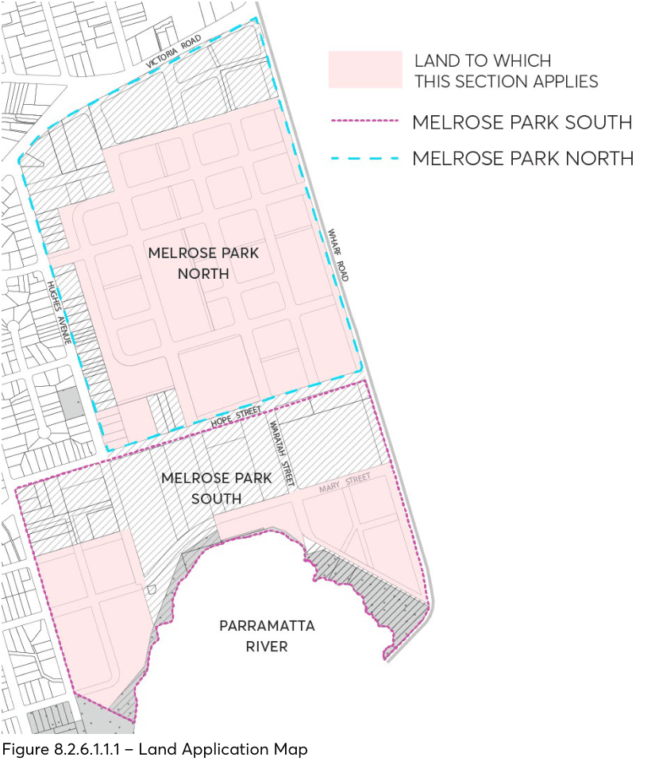

#### 8.2.6 MELROSE PARK URBAN RENEWAL PRECINCT

#### 8.2.6.1 INTRODUCTION

The Melrose Park precinct is made up of two sub-precincts, Melrose Park North and Melrose Park South. The development controls of this Section apply to certain land in Melrose Park as shown in Figure

8.2.6.1.1.1 – Land Application Map and must be read in conjunction with any relevant Parts of the Parramatta DCP 2023. Where there are inconsistencies between the controls contained within this Section and any other controls within this DCP, the Melrose Park Urban Renewal Precinct provisions will prevail to the extent of the inconsistency. Furthermore, Section 8.2.6.6 – Site Specific Controls prevails over other controls within this Section to the extent of any inconsistencies.

Section 8.2.6 – Melrose Park Urban Renewal Precinct is to be used in conjunction with the Parramatta Local Environmental Plan 2023 (PLEP 2023) and in consideration of the following documents:

• Melrose Park North Structure Plan

• Melrose Park South Structure Plan

• Council’s Standard Construction details

• Melrose Park Public Domain Guidelines

While a DCP generally does not apply to Development Applications lodged prior to its commencement, given this DCP was endorsed by Council on 11 October 2021 but came into effect on 1 December 2023, this DCP therefore applies to Development Applications lodged prior to its commencement.

#### 8.2.6.1.1 DESIRED FUTURE CHARACTER

City of Parramatta Council aims to foster the development of a lively, diverse, and healthy Local Government Area, one which celebrates a sense of place and local character.

Situated to the east of the Parramatta City Centre, the Melrose Park precinct is being developed on rezoned industrial land located between Victoria Road and the Parramatta River. The precinct falls south to the river and is surrounded by low-density detached housing on the east and the west.

The DCP is underpinned by and relates to the Melrose Park Structure Plan. The Structure Plan has been prepared by City of Parramatta Council and responds to the topography and the street context of the precinct.

The streets are organised to optimise connectivity for people and vehicles, minimise perceived density, address water management, enable canopy planting and support the proposed built form. Buildings are organised to define the streets and open spaces, provide deep soil, and create a legible public domain with amenity and spatial complexity. The building envelopes provide the opportunity for high quality architectural resolution.

The clarity and quality of public spaces are essential to this conception of a place centered on people. The public spaces – streets, and parks – will be the basic and enduring structuring spaces of Melrose Park, of which streets are the most prevalent. The interaction of buildings and public spaces is critical

MELROSE PARK URBAN RENEWAL PRECINCT

in shaping the way the place is experienced, particularly at the lower levels where detailed design plays an important part in the creation of a stimulating pedestrian environment.

> [Picture on page 227: a picture, saved as a picture (images/part-08-centres-precincts-special-character-areas-specific-page-227-4.gif, 150 dpi).]

Figure 8.2.6.1.1.1 – Land Application Map

Objectives

O.01 Create a legible, coherent, and attractive suburb characterised by generous, diverse streets and public spaces reinforced by the built form and vegetation.

O.02 Organise the buildings so that they form a coherent outcome; address and define the streets, pedestrian connections, courtyards, and special places.

O.03 Ensure that the spaces of the public domain - streets, squares, and parks are of high quality and amenity.

MELROSE PARK URBAN RENEWAL PRECINCT

O.04 Facilitate sustainable, resilient buildings that address climate, topography, energy consumption, urban heat, pedestrian scale, and internal amenity.

O.05 Protect and improve the natural environment and biodiversity. O.06 Provide sufficient detail of Council requirements and expectations to enable Development Applications to be easily assessed.

O.07 Safely manage overland flow and stormwater through the site and broader precinct, and design buildings and landscape accordingly.

O.08 Ensure that infrastructure is delivered in accordance with the staging plan and TMAP Implementation Plan.

Controls

C.01 An infrastructure Development Application (Development Application) is required to be lodged for the entire precinct upfront prior to individual Development Applications being lodged on a site-by-site basis, detailing the following:

a) The proposed lot boundaries.

b) Site levels, including cut and fill and retaining wall locations.

c) The design of the roads, including drainage.

d) Public open space provision.

e) Demonstrate how the obligations under the Planning Agreement will be addressed.

#### 8.2.6.1.2 DESIGN EXCELLENCE

The promotion of good design in the built environment is an objective of the Environmental Planning and Assessment Act 1979, and good design is a central aim for all development in the Local Government Area.

Design is a complex synthesis of multiple factors - technical, social, environmental, historic, aesthetic, and economic. It responds to the context – physical as well as cultural – and generates sustainable living and working environments. It is concerned not only with how buildings look but includes fundamental considerations of amenity for occupants and how buildings contribute to the development of quality urban places.

Good design generates spaces with a sense of appropriateness in which people naturally feel comfortable. It has detail and material quality, is long lasting, and creates financial return through the making of places that people value.

Good design also incorporates an understanding that individual buildings should relate to each other as well as contribute to a larger whole. This conception of the importance of collective urban form is an underlying principle of the DCP and informs design quality processes in the Local Government Area.

Melrose Park is a predominantly high-density environment and design quality is therefore paramount. Careful definition of the spaces between the buildings in plan and section, and

MELROSE PARK URBAN RENEWAL PRECINCT

preservation of all views to the sky and discrete modulation of the buildings are required to ensure variety and interest in the public domain and amenity in the apartments.

Objectives

O.01 Ensure that development individually and collectively contributes to the architectural and overall urban design quality of Melrose Park.

O.02 Incorporate design quality in public and private development as a central consideration through all stages of the process from design to completion.

O.03 Ensure that the integrity of design quality is carried through to the construction and completion of developments.

O.04 Incorporate overall coherence of the architecture within the whole precinct with variety in the detailed architectural resolution.

Controls

C.01 All Design Competition briefs must contain a reference to the objectives and controls in this DCP and be prepared in accordance with Council's Design Excellence Competition Manual.

C.02 Architectural Reference Designs developed as part of a Design Competition brief should use this DCP as the basis for building envelopes.

C.03 This DCP should form the primary basis of assessment of all Design Excellence Competition winning schemes.

C.04 For all Development Applications in Melrose Park that are not subject to a Design Competition, the Architect should provide sufficient detailed documentation for the building façades and external areas to form part of the consent documents. These should include fully annotated 1:20 scale cross-sections and partial plans of façades, details of typical and important junctions, and details and materials specification of all external works.

C.05 The Landscape Architect and Civil Engineer for all Development Applications must provide fully coordinated Public Domain Alignment Drawings (refer to Section 8.2.6.3 – Public Domain).

C.06 A variety in the detailed design of individual buildings shall be provided.

#### 8.2.6.1.3 WATER MANAGEMENT

As a result of development, the overland flow paths have been considerably altered from their natural state. Water management aims to reverse any negative environmental impacts that have arisen because of these changes so that a sustainable water environment can be recreated.

Despite the precinct being located within close proximity to Parramatta River it is not affected by riverine flooding. However, it is still considered to be at high risk of potentially polluting the river. The precinct is subject to overland flow flooding, reflecting the two historical watercourses that once traversed the precinct from north to south-east (and from north-west to south).

MELROSE PARK URBAN RENEWAL PRECINCT

Principles

P.01 The pre-development (natural) overland flow paths and flow regimes are to be acknowledged in water management planning, while recognising this is a substantially changed urban environment requiring complex water management systems.

P.02 Post-development run-off must not result in a harmful impact on surrounding properties or the environment.

P.03 Water management practices must be sustainable. P.04 The Water Management Control Plan governs water aspects of development and infrastructure, and landscape and environment in the precinct, and includes:

a) Flooding and overland flow management;

b) Road and public domain piped drainage;

c) Flood reduction using public and private water detention systems;

d) WSUD - Environmental management of private and public low flows with Water Sensitive Urban Design to reduce pollutant loads and create habitats; and

e) Rainwater harvesting and use.

Objectives

O.01 Ensure that overland water flows are to be managed and conveyed safely across the precinct within the roads, reserves and identified public open space areas.

O.02 Ensure that post-development run-off does not result in a net negative impact on surrounding properties or the environment, resulting in damage to public and private assets.

O.03 Ensure that sustainable water management practices are applied, where practicable. O.04 Acknowledge and safely accommodate with design, the overland flow flooding and stormwater conveyance in residential and ground floor frontage treatments.

Controls

C.01 A Water Management Control Plan shall be submitted in accordance with the Principles, Objectives and Controls contained in this section and Section 8.2.6.7 – Water Management Control Plan. It must address:

a) Flooding and overland flow management;

b) Road and public domain drainage;

c) Flood reduction using public and private water detention systems;

d) WSUD – environmental management of private and public low flows with Water Sensitive Urban Design to reduce the pollutant loads and create habitats; and

e) Rainwater harvesting and use.

C.02 For a building that is part of or adjacent to an overland flow path or flood storage area:

MELROSE PARK URBAN RENEWAL PRECINCT

a) In the 1% AEP event with 100% blockage, Council will require minimum finished floor levels of habitable rooms to be 500mm freeboard above the adjacent 1% AEP water surface level as mapped in the 2 Dimension (Tuflow) overland flow model accepted by Council. This level may vary along the site/building boundary with changing water levels.

C.03 For a building that is not part of an overland flow path or flood storage area:

a) Finished floor levels at the boundary adjacent to a road that is accepted by Council as not being an overland flow path or flood storage area, in a 1% event including 100% blockage, must be a minimum of the adjacent top of kerb levels plus 2% rising grade to the boundary.

b) Where a building is not part of or adjacent to an overland flow path or flood storage area, in a 1% event including a 100% blockage, surface levels must fall away from the building entrances and openings to the adjacent drainage/WSUD system at a minimum of 2%, or greater if necessary, to ensure adequate surface drainage.

C.04 A piped drainage reticulation system capable of carrying the 5% AEP stormwater flows is to be provided throughout the precinct for all roads, public domain areas and private lots. This system must be designed and constructed to Council standards and specifications and reasonable satisfaction. This drainage infrastructure is to be dedicated to Council at appropriate stages in the development process for ongoing operation by Council.

C.05 Excess peak flows are to be detained in both on-site and collective detention systems. C.06 Excess peak flows from private lots, public roads and public domain are to be detained in both on-site and collective detention systems. Detention systems are to be integrated into a sustainable overall water management plan for the site which may include WSUD and rainwater harvesting.

C.07 Peak flows are to be limited throughout the catchment in a 1% AEP storm event to estimated peak flows under 1999 conditions, regardless of whether future redevelopment within the catchment occurs which improves the quantity of overland flow entering the precinct.

C.08 Lower flows are to be managed within the landscape and directed through landscape water quality biotreatment systems (Water Sensitive Urban Design) including deep soil.

C.09 On-site detention (OSD) systems are to be integrated into a sustainable overall water management plan for the site, where possible.

C.10 Subject to maintaining environmental flows and irrigation of the public domain landscapes, rainwater must be captured and used on site wherever feasible.

MELROSE PARK URBAN RENEWAL PRECINCT
