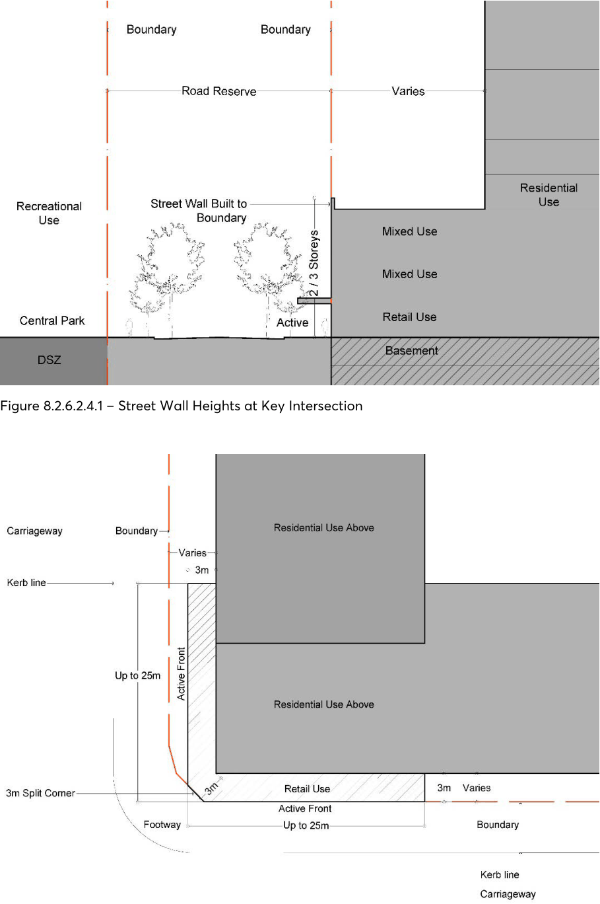
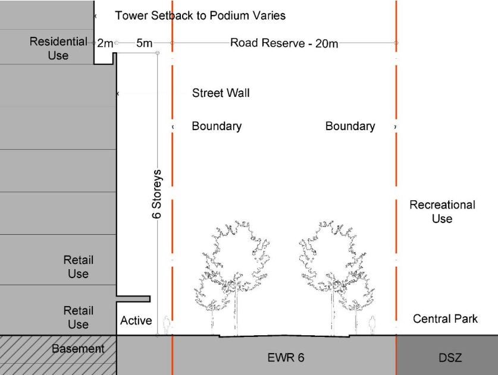
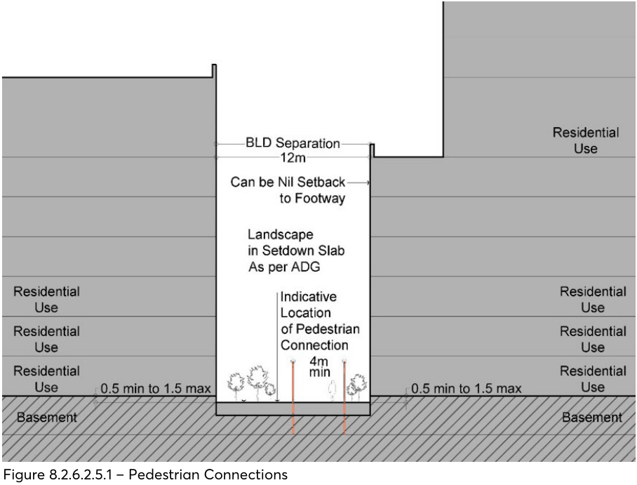
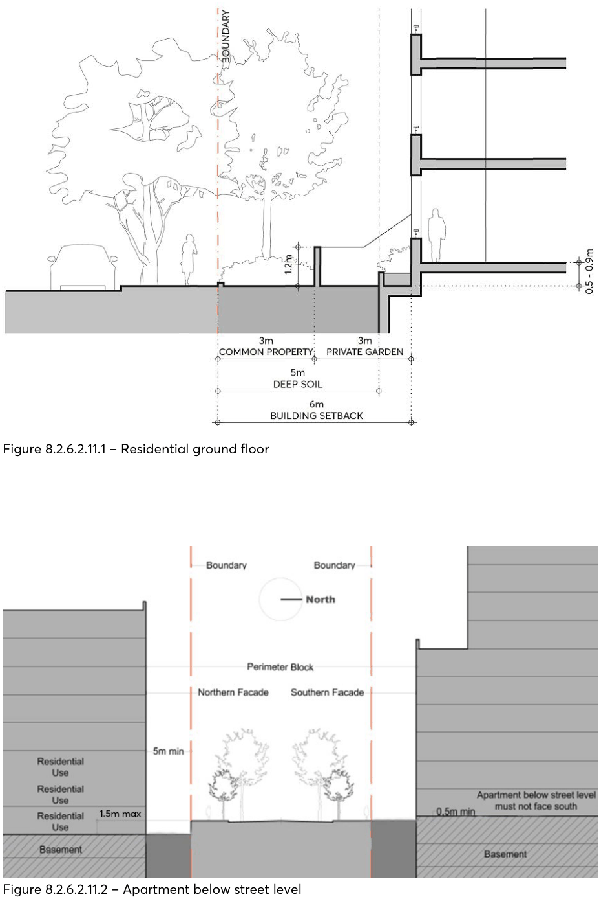
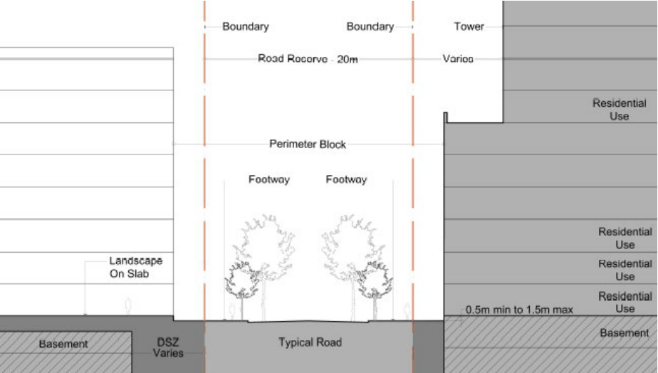

#### 8.2.6.2 BUILT FORM

Objectives

The following principles apply to all development in Melrose Park:

O.01 The floor space is generally consistent with the Gross Floor Area (GFA) as derived from the Floor Space Ratio (FSR).

O.02 The street network and building locations shall be consistent with the Masterplan to be designed to enable deep soil planting, reinforce the human scale of the streets, and enable views to the sky in streets and public places.

O.03 Building depth, bulk, and separation protects amenity, daylight penetration, and privacy between adjoining developments, and minimises the negative impacts of buildings on the amenity of the public domain.

O.04 Buildings should align with the streets so that positive spaces are formed within the streets and the lots.

O.05 Towers are to be appropriately proportioned and maximise their slender form. O.06 The design and materials selection of buildings and the public domain are to contribute to a high quality, durable, and sustainable urban environment.

O.07 Buildings are organised to create spatially defined streets and courtyards that are well proportioned, comfortable, safe, functional, and attractive.

O.08 The collective built form should reinforce the variety evidenced in the topography and the spatial organisation of the streets and open spaces.

O.09 Variety within the precinct is to be derived from the detailed resolution of the buildings and not from excessive differences in the form of the buildings and/or the selection of materials.

#### 8.2.6.2.1 ALLOCATION OF GROSS FLOOR AREA

Objectives

O.01 Regulate the density of development identifying a maximum GFA for lots, resulting from the maximum floor space ratio in the PLEP 2023.

O.02 Ensure development floor plate sizes and building footprints are not excessive.

Controls

C.01 The maximum GFA for any development lot is to be generally consistent with the GFA as shown in Figure 8.2.6.7.2.1 – Maximum Gross Floor Area.

C.02 The GFA attributed to each lot results from the FSR controls in the PLEP 2023 or as otherwise nominated in a Notice of Development Consent granted by a relevant consent authority.

MELROSE PARK URBAN RENEWAL PRECINCT

C.03 The indicative allocation of the total floor space relates to the Masterplan and is based on the capacity of the building envelope on each lot. The GFA is calculated at 75% of the building envelopes and the Gross Building Area (GBA) for residential development.

C.04 The maximum GFA is approximate for each lot and includes all buildings accommodated on a development lot.

C.05 The floor space is to be generally distributed as shown in the setback, building height, and street hierarchy figures. The perimeter-block is to be retained and floor space is not to be redistributed into towers where heights would enable greater height.

C.06 Development applications must submit supporting plans that demonstrate the GFA outcome on the development lot is consistent with PLEP 2023 or as otherwise nominated in a Notice of Development Consent granted by a relevant consent authority.

C.07 Should a maximum GFA not be able to be achieved for a development lot, or where there are minor variations, that amount of GFA may potentially be transferred to another development lot under the same ownership subject to consideration against the relevant provisions in this DCP and maintaining the gross permitted FSR across the development lots.

#### 8.2.6.2.2 STREET, BLOCK, OPEN SPACE, AND BUILDING LAYOUT

Objectives

O.01 Optimise the internal and external connectivity. O.02 Provide views to sky and views that are not blocked by buildings at the ends of streets. O.03 Reveal the topography. O.04 Minimise perceived density. O.05 Define a street hierarchy considering the landform, street widths, and built form. O.06 Enable generous canopy tree planting. O.07 Enable all road users to move safely. O.08 Provide access to parking basements. O.09 Enable streets to be dedicated to Council. O.10 Accommodate passive and active recreational needs of the residents and workers. O.11 Manage overland floodwater as well as local stormwater drainage, water sensitive urban design (WSUD), and ground water.

O.12 Minimise non-permeable surfaces. O.13 Enable buildings to achieve setbacks, solar access, and separation requirements, optimise the amenity of the apartments, define the public domain and minimise perceived density.

MELROSE PARK URBAN RENEWAL PRECINCT

Controls

C.01 The street network, pedestrian connections, block layout, and location of buildings shall be generally consistent with Figure 8.2.6.7.1 – Masterplan, Figure 8.2.6.7.8.1 – Street Hierarchy, and Figure 8.2.6.7.9.1 – Public Domain Plan.

C.02 All streets are to be at ground level and public streets are to be dedicated to Council. C.03 Pedestrian connections that are above basements and privately owned should be publicly accessible 24/7.

#### 8.2.6.2.3 THE BUILDING ENVELOPE

The building envelopes resulting from the setbacks, floor plate, and height constitute a three-dimensional volume within which, together with all other applicable controls, should result in a coherent built form. The envelope heights in the Masterplan are generous and designed to enable a well-considered architectural response rather than ‘filling’ the envelope.

The building envelopes have been located to reinforce view corridors, create a layered spatial network, and minimise perceived density. The taller towers are located strategically with generous separation. The building envelopes are designed to enhance the topography and have been tested for separation distances and overshadowing of public parks.

Objectives

O.01 Provide a coherent spatial and built form structure for the precinct. O.02 Create meaningful variety related to street character and topography. O.03 Define the streets, intersections, and open spaces in plan and in section. O.04 Enable the resolution of quality architecture within the building envelopes. O.05 Optimise the number of units with outlook to open spaces, courtyards, and views. O.06 Minimise overshadowing on open spaces and residential development. O.07 Minimise perceived density. O.08 Provide view corridors within the site and to the surrounding context. O.09 Enable satisfactory resolution of the slope and the water management of the precinct.

Controls

C.01 The building envelopes as defined in Figure 8.2.6.7.1 – Masterplan are to form the basis of the architectural resolution.

C.02 All view corridors as defined by the streets and pedestrian connections in Figure 8.2.6.7.1 – Masterplan are to be retained.

C.03 The floor space is to be distributed as shown in Figure 8.2.6.7.2.1 – Maximum Gross Floor Area.

MELROSE PARK URBAN RENEWAL PRECINCT

C.04 The perimeter block residential buildings up to 6 storeys must extend for the full frontage of lots within the nominated street setbacks and except where there are courtyards of pedestrian connections.

C.05 The maximum length of all residential buildings 10 storeys and above must be no greater than 50 metres.

#### 8.2.6.2.4 STREET SETBACKS

The purpose of establishing street setbacks is to ensure an appropriate interface with the street, ground floor usage, and building separation.

There are two principal categories for the ground floor:

a. The buildings that have a residential ground floor frontage.

b. The buildings that have an active/commercial ground floor frontage.

On lots with residential ground floors, the buildings should be set back from the street alignment allowing an arrangement which balances the need for residential privacy as well as engagement with the street. The setback provides the necessary space for deep soil, and landscaping and amenity, both for residents and the street.

Due to the sloping topography of the precinct, issues of residential amenity may also be addressed by raising the building ground floor levels relative to the site topography where residential uses are located adjacent to a pedestrian connection or public boundary.

On lots that have active frontages and no set back, the ground floor design of the buildings is the part of the development that has most impact on the street and public domain experience as it defines and articulates the street with appropriate scale and detail.

Objectives

O.01 Reinforce the appropriate spatial definition of streets and public spaces. O.02 Emphasise the importance of the street as a distinct spatial entity and design the street interface and street wall with an appropriate human scale and sense of enclosure for the street.

O.03 Ensure consistent street frontages with buildings having common setbacks and alignments. O.04 Provide building forms that achieve comfortable public domain conditions for pedestrians, with adequate daylight, appropriate scale, and adequate mitigation of wind effects on tower buildings.

O.05 Create a clear delineation between public and private space. O.06 Provide a landscape interface between residential buildings and streets, with room for street trees.

O.07 Emphasise the courtyard spaces as a distinct spatial entity and design with an appropriate human scale and sense of enclosure and landscaping.

MELROSE PARK URBAN RENEWAL PRECINCT

O.08 Reinforce important elements of the local context including public spaces, key intersections, public and heritage buildings, and landscape elements.

O.09 Provide space on residential sites for ground level residents to engage appropriately with the street and for landscape that contributes to the public domain.

Controls

C.01 Building setbacks from the streets should comply with those shown in Figure 8.2.6.7.6.1 – Street Setbacks.

C.02 A 400mm articulation zone is permitted forward of the setback, in which building elements such as bay windows, balconies, and shading devices may occupy a maximum of approximately one third of the area of the façade. Services or lift shafts are not permitted in the articulation zone.

C.03 Setbacks should be measured perpendicular to the boundary to the outer faces of the building. Elements in the articulation zone are excluded.

C.04 Above the 4-6 storey component and the Town Centre podium, buildings are to be set back as shown in Section 8.2.2.6.10 – Indicative Application of Building Envelopes.

C.05 The ground floor, first and second floors of the NSR 2 and EWR 4 intersection and the NSR 3 and EWR 4 intersection may extent into the front setback a maximum of 3 metres measured form the front building line. Refer to Figure 8.2.6.2.4.1 – Street Wall Heights at Key Intersection. In plan the decreased street setback can extend for a distance of up to 25 metres along each street. Refer to Figure 8.2.6.2.4.2 – Indicative Corner Activation at Key Intersections, Plan (NSR 2 and EWR 4 Highest Priority and EWR 4 Second Highest Priority).

C.06 All buildings with the decreased setback at the NSR 2 and EWR 4 intersection and the NSR 3 and EWR 4 intersection are to relate to each other and define the space of the intersection up to a height of 3 levels. The corner design is to incorporate a building form such as a splayed setback, orthogonal recess to address the intersection. The levels above the ground floor are to relate to the ground floor resolution.

C.07 Setbacks should be measured perpendicular to the boundary to the outer faces of the building. Refer to Figure 8.2.6.2.4.3 – Street Wall Height in Town Centre. Elements (such as awnings and signage) in the articulation zone are excluded.

MELROSE PARK URBAN RENEWAL PRECINCT

> [Picture on page 237: a picture, saved as a picture (images/part-08-centres-precincts-special-character-areas-specific-page-237-2.gif, 150 dpi).]

Figure 8.2.6.2.4.1 – Street Wall Heights at Key Intersection

Figure 8.2.6.2.4.2 – Indicative Corner Activation at Key Intersections, Plan (NSR 2 and EWR 4 Highest Priority and NSR 3 and EWR 4 Second Highest Priority)

MELROSE PARK URBAN RENEWAL PRECINCT

> [Picture on page 238: a picture, saved as a picture (images/part-08-centres-precincts-special-character-areas-specific-page-238-2.gif, 150 dpi).]

Figure 8.2.6.2.4.3 – Street Wall Height in Town Centre

#### 8.2.6.2.5 BUILDING SEPARATION

Building separation for residential buildings is based on the proportions of the pedestrian connections, courtyards and streets, and overshadowing. Issues of privacy and surveillance are to be resolved in the architectural resolution.

Objectives

O.01 Protect and manage the impact of development on the public domain and neighbouring sites. O.02 Protect the amenity of streets and public places by providing a healthy environment for street trees and allowing adequate daylight and views to the sky.

O.03 Ensure a pattern of built form and spatial definition that contributes to the character of the suburb.

O.04 Provide access to light, air, and outlook for the occupants of buildings, neighbouring properties, and future buildings.

Controls

C.01 The separation distances of buildings across courtyards are 24 metres minimum building to building and is to be appropriately landscaped.

MELROSE PARK URBAN RENEWAL PRECINCT

C.02 The separation distances of buildings across any pedestrian connections shall be 12 metres building to building. Within this space, a straight pedestrian path of a minimum 4 metres in width is to be located. Private gardens and entrances to apartments are permitted from these pedestrian paths. Refer to Figure 8.2.6.2.5.1 – Pedestrian Connections.

C.03 Issues of visual and noise privacy are to be addressed in the design of the buildings. C.04 Separation distances should be measured perpendicular to the boundary to the outer faces of the building. Elements in the articulation zone are excluded.

> [Picture on page 239: a picture, saved as a picture (images/part-08-centres-precincts-special-character-areas-specific-page-239-9.gif, 150 dpi).]

Figure 8.2.6.2.5.1 – Pedestrian Connections

MELROSE PARK URBAN RENEWAL PRECINCT

#### 8.2.6.2.6 TOWER DESIGN AND SLENDERNESS

The slenderness of towers is important both to achieve elegance of form as well as to minimise the perceived density and maximise amenity and environmental performance. Plan area, plan proportion, alignment, and height are contributing factors in the perception of slenderness. Their design needs to respond to context, climate, and views, and to provide a continuity of built form but with subtle differences.

The silhouettes of many buildings are significant and contribute to the identity of the place and its skyline. The massing and arrangement of the skyline and building silhouettes should be carefully considered and proposed development should be designed so that its appearance complements the broader skyline.

Objectives

O.01 Towers have slender proportions. O.02 Towers are well-proportioned, reflect their orientation and address the public domain. O.03 Minimise the potential adverse effects that buildings may have on the public domain. O.04 Achieve living and working environments with good internal amenity. O.05 Minimise the need for artificial heating, cooling, and lighting.

Controls

C.01 The maximum floorplate for a residential tower over 8 storeys should be 1,000m2 (the floorplate shall be measured to the outside face of the building inclusive of balconies, vertical and horizontal circulation, internal voids, and external walls).

C.02 The maximum length of the part of a building above 8 storeys should be 50m. In Melrose Park South the tower component height should be approximately double the height of the podium component (e.g. an 18-storey building where 12-storey minimum tower sits on 6-storey maximum podium).

C.03 No tower forms should be ‘L’ shaped in plan. C.04 Upper levels of towers should not extend over the lower levels and create under-croft spaces. C.05 The higher building forms are to be integrated with the lower levels and should define positive spaces for streets, open spaces, and courtyards.

C.06 Towers should meet sustainability measures. C.07 Tower design should respond to context, climate, and views.

MELROSE PARK URBAN RENEWAL PRECINCT

#### 8.2.6.2.7 BUILDING HEIGHTS

Objectives

O.01 Recognise the variation of podium heights in perimeter-block buildings that respond to topographical features.

O.02 Minimise adverse wind, reflectivity, glare, and urban heat impacts. O.03 Minimise solar impacts to streets, open spaces, and neighbouring buildings. O.04 Form a balanced composition of built form when viewed from within the street, neighbouring areas, and the river.

Controls

C.01 The number of storeys must be consistent with the number of storeys shown in the number of storeys in Figure 8.2.6.7.4.1 – Building Storeys.

C.02 The perimeter-block residential buildings are to be 8 storeys maximum.

#### 8.2.6.2.8 FLOOR TO FLOOR HEIGHTS

Objectives

O.01 Provide adequate amenity for buildings. O.02 Ensure that floor heights support a range of uses and enable a change of use over time.

Controls

C.01 Minimum floor to floor heights shall be provided in accordance with Table 8.2.6.2.8.1 – Minimum floor to floor heights. Table 8.2.6.2.8.1 – Minimum floor to floor heights

| Use | Minimum Floor to Floor Height |
|---|---|
| Commercial | 3.6m |
| Residential floor to floor heights from level 1 and above. Floor to ceiling heights greater than the minimum 2.7 metres are encouraged. | 3.1m |
| Ground floor active street frontage | 4.5m |
| Residential floor to floor heights for ground floor | 3.6m |
| Residential floor to floor heights for ground and first floor | 7.6m |

MELROSE PARK URBAN RENEWAL PRECINCT

#### 8.2.6.2.9 THE PERIMETER BLOCK BUILDINGS AND PODIUM

Together with the public domain, the perimeter-block residential building frontages and the retail podium are the built elements that shape the way most of Melrose Park is experienced.

As the primary means of providing definition and spatial enclosure to the streets and other public spaces, they are the principal architectural component of collective civic intent. That is, they should operate in concert with other buildings to form a satisfyingly rich experience for the public spaces of the town, and its modulation, articulation and character should be guided by this understanding of its role. The design of the lower parts of the building should be derived from the attributes that generate successful streets – human scale, expressed detail, and tactile material quality.

The lower levels of all buildings should complement each other. The buildings that are lower in height act as a mitigating element for the tower building, able to define the street at the appropriate height, and protect the street from the wind effects of the tower. The perimeter buildings and podiums are set to address the street setbacks, building separation, and the proportions of the street and overshadowing.

Erosions of the lower levels of towers and the podium in the form of undercrofts are not appropriate.

For U-shaped buildings where the courtyards are located with the ends of the U to the street, the landscaping in the courtyard is to relate to the street interface but allow for a reading of the built form and open space from the street.

Objectives

O.01 Define the space of the street, pedestrian connections, parks, and courtyards by articulating their edges with perimeter-block buildings and podiums.

O.02 Create visual interest and variety in the streetscape within an overall framework of consistency in the definition of the street and its character.

O.03 Reveal the topography and provide rhythm. O.04 Provide a façade design that enhances the walking experience. O.05 Optimise active frontages in the Town Centre and at key intersections.

Controls

C.01 The perimeter-block buildings and the podiums should:

a) Be built to align with the street along their full frontage as generally shown on the Masterplan. Minor recesses in the profile for modulation and articulation, and to accommodate building entrances are permissible.

b) Be modulated in vertical increments to provide rhythm to the street.

c) Be articulated horizontally to reveal the topography.

d) Be articulated horizontally to address any negative impacts of wind from the taller buildings.

MELROSE PARK URBAN RENEWAL PRECINCT

e) Be of predominantly masonry character with no lightweight panel construction or curtain walling.

f) Be articulated with depth, relief, and shadow on the street façade. A minimum relief of 150mm between the masonry finish and glazing face should be achieved.

g) Utilise legible architectural elements and spatial types – doors, windows, loggias, reveals, pilasters, sills, plinths, frame, and infill, etc. – not necessarily expressed in a literal traditional manner. Horizontal plinths are particularly encouraged in Melrose Park so that the topography is emphasised.

C.02 Under-crofts or other interruptions of the street wall that expose the underside of towers and amplify their presence on the street are not encouraged.

C.03 All Development Applications should include a streetscape analysis and provide details of the street wall and perimeter-block. Submissions should include:

a) The street wall elevation at 1:200 scale in context showing existing buildings on the block.

b) A detailed street wall elevation at 1:100 scale including immediately adjacent buildings accurately drawn.

c) Sections through the street wall and awning at 1:50 scale including the public domain.

d) Detailed façade plans/sections at 1:20 scale including ground floor active frontage and awning details.

C.04 Above ground car parking is only permitted for 3 levels in the Town Centre. It is to be sleeved by other uses on the East/West frontages EWR 6 and Hope Street. On the North/South frontages, it is to be screened.

#### 8.2.6.2.10 RETAIL GROUND FLOOR FRONTAGE

Objectives

O.01 Enable retail uses at key locations. O.02 Ensure retail frontages have comfort and shelter for pedestrians. O.03 Provide visual interest. O.04 Enable retail uses along the streets in the Town Centre and at key intersections.

Controls

C.01 Ground floor commercial uses should be located to activate the public domain. C.02 Service frontages should be minimised. C.03 The internal tenancy widths, foyers, and lobbies should create a fine grain frontage. C.04 Ground floor commercial uses should include:

MELROSE PARK URBAN RENEWAL PRECINCT

a) A nominal 500mm interface zone at the frontage should be set aside to create interest and variety in the streetscape, to be used for setbacks for entries, opening of windows, seating ledges, benches, and general articulation.

b) A masonry façade that allows for fine grain tenancy widths.

c) A high level of expressed detail and tactile material quality.

d) A well resolved meeting with the ground that takes account of any slope.

e) A horizontal plinth, at the base of glazing to the footpath.

f) A clear path of travel for disability access.

g) Legible entrances.

h) Awnings in accordance with Section 8.2.6.3.5 – AWNINGS & AWNING DESIGN.

C.05 An appropriate freeboard at ground floor level is to be provided, where required. C.06 Fire escapes and service doors should be designed to complement the commercial frontage and be seamlessly incorporated into the façade with quality materials.

C.07 Colonnades are not encouraged. C.08 All required major services should be incorporated in the design of the ground floor frontage at Development Application stage, refer to Section 8.2.6.2.21 – Servicing and Utilities.

C.09 Security doors or grilles should be designed to be fitted internally behind the shopfront, fully retractable and a minimum 50% transparent when closed.

#### 8.2.6.2.11 RESIDENTIAL GROUND FLOOR FRONTAGE

Residential buildings should be set back from the street boundary or set at a different level to the street/pedestrian connections to provide amenity for ground floor residents. Setbacks are to enable a landscaped setting for buildings.

The area between the façade and the street boundary should receive attention both in design and in its material quality. The subtleties involved in the design of ground level entries, private terraces or balconies, fences, walls, level changes, and planting play an important part in the articulation of the street.

A detailed resolution of these elements is essential in contributing to an unambiguous definition of public space, good street form, pedestrian scale, clarity of access and address, and a balance of privacy and passive surveillance. These details should all be designed with the same level of care given to the building.

Objectives

O.01 Deliver a ground floor that achieves amenity and privacy for residents as well as engagement with and passive surveillance of the street and other public places.

O.02 Enable a landscape setting where buildings are set back from the public domain.

MELROSE PARK URBAN RENEWAL PRECINCT

O.03 Provide appropriate amenity for all residential apartments, including:

a) Apartments that are located below street level.

b) Apartments that have no setback to the public domain.

O.04 Locate the disability access so that it relates seamlessly to the building design. O.05 Minimise the impact of basements.

Controls

C.01 Basements are to be located under the footprints of the buildings. They can extend under courtyards but not into the street setbacks, refer to Figure 8.2.6.2.11.2 – Apartment below street level.

C.02 Generally, ground floor apartment levels should be a minimum of 500mm and maximum of 1500mm above the adjacent footpath level except where the buildings front the pedestrian connections or additional height above the ground is required for privacy and/or to address the slope. Refer to Figure 8.2.6.2.11.1 – Residential ground floor.

C.03 Where apartment have individual entries from the street, a front door with a distinct entry space within the apartment should be provided. Individual apartment entries should be understated, with post boxes and street numbers located at the common entry. Individual entries are permitted from the pedestrian connections.

C.04 Unless easy ramp access can be provided without compromising the entrance to the building or the ground floor apartments, disability access should be provided as per AS 1428.

C.05 Apartments cannot be located below the street level except in the following situations at Council’s discretion (refer to Figure 8.2.6.2.11.1 – Residential ground floor):

a) Where the adjacent public road or public land is not an overland flow flood path as shown in approved flood maps included in the Water Management Strategy, or in any other flood study approved by Council.

b) Where the proposed apartment will not be subject to flooding in a 1%AEP flood plus 500mm freeboard as identified by Council.

c) Where the orientation is not south.

d) Where the distance of the apartment front wall is a minimum of 5 metres from the street boundary.

e) Where the finished floor level of the lowest apartment is not more than 1500mm below the level of the adjacent street.

C.06 The head height of the windows is not to be more than 300mm from the underside of the slab above.

C.07 The ground floor design is to:

a) Address privacy and articulation (refer to Figure 8.2.6.2.5.1 – Pedestrian Connections) for an example)

b) Provide a sense of address and passive surveillance along the edge of the development.

MELROSE PARK URBAN RENEWAL PRECINCT

C.08 The setback area should be designed to relate to the footpath and as common property for landscaping.

C.09 Canopy trees can be provided within setbacks that are 5 metres or greater, contributing to the landscape character of the street and residential amenity. Canopy trees should be planted in this area, a minimum 3.5 metres from any structure. Trees are to achieve greater than 13 metres mature height and spread, at the rate of 1 canopy tree for every 15 lineal metres of frontage.

C.10 Establish lower scale planting including hedges at street boundary for a minimum of 1 metre in street setback zone.

C.11 Establish canopy planting in courtyards to achieve amenity and privacy for residents as well as contributing to the street.

C.12 Co-locate the deep soil planting with the courtyard planting where the courtyards face the street setback.

C.13 Minimise impervious surfaces at ground level in the setback areas. C.14 All required major services should be incorporated in the design of the ground floor frontage at Development Application stage, refer to Section 8.2.6.2.21 – Servicing and Utilities.

C.15 A fully illustrated and coordinated ground floor design, showing all the necessary levels and detail, should accompany applications. Drawings should include the following:

a) A detail ground level plan and sections as part of the architectural submission that illustrates the relationships between the interior and the exterior spaces of the setback area, including the landscape and hydraulic detail, and extends into the public domain.

b) Any required services should be discreetly integrated into the frontage design.

c) The architectural drawings should be fully coordinated with the landscape and hydraulic drawings.

d) Elevations and sections at minimum 1:50 scale of all built elements in the setback area should be provided.

MELROSE PARK URBAN RENEWAL PRECINCT

> [Picture on page 247: a picture, saved as a picture (images/part-08-centres-precincts-special-character-areas-specific-page-247-2.gif, 150 dpi).]

Figure 8.2.6.2.11.1 – Residential ground floor

Figure 8.2.6.2.11.2 – Apartment below street level

MELROSE PARK URBAN RENEWAL PRECINCT

#### 8.2.6.2.12 RESIDENTIAL APARTMENT DESIGN QUALITY

Objectives

O.01 Ensure development achieves good amenity standards for residents.

Controls

C.01 Upper levels of buildings should not extend over the lower levels. C.02 Building floor plates and sections should define positive spaces for streets, open spaces, and courtyards.

C.03 Building indentations providing light and ventilation to apartments should have a minimum width to depth ratio of 2:1.

C.04 High-level windows should not be used as the primary source of light and ventilation for habitable rooms.

C.05 Where practicable, balconies should be rectangular in shape with the longer side parallel to the façade of the building.

C.06 Divisions between apartment balconies should be of solid construction and extend from floor to ceiling.

C.07 Common open space should include a unisex WC, seating, solid sun shading, and a BBQ and food preparation area with a sink.

C.08 Balustrades should take account of sightlines to balance the need for privacy within apartments and views out of apartments. A proportion of solid or translucent material should be used, which will vary according to outlook and height relationships.

C.09 The following details should be resolved in principle and shown on drawings at Development Application stage so as not to compromise amenity, built form, and aesthetics at a later stage:

a) HVAC equipment should be grouped within designated plant areas either on typical floors or on rooftops. If HVAC equipment is located on rooftops of lower buildings, it is to be screened as necessary to minimise impacts of heat buildup and noise to neighbouring units.

b) Wall mounted equipment (and associated pipework) should be concealed into wall cabinets and ducts.

c) The above items should be positioned so that they are not visible from common areas or the public domain adjacent to the development.

d) If equipment is located on private balconies, additional area above Apartment Design Guide (ADG) minimums should be provided.

e) Rainwater downpipes should be integrated into the building fabric and coordinated with stormwater drawings.

C.10 Apartment design should consider incorporating suitable spaces that can be utilised as a work from home space.

MELROSE PARK URBAN RENEWAL PRECINCT

#### 8.2.6.2.13 SOLAR ACCESS (RESIDENTIAL)

Objectives

O.01 Development should be designed to maximise the solar access of neighbouring properties.

Control

C.01 Where residential development cannot strictly comply with the design criteria of the ADG, it should demonstrate how solar access is maximized to the living rooms and private open space of neighbouring properties taking account the site constraints and orientation of the site.

#### 8.2.6.2.14 WINTERGARDENS

Objectives

O.01 Improve amenity of balconies in high-rise apartments above 8 storeys and apartments fronting noisy environments.

O.02 Provide acoustic attenuation for internal living areas. O.03 Improve thermal environment. O.04 Balance ventilation and wind impacts in high-rise apartment balconies. O.05 Maximise daylight access, views, and comfort of balconies.

Controls

C.01 Wintergardens are only permitted above 8 storeys or where there are negative external impacts such as high levels of noise.

C.02 Wintergardens should:

a) Be designed and constructed as a private external balcony with drainage, natural ventilation, and finishes acceptable to an outdoor space and should not be treated as a conditioned space or weatherproof space.

b) Have 75% of the external walls (excluding balustrade) fully operable louvres or sliding glass panels. Casement or awning windows are not permitted.

C.03 All wintergardens are to have a balustrade less than 1.4m above finished floor level and a contiguous and permanently openable area between the balustrade and the ceiling level of not less than 25% of this area. This restriction shall apply to all elevations if the wintergarden has multiple elevations.

C.04 A generous opening should be provided between the wintergarden and any adjacent living area to allow connection of the spaces when ambient conditions are suitable.

C.05 Acoustic control for living areas and bedrooms should be provided on the internal façade line between the wintergarden and the living area or bedroom.

MELROSE PARK URBAN RENEWAL PRECINCT

C.06 Glazing in the external façades of a wintergarden should have a solar absorption of less than 10% glass so as not to have solar heat absorption greater than what a clear float glass might be of the same composition.

C.07 The flooring of the wintergarden should be an impervious finish and provide exposed thermal mass.

C.08 Air conditioning units should not be located on wintergarden balconies. C.09 Wintergarden areas able to be excluded from Gross Floor Area should be limited to a depth of 3 metres.

#### 8.2.6.2.15 CLIMATE CONTROL AND PRIVACY

The precinct of Melrose Park experiences high temperatures and will be subject to urban heat impacts resulting from the density of buildings. Most towers and many of the perimeter-block buildings have east and west facing façades so it is essential that climate control measures are included on the façades.

Climate control devices should also be used to assist in protecting both visual and acoustic privacy.

Objectives

Climate control devices are to:

O.01 Enhance the:

a) Amenity of the balcony and interior spaces.

b) Design of the building façades.

O.02 Provide:

a) Individual apartment owners with the ability to moderate external impacts from climate, noise, and overlooking.

b) Commercial tenants with the ability to moderate external impacts from climate, noise, and overlooking.

O.03 Ensure that the design of climate control devices can:

a) Provide optimum control.

b) Be easily cleaned.

c) Assist in providing both visual and acoustic privacy.

Controls

C.01 Climate control devices such as louvres or blinds should:

a) Have the ability to act as visual, wind and noise privacy screens.

b) Be used on balconies.

MELROSE PARK URBAN RENEWAL PRECINCT

c) Be used where apartment façades are subject to solar loads and there are no other mechanisms that assist in climate moderation, such as green walls.

d) Be designed as an integral part of the building façade.

e) Have the capacity to be adjusted to suit sun access angles and allow the passage of air.

f) Be constructed in materials that meet the sustainability objectives.

g) Be able to be cleaned from within the individual apartment boundary.

#### 8.2.6.2.16 DWELLING MIX AND FLEXIBLE HOUSING

Objectives

O.01 Ensure a range of dwelling types and size. O.02 Promote the design of buildings that are adaptable and incorporate flexible apartments to suit the changing lifecycle housing needs of residents over time.

Controls

C.01 The dwelling mix identified in Table 8.2.6.2.16.1 – Dwelling Mix is to be used as a guide for the apartments in Melrose Park: Table 8.2.6.2.16.1 – Dwelling Mix

| Dwelling Type | Dwelling Mix |
|---|---|
| 1 Bedroom 2 Bedroom 3 Bedrooms | 10 – 20% of total dwellings 60 – 75% of total dwellings 10 – 20% of total dwellings |

C.02 A maximum 25% of the total apartments can be split into a pair of dual key apartments (which are considered to be one apartment for the purpose of dwelling mix). In all combinations the size and amenity of each dual key apartment should be consistent with the ADG.

C.03 Dual key apartments are to be under one strata title. C.04 Consider the provision of apartment designs in sole occupancy units that are fully serviced but that have internal moveable walls, subject to compliance with the Building Code of Australia (BCA).

MELROSE PARK URBAN RENEWAL PRECINCT

#### 8.2.6.2.17 MATERIALS

Melrose Park proposes very high densities with towers and perimeter-block buildings in close proximity. To achieve both variety and continuity the perimeter-block buildings and towers, require consistency in both form and the selection of materials so there is an overall continuity of built form throughout the precinct.

Objectives

O.01 Ensure that materials contribute to the coherence of the precinct so that one building does not stand out from another. Variety within the precinct is derived from the detail resolution of the buildings and not from excessive differences in the selection of materials.

O.02 Use materials that meet sustainability objectives and requirements. O.03 Select a palette of materials for the buildings that enable a complementary response with the finishes in public domain.

O.04 Employ materials that are durable, of an appropriate scale, and easily maintained.

Controls

C.01 A selected palette of materials for buildings, fencing, and retaining walls are to be agreed in consultation with Council.

C.02 Materials should:

a) Ensure that one building does not stand out one from another building.

b) Meet sustainability requirements of embodied energy.

c) Be durable, of an appropriate scale, and easily maintained.

d) Complement the materials in the public domain.

#### 8.2.6.2.18 RETAINING WALLS

Melrose Park is located on sloping terrain. The retaining walls may occur adjacent to the street boundary of a lot or within the lot depending on the topographical conditions and/or the specific lot design. Because of their highly visible location adjacent to streets and pedestrian connections, the design of retaining walls should provide continuity across the precinct and a sensitive interface with the public domain.

Objectives

The retaining walls are to: O.01 Provide continuity across the precinct. O.02 Be an integral element in the design character of the precinct.

MELROSE PARK URBAN RENEWAL PRECINCT

O.03 Employ construction details and materials that are durable and appropriate for the public domain interface.

O.04 Provide opportunities for casual seating.

Controls

C.01 Retaining walls should:

a) Be located within the lot boundaries on all development lots.

b) Use a design and profile to meet Public Domain Guidelines in consultation with Council.

c) Select a limited palette of durable materials in consultation with Council.

d) Enable casual seating where appropriate.

e) Have horizontal tops and minimal stepping.

#### 8.2.6.2.19 FENCING

Objectives

O.01 Relate to the scale and materiality of the buildings. O.02 Define the public/private edge. O.03 Provide privacy and visibility. O.04 Be durable. O.05 Relate to and reveal the slope of the land.

Controls

C.01 Fencing is to:

a) Be located at the street boundary or to private terraces on ground floor units.

b) Provide a combination of solidity and porosity.

c) Reveal the slope by introducing a horizontal element such as a masonry plinth.

d) Be of an appropriate height and detail that reflects the scale of buildings.

e) Define the public edge to the property and reinforce the edge to the public domain.

f) Provide continuity with subtle differences across the precinct.

g) Use construction details and materials that are durable and appropriate for the public domain interface.

C.02 Fencing to private terraces where ground floor units extend into the street setback are to be designed to relate to any fencing on the property boundary.

C.03 The height of fences can vary but be no greater than 2 metres.

MELROSE PARK URBAN RENEWAL PRECINCT

#### 8.2.6.2.20 COURTYARDS

Courtyards provide communal open space for residents at ground level associated with deep soil supporting large crown canopy trees. Courtyards provide alternative, secondary entry points to the building linked to the pedestrian connections and public domain. Courtyards provide visual extension to the public domain. Courtyards provide relief to the overall physical and visual bulk of the built form and perceived density.

Objectives

O.01 Reinforce the built form and open space structure of the precinct. O.02 Expand and enhance the public domain. O.03 Provide outlook from the apartments. O.04 Provide a communal space for relaxation and communal activities. O.05 Provide passive surveillance opportunities in public areas. O.06 Have generous planting. O.07 Assist with reducing urban heat. O.08 Assist with flood management. O.09 Provide visual separation between buildings.

Controls

C.01 Courtyards are to be located as shown in Figure 8.2.6.7.3.1 – Courtyard Locations and have a minimum width (east – west) of 24 metres.

C.02 Courtyards should:

a) Be visually and physically linked with streets, open spaces, and pedestrian connections.

b) Be usable outdoor spaces that provide good amenity, having regard to aspect and configuration.

c) Include vegetation and canopy planting.

d) Generally, be the same level as the street to facilitate access and integration with the public domain. Where they are not level, access stairs and ramps are to be located on the private lot.

C.03 Courtyard levels are to be designed to appropriately address flood risk management. C.04 Where courtyards are located over basements, canopy planting is to be set down in the slab. C.05 Courtyards are to be designed to respond to the street interface (Refer to Figure 8.2.6.2.20.1 – Courtyard Basement – Interface with Street).

MELROSE PARK URBAN RENEWAL PRECINCT

> [Picture on page 255: a picture, saved as a picture (images/part-08-centres-precincts-special-character-areas-specific-page-255-2.gif, 150 dpi).]

Figure: 8.2.6.2.20.1 – Courtyard Basement – Interface with Street

#### 8.2.6.2.21 SERVICING AND UTILITIES

The location of utilities and services can adversely affect the ground floor street frontage if not properly taken account of in the initial design stage. It is also essential that building services are located and designed to be free from flooding impacts.

Objectives

O.01 Minimise the extent of space and blank walls occupied by services, including electricity substations, fire boosters, fire doors, plant, and equipment hatches.

O.02 Locate building services so that they are free from flooding impacts. O.03 Encourage design and location solutions for services and utilities that minimise adverse visual, environmental, and access impacts.

O.04 Organise garbage collection and recycling facilities to have minimum impact on the development and public domain.

Controls

C.01 Wherever possible, services and utilities should be located on secondary street frontages, or non-active street frontages.

C.02 Substations are to be designed within the building. C.03 Services and utilities should be designed and located to minimise the length of ground floor frontage occupied.

MELROSE PARK URBAN RENEWAL PRECINCT

#### 8.2.6.2.22 TOWN CENTRE MALL INTERFACE

Objectives

O.01 Link the external spatial network with the internal spatial network in the Town Centre. O.02 Improve connectivity. O.03 Encourage walkability. O.04 Maintain the number of safe routes of travel throughout Melrose Park North as shown in the Masterplan.

Controls

C.01 Provide direct access and sight lines from the 6 metre north/south pedestrian path from the EWR2 to the Parramatta River through the Town Centre.

C.02 Define the access internally to reflect the external space. C.03 Allow for pedestrian access to Hope Street during the hours of operation of the Light Rail through the Town Centre.

C.04 Provide an east/west connection through the Detention Basin open space to the Mall. This is to be located to relate to any proposed entrances on the western site of the Mall or if entrances are not proposed to connect to the corner of EWR5 and NSR2. This connection is to ultimately connect to Hughes Avenue.
