#### 8.2.6.3 PUBLIC DOMAIN

Public spaces – streets, squares, and parks – are the most enduring spaces of the city, the shared social and cultural domain that make up the organising framework of the city. Their clarity, quality, and amenity contribute in a fundamental way to the experience and identity of Melrose Park.

This section details aspects of the design of the public domain and should be read in conjunction with the Melrose Park Public Domain Guidelines These set out the process, design guidelines, and submission requirements for all new public domain assets in the City of Parramatta Local Government Area.

Street tree location shown in the public domain cross sections, Figures 8.2.6.3.1.1 to 8.2.6.3.1.9 are indicative. For final street tree arrangements refer to Figure 8.2.6.7.9.1 – Public Domain Plan – Melrose Park South, Figure 8.2.6.7.9.2 – Public Domain Plan – Melrose Park North, and the Melrose Park Public Domain Guidelines.

MELROSE PARK URBAN RENEWAL PRECINCT

#### 8.2.6.3.1 STREET NETWORK AND FOOTPATHS

The streets and footways in Melrose Park are accessible to the public. The elements in the street such as footpaths and paving widths, parking lanes, tree planting, and cycleways should be designed to suit the street network.

Objectives

O.01 Provide a safe, efficient, and generous network of pedestrian, bicycle, and vehicular movements for a precinct of this density.

Controls

C.01 The streets network, hierarchies, and widths are to be laid out as per Figures 8.2.6.7.1.1 – Masterplan and 8.2.6.7.8.1 – Street Hierarchy.

C.02 Streets, footways, and footpath layout and widths vary for each street type and should be laid out as per the street cross sections in this section, and Figure 8.2.6.7.9.1 – Public Domain Plan – Melrose Park South, and Figure 8.2.6.7.9.2 – Public Domain Plan – Melrose Park North.

C.03 Materials for the footpath shall be as per the Melrose Park Public Domain Guidelines. C.04 Street trees are to be planted as per Figure 8.2.6.7.9.1 – Public Domain Plan – Melrose Park South, Figure 8.2.6.7.9.2 – Public Domain Plan – Melrose Park North and Melrose Park Public Domain Guidelines.

C.05 Street trees are to be planted in the parking lanes and the footway as per the Public Domain Plans. The spacing of trees in the parking lanes should aim to achieve a closed tree canopy at tree maturity – selected tree species as per Melrose Park Public Domain Guidelines.

C.06 Street tree planting is to use best practice water sensitive urban design (WSUD) measures that provide best long-term sustainability to support that tree. The planter pit length should be no less than the minimum car parking bay width, preferably larger, and the soil profile will be as per the Melrose Park Public Domain Guidelines and should be detailed prior to Development Application approvals to the satisfaction of Council.

C.07 All cycleways and bike paths are to be provided and designed in accordance with Council’s Bike Plan.

Melrose Park Street Type Cross-Sections

Table 8.2.6.3.1.1 – Legend for all Street Cross Sections

| F | Footpath | L | Landscape |
|---|---|---|---|
| V | Vehicular Lane | LR | Parramatta Light Rail 2 |
| B | Bike Path | B/V, BL | Lane Able to Accommodate Buses |
| P | Parking | SHP | Shared Path |

Note:

MELROSE PARK URBAN RENEWAL PRECINCT

i) Level changes to be managed within the building footprint.

ii) Light poles are indicative and for locations only. Lighting is subject to specialist design. Light pole and type to be confirmed.

iii) All street cross-sections noted below should be read in conjunction with Figure 8.2.6.7.8.1 – Street Hierarchy.

TYPE 1A – MAJOR ROAD – TWO WAY (NSR 2 – TYPICAL)

• 25m-wide road corridor as typical.

• 3.2m lanes.

• 2.6m for parking both sites.

• 3.5m wide footpaths both sides.

• Trees in parking Lanes.

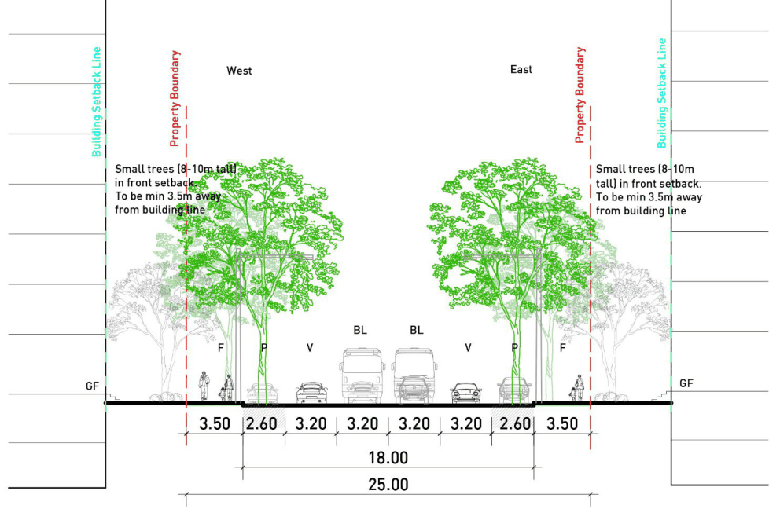

> [Picture on page 258: a picture, saved as a picture (images/part-08-centres-precincts-special-character-areas-specific-page-258-13.gif, 150 dpi).]

Figure 8.2.6.3.1.1 – Type 1A Major Road Building to Building (NSR 2)

MELROSE PARK URBAN RENEWAL PRECINCT

TYPE 1B – MAJOR ROAD – TWO WAY (NSR 2 – BETWEEN EWR 4 & EWR 6)

• 22m-wide road corridor.

• 2.5m lanes.

• 2.6m for parking both sides.

• Minimum 2.4m wide footpaths both sides.

• Trees in footpath and/or verge.

• WSUD details to be applied.

• Trees in deep soil in the 5m front setbacks.

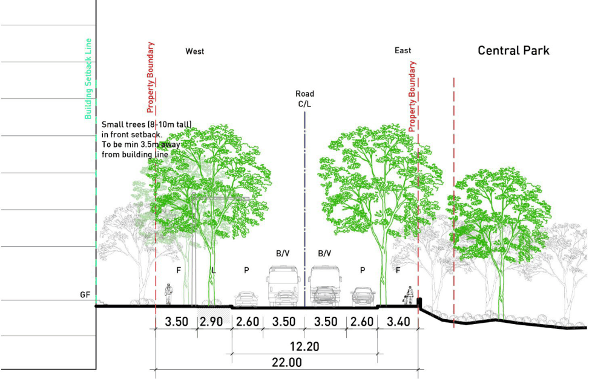

> [Picture on page 259: a picture, saved as a picture (images/part-08-centres-precincts-special-character-areas-specific-page-259-10.gif, 150 dpi).]

Figure 8.2.6.3.1.2 – Type 1B Major Road Central Park Interface (NSR 2 between EWR 4 and EWR 6)

MELROSE PARK URBAN RENEWAL PRECINCT

TYPE 1C – MAJOR ROAD (NSR 2 – TOWN CENTRE AND WESTERN PARK INTERFACE)

• 25m-wide road corridor.

• 3.2m lanes.

• 2.6m for parking both sides.

• Minimum 3.5m wide footpaths both sides.

• Trees in footpath and/or verge.

• WSUD details to be applied.

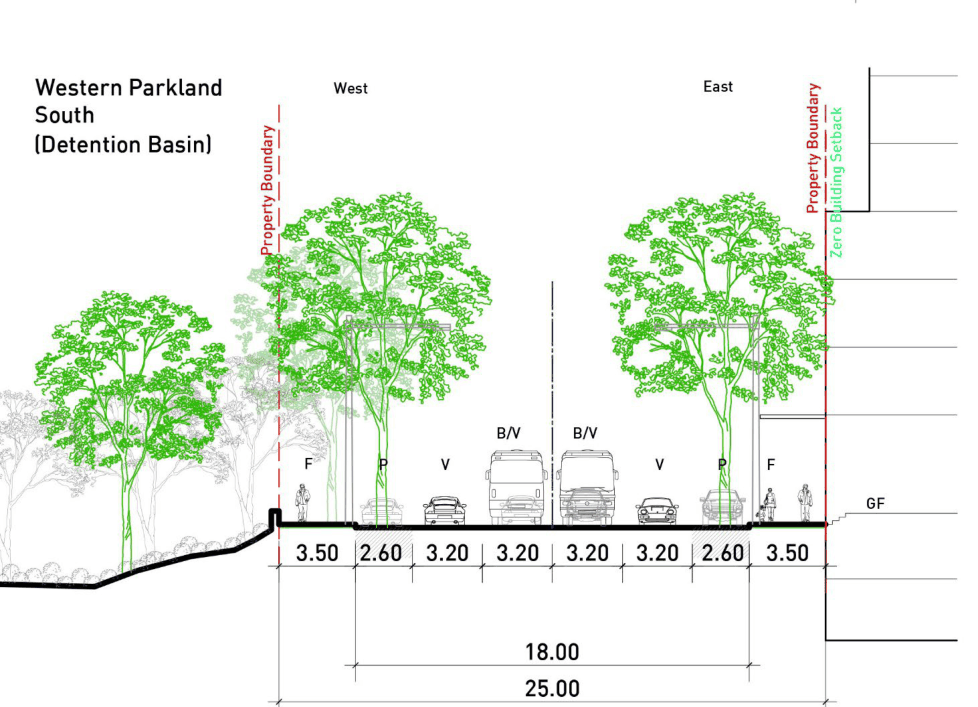

> [Picture on page 260: a picture, saved as a picture (images/part-08-centres-precincts-special-character-areas-specific-page-260-9.gif, 150 dpi).]

Figure 8.2.6.3.1.3 – Type 1C Major Road Town Centre and Western Park Interface (NSR 2)

MELROSE PARK URBAN RENEWAL PRECINCT

TYPE 2A – MAIN ROAD – TWO WAY WITH CYCLE TRACKS (NSR 3 – TYPICAL)

• 23.5m-wide road corridor.

• 3.2m lanes.

• 2.3m parking both sides.

• 1.8m wide footpaths both sides.

• One-way paired, separated bicycle paths: 1.5m wide with an additional 1m buffer with parking lane, on both sides (2.5m corridor each side).

• Trees in parking lanes.

• WSUD details to be applied.

• Trees in open planted beds between the footpath and cycle track.

• Trees in 5m front setback.

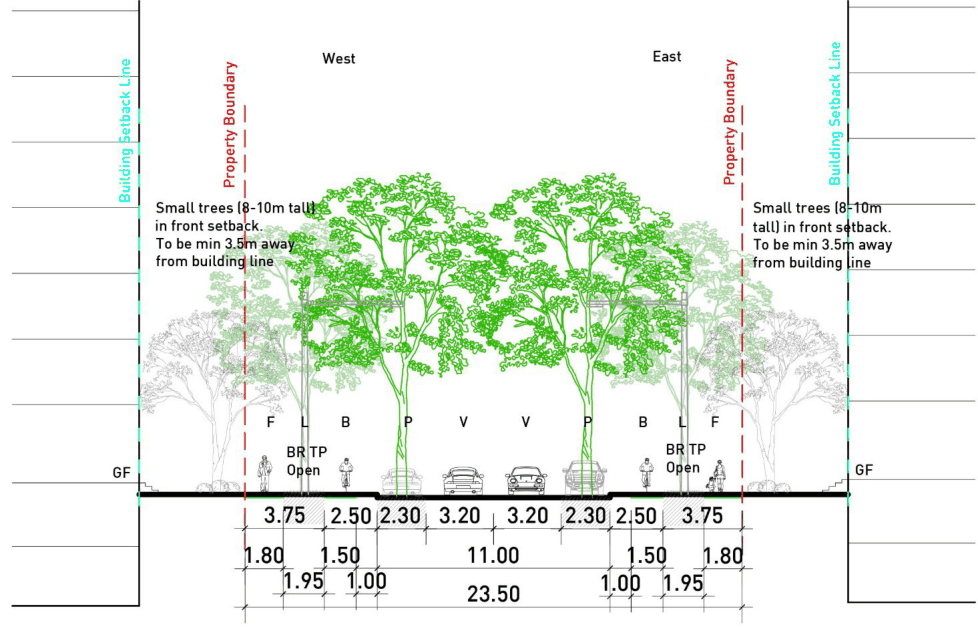

> [Picture on page 261: a picture, saved as a picture (images/part-08-centres-precincts-special-character-areas-specific-page-261-13.gif, 150 dpi).]

Figure 8.2.6.3.1.4 – Type 2A Main Road with Cycle Tracks (NSR 3)

MELROSE PARK URBAN RENEWAL PRECINCT

TYPE 2B – MAIN ROAD WITH CYCLE TRACKS (NSR 3 – BETWEEN EWR & EWR 6)

• 26.5m-wide road corridor.

• 2m wide footpath on western side and 1.8m wide on eastern side.

• One-way Paired, separated bicycle paths: 1.5m wide with an additional 1m buffer with parking lane on both sides (2.5m corridor each side).

• Trees in parking Lanes.

• WSUD details to be applied.

• Trees in open planted beds between the footpath and cycle track.

• Vegetated area in the wider public domain on western side.

• Trees in 5m front setback.

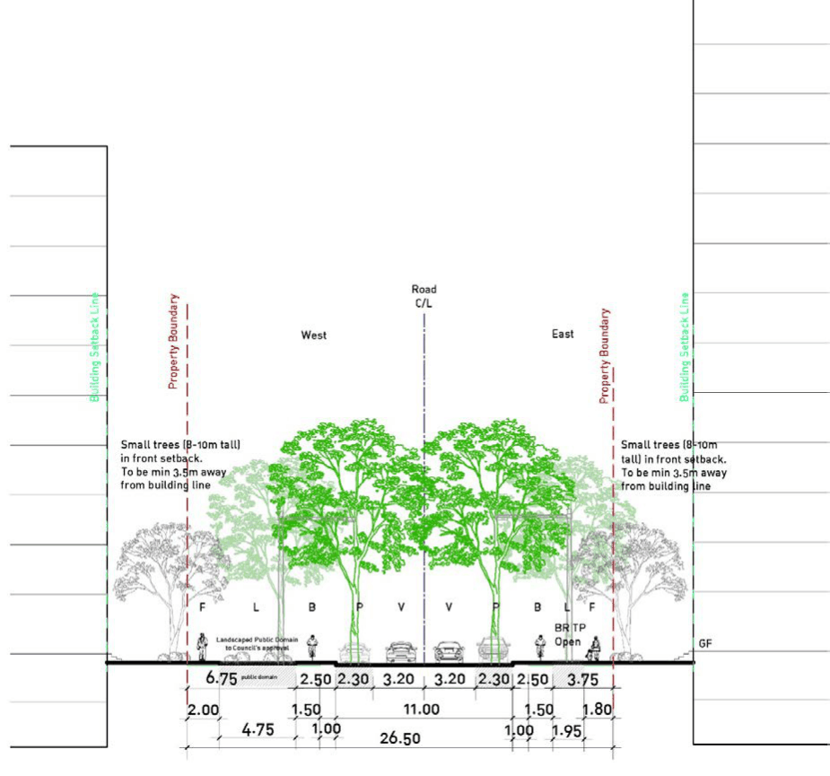

> [Picture on page 262: a picture, saved as a picture (images/part-08-centres-precincts-special-character-areas-specific-page-262-12.gif, 150 dpi).]

Figure 8.2.6.3.1.5 – Type 2B Main Road with Cycle Tracks between EWR 4 and EWR 6 (NSR 3)

MELROSE PARK URBAN RENEWAL PRECINCT

TYPE 2C – MAIN ROAD TWO WAY WITH CYCLE TRACKS (NSR 3 – TOWN CENTRE INTERFACE)

• 23.5m-wide road corridor.

• 3.2m lanes.

• 2.3m parking both sides.

• 1.8m-wide footpaths both sides.

• One-way Paired, separated bicycle paths: 1.5m wide with an additional 1m buffer with parking lane on both sides (2.5m corridor each side).

• Trees in parking lanes.

• WSUD details to be applied.

• Trees in open planted beds between the footpath and cycle track.

• Trees in 5m front setback.

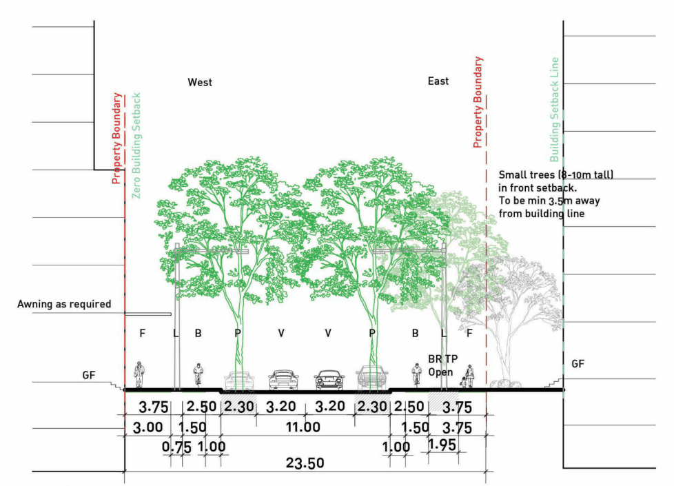

> [Picture on page 263: a picture, saved as a picture (images/part-08-centres-precincts-special-character-areas-specific-page-263-14.gif, 150 dpi).]

Figure 8.2.6.3.1.6 – Type 2C Main Road with Cycle Tracks Town Centre Interface (NSR 3)

MELROSE PARK URBAN RENEWAL PRECINCT

TYPE 3 – MAIN EAST/WEST CONNECTOR ROAD (EWR 4 – TYPICAL)

• 20m-wide road corridor.

• 3m-wide shared path on northern side of the road.

• 2m-wide footpath on south side next to swale/rain garden.

• WSUD treatment via the continuous swale/rain garden.

• Trees in parking lanes.

• WSUR details to be applied.

• Trees in deep soil, in the 5m front setback on southern side of the road.

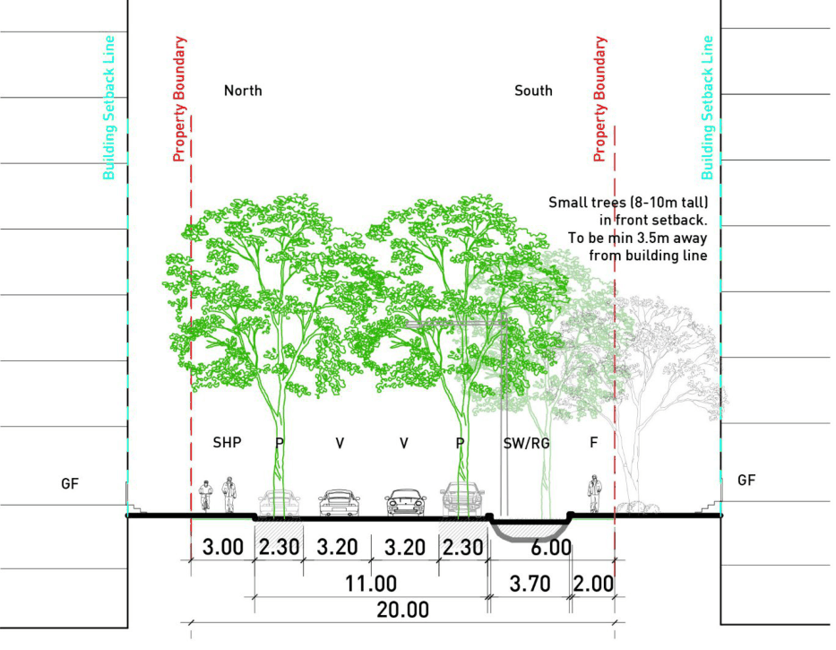

> [Picture on page 264: a picture, saved as a picture (images/part-08-centres-precincts-special-character-areas-specific-page-264-10.gif, 150 dpi).]

Figure 8.2.6.3.1.7 – Type 3 Main East West Connector road

MELROSE PARK URBAN RENEWAL PRECINCT

TYPE 4 – LOCAL STREET, TWO-WAY (NSR 1, NSR 4, EWR 2, EWR 3, EWR 6 & EWR 8)

• 20m-wide road corridor.

• 2 x 3.5m lanes.

• 2.3m for parking both sides.

• 2m-wide footpaths both sides.

• Trees in parking lanes.

• WSUD details to be applied where possible.

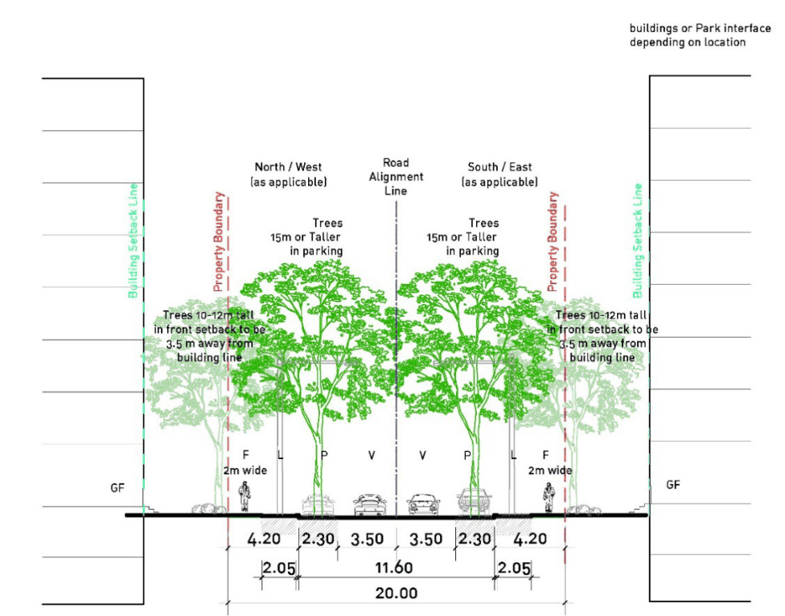

> [Picture on page 265: a picture, saved as a picture (images/part-08-centres-precincts-special-character-areas-specific-page-265-9.gif, 150 dpi).]

TYPICAL 20m WIDE STREET – Applicable to HUGHES AVENUE & EWR 8 (Mary Street)

Note: Building setbacks vary per street, and are as per the setback drawing

EWR 8 predominantly has the River Park has the river park interface on the southern side

Figure 8.2.6.3.1.8 – Type 4 Local Street (Hughes Avenue & EWR 8/Mary Street)

MELROSE PARK URBAN RENEWAL PRECINCT

TYPE 5A – LOCAL STREET, TWO-WAY (NSR 5, NSR 5A, EWR 10)

• 15.8m-wide road corridor.

• 2 x 3.2m lanes.

• 2.3m for parking both sides.

• 2.4m-wide footpaths both sides.

• Tree planting in parking zone.

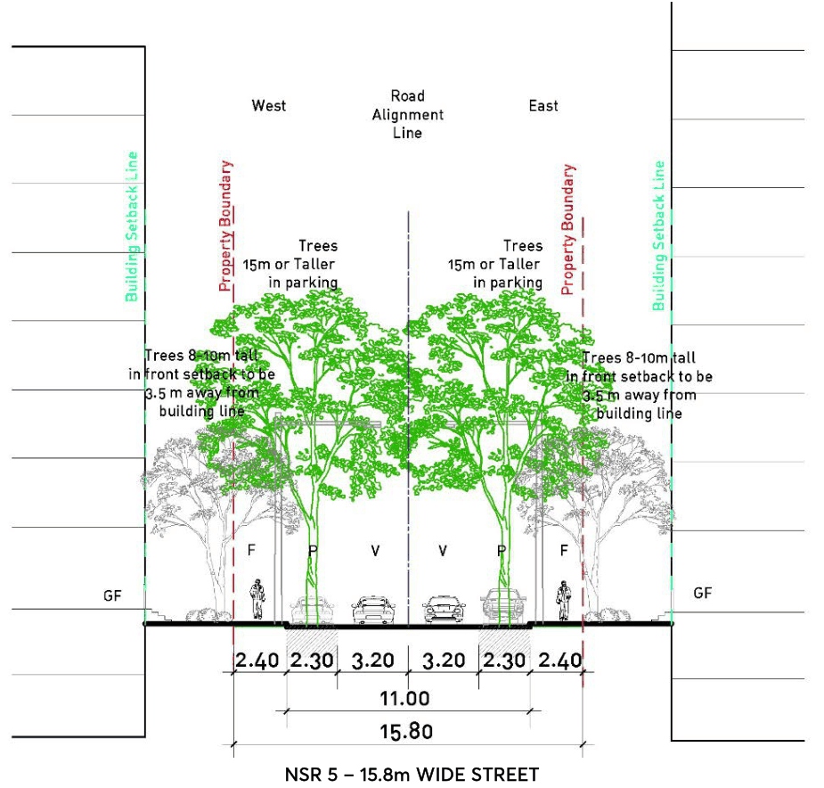

> [Picture on page 266: a picture, saved as a picture (images/part-08-centres-precincts-special-character-areas-specific-page-266-8.gif, 150 dpi).]

NSR 5 – 15.8m WIDE STREET

Figure 8.2.6.3.1.9 – Type 5A Local Street (NSR 5)

MELROSE PARK URBAN RENEWAL PRECINCT

TYPE 5B – LOCAL STREET, TWO-WAY, INTERIM CONFIGURATION (UNTIL PRECINCT IS BUILT COMPLETELY)

• 15.8m-wide road corridor.

• 2 x 3.2m lanes.

• 2.3m for parking both sides.

• 2.4m-wide footpaths both sides.

• Tree planting in parking zone.

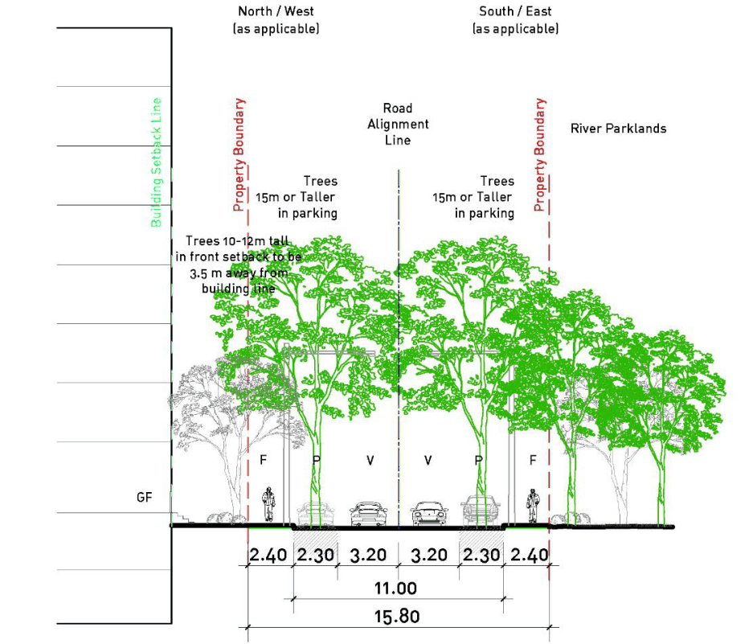

> [Picture on page 267: a picture, saved as a picture (images/part-08-centres-precincts-special-character-areas-specific-page-267-9.gif, 150 dpi).]

NSR 5A & EWR 10 – 15.8m WIDE STREET TWO WAY – INTERIM CONFIGURATION

Figure 8.2.6.3.1.10 – Type 5B Local Street Interim Configuration (NSR 5A and EWR 10)

MELROSE PARK URBAN RENEWAL PRECINCT

TYPE 5B – LOCAL STREET, ONE-WAY, FINAL CONFIGURATION (AFTER PRECINCT IS BUILT COMPLETELY)

• 15.8m-wide road corridor.

• 3.5m single lane, one way.

• 2.3m for parking both sides.

• 2.9m planted verge with trees, one side (northern or western edge of street, as applicable).

• 2.4m-wide footpaths both sides.

• Tree planting in parking zone one side (southern or eastern edge of street, as applicable).

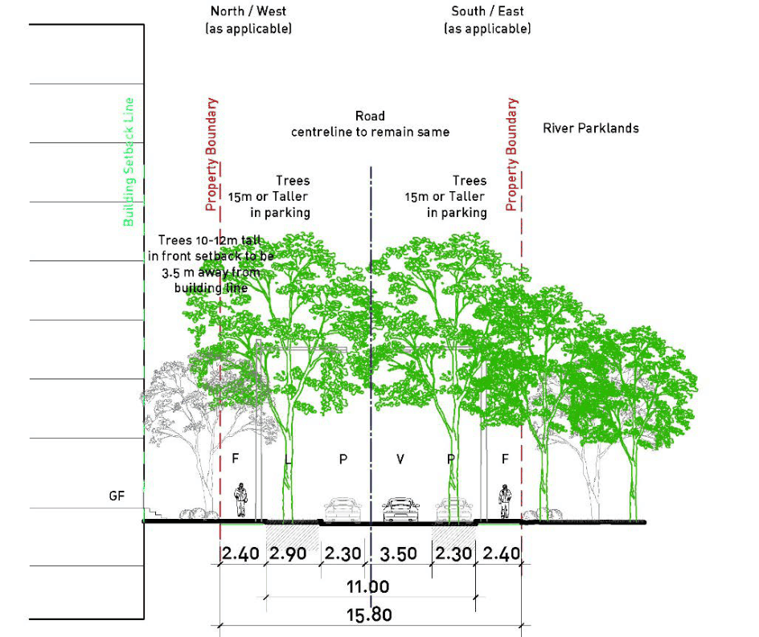

> [Picture on page 268: a picture, saved as a picture (images/part-08-centres-precincts-special-character-areas-specific-page-268-10.gif, 150 dpi).]

NSR 5A & EWR 10 – 15.8m WIDE STREET ONE WAY – FINAL CONFIGURATION

• Eastern/Southern edge of the street to remain unchanged.

• Tree locations and footpath locations to remain unchanged.

• Road alignment to be maintained, vehicular lane shall be widened to 3.5m northward/westward,

• New parking lane to be line marked, kerb shifted out, and older parking lane to be converted to a planted verge.

Figure 8.2.6.3.1.11 – Type 5B Local Street Final Configuration (NSR 5b & EWR 10)

MELROSE PARK URBAN RENEWAL PRECINCT

TYPE 6 – LOCAL STREET, TWO-WAY (NSR 6)

• 17.2m-wide road corridor.

• 2 x 3.2m lanes.

• 2.3m for parking both sides.

• 2m-wide footpaths both sides.

• 0.95m planted verge both sides.

• Tree planting in parking zone.

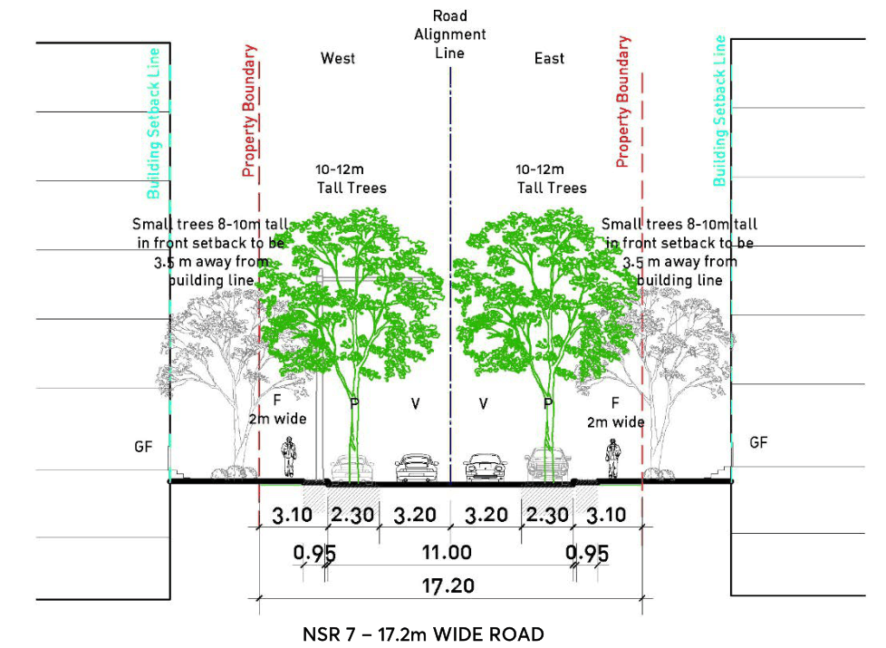

> [Picture on page 269: a picture, saved as a picture (images/part-08-centres-precincts-special-character-areas-specific-page-269-9.gif, 150 dpi).]

NSR 7 – 17.2m WIDE ROAD

Figure 8.2.6.3.1.12 – Type 6 Local Street (NSR 6)

MELROSE PARK URBAN RENEWAL PRECINCT

TYPE 7 – LOCAL STREET, ONE-WAY (NSR 3B)

• 7m to 9.3m-wide road corridor.

• 3.5m single lane, one-way.

• 2.3m for parking on one side, depending on location along street.

• 2m-wide footpath on one side.

• Tree planting in verge 1.5m wide, beside footpath.

• Interface with PLR corridor and stop as per location along street.

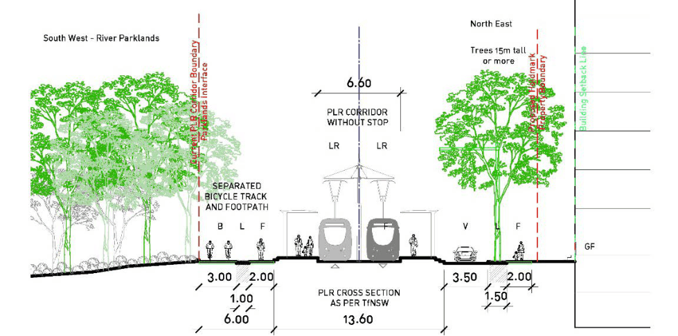

> [Picture on page 270: a picture, saved as a picture (images/part-08-centres-precincts-special-character-areas-specific-page-270-9.gif, 150 dpi).]

WARATAH STREET / NSR 3B – Interface with PLR with stop (South of Mary Street)

Figure 8.2.6.3.1.13 – Type 7 Local Street (NSR 3B with Stop)

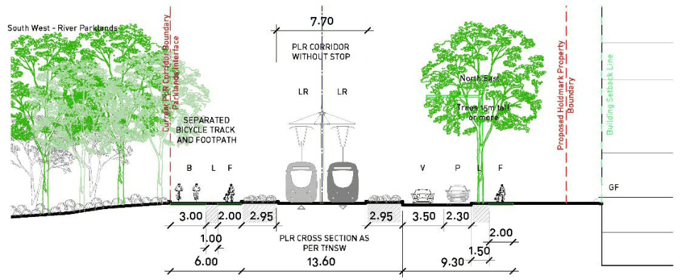

> [Picture on page 270: a picture, saved as a picture (images/part-08-centres-precincts-special-character-areas-specific-page-270-12.gif, 150 dpi).]

WARATAH STREET / NSR 3B – Interface without PLR stop (South of Mary Street)

Figure 8.2.6.3.1.14 – Type 7 Local Street (NSR 3B in areas without Stop)

MELROSE PARK URBAN RENEWAL PRECINCT

TYPE 8 – LOCAL STREET, ONE-WAY (EWR 9A & NSR 6A)

• 7.1m-wide road corridor.

• 3.2m single lane, one-way.

• 2.3m for parking, one side.

• 1.6m-wide footpath, one side.

• Tree planting in parking, one side.

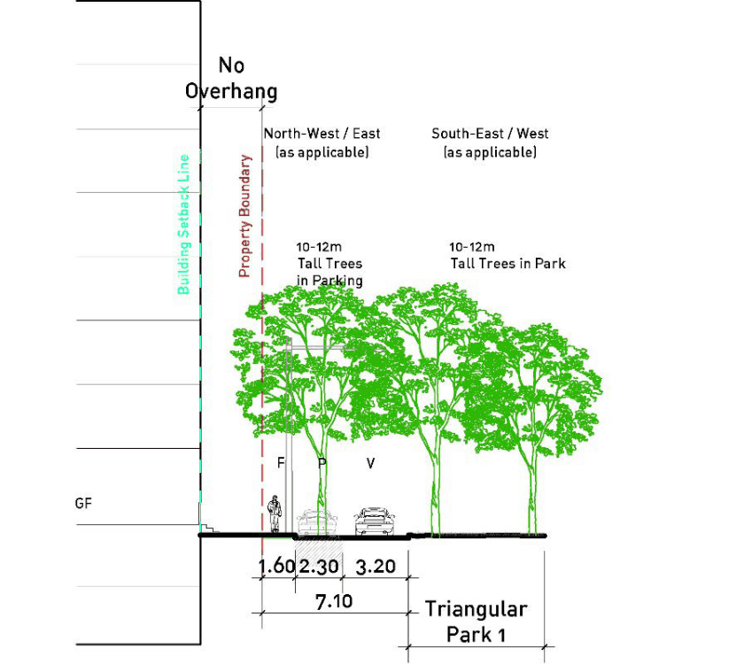

> [Picture on page 271: a picture, saved as a picture (images/part-08-centres-precincts-special-character-areas-specific-page-271-8.gif, 150 dpi).]

7.1m WIDE LOCAL ONE WAY STREET with parking on one side – NSR 6A (southbound) & EWR 9A (northeast-bound)

Figure 8.2.6.3.1.15 – Type 8 Local Street (NSR 6A & EWR 9A)

MELROSE PARK URBAN RENEWAL PRECINCT

TYPE 9 – LOCAL STREET, ONE-WAY (EWR 9)

• 14.2m-wide road corridor.

• 3.5m single lane, one-way.

• 2.3m for parking, both sides.

• 1.8m-wide footpaths, both sides.

• Tree planting in verge 1.1m-wide, both sides.

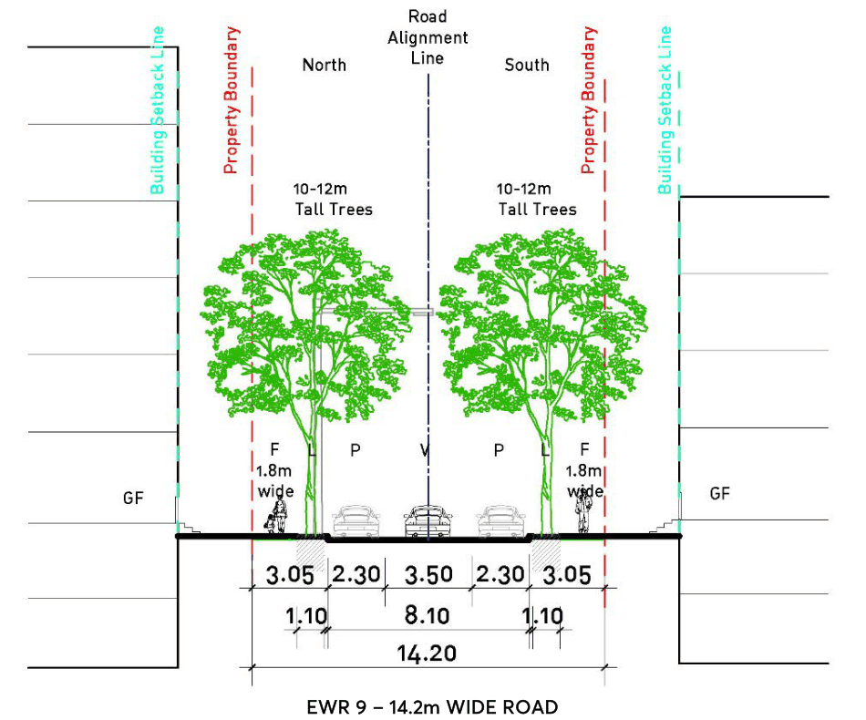

> [Picture on page 272: a picture, saved as a picture (images/part-08-centres-precincts-special-character-areas-specific-page-272-8.gif, 150 dpi).]

EWR 9 – 14.2m WIDE ROAD

One way traffic eastbound with parking on both sides of the street

Figure 8.2.6.3.1.16 – Type 9 Local Street (EWR 9)

MELROSE PARK URBAN RENEWAL PRECINCT

8.2.6.3.2 PEDESTRIAN CONNECTIONS – TYPE 10

The benefits of a finer network of connections are numerous: greater connectivity, increased frontage for entries and business opportunities, and spatial intimacy and variety in the public domain.

Pedestrian connections in Melrose Park enable access for service vehicles but are narrower in width than streets.

Refer to Council’s Melrose Park Public Domain Guidelines for site-specific guidance for the materials, finishes, and treatment of the pedestrian connections.

Objectives

O.01 Pedestrian connections are to increase connectivity and spatial variety in the street network and break up built form.

O.02 Provide a direct path of access to the town centre, public amenities, parks, and modes of transport.

O.03 Enable alternative access points to apartments. O.04 Link the open spaces to the overall precinct. O.05 Have a design characteristic equivalent to the public domain.

Controls

C.01 The pedestrian connections should be:

a) Consistent with the Masterplan.

b) 24/7 publicly accessible.

c) Extend from street to street or street to park.

d) Open to sky.

e) Available for controlled access for lightweight maintenance/service vehicles.

f) Fully accessible using, in order of preference:

• graded walkways (no steeper than 1:20);

• limited use of ramp system as per the Disability Discrimination Act 1992;

• 24/7 clearly visible and publicly accessible lift service within the building structure; or

• alternative options for approval.

C.02 The pedestrian connections should have:

a) View lines that align across all blocks.

b) Building to building separation generally as 12m. A public path with a minimum width of 4 metres within the separation between buildings.

MELROSE PARK URBAN RENEWAL PRECINCT

c) Trees in deep soil (preferably) or in set down slabs and planters to encourage and sustain large canopy trees generally consistent with the ADG requirements including soil volumes, soil depth, irrigation, and sub-soil drainage.

d) Pedestrian lighting to provide safe 24/7 access without creating nuisance to residential properties.

C.03 Materials as per the Melrose Park Public Domain Guidelines. C.04 The pedestrian connections can provide secondary entry to the buildings and courtyards. C.05 Landscaping, lighting, and street furniture elements such as seating (formal and incidental) is to be developed as an overall design, and be strategically located, with recognition of the grades and sight lines across the site.

C.06 Central Park north/south connection, refer Figure 8.2.6.3.2.1 – Pedestrian connection – interface with Central Park, is to have:

a) A minimum 6m wide path.

b) A low wall located on the park edge, with a 6m boundary.

c) The wall is to be masonry or similar durable material a minimum of 300mm high and up to 1000mm high and suitable for sitting.

d) Canopy trees within the path corridor.

#### 8.2.6.3.3 STREET TREES

Street trees help improve the quality of environment for the residents by reducing temperatures, providing shade, attracting fauna, and providing outlook. Street trees will be the elements in public domain which will define the spaces and relate to the scale of buildings in Melrose Park.

Objectives

O.01 Maintain existing and plant additional street trees within the public domain. O.02 Improve and enhance environmental biodiversity and mitigate temperature at ground level. O.03 Select tree species and planting regime to maximise connected street tree crown. O.04 Improve visual amenity of the public domain and from the buildings.

Controls

C.01 Street trees should be provided along streets in accordance with Figure 8.2.6.7.9.1 – Public Domain Plan and Melrose Park Public Domain Guidelines.

C.02 Street trees in the footway should be 12-15 m (or higher) in mature height, at 8-10m centres and planted generally in accordance with the Melrose Park Public Domain Guidelines and Council Design Standards.

MELROSE PARK URBAN RENEWAL PRECINCT

C.03 Street trees in the street parking lanes should have a mature height of more than 15m and are to be installed as per Figure 8.2.6.3.1.9 Public Domain Plan and street cross sections above, and the Melrose Park Public Domain Guidelines. Spacing of the trees should ensure tree crown touching at maturity.

C.04 Development applications should be consistent with the Melrose Park Public Domain Guidelines.

C.05 Public domain documentation indicating the street tree locations as detailed in the Melrose Park Public Domain Guidelines should be submitted with Development Applications and at Construction Certificate Applications approval stage.

#### 8.2.6.3.4 OVERHEAD POWER LINES

Objectives

O.01 Ensure the appropriate location of all power lines within the precinct to provide an aesthetic appeal and necessary function.

Controls

C.01 All new and existing power lines (excluding the high voltage power lines) are to be undergrounded for all streets of Melrose Park, where possible, for the full lengths of the development site street frontages, and should be in accordance with the Melrose Park Public Domain Guidelines.

#### 8.2.6.3.5 AWNINGS & AWNING DESIGN

Awnings assist in encouraging pedestrian activity along streets by providing comfortable conditions at footpath level and, in conjunction with active ground floor frontages, contribute to the vitality of the streets.

Awnings are preferred on public footpaths with active frontages, to provide shelter and weather protection for pedestrians.

As an architectural element that is both part of the building as well as the public space of the street, the awning should integrate both with the characteristics of the building as well as existing and possible future adjacent awnings. In Melrose Park awnings are encouraged only at the town centre and along activated street frontages.

Objectives

O.01 Increase amenity in areas of high pedestrian volume. O.02 Design awnings to provide protection from rain, sun, and wind down draft. O.03 Maintain complementary architectural detail between awnings.

MELROSE PARK URBAN RENEWAL PRECINCT

Controls

C.01 Awnings in Melrose Park should be used at activated retail frontages. C.02 New awnings should align with adjacent existing awnings and complement building façades. C.03 Where a proposed building is located on a street corner and an awning is not required on one frontage, the awning should extend around the corner by a minimum of approximately 6m.

C.04 Awning dimensions should generally be consistent with Figure 8.2.6.3.5.1 – Typical Awning Condition with Street Trees, and:

a) Minimum soffit height of 3.3 metres, maximum of 4.2 metres.

b) Low profile, with slim vertical fascias or eaves (generally not to exceed 300mm height).

c) Setback a minimum of 600mm from the face of the kerb.

d) Minimum of 2.0 metres deep unless street trees are required.

e) Where street trees are required, the entire length of the awning should be set back from the kerb by a minimum of 1.9 metres. Cut outs for trees and light poles in awnings are not permitted.

C.05 Double height awnings are not permitted except where emphasis is required for entries and the like.

C.06 All awnings are to have non-reflective surfaces. C.07 Glass in awnings should be used where climatically appropriate and should comply with the controls outlined in Section 8.2.6.5 – Sustainability.

C.08 The awning roof should be designed so that all gutters are concealed, and downpipes incorporated in the building fabric.

C.09 Lighting and other fixtures should be recessed and integrated into the design of the soffit.

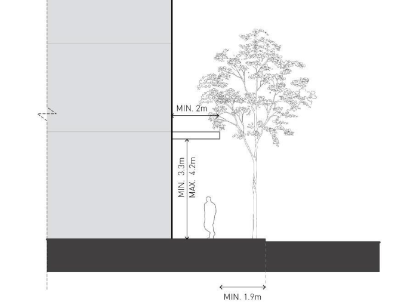

> [Picture on page 276: a picture, saved as a picture (images/part-08-centres-precincts-special-character-areas-specific-page-276-24.gif, 150 dpi).]

Figure 8.2.6.3.5.1 – Typical Awning Condition with Street Trees

MELROSE PARK URBAN RENEWAL PRECINCT

#### 8.2.6.3.6 PEDESTRIAN ACCESS AND MOBILITY

Objectives

O.01 Enable access and use of all spaces, services, and facilities through the creation of a barrier-free environment in all public spaces, premises, and associated spaces.

O.02 Provide safe and easy access to buildings to enable better use and enjoyment by people regardless of age and physical condition, whilst also contributing to the vitality and vibrancy of the public domain.

Controls

C.01 Disability access and provisions must be in compliance with the relevant Building Codes, Australian Standards, and Disability Discrimination Act 1992.

#### 8.2.6.3.7 SOLAR ACCESS & OVERSHADOWING OF PUBLIC SPACES

The provision of solar access throughout the year is critical to the success of public open space. In a densely occupied precinct, public open spaces with good solar access provide a respite and resource for residents, workers, and visitors.

In addition, sunlight is another essential ingredient for public open space, to ensure the necessary conditions for the health of trees and vegetation. Public spaces have been identified in the Masterplan (Figure 8.2.6.7.1.1), which provide valuable opportunities to maintain and maximise use of solar access at ground level.

Objectives

O.01 Maximise solar access to public parks, public spaces, and streets during periods in the day when they are most used, throughout the year.

O.02 Support the successful growth and survival of trees and vegetation within the streets, parks, and open spaces.

Controls

C.01 Development should demonstrate how built form massing, orientation, and distribution of height will provide adequate sunlight to parks and public spaces as identified in Figure 8.2.6.7.7.1

– Public Open Space

MELROSE PARK URBAN RENEWAL PRECINCT

#### 8.2.6.3.8 PUBLIC OPEN SPACE

Objectives

O.01 Create a strong definition of the public domain and maintain the range of public open spaces as shown in the Masterplan, Public Domain Plan, and Public Open Space Plan, to support the new residential community to meet, walk, and recreate.

O.02 The public open spaces are:

• Southern Parklands West OS4 (Melrose Park South).

• Southern Parklands East OS3 (Melrose Park South).

• Wharf Road Gardens OS1 and OS2 (Melrose Park South).

• Wharf Road Gardens OS3 - OS6 (Melrose Park North).

• Central Park OS1 (Melrose Park North).

• Playing Field OS2 (Melrose Park North).

• Western Parklands OS7 and OS8 (Melrose Park North).

• The Wetlands (Melrose Park North).

O.03 Public open spaces are capable of:

a) Accommodating a range of uses and events, experiences, and activities.

b) Encouraging social interaction and use by people of different ages and abilities.

c) Accommodating the needs of key user groups including children, young people, the elderly, low-income earners, and people with a disability.

d) Provide public open spaces that are attractive and memorable with high levels of amenity that consider safety, climate, activity, circulation, seating, lighting, and enclosure.

e) Contribute to the management of stormwater and enhancement of ecological values.

Controls

C.01 Public open space is to be provided in accordance with this Section and as identified in the Masterplan (Figure 8.2.6.7.1.1), Public Domain Plans (Figures 8.2.6.7.9.1 – 8.2.6.7.9.2), and Table

8.2.6.8.1 – Public Open Space Key Characteristics.

C.02 The designs for the public open spaces and the wetlands are to be developed in consultation with Council. They are to be designed to:

a) Incorporate a palette of high quality and durable materials, and robust and drought tolerant landscaping species.

b) Include clear, accessible, safe, and convenient linkages to each other and to the surrounding public open space network.

c) Integrate stormwater management and urban tree canopy.

MELROSE PARK URBAN RENEWAL PRECINCT

d) Include design elements, furniture, and infrastructure to facilitate active and passive recreation and community gatherings.

e) Maximise the safety and security of users consistent with ‘Safety by Design’ principles.

f) Provide deep soil throughout, with no car parking or infrastructure underneath unless agreed to by Council.

g) Encourage pedestrian use through the design of open space pathways and entrances.

h) Clearly delineate private and publicly accessible open space.

i) Provide access to both sunlight and shade.

j) Incorporate appropriate levels of lighting to maximise hours of use.

k) Accommodate high levels of use.

l) Be accessible 24/7.

m) Be capable of being well maintained within reasonable costs.

C.03 All public open space is to be dedicated and then maintained by Council. C.04 The landscaping and materials palette should respond to the character and environmental conditions of each space and should unite and relate to the other public open spaces throughout the precinct.

C.05 Vehicular movement through public open space should be restricted, except for emergency vehicles, servicing, and special events.

C.06 Landscaping, plant species, and structures such as retaining walls should be compatible with flood risk and not located on a flow path. Also see Section 8.2.6.2.18 – Retaining Walls.

C.07 Soil profile to be consistent with the Soil Profile Strategy – fill within the public domain and open spaces should not occur prior to undertaking a Soil Profile Strategy which has been agreed to by Council.

C.08 Where open space performs dual recreation and stormwater detention functions, the design of the detention basin should:

a) Provide an appropriate balance between stormwater management and recreation functions.

b) Include appropriate measures to restrict gross pollutants from entering the basin.

c) Allow the release of detained water within 24 hours of a significant rainfall event to protect landscaping within the basin.

d) Have one or more embankment batters of a maximum 1 in 3 gradient to provide for the safe exit of persons from the basin following a significant rainfall event.

e) Accommodate plant species and structures that can tolerate temporary flood inundation.

MELROSE PARK URBAN RENEWAL PRECINCT

Table 8.2.6.8.1 – Public Open Space Key Characteristics

| Site | Purpose(s) | Use(s) |
|---|---|---|
| Southern Parklands West OS4 (Melrose Park South) | Foreshore Park | Active informal recreation, passive recreation, community events, and gatherings |
| Southern Parklands East OS3 (Melrose Park South) | Foreshore Park | Passive recreation, gatherings |
| Wharf Road Gardens OS1 and OS2 (Melrose Park South) | Landscape Buffer | Passive recreation |
| Wharf Road Gardens OS3 – OS6 (Melrose Park South) | Landscape Buffer | Passive recreation |
| Central Park OS1 (Melrose Park North) | District Park | Play, passive recreation, community events and gatherings |
| Playing Field OS2 (Melrose Park North) | Sport, WSUD | Active recreation, wetland |
| Western Parklands OS7 and OS8 (Melrose Park North) | Green Link, WSUD | Pedestrian/cycle connections, dog off-leash, multi-use courts, stormwater detention |
| The Wetlands (Melrose Park North) | Stormwater Management | Passive recreation |

Southern Parklands East OS3 and Southern Parklands West OS4 (Melrose Park South)

The Southern Parklands East OS3 and Southern Parklands West OS4 will assist in creating one continuous foreshore park along the Parramatta River once the entire south precinct is developed. The Southern Parklands East OS3 and Southern Parklands West OS4 will have an area of approximately 22,126m2 and:

• function as the principal gathering space for the Melrose Park South precinct,

• be edged by the existing Parramatta River cycleway to the south,

• have a diverse mix of hard and soft landscaping and deep soil planting utilising indigenous, native, and exotic species to suit park environmental conditions,

• should provide:

- a variety of outdoor spaces (including sheltered, sunny, shaded, intimate, expansive),

- informal seating areas, public amenities, BBQ, shade structures, and drinking fountains.

• utilise durable materials to resist vandalism and graffiti,

• include gathering spaces and play elements integrated into the landscape design,

• provide opportunities and infrastructure to support small scale events,

• facilitate cross-site and internal pedestrian connections that are sympathetically integrated to maintain the overall landscape character, and

• achieve direct sunlight to a minimum of 50% of Southern Parklands East OS3 and Southern Parklands West OS4 between 10am and 2pm on 21 June in accordance with Figure 8.2.6.7.5.1 – Solar Access Plan.

MELROSE PARK URBAN RENEWAL PRECINCT

Wharf Road Gardens OS1 and OS2 (Melrose Park South)

A linear park with a minimum width of approximately 17 metres and minimum area of 3,907m2 should be provided along the eastern boundary of the precinct as identified in the Masterplan, and should:

• explore opportunities to integrate references to the agricultural or pharmaceutical heritage,

• provide a green buffer of soft landscaping to protect significant trees,

• include deep soil planting utilising indigenous, native, and exotic species,

• incorporate shade and some formal and informal seating, and

• achieve direct sunlight to a minimum of 50% of Wharf Road Gardens OS1 & OS2 between 10am and 2pm on 21 June in accordance with Figure 8.2.6.7.5.1 – Solar Access Plan – Melrose Park South.

Wharf Road Gardens OS1 and OS2 (Melrose Park South)

A linear park with a minimum width of approximately 17 metres; 13 metres adjacent to the playing field and an approximate area of 7,500m2 should be provided along the eastern boundary of the precinct as identified in the Masterplan and should:

• explore opportunities to integrate references to the agricultural/pharmaceutical heritage,

• provide a green buffer of soft landscaping to protect significant trees,

• include deep soil planting utilising indigenous, native and exotic species,

• incorporate shade and some formal and informal seating, and

• achieve direct sunlight to a minimum of 40% of the park between 10am and 2pm on 21 June in accordance with Figure 8.2.6.7.5.2 – Solar Access Plan – Melrose Park North.

Central Parklands OS1 (Melrose Park North)

A district park with a minimum size of approximately 84.89 metres by 207 metres and an approximate area of 17,600m2 is to be provided in the location identified in the Masterplan and should:

• function as the key open space and principal gathering space for the Melrose Park precinct,

• accommodate a range of experiences and activities, including space for outdoor performances and temporary events,

• be edged by a 6m north/south pedestrian walkway on the eastern edge between the park and the development,

• have a diverse mix of hard and soft landscaping and deep soil planting utilizing indigenous, native and exotic species to suit park environmental conditions,

• should provide:

- a variety of outdoor spaces (including sheltered, sunny, shaded, intimate, expansive),

- informal seating areas, public amenities, BBQ, and shade structures, and drinking fountains,

- a district level playground for children that is to:

◦ physically and visually integrate into the surrounding park,

MELROSE PARK URBAN RENEWAL PRECINCT

◦ maximise play value, accessibility, and inclusiveness for children of all ages and abilities,

◦ incorporate nature play to provide opportunities for exploration, imagination, and creativity.

• utilise durable materials to resist vandalism and graffiti,

• include gathering spaces and play elements integrated into the landscape design,

• provide opportunities and infrastructure to support small scale events,

• facilitate cross-site and internal pedestrian connections that are sympathetically integrated to maintain the overall landscape character,

• provide new street trees to define the boundary of the park, and

• achieve direct sunlight to the minimum standards in accordance with Figure 8.2.6.7.5.2 – Solar Access Plan – Melrose Park North.

Playing Field OS2 (Melrose Park North)

An active recreation park with a minimum size of approximately 75 metres by 108 metres and an approximate area of 8000m2 is to be provided in the location identified in the Masterplan and should:

• achieve an appropriate balance between active recreation and stormwater detention functions,

• provide a multi-use field,

• incorporate appropriate:

- floodlighting to maximise capacity, and

- perimeter fencing to minimise potential conflict with pedestrians and vehicles Flood Lighting

• achieve direct sunlight to a minimum of 50% of the playing field between 10am and 2pm on 21 June in accordance with Figure 8.2.6.7.5.2 – Solar Access Plan – Melrose Park North, and

• integrated stormwater and floodwater management.

Western Parklands OS7 and OS8 (Melrose Park North)

A linear park with a minimum dimension of approximately 20 metres and an approximate area of 15,180m2 should be provided along the western boundary of the precinct in the location identified in the Masterplan and should:

• provide for passive and active recreation including multi-use courts, outdoor fitness equipment and skateable elements,

• incorporate a north-south shared pedestrian/cycle connection,

• include soft landscaping and deep soil planting utilising indigenous, native and exotic species,

• incorporate shade and some formal and informal seating,

• provide fenced dog off-leash exercise area,

• dual recreation and stormwater detention function, and

• achieve direct sunlight to a minimum of 50% of the park between 11am and 3pm on 21 June in accordance with Figure 8.2.6.7.5.2 – Solar Access Plan – Melrose Park North.

MELROSE PARK URBAN RENEWAL PRECINCT

Wesetrn Parklands South (Area 4, Melrose Park North)

An extension of the linear Western Parklands South OS8, the Western Parklands South (Area 4, Melrose Park North) will provide a linear park connection between Hope Street and Victoria Road.

• Provide pedestrian access from the park to a residential lobby in the neighbouring development.

• Provide suitable boundary treatments to ensure an appropriate transition of levels between neighbouring sites and the subject site, and

• The setback area between the neighbouring development and the park should comprise soft landscaping that complements the design of the park.

Wetlands (Melrose Park North)

A triangular park with an approximate area of 2,260m2 should be provided along the eastern boundary of the precinct as identified in the Masterplan and should:

• assist in the management of stormwater,

• increase the provision of deep soil,

• be accessible to the public 24/7 through a formalised path separated from the stormwater management function,

• designed to safe guarded against in appropriate use, and

• not have underground structures, such as car parking, unless approved by Council.

#### 8.2.6.3.9 LANDSCAPE DESIGN

Objectives

O.01 Ensure that the landscape is fully integrated into the design of development. O.02 Optimise landscaping to ameliorate urban heat effects. O.03 Provide tree canopies to enhance the street character.

Controls

C.01 A landscape plan should be provided for all landscaped areas. The plan should outline how landscaped areas are to be maintained for the life of the development.

C.02 Canopy trees should be provided in the street frontage setback deep soil to complement tree canopy species in accordance with Figure 8.2.6.7.9.1 – Public Domain Plan and the Melrose Park Public Domain Guidelines.

C.03 Ensure that A-grade soil profile is appropriate for the planting in the deep soil zones. C.04 Deep soil depth should be provided as per Figure 8.2.6.2.11.1 – Residential ground floor.

MELROSE PARK URBAN RENEWAL PRECINCT

C.05 Landscape requirements should be as per Section 3.3.1 – Landscaping, and 3.3.2 – Private and Communal Open Space of the Parramatta DCP 2023. Where there is any inconsistency the Melrose Park provisions of this part will prevail.

#### 8.2.6.3.10 PLANTING ON STRUCTURES

Constraints on the location of car parking structures may mean that landscaping within the site and not in the setbacks might need to be provided over parking structures on rooftops or on walls.

Objectives

O.01 Contribute to the landscape quality and amenity of buildings. O.02 Encourage the establishment and healthy growth of landscaping on structures in urban areas. O.03 Ensure that A-grade soil profile appropriate for the proposed planting in the deep soil zones and for the landscaping on slab is provided.

Controls

C.01 Design for optimum growing conditions and sustained plant growth and health by providing minimum soil depth and soil volume as per Table 8.2.6.3.10.1 – Minimum soil depth for plant establishment (in addition to drainage layer), and soil area appropriate to the size of the plants to be established.

C.02 Provide appropriate soil conditions including irrigation (where possible using recycled water) and suitable drainage.

C.03 Provide square or rectangular planting areas rather than narrow linear areas. C.04 Provide a soil profile report that specifies A-grade soil that meets the specific requirements for the proposed planting, for 1 metre above drainage in landscape planting on slab.

C.05 Tree planting and landscaping located on a slab is to be set down into the slab a minimum of 1 metre, plus drainage for trees, and a lessor amount appropriate for other planting.

C.06 The minimum number of trees to be provided in landscaped areas is 1 tree per 80m2 or as agreed by Council’s Landscape Management Officer. Table 8.2.6.3.10.1 – Minimum soil depth for plant establishment (in addition to drainage layer)

| Plant type | Min soil depth | Min soil volume |
|---|---|---|
| Large trees (over 12m high, to 16m crown spread at maturity or to connect with other tree crowns) | 1.3m | 150m3 |
| Medium trees (8-12m high, up to 8m crown spread at maturity) | 1m | 35m3 |
| Small trees (6-8m high, up to 4m crown spread at maturity) | 800mm | 9m3 |
| Shrubs and ground cover | 500m | n/a |

MELROSE PARK URBAN RENEWAL PRECINCT
