#### 8.2.6.7 APPENDIX A – MELROSE PARK FIGURES

#### 8.2.6.7.1 MASTERPLAN

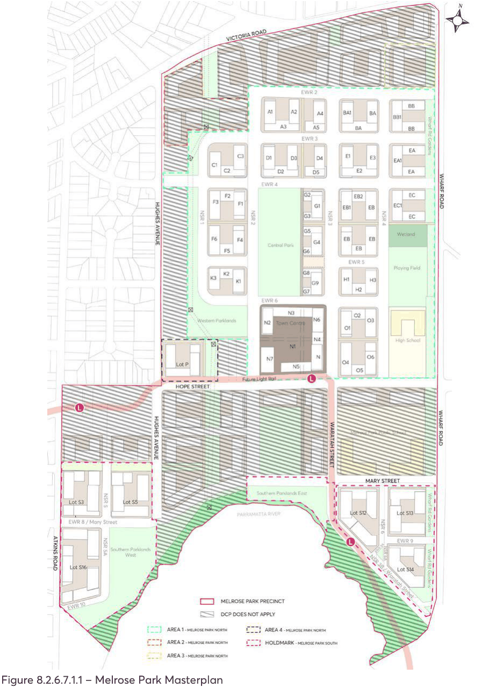

> [Picture on page 303: a picture, saved as a picture (images/part-08-centres-precincts-special-character-areas-specific-page-303-4.gif, 150 dpi).]

Figure 8.2.6.7.1.1 – Melrose Park Masterplan

MELROSE PARK URBAN RENEWAL PRECINCT

#### 8.2.6.7.2 MAXIMUM GROSS FLOOR AREA

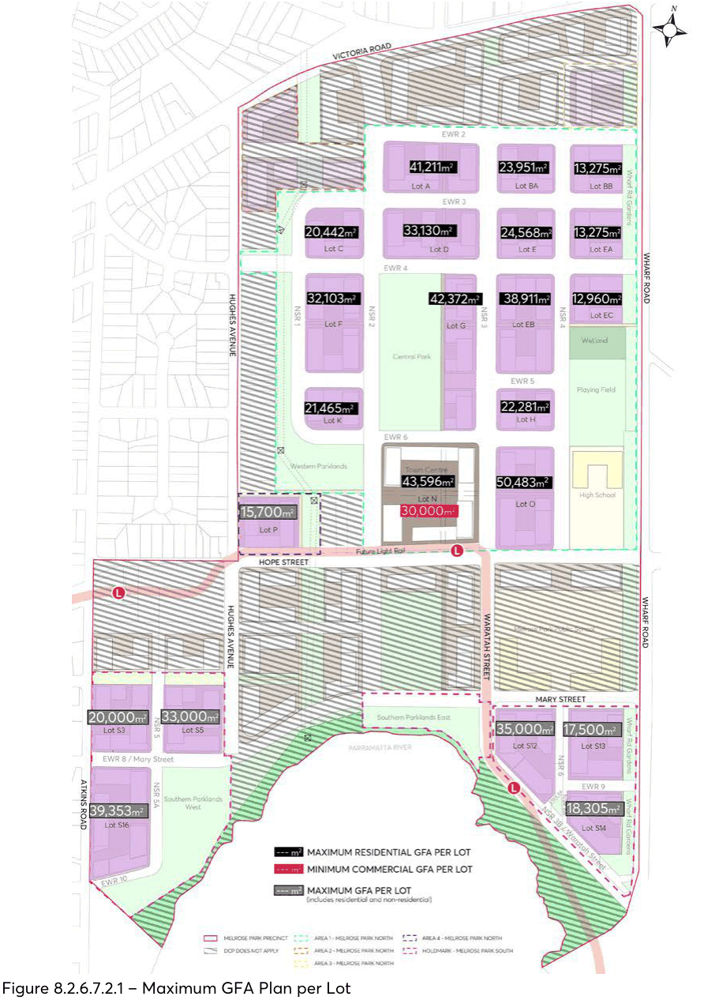

> [Picture on page 304: a picture, saved as a picture (images/part-08-centres-precincts-special-character-areas-specific-page-304-3.gif, 150 dpi).]

Figure 8.2.6.7.2.1 – Maximum GFA Plan per Lot

MELROSE PARK URBAN RENEWAL PRECINCT

#### 8.2.6.7.3 COURTYARD LOCATIONS

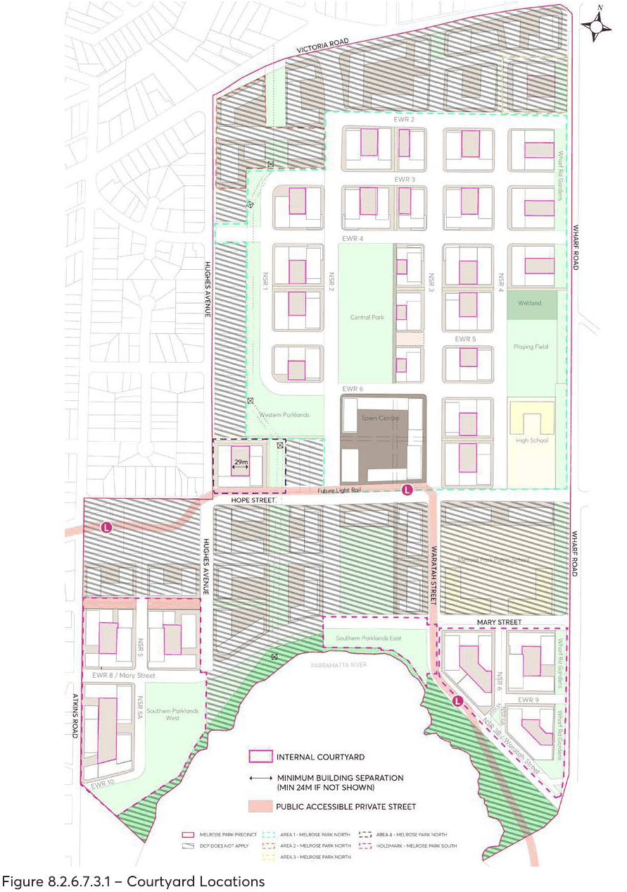

> [Picture on page 305: a picture, saved as a picture (images/part-08-centres-precincts-special-character-areas-specific-page-305-3.gif, 150 dpi).]

Figure 8.2.6.7.3.1 – Courtyard Locations

MELROSE PARK URBAN RENEWAL PRECINCT

#### 8.2.6.7.4 BUILDING STOREYS

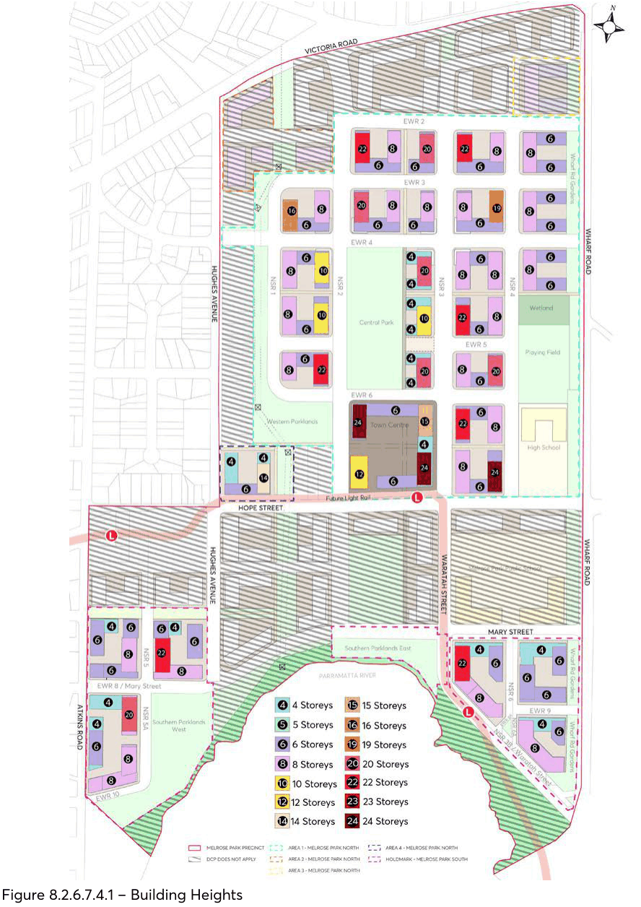

> [Picture on page 306: a picture, saved as a picture (images/part-08-centres-precincts-special-character-areas-specific-page-306-3.gif, 150 dpi).]

Figure 8.2.6.7.4.1 – Building Heights

MELROSE PARK URBAN RENEWAL PRECINCT

#### 8.2.6.7.5 SOLAR ACCESS PLAN

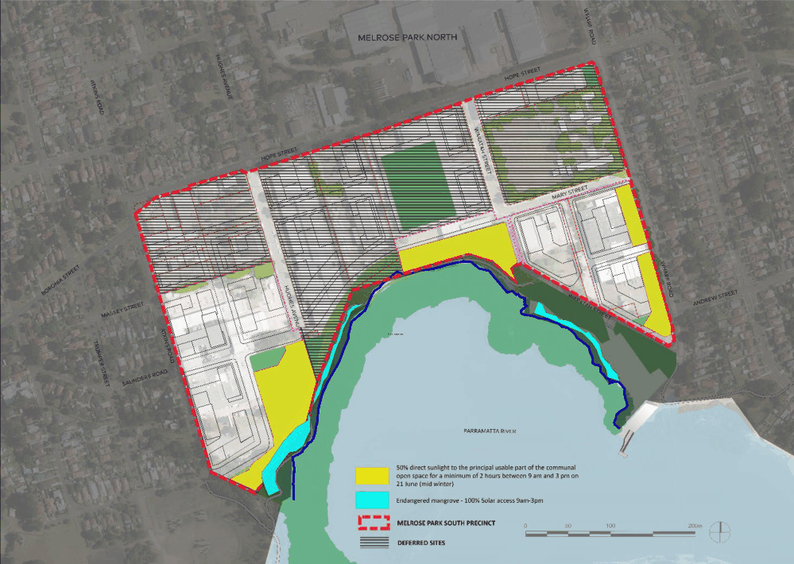

> [Picture on page 307: a picture, saved as a picture (images/part-08-centres-precincts-special-character-areas-specific-page-307-3.gif, 150 dpi).]

Figure 8.2.6.7.5.1 – Solar Access Plan - Melrose Park South

MELROSE PARK URBAN RENEWAL PRECINCT

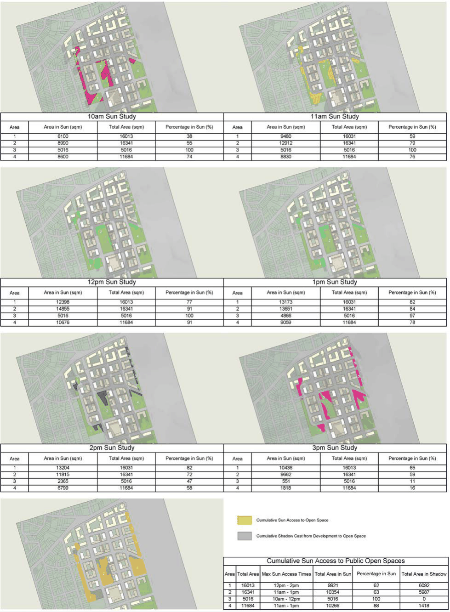

> [Picture on page 308: a picture, saved as a picture (images/part-08-centres-precincts-special-character-areas-specific-page-308-2.gif, 150 dpi).]

Figure 8.2.6.7.5.2 – Solar Access Plan – Melrose Park North

MELROSE PARK URBAN RENEWAL PRECINCT

#### 8.2.6.7.6 STREET SETBACKS

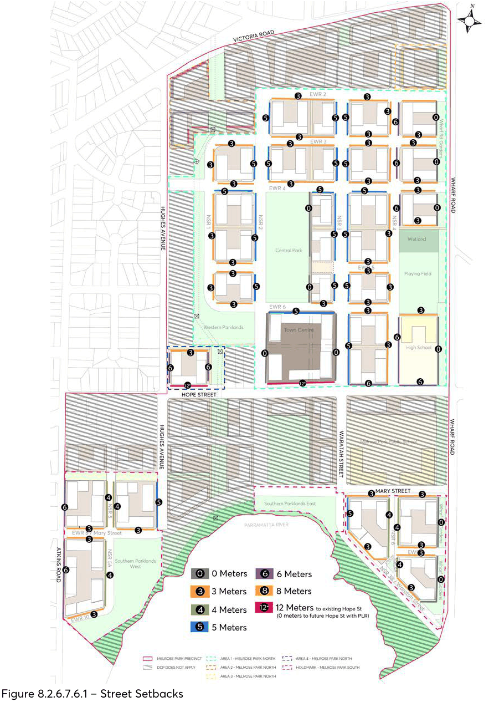

> [Picture on page 309: a picture, saved as a picture (images/part-08-centres-precincts-special-character-areas-specific-page-309-3.gif, 150 dpi).]

Figure 8.2.6.7.6.1 – Street Setbacks

MELROSE PARK URBAN RENEWAL PRECINCT

#### 8.2.6.7.7 PUBLIC OPEN SPACE

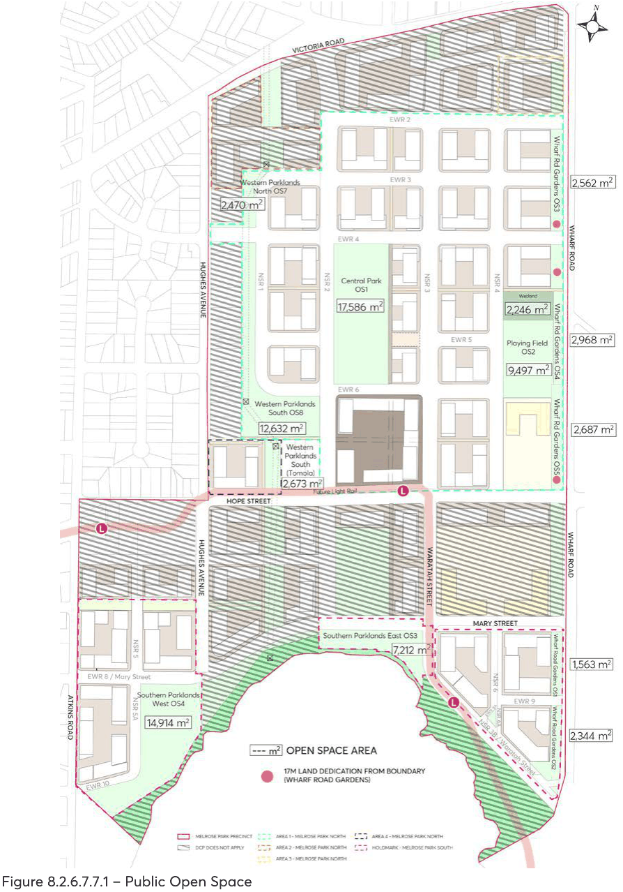

> [Picture on page 310: a picture, saved as a picture (images/part-08-centres-precincts-special-character-areas-specific-page-310-3.gif, 150 dpi).]

Figure 8.2.6.7.7.1 – Public Open Space

MELROSE PARK URBAN RENEWAL PRECINCT

#### 8.2.6.7.8 STREET HIERARCHY

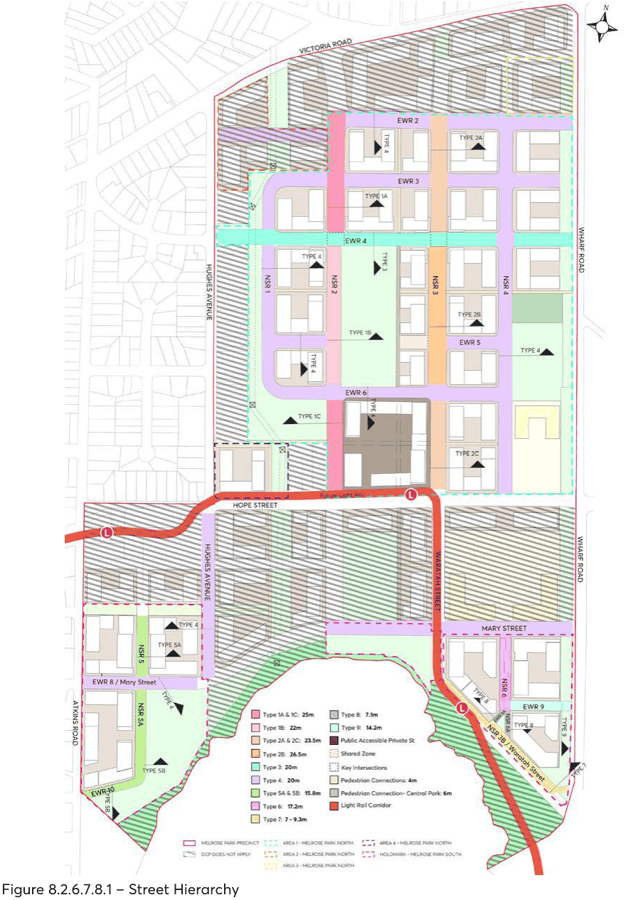

> [Picture on page 311: a picture, saved as a picture (images/part-08-centres-precincts-special-character-areas-specific-page-311-3.gif, 150 dpi).]

Figure 8.2.6.7.8.1 – Street Hierarchy

MELROSE PARK URBAN RENEWAL PRECINCT

#### 8.2.6.7.9 PUBLIC DOMAIN PLAN

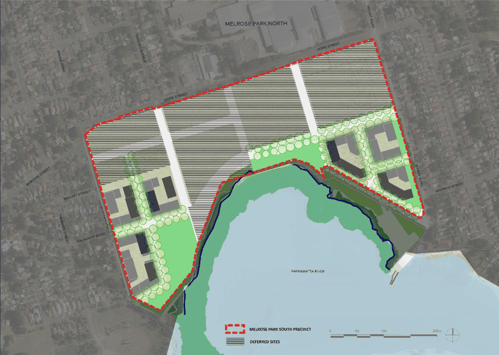

> [Picture on page 312: a picture, saved as a picture (images/part-08-centres-precincts-special-character-areas-specific-page-312-3.gif, 150 dpi).]

Figure 8.2.6.7.9.1 – Public Domain Plan - Melrose Park South

MELROSE PARK URBAN RENEWAL PRECINCT

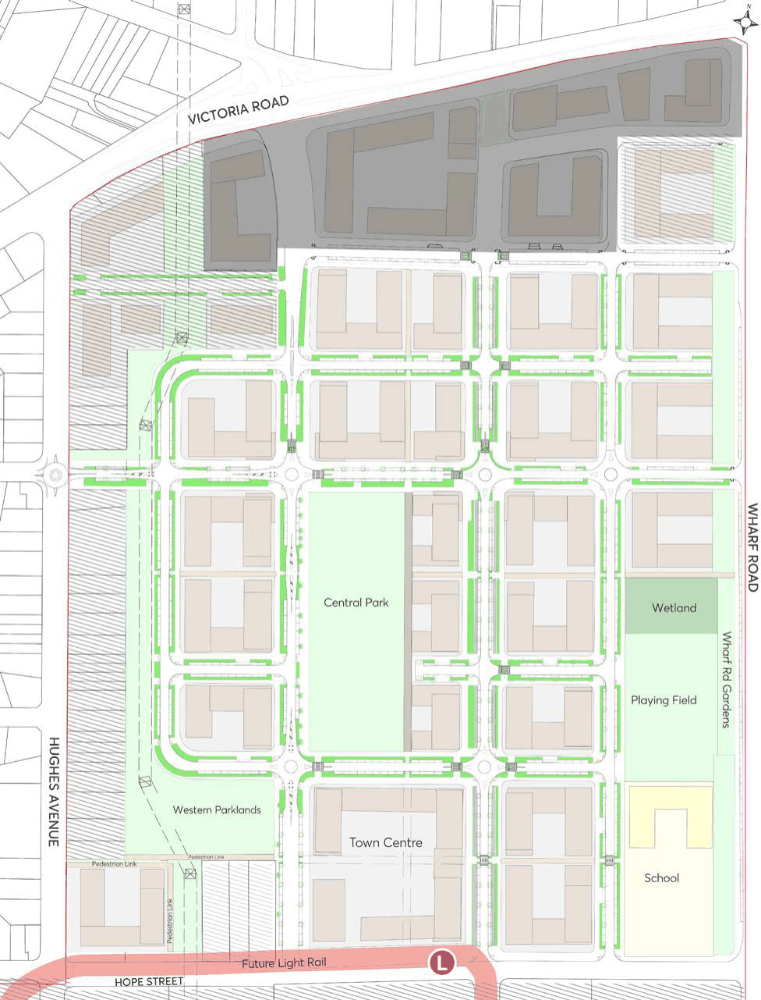

> [Picture on page 313: a picture, saved as a picture (images/part-08-centres-precincts-special-character-areas-specific-page-313-2.gif, 150 dpi).]

Figure 8.2.6.7.9.2 – Public Domain Plan - Melrose Park North

MELROSE PARK URBAN RENEWAL PRECINCT

#### 8.2.6.7.10 INDICATIVE APPLICATION OF BUILDING ENVELOPES

The purpose of this information is to clarify for the architects and assessment officers how the masterplan and the setback controls are to be interpreted.

Part 1 – Setbacks provides information and a table of how the upper-level setbacks to all buildings above are determined on each block.

Part 2 – Illustrated Examples provides drawings of how the height and setbacks are to be applied. The lots selected are D, G and EA because they show different building types and different topography.

## PART 1 SETBACKS

Assumptions

Base Building Element

• The perimeter block height is generally 6 storeys.

• Block G is 4 storeys.

• The Town Centre is 2 retail + 3 car parking levels sleeved with residential.

• The 6 storey and 4 storey elements of all buildings must extend to the required street setbacks and align with the streets.

• The podium of the Town Centre must extend to the street setbacks. Length and Width of Buildings

• The length of buildings that are 10 storeys and above are drawn at 50 metres.

• The width of buildings aligned East-West are drawn at 20 metres.

• The width of buildings aligned North - South without tower are drawn at 20 metres.

• The width of buildings aligned North -South with tower are drawn at 22 metres.

Changes to the length and width in the detail design of buildings may alter some of the setbacks and heights but these differences will only be minor.

Alignments

The Masterplan has organised the building envelopes at ground and above to define a series of spaces. For example:

a) Buildings C1, D1, D3, D4, E1 align on the southern side.

b) Buildings A1, A2, A4, BA1, BA3 align on the southern side.

c) Buildings C3, F3 and EA1 align on the southern side.

d) Buildings C3, F3 align on the northern side.

MELROSE PARK URBAN RENEWAL PRECINCT

e) Buildings F3, G1, EB1, EB3 align on the southern side.

f) Buildings F6, F4, G4, EB4, EB6 align on the southern side.

g) Buildings K1, G7, H1, H3 align on the southern side.

h) Buildings O4, O6 align on the southern side.

i) Buildings O1, O3 align on the northern side.

Minor discrepancies in the Masterplan drawings are evident because of scale of the drawing and where streets are slightly non orthogonal.

Table 8.2.6.6.10.1 – Building Setbacks Above Perimeter Block and Podium

| Lot | Building Number | No. of Storeys | Setback Above Perimeter Block Height |  |  |
|---|---|---|---|---|---|
|  |  |  | North | East + West | South |
| X | X1 | 8 | Optional 1 or 2 Storeys | Optional 1 or 2 Storeys | Optional 1or 2 Storeys |
|  | X2 | 8 | Optional 1 or 2 Storeys | Optional 1 or 2 Storeys | Optional 1or 2 Storeys |
|  | X3 | 8 | Optional 1 or 2 Storeys | Optional 1 or 2 Storeys | Optional 1or 2 Storeys |
|  | X4 | 8 | Optional 1 or 2 Storeys | Optional 1 or 2 Storeys | Optional 1or 2 Storeys |
| A | A1 | 22 | Optional | Nil | Mandatory - Approx. 13- 14m |
|  | A2 | 8 | Optional | Nil | Mandatory- Approx. 13-14m |
|  | A4 | 20 | Optional | Nil | Mandatory - Approx. 13- 14m |
| BA | BA1 | 22 | Optional | Nil | Mandatory - Approx. 13- 14m |
|  | BA3 | 8 | Optional | Nil | Mandatory - Approx. 13- 14m |
| Y | Y2 | 8 | Optional 1 or 2 Storeys | Optional 1 or 2 Storeys | Optional 1 or 2 Storeys |
| BB | BB1 | 8 | Optional 1 or 2 Storeys | Optional 1 or 2 Storeys | Optional 1 or 2 Storeys |
| C | C3 | 16 | Nil | Nil | Nil |
|  | C1 | 8 | Nil | Nil | Mandatory - Approx. 13- 14m |
| D | D1 | 20 | Optional | Nil | Mandatory - Approx. 13- 14m |
|  | D3 | 8 | Optional 1 or 2 Storeys | Nil | Mandatory - Approx. 13- 14m |
|  | D4 | 8 | Optional 1 or 2 Storeys | Nil | Mandatory - Approx. 13- 14m |
| E | E1 | 8 | Optional 1 or 2 Storeys | Nil | Mandatory - Approx. 13- 14m |
|  | E3 | 19 | Remainder | Nil | Mandatory to align with EA1 and C3 |
| EA | EA1 | 8 | Optional 1 or 2 Storeys | Optional 1 or 2 Storeys | Optional 1 or 2 Storeys |
|  | EA4 | 8 | Optional 1 or 2 Storeys | Optional 1 or 2 Storeys | Optional 1 or 2 Storeys |
|  | EA5 | 8 | Optional 1 or 2 Storeys | Optional 1 or 2 Storeys | Optional 1 or 2 Storeys |
| F | F3 | 8 | Optional 1 or 2 Storeys | Optional 1 or 2 Storeys | Optional 1 or 2 Storeys |
|  | F1 | 10 | Nil | Nil | Remainder |
|  | F6 | 8 | Optional 1 or 2 Storeys |  |  |
|  | F4 | 10 | Remainder | Nil | Nil |
| G Base Perimeter Block of 4 storeys |  |  |  |  |  |
| G | G1 | 20 | Block Dimension minus length of tower | Nil on West Block Dimension minus width of tower on East | Nil |
|  | G4 | 10 | Block Dimension minus length of tower | Nil on West | Nil |

MELROSE PARK URBAN RENEWAL PRECINCT

| Lot | Building Number | No. of Storeys | Setback Above Perimeter Block Height |  |  |
|---|---|---|---|---|---|
|  |  |  | North | East + West | South |
|  |  |  |  | Block Dimension minus width of tower on East |  |
|  | G7 | 20 | Block Dimension minus length of tower | Nil on West Block Dimension minus width of tower on East | Nil |
| EB | EB1 | 8 | Optional 1 or 2 Storeys | Optional 1 or 2 Storeys | Optional 1 or 2 Storeys |
|  | EB3 | 8 | Optional 1 or 2 Storeys | Optional 1 or 2 Storeys | Optional 1 or 2 Storeys |
|  | EB4 | 22 | Block Dimension minus length of tower | Nil | Nil |
|  | EB6 | 8 | Optional 1 or 2 Storeys | Optional 1 or 2 Storeys | Optional 1 or 2 Storeys |
| K | K3 | 8 | Optional 1 or 2 Storeys | Optional 1 or 2 Storeys | Optional 1 or 2 Storeys |
|  | K1 | 22 | Nil | Nil | Nil |
| H | H1 | 8 | Optional 1 or 2 Storeys | Optional 1 or 2 Storeys | Optional 1 or 2 Storeys |
|  | H3 | 20 | Block Dimension minus length of tower to align with G7 | Nil | Nil |
| O | O1 | 22 | Block Dimension minus length of tower | Nil | Nil |
|  | O3 | 8 | Optional 1 or 2 Storeys | Optional 1 or 2 Storeys | Optional 1 or 2 Storeys |
|  | O4 | 8 | Optional 1 or 2 Storeys | Optional 1 or 2 Storeys | Optional 1 or 2 Storeys |
|  | O6 | 24 | Block Dimension minus length of tower | Nil | Nil |
| TOWN CENTRE Setbacks to the podium are flexible but buildings are to align with the streets. 12 metres between N6 + N9; 12 metres between N2 + N7 |  |  |  |  |  |
| N | N2 | 24 | N2 to align with N6 North Side |  |  |
|  | N6 | 15 | N6 to align with N9 East Side and West Side |  |  |
|  | N7 | 12 | N7 to align with N2 West Side |  |  |
|  | N9 | 24 |  |  |  |

## PART 2 ILLUSTRATED EXAMPLES

Examples of Blocks D, G and EA have bene prepared to illustrate how the height and setback controls are interpreted. These illustrated that:

• The different topographical levels are to be taken up in the lower levels, so the upper levels of buildings are not stepped.

• The height nominated on the Building Height Drawing Appendix 2 for the base building (4 and 6 storeys) is to be located on the high side of the lot and the additional height on the lower side of the lot.

MELROSE PARK URBAN RENEWAL PRECINCT

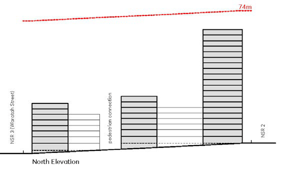

> [Picture on page 317: a picture, saved as a picture (images/part-08-centres-precincts-special-character-areas-specific-page-317-2.gif, 150 dpi).]

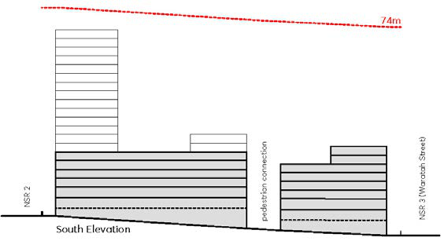

> [Picture on page 317: a picture, saved as a picture (images/part-08-centres-precincts-special-character-areas-specific-page-317-3.gif, 150 dpi).]

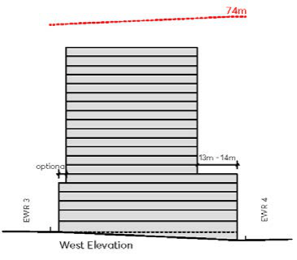

> [Picture on page 317: a picture, saved as a picture (images/part-08-centres-precincts-special-character-areas-specific-page-317-4.gif, 150 dpi).]

BLOCK D

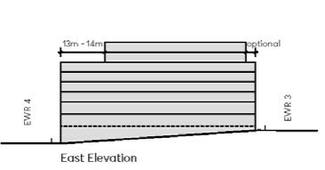

> [Picture on page 317: a picture, saved as a picture (images/part-08-centres-precincts-special-character-areas-specific-page-317-6.gif, 150 dpi).]

MELROSE PARK URBAN RENEWAL PRECINCT

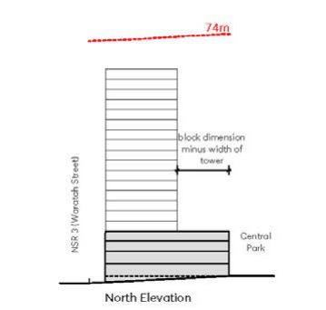

> [Picture on page 318: a picture, saved as a picture (images/part-08-centres-precincts-special-character-areas-specific-page-318-2.gif, 150 dpi).]

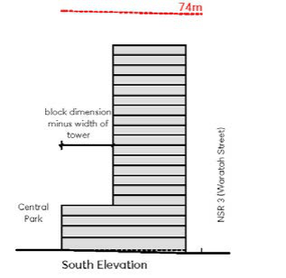

> [Picture on page 318: a picture, saved as a picture (images/part-08-centres-precincts-special-character-areas-specific-page-318-3.gif, 150 dpi).]

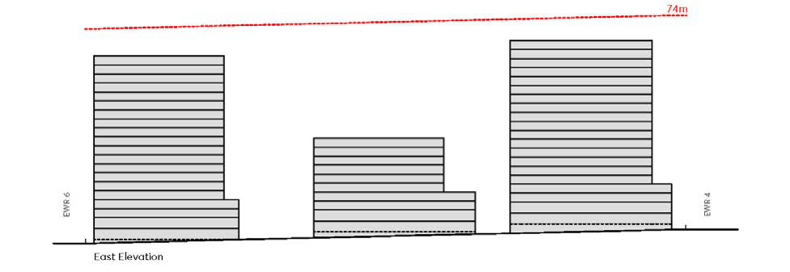

> [Picture on page 318: a picture, saved as a picture (images/part-08-centres-precincts-special-character-areas-specific-page-318-4.gif, 150 dpi).]

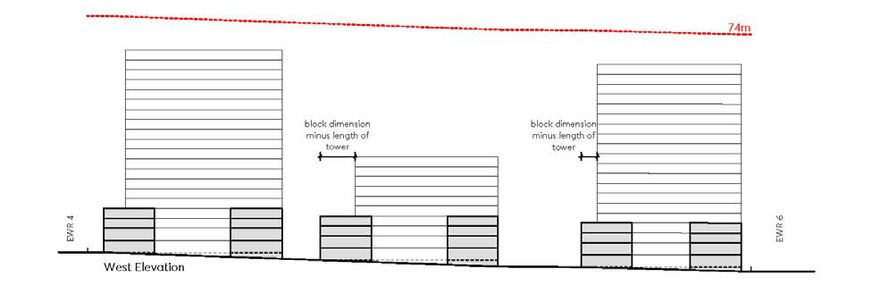

> [Picture on page 318: a picture, saved as a picture (images/part-08-centres-precincts-special-character-areas-specific-page-318-5.gif, 150 dpi).]

BLOCK G

MELROSE PARK URBAN RENEWAL PRECINCT

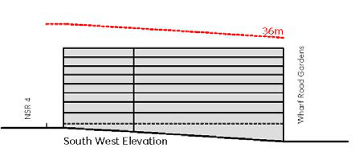

> [Picture on page 319: a picture, saved as a picture (images/part-08-centres-precincts-special-character-areas-specific-page-319-2.gif, 150 dpi).]

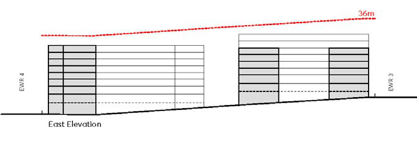

> [Picture on page 319: a picture, saved as a picture (images/part-08-centres-precincts-special-character-areas-specific-page-319-3.gif, 150 dpi).]

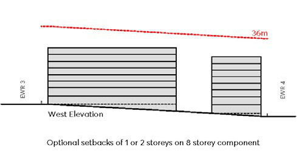

> [Picture on page 319: a picture, saved as a picture (images/part-08-centres-precincts-special-character-areas-specific-page-319-4.gif, 150 dpi).]

BLOCK EA

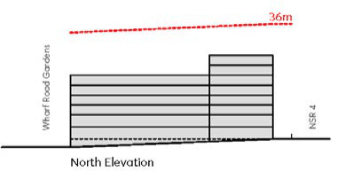

> [Picture on page 319: a picture, saved as a picture (images/part-08-centres-precincts-special-character-areas-specific-page-319-6.gif, 150 dpi).]

MELROSE PARK URBAN RENEWAL PRECINCT
