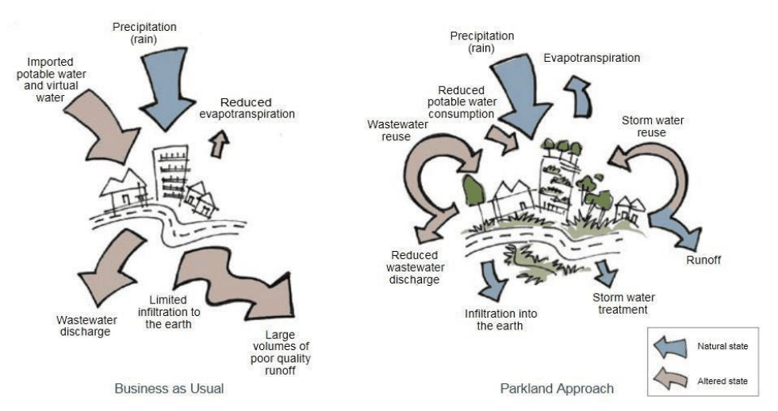
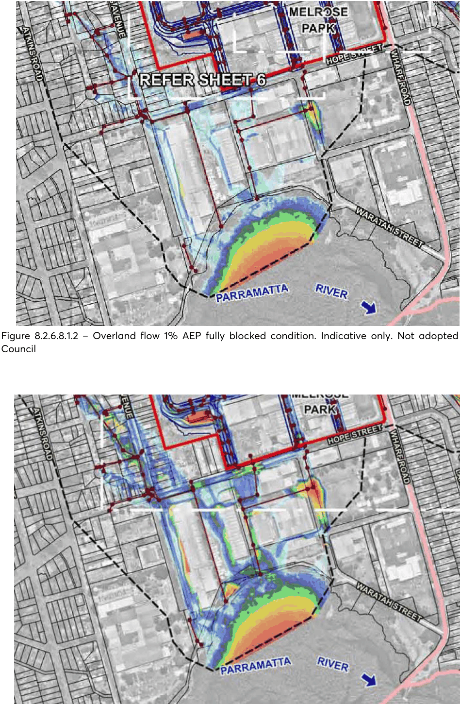
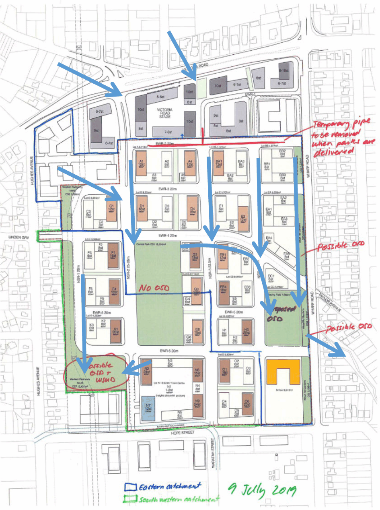
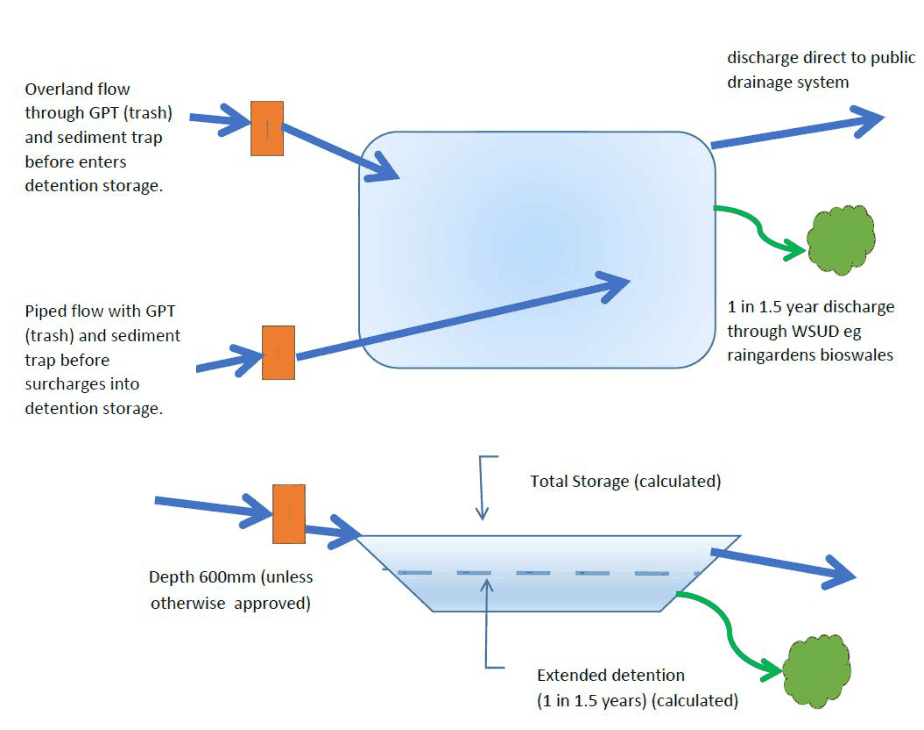
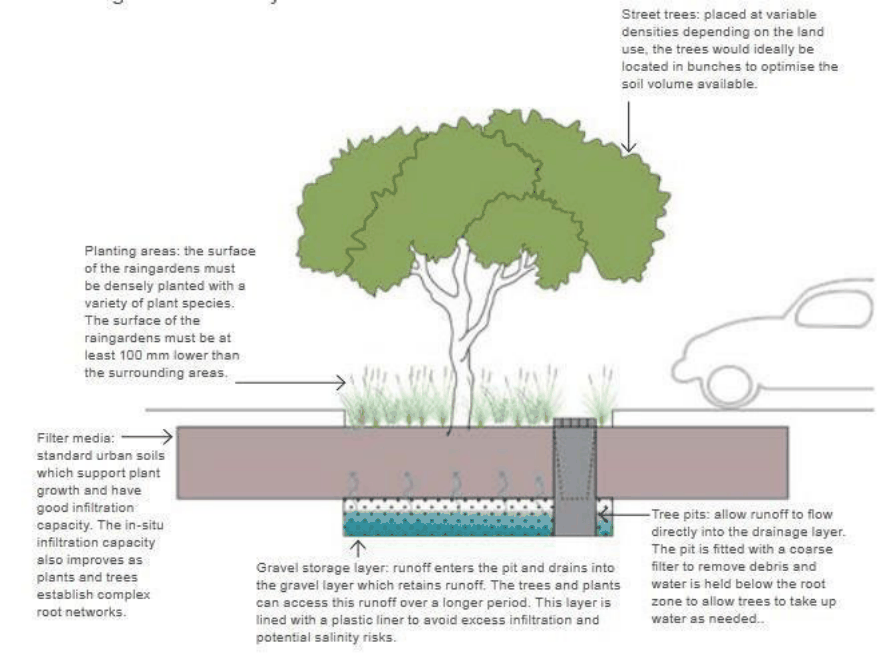
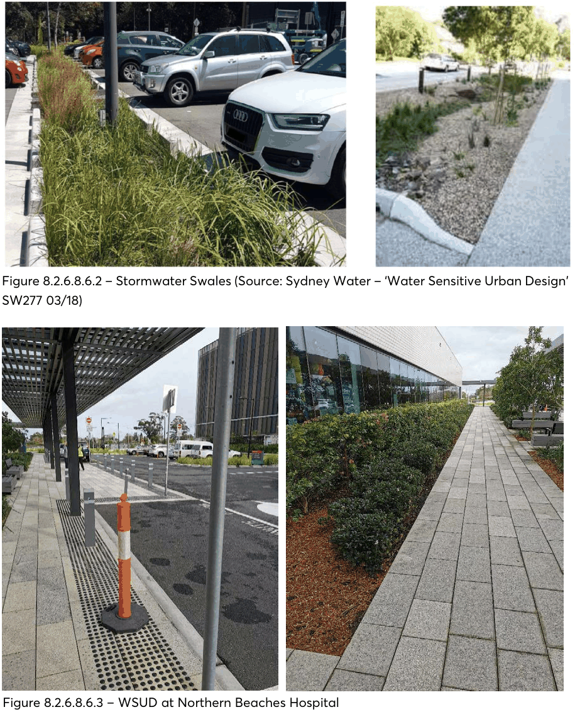
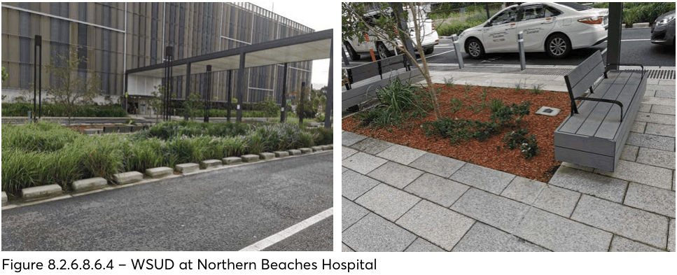
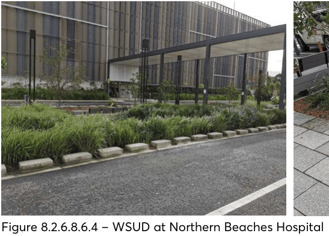
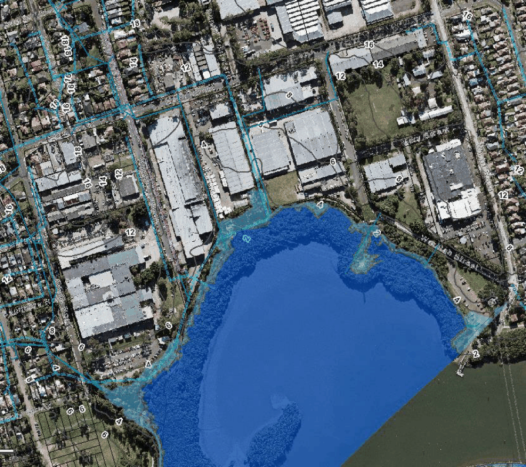

#### 8.2.6.8 APPENDIX B – WATER MANAGEMENT CONTROL PLAN

#### 8.2.6.8.1 WATER MANAGEMENT STRATEGY – OVERVIEW

Urbanisation brings impermeable paving and roofing, replacing ‘natural’ landscapes. More rainwater runs off, and it runs faster. This substantially changes the catchment: flooding is increased, water and waterways become polluted, bushland degrades and there are numerous other impacts. Sustainable water management is required to counteract this.

Overland flow will traverse the VRS and Melrose Park precinct during severe storms. There is a catchment above Victoria Road that contributes to this overland flow.

At present, overland flow and drainage across Melrose Park is informal but allows overland stormwater to be delayed on its passage through the site into the two key discharge points – Wharf Road, near Jennifer Park, and Hope Street.

Overland flow will traverse the catchment above the Melrose Park South precinct and the precinct itself during severe storms. There are catchments above Victoria Road and west of Melrose Park Precincts that contribute to this overland flow.

> [Picture on page 320: a picture, saved as a picture (images/part-08-centres-precincts-special-character-areas-specific-page-320-16.gif, 150 dpi).]

Figure 8.2.6.8.1.1 – Business as Usual’ and ‘Parkland Approach (Source: Urban Typologies and Stormwater Management – achieving a cool green liveable Western Parkland City, Sydney Water, Bligh Tanner and Architectus 2020)

Once the Melrose Park North precinct development is completed, some but not all, of this overland flow will be managed to prevent accelerated runoff and other factors that would otherwise increase flooding below the site, particularly in Melrose Park South precinct. However, with this size of catchment and its terrain and character, some overland flow flooding is unavoidable, and this must be managed within the Melrose Park South precinct so that overland flow floodwaters are safely conveyed through the precinct to the Parramatta River.

MELROSE PARK URBAN RENEWAL PRECINCT

In Melrose Park North, both private and public stormwater/floodwater detention will be implemented so that peak discharges from the northern precinct are reduced to at or below pre-development peak levels and at the same time Council’s obligations regarding on site detention in the Parramatta River Catchment are met. This detention and flood peak management must occur for the range of storm/rainfall events up to the 1% AEP, and for higher events to ensure flood impacts are not significant.

Flood detention within Melrose Park North will not reduce the total volume of water flowing across and out of the site but will delay and reduce its peak so that flood levels are kept below predevelopment levels at least up to the 1% AEP events.

In Melrose Park North, private On-Site-Detention (OSD) will be provided within the privately owned sites for each development in accordance with the Upper Parramatta River Catchment Trust Handbook Edition 4.

Water Sensitive Urban Design (WSUD) within the private sites will manage water quality as well as rainwater capture and use.

In addition, public OSD and WSUD will be provided within the road reserves where practicable, as well as playing fields, parks, and other public lands. The primary purpose of the public OSD systems is to ensure that flooding conditions are not exacerbated in existing development that lies downstream of the Melrose Park North Precinct for all storms up to 1% AEP in intensity. As a minimum, both overland and piped flows are to be detained in two surface detention systems which are to be located in the open space areas which are to be provided adjacent to Wharf Road and Hope Street.

Initial modelling suggests there will be several overland flow paths from Melrose Park North flowing across the Melrose Park South precinct. All of these overland flow paths and those not yet modelled to the east and west that are not part of the Melrose Park precincts must be accommodated by planned and designed overland flow paths through the Melrose Park South precinct site.

These flow paths are likely to be a combination of roadways and open space – which may be public domain, such as parks, or privately owned but protected with easements and covenants on title.

Unlike for the North, OSD within the Melrose Park South precinct may cause worsening of flooding due to this area’s close proximity to the Parramatta River. An earlier undetained discharge from the precinct may be preferable. If this negative consequence can be demonstrated, it is possible, at Council’s discretion, that the requirements for both public and private OSD will be waived.

MELROSE PARK URBAN RENEWAL PRECINCT

> [Picture on page 322: a picture, saved as a picture (images/part-08-centres-precincts-special-character-areas-specific-page-322-2.gif, 150 dpi).]

Figure 8.2.6.8.1.2 – Overland flow 1% AEP fully blocked condition. Indicative only. Not adopted by Council

Figure 8.2.6.8.1.3 – Overland flow. PMF Indicative only. Not adopted by Council

MELROSE PARK URBAN RENEWAL PRECINCT

Note there are additional catchments to the east and west that are not modelled here. Source of both images: Lyall and Associates, January 2022

The roads will theoretically convey up to the 5% AEP flows in the pipes and between opposite kerbs. The ‘public’ 1% AEP flows above the 5% AEP flows will be conveyed across the whole road reserve width between property boundaries and in designed floodways if the road width is not sufficient.

Flood planning levels for buildings adjacent to the overland flow paths will be derived from the condition in a 1% AEP event where drainage pits and pipes are assumed to be not functioning and all flow is overland (100% blockage). Flood Planning Levels will include 0.5m freeboard.

Both the private and public WSUD systems must achieve the water quality targets set out in this DCP.

The development of the Parramatta Local Government Area and Melrose Park itself requires integrating water management within the landscape and urban design using appropriate, sustainable technology.

This appendix provides technical guidelines for water management for the whole Melrose Park Precinct. It applies to water management as follows.

The Water Management Strategy must be considered under six (6) interdependent aspects:

a) Flooding and Overland flow management.

b) Road and public domain piped drainage.

c) Flood reduction using public and private water detention systems.

d) Environmental management of private and public low flows with Water Sensitive Urban Design (WSUD).

e) Rainwater harvesting and use.

f) Interactions with the Parramatta River.

MELROSE PARK URBAN RENEWAL PRECINCT

#### 8.2.6.8.2 FLOODING AND OVERLAND FLOW MANAGEMENT

Principles

P.01 Assess and design for the safe conveyance (and detention) of overland flow through the site with protection of people, buildings, and property during rainfall events of 1% AEP (100 year) plus 0.5m freeboard and up to Probable Maximum Precipitation Floods (PMP, PMF).

P.02 Design conveyance and detention of overland flow to ensure there is no worsening of flooding in a 1% AEP event anywhere as a result of the development of the precinct and there is no significant worsening of flooding in higher events up to the PMP/PMF anywhere as a result of the development.

P.03 Protect the Melrose Park South precinct from flooding from the Parramatta River P.04 Protect the Parramatta River and its foreshore and riparian zone from suffering adverse environmental impacts caused by flooding and stormwater discharges from the Melrose Park South and North precincts.

Objectives

O.01 Protect the community and developments from river flooding rising from Parramatta River and its tributaries/creeks.

O.02 Protect the community and developments from overland flow flooding from rainfall within, and up slope of, the site.

O.03 Manage the risks for all floods up to the Probable Maximum Flood. O.04 Identify and manage overland flow paths and buildings and land affected by them.

Controls

C.01 A set of hydrologic and hydraulic models are to be developed of the catchments within which the Melrose Park Precinct is located. These models must be to Council’s satisfaction and criteria.

C.02 The ‘ensemble approach’ prescribed in Australian Rainfall and Runoff (ARR) 2019 is to be adopted for deriving design discharge hydrographs for storms up to 0.2% AEP in intensity, while the 2003 update of the Bureau of Meteorology’s “The Estimation of Probable Maximum Precipitation in Australia: Generalised Short-Duration Method” is to be used to derive estimates of Probable Maximum Precipitation.

C.03 The hydraulic model is to incorporate all of the features which influence flood behaviour in the study catchments, including details of the existing stormwater drainage system.

C.04 Blockage factors of 20% and 50% are to be applied to on-grade and sag type inlet pits, respectively when designing major/minor drainage systems.

C.05 Flood and stormwater behaviour is to be defined for design storms with AEPs of 5% and 1%, 1% plus climate change, as well as the Probable Maximum Flood (PMF).

C.06 Steady-state design discharge hydrographs are to be adopted for defining the maximum rate at which flow will discharge from each individual super lot within the Melrose Park North

MELROSE PARK URBAN RENEWAL PRECINCT

Precinct under post-development conditions. Where OSD is to be provided, this flow rate is to be based on the OSD calculations which are referred to in this document and is to be adopted when defining flood behaviour under post-development conditions for storms up to 0.2% AEP in intensity. Uncontrolled flow from each super lot is to be adopted when defining flood behaviour for more intense storm events (for example, the PMF event).

C.07 The impact that a potential increase in design 1% AEP rainfall intensities associated with future climate change is to be assessed. The assessment is to be in accordance with the NSW Department of Planning, Infrastructure and Environment’s floodplain risk management guideline entitled “Practical Considerations of Climate Change”. Design storms of 0.5% and 0.2% AEP may respectively be adopted as being analogous to Representative Pathway Concentration 4.5 and 8.5 increases in 1% AEP design rainfall intensities under year 2090 conditions for the purpose of the assessment, noting that the assessment need only be undertaken for post-development conditions.

C.08 An assessment is to be undertaken into the impact a complete blockage of the existing and proposed piped drainage system in the vicinity of the Melrose Park South Precinct would have on flood behaviour for a 1% AEP storm event, as well as its implications on the proposed developments.

C.09 When modelling to determine flood levels and flood planning levels with respect to overland flow, the analysis and modelling of the overland flow paths must be with 2D modelling such as Tuflow, and must assume all flow is overland, while piped reticulation is fully blocked and not contributing to conveyance.

C.10 Flood modelling (and drainage design) must take account of tailwater levels in the Parramatta River, including with climate change.

C.11 This modelling must also assume that, where it is to be provided, on site detention is fully functional within the private lots and that such flows are discharging on to the surfaces of roads etc.

C.12 The Flood Planning Levels shall be the adjacent interpolated 1% AEP flood levels (100% blocked) plus 0.5 metre freeboard.

C.13 Minimum finished floor levels must be the respective Flood Planning Levels as defined above. For sloping sites these levels may be stepped.

C.14 There must be no habitable rooms/floors below the applicable flood planning level, including residential, retail, community use, gathering and performance spaces and offices. In addition, any uses that would present a significant risk of harm to occupants are not permitted below the applicable Flood Planning Levels.

C.15 As and if determined by Council, non-habitable rooms and floors such as car parks, waste and loading docks, plant rooms and the like may be constructed below the applicable Flood Planning levels, provided such floors are protected from flooding to Council’s satisfaction by the building design from inundation up to the applicable Flood Planning Level(s) and, if required by Council, by additional means such as flood gates and flood doors up to the Probable Maximum Flood Level.

C.16 Council may require a sensitivity analysis for the effects of climate change. C.17 For a building that is adjacent to a road, or public domain, or other land adjacent, that is part of an overland flow path or flood storage area:

MELROSE PARK URBAN RENEWAL PRECINCT

a) Where Council is satisfied that the roadway, or public domain, or other land adjacent to a building, is an overland flow path or flood storage area in the 1% AEP event with 100% blockage, Council will require minimum finished floor levels of habitable rooms to be 500mm freeboard above the adjacent 1% AEP water surface level as mapped in the 2 Dimension (2D) overland flow model accepted by Council. This level may vary along the site /building boundary with changing water levels.

C.18 For a building that is adjacent to a road, or public domain, or other land adjacent, that, in Council’s view, is not part of an overland flow path or flood storage area:

a) Finished floor levels at the boundary adjacent to a road that is accepted by Council as not being an overland flow path, or flood storage area, in a 1% event, including 100% blockage, must be a minimum of the adjacent top of kerb levels plus 2% rising grade to the boundary.

b) Where there is no road, such as paving or landscape, and Council accepts the area is not part of an overland flow path, or flood storage area, in a 1% event including 100% blockage, surface levels must fall away from the building entrances and openings to the adjacent drainage/WSUD system at a minimum of 2%, or greater if necessary to ensure adequate surface drainage.

MELROSE PARK URBAN RENEWAL PRECINCT

> [Picture on page 327: a picture, saved as a picture (images/part-08-centres-precincts-special-character-areas-specific-page-327-2.gif, 150 dpi).]

Figure 8.2.6.8.2.1 - Sketch of Melrose Park North approximate overland flow paths and public detention basins.  For details refer Lyall and Associates drawings dated 5 November 2020 - Figure 6: Indicative Extent and Depth of Inundation - Post-VRS and PP Development and Complete Blockage Conditions – 1% AEP (9 sheets) (Included as attachment)

MELROSE PARK URBAN RENEWAL PRECINCT

#### 8.2.6.8.3 ROAD AND PUBLIC DOMAIN DRAINAGE

Principles

P.01 Provide effective, safe conveyance of stormwater across the catchment using planned and managed overland flow paths, trunk, and local drainage.

Objectives

O.01 Protect occupants of roads and the public domain and property from uncontrolled stormwater in events up to the 5% AEP (1 in 20 year) rainfall by installing underground or above ground drainage infrastructure to contemporary standards.

Controls

C.01 All drainage work to be designed and constructed to Council standards. C.02 All civil designs for public infrastructure must be approved in writing by Council’s Manager Assets prior to commencement of construction.

C.03 All construction of public infrastructure must be inspected and approved by Council’s representative as the works proceed and upon completion prior to occupation or use.

C.04 Appropriate easements, restrictions, covenants, and land title dedications must be in place to Council’s satisfaction prior to occupation or use.

8.2.6.8.4 FLOOD REDUCTION USING PUBLIC AND PRIVATE STORMWATER DETENTION SYSTEMS

Principles - public and private stormwater detention

P.01 Manage and moderate stormwater flow across the catchment to minimise the effects of urbanisation, which include increased amount of runoff, shorter times of concentration, faster and deeper overland flows, erosion and flooding.

P.02 Manage and moderate stormwater flow from individual sites to compensate for increased impervious areas and faster conveyance systems, using on site detention, WSUD, deep soil, permeability, and other measures.

P.03 Provide sustainable management, conveyance, and detention of stormwater within the Public Domain.

P.04 Mitigate floods. P.05 Melrose Park North requires a combination of on-site detention within the private lots and stormwater detention basins in the public domain to sufficiently attenuate flows prior to discharge from the precinct. These two systems must be designed to work together hydraulically in a full range of design storms.

MELROSE PARK URBAN RENEWAL PRECINCT

P.06 Stormwater from the private lots must be attenuated using OSD in accordance with this DCP and generally in accordance with catchment management criteria advised by the Upper Parramatta River Catchment Trust in their Edition 4 OSD Design Handbook.

P.07 On site detention within the Melrose Park South precinct may cause worsening of flooding due to his area’s close proximity to the Parramatta River. An earlier undetained discharge from the precinct may be preferable. If this negative consequence can be demonstrated, it is possible, at Council’s discretion, that the requirements for private OSD will be waived.

Principles - private stormwater detention

P.01 Council has identified the following design criteria which is to be adopted in the design of the Private OSD systems, noting for OSD on private land that it is generally in accordance with the Fourth Edition Upper Parramatta River Trust’s On-site Stormwater Detention Handbook (UPRCT Edition 4). The design principles for stormwater conveyance and detention within private land are:

a) To ensure that new developments and redevelopments do not increase peak stormwater flows in any downstream area during major storms up to 1% AEP in intensity.

b) To reduce post-development peaks throughout the catchment in a 50% AEP storm event to be as close to natural levels as practical and

c) To encourage the integration of OSD with other water quality WSUD measures.

d) To prevent any increase in the site discharge to the downstream drainage system nor reduction in the volume of storage provided unless specifically allowed in the following sections or for rainwater storage.

Objectives – private stormwater detention

O.01 To limit flow peaks throughout the catchment in a 1% AEP storm event, to estimated peak flows under 1999 conditions, even if the further development of the catchment is equivalent to full medium/high density redevelopment throughout the catchment thereby preventing any increase in downstream peak flows resulting from new developments or redevelopments by temporarily storing on-site the additional and quicker runoff generated.

O.02 Prevent increases in downstream flooding and drainage problems that could:

a) Increase flood losses.

b) Damage public assets.

c) Reduce property values.

d) Require additional expenditure on flood mitigation or drainage works.

O.03 Reduce post-development peaks, throughout the catchment, in the 50% AEP storm event to as close to natural levels as practical.

O.04 Encourage integration of OSD systems into the architectural design and layout of the development so that adequate storage areas are included in the initial stages of the site design.

MELROSE PARK URBAN RENEWAL PRECINCT

O.05 Encourage integration of the OSD facilities into a sustainable overall water management plan for the site.

O.06 Require construction supervision of OSD systems by the OSD designer to improve construction standards.

Controls

C.02 The private lot stormwater drainage system (including surface gradings, gutters, pipes, surface drains and overland flow paths) for the property must:

a) be able to collectively convey all runoff to the OSD system in a 1% AEP storm event with a duration equal to the time of concentration of the site; and

b) ensure that the OSD storage is by-passed by all runoff from neighbouring properties and any part of the site not being directed to the OSD storage, for storms up to and including the 1% AEP storm event.

c) direct all site runoff to the Private OSD. That is the storage is ‘on-line’.

C.03 The Private OSD is to have two orifices (or other) outlets and a non-piped overflow spillway. C.04 The primary or lower orifice or controlled discharge must have a SRDL of 40 L/s/ha. This must be located as close as possible to the storage invert.

C.05 A secondary orifice must be provided located at the base of a discharge control pit (DCP) providing HED with a SRDU of 150 L/s/ha.

C.06 SRDL (40 L/s/ha) and SRDU (150 L/s/ha) may need to be adjusted in accordance with the procedures set out in UPRCT ED 4 Section 5.1 when the entire site cannot be drained to the storage.

C.07 The crest of the DCP must be designed to be at the water level of the 50% AEP storm event when the volume in the lower storage (SSRL) reaches 245 m3/ha.

C.08 The secondary orifice must operate from when the water level in the storage exceeds the crest level and water starts to overflow into the DCP.

C.09 A non-piped spillway, of suitable length must be provided to prevent flooding of neighbouring lands if the OSD outlets become blocked. This overflow must be located at the top of the storage (i.e., at 396 m3/ha).

C.10 The SSRT and SSRL are only adjusted if a rainwater tank is included in the development/redevelopment and an airspace “credit” is claimed to partially offset the SSR.

C.11 The site area to be adopted for sizing the Private OSD systems in the individual super lots is to include half of the adjacent road reserve, appreciating that the portion of the site area which is not controlled by each individual Private OSD system may exceed the permissible 30% rule.

C.12 Unless otherwise advised by Council, Version 9 of the UPRCT Edition 4 OSD calculation sheet shall be used for sizing the various components of the Private OSD systems.

C.13 Guidelines to assist in determining depths and frequencies of ponding for different classes of storages are given in Table 6.1 of UPRCT Edition 4. It is emphasised that these are general guidelines that will be varied according to the nature of the development and the location of the storage.

MELROSE PARK URBAN RENEWAL PRECINCT

C.14 In general, the maximum depth of ponding in above ground storages is 600 mm. C.15 Council may approve deeper ponding in individual cases where the applicant demonstrates that safety issues have been adequately addressed. For example, warning signs and fencing must be installed where the depth exceeds 600 mm, or the ponding is adjacent to pedestrian traffic areas.

C.16 Surface storages should be constructed so as to be easily accessible, with gentle side slopes permitting walking in or out. A maximum gradient of 1(V):4(H) (i.e. 1 vertical to 4 horizontal) will be required on at least one side to permit safe egress in an emergency. Where steep or vertical sides are unavoidable, due consideration should be given to safety aspects, such as the need for fencing or steps or a ladder, both when the storage is full and empty.

C.17 Balustrades (fences) must comply with the BCA (See Section D2.16 of the Code), while safety fences should comply with the Swimming Pool Act 1992. Fencing must not obstruct overland flow and floodwaters.

MELROSE PARK URBAN RENEWAL PRECINCT

Table 8.2.6.8.4.1 – Private OSD System Glossary

| Detention storage | Detention devices capture and temporarily store stormwater runoff during major (infrequent) storm events. Stormwater is then discharged to the drainage system at a controlled rate. Detention devices act to mitigate potential downstream flooding impacts. |
|---|---|
| Extended Detention storage | The lower portion of the OSD storage, which detains stormwater in smaller, frequent storms up to the 50% AEP event in order to reduce stormwater runoff closer to the rates under natural, pre-development conditions. This helps minimise damage and disturbance to downstream watercourses and aquatic ecosystems. |
| Flood Detention storage | The upper portion of the OSD storage that detains stormwater to prevent any increase in downstream flooding in moderate to major storms. Water held in the Flood Detention storage drains away through both the primary and secondary orifice outlets. |
| PSD | Permissible Site Discharge - the maximum allowable discharge leaving the site in litres/sec/hectare (L/s/ha) |
| SRDL | The Site Reference Discharge from the extended detention storage in litres/sec/hectare (L/s/ha), or in litres/sec (L/s) when applied to a specific site, when the volume of runoff stored in the extended detention storage equals the SRDL. In the case of the Melrose Park North Precinct, the SRDL has been set at 40 L/s/ha. |
| SRDU | The Site Reference Discharge from the DCP that receives stormwater when the volume of runoff exceeds the volume of the extended detention storage in litres/sec/hectare (L/s/ha), or in litres/sec (L/s) when applied to a specific site. The site reference discharge occurs when the DCP is completely filled and HED conditions are established at the commencement of flood detention. In the case of the Melrose Park North Precinct, the SRDU has been set at 150 L/s/ha. |
| SSRL | 33 the minimum volume (in m /hectare or in m when applied to a specific site) required for the lower Extended Detention storage when the outflow is restricted to the SRD. In the case of the Melrose Park North Precinct, the SSRL has been set at 245 L/s/ha. |
| SSRT | 3 the total volume (in m /hectare or in m when applied to a specific site) required for overall storage (combined Extended Detention storage and Flood Detention storage) when outflows occur through the primary and secondary orifice outlets. In the case of the Melrose Park North Precinct, the SSRT has been set at 396 L/s/ha. |

MELROSE PARK URBAN RENEWAL PRECINCT

#### 8.2.6.8.5 PUBLIC STORMWATER DETENTION SYSTEMS

Principles

P.01 The following principles, objectives and controls must be adopted in the design of the public stormwater conveyance and detention systems, noting that it is generally in accordance with the latest addition of Australian Rainfall and Runoff (ARR 2019).

P.02 Public stormwater detention within the Melrose Park South precinct may cause worsening of flooding due to this area’s close proximity to the Parramatta River. An earlier undetained discharge from the precinct may be preferable. If this negative consequence can be demonstrated, it is possible, at Council’s discretion, that the requirements for public OSD will be waived.

Objectives

O.01 Flooding conditions and risks must not be worsened anywhere for all storms up to 1% AEP in intensity.

O.02 Flooding conditions and risks must not be significantly worsened anywhere for storms that are more intense than 1% AEP up to the Probable Maximum Precipitation.

O.03 Ensure Safety, amenity, aesthetic, and ecological values affected by the detention systems are satisfactory.

O.04 Detention infrastructure can readily be maintained in perpetuity.

Controls

C.01 Sufficient area must be provided for above ground detention purposes within the public domain of the Melrose Park South precinct assuming max depths of 300mm – 600mm. To this is to be added sloping sides, inflow, and outflow swales etc.

C.02 Playing fields and open space are in suitable locations and of appropriate size to be used for stormwater detention purposes.

C.03 Unless otherwise approved by Council, basins shall be designed as a dry basin, with low level inundation potentially occurring statistically every 18 months (approx.) and will remain temporarily wet (for a few hours) after a triggering rain event.

C.04 The depth of the basins during severe storms will be typically 300mm to 600mm although greater depths may be necessary in extreme events. Basins must not pose a safety hazard or affect overall usability of the playing field under normal weather conditions.

MELROSE PARK URBAN RENEWAL PRECINCT

> [Picture on page 334: a picture, saved as a picture (images/part-08-centres-precincts-special-character-areas-specific-page-334-2.gif, 150 dpi).]

Figure 8.2.6.8.5.1 – Melrose Park - Typical above-ground overland flow detention 1% AEP (1 in 100 year)

8.2.6.8.6 WSUD - ENVIRONMENTAL MANAGEMENT OF PRIVATE AND PUBLIC LOW FLOWS WITH WATER SENSITIVE URBAN DESIGN

Principles

P.01 In the Melrose Park North Precinct all developments must implement Water Sensitive Urban Design (WSUD).

P.02 WSUD is used to ensure runoff water quality is within acceptable limits using landscape integration and if necessary, treatment technology.

P.03 Water sensitive urban design is used to enhance the landscape, support tree canopies with rainwater and deep soil to increase evapotranspiration, urban heat reduction and to reduce uncontrolled runoff.

P.04 A water sensitive stormwater system must be designed to minimise the impact of urban development on the catchment, by improving the quality and quantity of stormwater runoff as well as providing ancillary benefits.

P.05 A WSUD system may contribute to aspects such as biodiversity, reduction of potable water use, carbon sequestration, habitat provision, amenity, community engagement in water resource management and reduction of urban heat island effect.

MELROSE PARK URBAN RENEWAL PRECINCT

P.06 Protect and enhance natural water systems (creeks, rivers, wetlands, estuaries, lagoons, groundwater systems etc.).

Objectives

O.01 Use Water Sensitive Urban Design to manage water, particularly for rainfall events up to 1 in

1.5 years probability.

O.02 Implement successful Water Sensitive Urban Design and Stormwater Quality improvements for the public domain.

O.03 Implement successful Water Sensitive Urban Design and Stormwater Quality improvements for private developments.

> [Picture on page 335: a picture, saved as a picture (images/part-08-centres-precincts-special-character-areas-specific-page-335-11.gif, 150 dpi).]

Figure 8.2.6.8.6.1 – Street Trees using WSUD – design and benefits (Source: Urban Typologies and Stormwater Management – achieving a cool green liveable Western Parkland City, Sydney Water, Bligh Tanner and Architectus 2020)

MELROSE PARK URBAN RENEWAL PRECINCT

> [Picture on page 336: a picture, saved as a picture (images/part-08-centres-precincts-special-character-areas-specific-page-336-2.gif, 150 dpi).]

Figure 8.2.6.8.6.2 – Stormwater Swales (Source: Sydney Water – ‘Water Sensitive Urban Design’

SW277 03/18)

Figure 8.2.6.8.6.3 – WSUD at Northern Beaches Hospital

MELROSE PARK URBAN RENEWAL PRECINCT

Controls

C.01 WSUD principles are to be integrated into the development through the design of the stormwater systems and landscaping scheme and in the orientation of the development rather than relying on ‘end of pipe’ treatment devices prior to discharge.

C.02 Some options for WSUD measures at Melrose Park include:

a) Vegetated and grassy swales.

b) Vegetated filter and buffer strips.

c) Wetlands.

d) Sand and gravel filters (depending on indigenous soil suitability).

e) Bio-retention systems.

f) Permeable/porous pavements.

g) Infiltration basins.

h) Rainwater tanks.

i) Gross pollutant traps and filters.

j) Passive watering systems for landscaped areas.

k) Additional deep soil areas.

l) Naturalised watercourses.

m) Rain gardens.

n) ‘End of pipe’ proprietary treatment devices (these must be used in conjunction with other landscape integrated measures to provide ancillary social, environmental, and economic benefits).

o) This is not an exclusive list and Council does not specify particular measures for particular types of development. These measures are typically employed in a ‘treatment train’ to maximise the range of pollutants removed.

C.03 Development is to be sited and designed to minimise disturbance of natural watercourses and overland flow paths.

C.04 Impervious surfaces are to be minimised and soft landscaping with deep soil and tree planting extensively used to promote infiltration, evapotranspiration and reduced stormwater run-off.

C.05 WSUD elements should be located and configured to maximise the impervious area that is treated.

C.06 WSUD must be adopted for the following development types:

a) Residential on lots greater than 1500m2 or with 5 or more dwellings.

b) Commercial and Industrial – development, redevelopment and alterations/additions which increase gross floor area by more than 150m2 or alter and/or add more than 150m2 of impervious area. (Approach to WSUD will vary depending on lot size.)

c) Subdivisions of Industrial/commercial properties.

MELROSE PARK URBAN RENEWAL PRECINCT

d) Subdivision of residential properties where the existing lot is greater than 1500m2 or 5 or more lots are being created.

e) Other development >$50k in value which exceeds either of the following criteria:

• Development which alters and/or adds more than 150m2 of impervious area.

• Development which results in an increase in gross floor area of more than 150m2.

C.07 WSUD systems shall generally be designed to treat storm events up to the 1 in 1.5 year average recurrence interval. Low flows of this frequency must be separated from higher flows that will be diverted into OSD and other stormwater quantitative management systems.

C.08 WSUD must achieve the following pollution reduction targets: Table 8.2.6.7.5.1 – WSUD Pollution Reduction Targets

| Pollutant NOTE: Reductions in loads are relative to the pollution generation from the same development without treatment. | Performance Target (% reduction in the post development mean annual load of pollutant) |
|---|---|
| Gross Pollutants (greater than 5mm) | 90% |
| Total Suspended Solids (TSS) | 85% |
| Total Phosphorus (TP) | 60% |
| Total Nitrogen (TN) | 45% |
| Hydrocarbons, motor oils, oil and grease | 90% |

C.09 The post development mean annual runoff volume from the entire site must be reduced by at least 10% from that pre-development. This may be achieved with rainwater tanks, infiltration into deep soil, minimising impervious areas, using permeable paving and other methods.

C.10 Rainwater is a valuable water resource to be harvested and used if possible. C.11 The receiving waterway must be protected and enhanced. C.12 Where water sensitive urban design measures are required, Development Application or other proposal lodgement must be supported by the following documentation to Council’s satisfaction:

a) A WSUD report, describing the treatment train including all measures used, justification for this selection and a summary of design ancillary benefits.

b) MUSIC software modelling (or equivalent) to demonstrate that the proposed WSUD design achieves the required pollution reduction targets. Both a written summary of the assumptions, configuration and results of the model, and a digital copy of the model file must be submitted.

c) The above documentation must be prepared by a qualified hydraulic/environmental engineer in consultation with the project landscape and architectural professionals.

d) Council requires simple WSUD landscape designs that achieve water management objectives without unusual or complicated maintenance demands.

MELROSE PARK URBAN RENEWAL PRECINCT

e) The Development Application must be accompanied with a management and maintenance Plan for the WSUD biological and landscape facilities for both establishment phase (3-5 years) and the long-term phase.

f) The Development Application must be accompanied with a Management and Maintenance Plan for the WSUD proprietary treatment devices (such as GPT’s, filters etc).

g) The Applicant must also provide evidence to Council that they have signed a minimum 3-year contract with a suitable maintenance contractor to carry out ongoing maintenance of the water treatment facilities and technology installed on site.

C.13 The discharge of polluted waters from any site is not permitted. Discharges from premises of any matter, whether solid, liquid, or gaseous is required to conform to the Protection of the Environment Operations Act 1997 and its Regulations, or a pollution control approval issued by the NSW Environment Protection Authority for Scheduled Premises.

> [Picture on page 339: a picture, saved as a picture (images/part-08-centres-precincts-special-character-areas-specific-page-339-14.gif, 150 dpi).]

> [Picture on page 339: a picture, saved as a picture (images/part-08-centres-precincts-special-character-areas-specific-page-339-15.gif, 150 dpi).]

Figure 8.2.6.8.6.4 – WSUD at Northern Beaches Hospital

#### 8.2.6.8.7 RAINWATER HARVESTING AND USE

Principles

P.01 Rainwater harvesting and use is encouraged in any water management system for individual lots and for the public domain.

P.02 Rainwater captured by WSUD direction of flows into deep soil will assist plant and tree growth, reduce ambient temperatures, trap pollutants and moderate runoff flows.

P.03 Captured rainwater is readily suited for landscape irrigation and, with treatment, for other internal uses such as toilet flushing.

P.04 Rainwater may be captured in a separate rainwater tank or a combined rainwater and on-site detention tank. Refer Edition 4 of the Upper Parramatta River Catchment Trust On-Site Detention Handbook.

P.05 Refer to Section 8.2.6.5 – Sustainability of this DCP; Section 8.2.6.5.1 – Energy and Water Efficiency; and Section 8.2.6.5.2 – Recycled Water.

MELROSE PARK URBAN RENEWAL PRECINCT

> [Picture on page 340: a picture, saved as a picture (images/part-08-centres-precincts-special-character-areas-specific-page-340-2.gif, 150 dpi).]

Figure 8.2.6.8.7.1 – Council GIS Parramatta River: PMF, 1% AEP and 5% AEP river flood extents as adopted by Council

Principles

P.01 Melrose Park South precinct has a large interface with Parramatta River which must be managed to control environmental impacts.

P.02 The river’s flooding for events up to the PMF does partially affect the precinct.

Controls

C.01 All water management planning, implementation, and associated infrastructure, such as floodways, stormwater pipes and headwalls, must result in minimum disturbance and must not adversely affect the riparian and aquatic environment and riparian and aquatic ecology.

C.02 Flooding of the site by the Parramatta River for all flood events up to the PMF must be considered to Council’s satisfaction in planning the precinct.

C.03 Elevated river levels must be considered (tailwater levels) to Council’s satisfaction in design of hydraulic systems including floodways, stormwater pipes and detention systems.

MELROSE PARK URBAN RENEWAL PRECINCT

Resources and Further Information

Australian Disaster Resilience Handbook 7, Managing the Floodplain: A Guide to Best Practice in Flood Risk Management in Australia (AIDR 2017), Australian Government Australian Runoff Quality, Engineers Australia 2005 Ball J, Babister M, Nathan R, Weeks W, Weinmann E, Retallick M, Testoni I, (Editors) Australian Rainfall and Runoff: A Guide to Flood Estimation, © Commonwealth of Australia (Geoscience Australia), 2019. Book 9: Runoff in Urban Areas: Coombes, P., and Roso, S. (Editors), 2019 Runoff in Urban Areas, Book 9 in Australian Rainfall and Runoff - A Guide to Flood Estimation, Commonwealth of Australia, © Commonwealth of Australia (Geoscience Australia), 2019 CRC for Water Sensitive Cities, https://www.watersensitivecities.org.au Facility for Advancing Water Biofiltration 2008, Guideline Specifications for Soil Media in Bioretention Systems Flood Risk Management Manual NSW 2023, https://www.environment.nsw.gov.au/research-and-publications/publications-search/flood-risk-management-manual Flood Emergency Planning for Disaster Resilience, Australian Institute for Disaster Resilience, First Edition 2020 Melrose Park Flooding and Drainage Investigation, VRS and PP Development Sites, Lyall and Associates, 5 November 2020, Figure 6: Indicative Extent and Depth of Inundation - Post-VRS and PP Development and Complete Blockage Conditions – 1% AEP (9 sheets) MUSIC Modelling Guidelines for New South Wales, eWater Cooperative Research Centre 2009 South East Queensland Healthy Waterways Partnership 2010, Water by Design Guidelines and Resources, http://www.waterbydesign.com.au Urban Typologies and Stormwater Management, achieving a cool green liveable Western Parkland City, Sydney Water, Bligh Tanner and Architectus 2020 Water Sensitive Planning Guide, http://www.wsud.org Water Sensitive Urban Design Engineering Procedure: Stormwater, Melbourne Water. Water Sensitive Urban Design Technical Guidelines for Western Sydney (UPRCT, 2004), http://www. wsud.org/tech

MELROSE PARK URBAN RENEWAL PRECINCT
