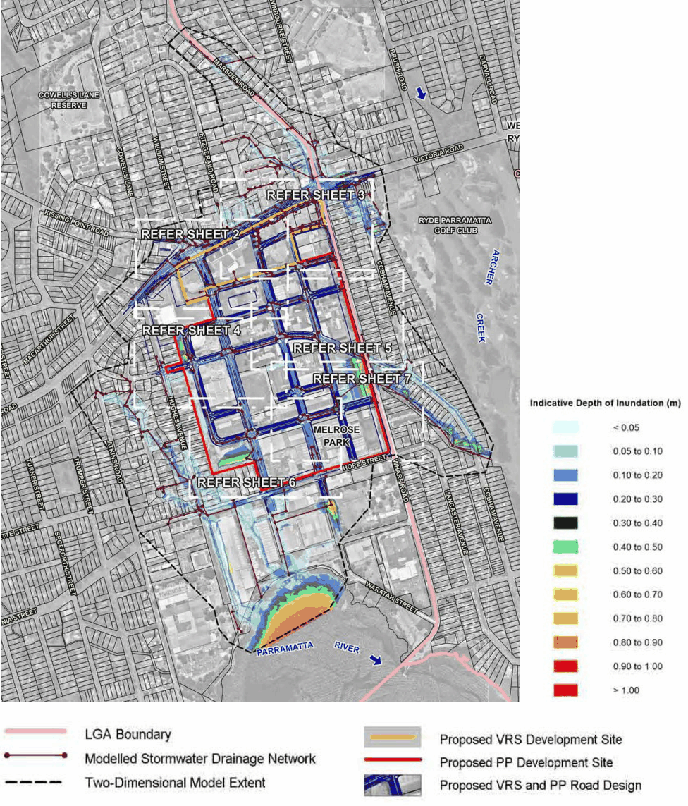
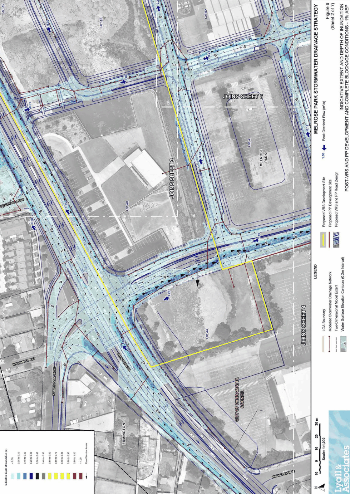
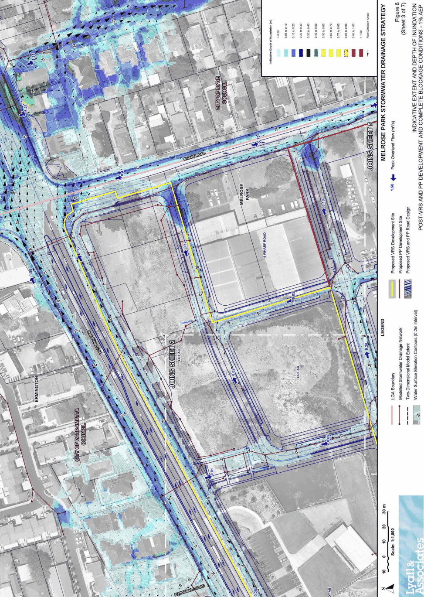
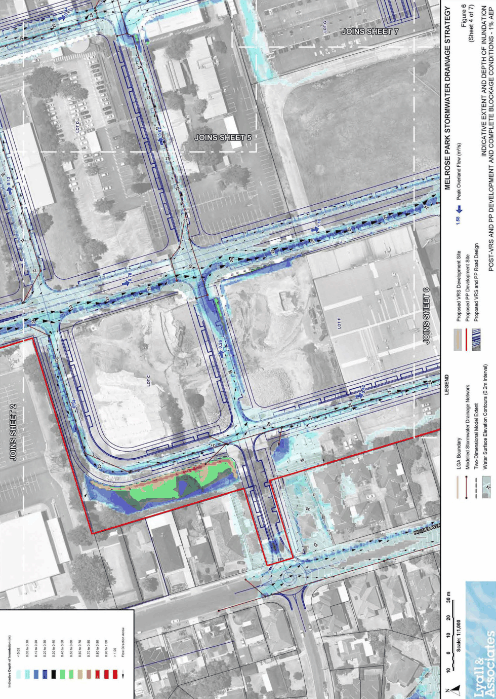
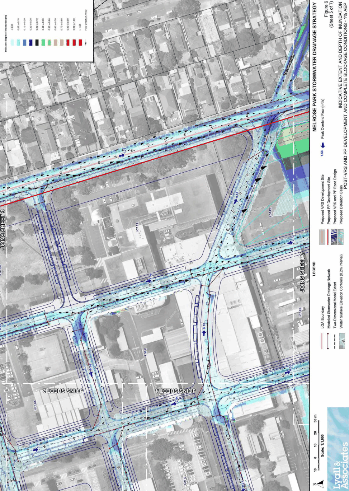
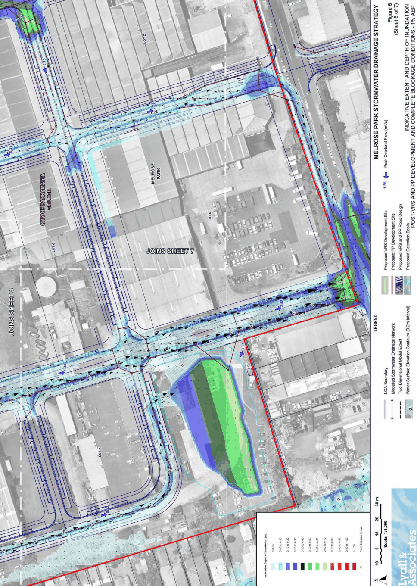
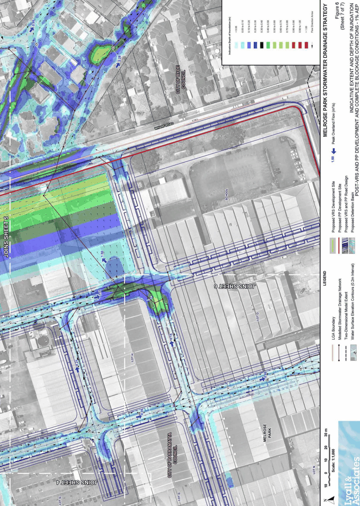

#### 8.2.6.9 APPENDIX C – MELROSE PARK NORTH FLOODING MAPS

> [Picture on page 342: a picture, saved as a picture (images/part-08-centres-precincts-special-character-areas-specific-page-342-3.gif, 150 dpi).]

Figure 8.2.6.9.1 – Melrose Park Stormwater Sheet 1 (Source: Lyall & Associates)

MELROSE PARK URBAN RENEWAL PRECINCT

> [Picture on page 343: a picture, saved as a picture (images/part-08-centres-precincts-special-character-areas-specific-page-343-2.gif, 150 dpi).]

Figure 8.2.6.9.2 – Melrose Park Stormwater Sheet 2 (Source: Lyall & Associates)

MELROSE PARK URBAN RENEWAL PRECINCT

> [Picture on page 344: a picture, saved as a picture (images/part-08-centres-precincts-special-character-areas-specific-page-344-2.gif, 150 dpi).]

Figure 8.2.6.9.3 – Melrose Park Stormwater Sheet 3 (Source: Lyall & Associates)

MELROSE PARK URBAN RENEWAL PRECINCT

> [Picture on page 345: a picture, saved as a picture (images/part-08-centres-precincts-special-character-areas-specific-page-345-2.gif, 150 dpi).]

Figure 8.2.6.9.4 – Melrose Park Stormwater Sheet 4 (Source: Lyall & Associates)

MELROSE PARK URBAN RENEWAL PRECINCT

> [Picture on page 346: a picture, saved as a picture (images/part-08-centres-precincts-special-character-areas-specific-page-346-2.gif, 150 dpi).]

Figure 8.2.6.9.5 – Melrose Park Stormwater Sheet 5 (Source: Lyall & Associates)

MELROSE PARK URBAN RENEWAL PRECINCT

> [Picture on page 347: a picture, saved as a picture (images/part-08-centres-precincts-special-character-areas-specific-page-347-2.gif, 150 dpi).]

Figure 8.2.6.9.6 – Melrose Park Stormwater Sheet 6 (Source: Lyall & Associates)

MELROSE PARK URBAN RENEWAL PRECINCT

> [Picture on page 348: a picture, saved as a picture (images/part-08-centres-precincts-special-character-areas-specific-page-348-2.gif, 150 dpi).]

Figure 8.2.6.9.7 – Melrose Park Stormwater Sheet 7 (Source: Lyall & Associates)

TELOPEA LOCAL CENTRE
