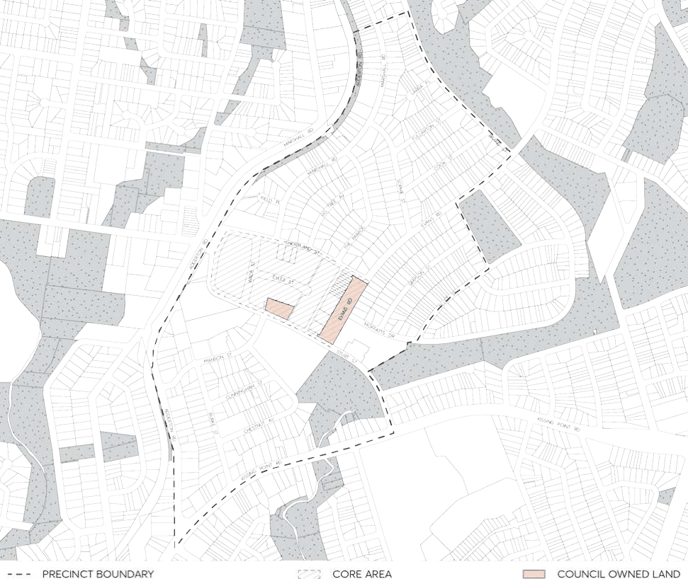

#### 8.2.7 TELOPEA LOCAL CENTRE

The provisions of this Section of this DCP apply to development within the Telopea precinct as shown in Figure 8.2.7.1 and any relevant controls in Parts 2, 3 and 5 of the Parramatta DCP 2023. Where there is any inconsistency the Telopea Precinct provisions of this part will prevail.

> [Picture on page 349: a picture, saved as a picture (images/part-08-centres-precincts-special-character-areas-specific-page-349-6.gif, 150 dpi).]

Figure 8.2.7.1 – Land application map

TELOPEA LOCAL CENTRE
