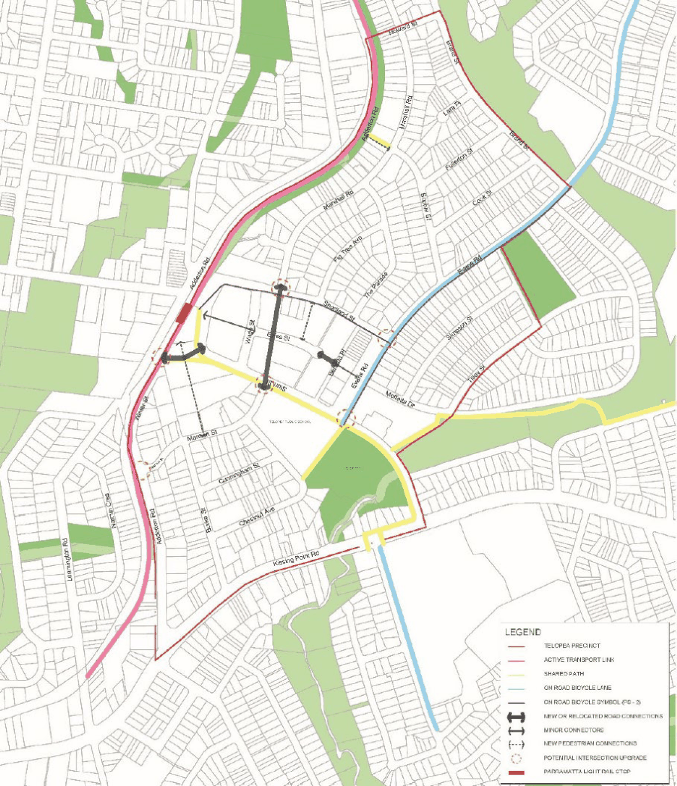

#### 8.2.7.2 TRAFFIC AND TRANSPORT

#### 8.2.7.2.1 ROAD CONNECTIONS

Objectives

O.01 Provide new or relocated road connections and intersections to service the new retail precinct and residential developments.

O.02 Road connections are to be provided to increase accessibility and appropriately navigate the topography of the precinct for motorists, pedestrians and cyclists.

O.03 To ensure new streets are designed to maximise equitable access, where possible, and as topography permits.

O.04 Where possible, that new road connections connect with the existing street pattern in order to provide direct connections.

TELOPEA LOCAL CENTRE

Controls

C.01 Any new road or any relocation of an existing road or active transport connections are to be provided in accordance with Figure 8.2.7.2.1.1 and the specifications in Table 8.2.7.2.1.1.

C.02 Any additional new road connections not listed in Table 8.2.7.2.1.1 shall be designed to incorporate a minimum of a 7 metre wide carriageway and a minimum 2.5 metre parking indented parking bays to one side of the street and a minimum of 3 metre verges. Table 8.2.7.2.1.1 – Dimensions for new road and upgraded connections in Telopea

| Road/Connection | Road Carriageway (including roadway and on street parking) | On street Parking (included in road carriageway width) | Footpath with landscape verge | Activated frontage (where active uses on ground level) |
|---|---|---|---|---|
| Wade Street (relocated) | 13 metres | On both sides | 3 metres each side | 3 metres - 5 metres |
| Extension of Elyse Street | 10 metres | On the northern side of the street. | 4 metres - metres each side | - |
| Benaud Place | 9 metres | One the western side of the street. | 3 metres each side | - |

TELOPEA LOCAL CENTRE

> [Picture on page 353: a picture, saved as a picture (images/part-08-centres-precincts-special-character-areas-specific-page-353-2.gif, 150 dpi).]

Figure 8.2.7.2.1.1 – Road and Transport Connections

#### 8.2.7.2.2 VEHICLE ACCESS

Controls

C.01 Driveways should be:

a) Provided from lanes and secondary streets rather than the primary street, wherever practical.

b) Located to take into account any services within the road reserve, such as street lights or power poles, drainage inlet pits and existing street trees.

TELOPEA LOCAL CENTRE

c) Located a minimum of 10 metres from the perpendicular of any intersection of any two roads.

d) Designed so that vehicles can enter and leave in a forward direction without the need to make more than a three-point turn.

e) Separated and clearly distinguished from pedestrian access.

f) Located at least 2 metres from the side boundary with any public domain area, street, lanes or parks.

C.02 Access to basement parking or service areas should be located in combined and consolidated entries to minimise impacts on pedestrians.

C.03 Vehicular crossing widths are to comply with AS2890.1. C.04 Doors to vehicle access points in apartment buildings are to be non-solid roller shutters or tilting doors fitted behind the building façade and to be of materials that integrate with the design of the building and contribute to a positive public domain.

#### 8.2.7.2.3 OFF-STREET PARKING AND BICYCLE STORAGE

Objectives

O.01 Development shall provide adequate off-street car parking which responds to Telopea as a suburban centre and access to the Parramatta Light Rail.

O.02 Development shall encourage sustainable and active transport usage by residents and visitors.

Controls

C.01 Development must provide a minimum number of the car parking spaces specified in Table

8.2.7.2.3.1 below.

C.02 Car parking will generally be incorporated into basement (for apartments, shopping centres and community facilities) and utilised by occupants or visitors.

Table 8.2.7.2.3.1 – Telopea Precinct Parking Rates

| Type | Rate |
|---|---|
| Residential flat buildings, shop top housing or mixed use development with a residential accommodation component |  |
| Studios, 1, 2, and 3+ bedroom apartments | Minimum Car Parking rate: Studio 0.6 spaces 1 0.6 spaces 2 0.9 spaces 3+ 1.4 spaces |
| Visitors parking | Minimum 1 space per 5 dwellings. |

TELOPEA LOCAL CENTRE

| Type | Rate |  |
|---|---|---|
| Car share spaces | A minimum of 1 space is to be allocated to car share for developments with 50 or more dwellings. Any car share spaces should be located on street where practical, if not practical car share spaces can be provided in basements. |  |
| Affordable and social housing parking |  |  |
| Studios, 1, 2, and 3+ bedroom apartments | Minimum car parking rates as per the relevant State Environmental Planning Policy. |  |
| Non-residential uses parking |  |  |
| Supermarket and Specialty Shops | 1 space per 30m² of Gross Floor Area |  |
| Commercial (including medical and professional consulting) | 1 space per 50m² of Gross Floor Area |  |
| Community Uses, Places of Public Worship or Recreation Facilities | Assessed on merits based on a submitted Traffic Impact Assessment Report, and will take into account integration of retail/community uses and ability to share car parking as it would facilitate multi-stop facilities. |  |
| Other non-residential uses | To comply with rates in Part 6 of the Parramatta DCP 2023. Any uses not specified in Part 3 will be assessed against the RMS Guide to Traffic Generating Development. |  |
| Bicycle parking areas |  |  |
| Land Use | Residents | Visitors |
| Residential accommodation | Minimum 1 bicycle storage space per dwelling | Minimum 1 bicycle storage space per 15 dwellings. |
| All non-residential uses | To comply with rates in Part 6 of the Parramatta DCP 2023. |  |

#### 8.2.7.2.4 ACTIVE TRANSPORT CONNECTIONS

Objectives

O.01 Encourage walking and cycling and public transport use in order to reduce the number of motor vehicles travelling to and from the precinct.

O.02 Improve existing and create new quality pedestrian and cycling routes which seek to improve permeability and access to and from the community facilities, the retail precinct and the light rail stop.

TELOPEA LOCAL CENTRE

Controls

C.01 Any new or improved pedestrian or cycle connections are to be provided in accordance with Figure 8.2.7.2.1.1.

C.02 A new pedestrian connection extending from the existing through site link from Manson Street toward the new Light Rail line crossing shall be provided as part of any new development. It is to have a minimum width of 3.5 metres. It should be publicly accessible at all times and adjoining buildings should be designed to provide passive surveillance.

C.03 The new shared pedestrian and cycleway connections from Marshall Road to the Greenway Corridor are to have a minimum width of 3 metres and be provided as an extension of Sophie Street. This connection shall be provided as part of any new development and in this case setbacks and deep soil requirements specified in this precinct DCP may be varied to ensure the delivery of the link.

8.2.7.2.5 2.5 ELECTRIC VEHICLE CHARGING INFRASTRUCTURE

The following technical terms are used as part of controls in this Section of this DCP:

EV Ready Connection is the provision of a dedicated spare 32A circuit provided in an EV Distribution Board to enable easy future installation of cabling from an EV charger to the EV Distribution Board and a circuit breaker to feed the circuit.

Private EV Connection is the provision of a minimum 15A circuit and power point to enable easy future an EV in the garage connected to the main switch board.

Shared EV Connection is the provision of a minimum Level 2 40A fast charger and Power Supply to a car parking space connected to an EV Distribution Board.

EV Distribution Board is a distribution board dedicated to EV charging that is capable of supplying not less than 50% of EV connections at full power at any one time during off-peak periods. This will ensure that the impacts of maximum demand are minimised and that increases to electrical feed sizes are not required. to ensure impacts of maximum demand are minimised. To deliver this, the distribution board will be complete with an EV Load Management System and an active suitably sized connection to the main switchboard.

EV Load Management System is to be capable of:

• reading real time current and energy from the electric vehicle chargers under management

• determining, based on known installation parameters and real time data, the appropriate behaviour of each EV charger to minimise building peak power demand whilst ensuring electric vehicles connected are full recharged.

• scale to include additional chargers as they are added to the site over time.

TELOPEA LOCAL CENTRE

Objectives

O.01 Recognise the positive benefits of increased electric vehicle adoption on urban amenity including air quality and urban heat.

O.02 Ensure new development in Telopea provides the necessary infrastructure to support the charging of electric vehicles.

O.03 Minimise the impact of electric vehicle charging on peak electrical demand requirements.

Controls

C.02 All apartment residential car parking must:

a) Provide an EV Ready Connection to at least one car parking space per dwelling.

b) Provide EV Distribution Board(s) of sufficient size to allow connection of all EV Ready Connections and Shared EV connections.

c) Locate EV Distribution board(s) so that no future EV Ready Connection will require a cable of more than 50 metres from the parking bay to connect.

d) Provide adequate space for the future installation (post construction) of compact meters in or adjacent to the EV Distribution Board, to enable the body corporate to measure individual EV usage in the future.

e) Identify on the plans the future installation location of the cable trays from the EV Distribution Board to the car spaces allocated to each dwelling that are provided a Future EV connection, and to make spatial allowance for it when designing in other services.

C.03 All car share spaces and spaces allocated to visitors must have a Shared EV connection. C.04 All commercial building car parking must provide 1 Shared EV connection for every 10 commercial car spaces distributed throughout the carpark to provide equitable access across floors and floor plates.

C.05 Shared bicycle storage facilities and visitor bicycle parking spaces are to include 10A e-bike charging outlets to 10% of spaces with no space being more than 20 metres away from a charging outlet. Chargers are to be provided by the owner.
