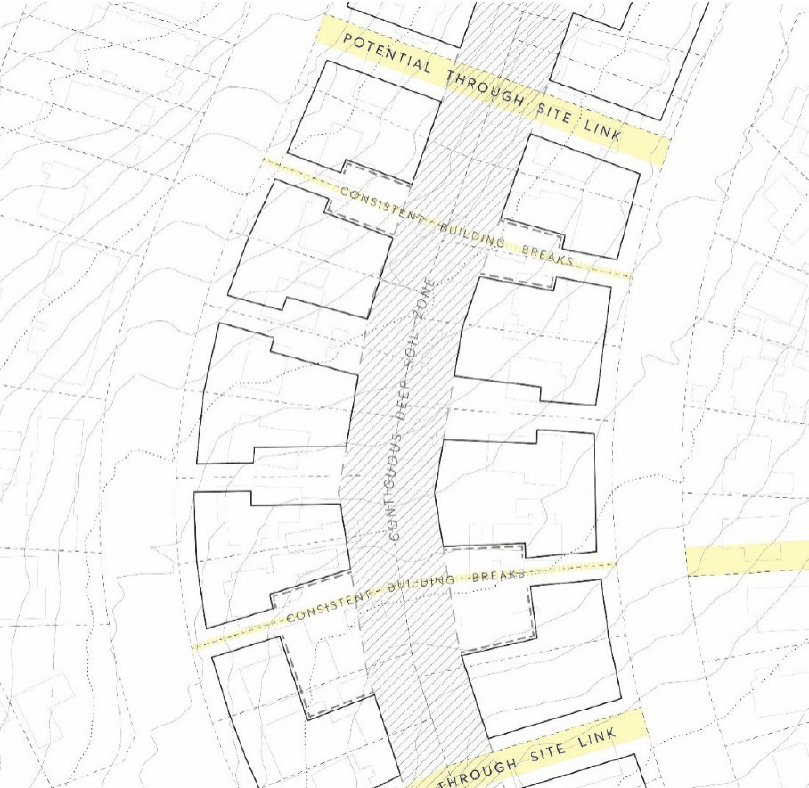
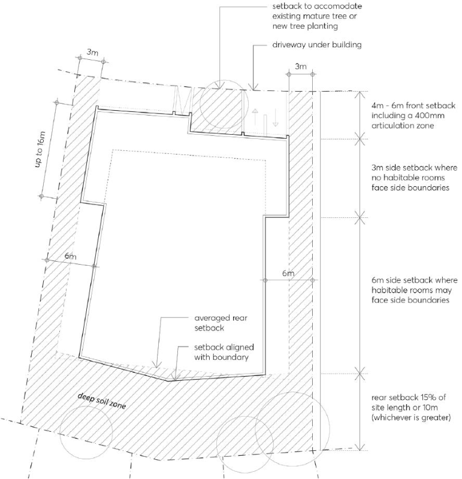
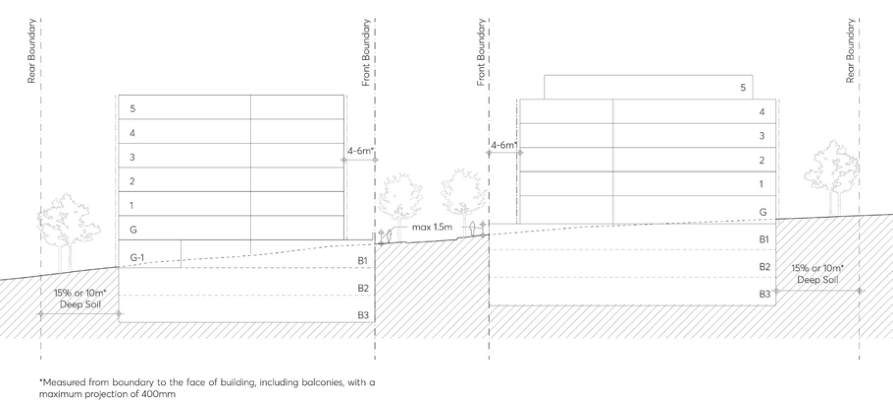
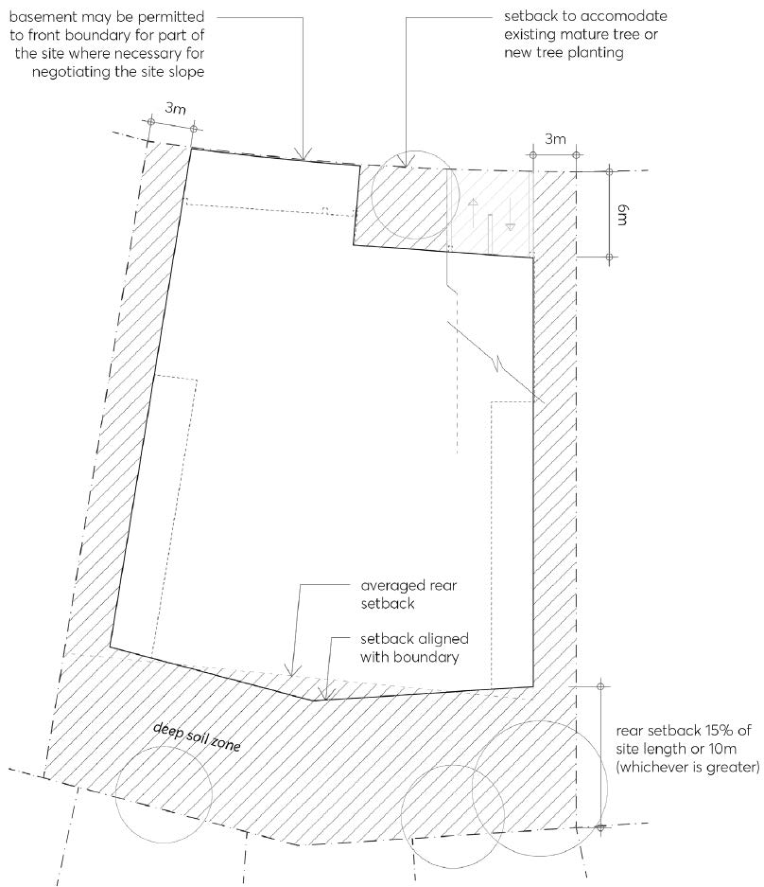
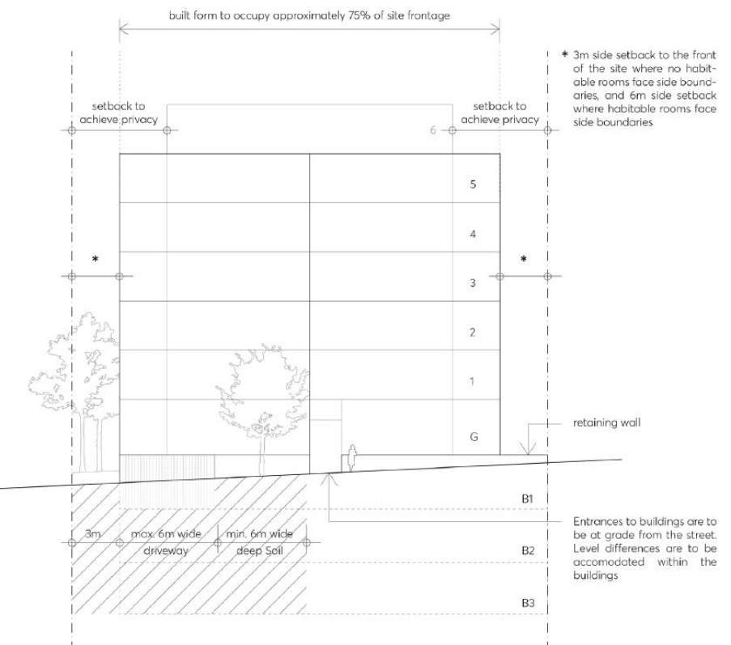

#### 8.2.7.3 DEVELOPMENT AND DESIGN

This Section provides built form and public domain and open space controls for future developments within the Telopea precinct.

The planning controls for Telopea Precinct envisages delivery of high-quality buildings and public places. The Telopea Precinct planning controls allow for significant transformation and renewal of existing buildings, however new buildings and places shall be designed to maintain existing site characteristics such as mature trees, topography and access to open spaces to retain and enhance the sense of place.

Design excellence of buildings will be required to be demonstrated as required by the Parramatta LEP 2023. Development Applications for new buildings or external alterations to existing buildings

TELOPEA LOCAL CENTRE

within the Telopea Precinct must demonstrate that it exhibits design excellence. This ensures that new development contributes positively to the natural, cultural, visual and built character values of the area. Further, Development Applications for development higher than 55 metres or a capital value of more than $100 million, or where chosen by the applicant, must undertake an architectural design competition.

#### 8.2.7.3.1 DEVELOPMENT WITHIN THE CORE AREA

The following principles and controls apply to all development within the Core Area, which is bounded by Sturt Street, Shortland Street and Evans Road as identified in Figure 8.2.7.1.

Objectives

O.01 Facilitate the development of a new neighbourhood retail, commercial and residential precinct which supports activation, a quality public domain and pedestrian connections to the Parramatta Light Rail.

O.02 Ensure taller buildings are slender in form and are adequately separated to ensure solar access, view to the sky and minimise wind impacts.

O.03 Encourage an urban form which works with the topography, addresses the streets, maximises solar access and creation of views.

O.04 Ensure development facilitates a healthy environment for landscaping and street trees.

Controls

C.01 Provide appropriate building depth, bulk and separation which protects amenity, daylight penetration, privacy between adjoining developments and increases solar access and amenity to the public domain.

C.02 Allow building setbacks which reinforce the human scale of the streets, mitigate wind impacts, enable views to the sky in streets and public places, and recognise the variation in street setbacks within the precinct to allow for an appropriate response to topography, street trees and other site constraints.

C.03 Maximise amenity to below street level apartments, including privacy, solar access and natural light.

C.04 Ensure that the design and material selection of buildings and the public domain contribute to a high-quality, durable and sustainable urban environment.

C.05 Maximise the opportunity for deep soil to encourage retention of, and planting of new trees, as well as the provision of landscaping on public and private land.

Lodgement of a Concept Application C.06 Prior to, or concurrently with, the lodgement of a Development Application for all or part of the Core Area, a Masterplan or a Concept Development Application shall be lodged with Council for consideration. The Masterplan or Concept Application must address the Objectives,

TELOPEA LOCAL CENTRE

Principles within this DCP, and demonstrate that the controls are capable of being complied with when detailed Development Applications are submitted for each stage within the Core.

C.07 The following information shall be submitted as part of the Masterplan or Concept Application for the Core:

a) Street and pedestrian layout and hierarchy;

b) Each development lot and indicative staging;

c) Building envelopes – the footprints, heights, building typologies, gross floor areas and separation distances for each development lot;

d) Indicative location of all communal open space, including at grade and roof top areas;

e) Setbacks to streets and setbacks between building and buildings on podia;

f) Streets and street sections, including building and basement setbacks;

g) Public domain plan based on the Parramatta Public Domain Guidelines;

h) A contour and slope plan;

i) Trees to be retained and additional tree planting in the public domain;

j) A deep soil network plan;

k) A basement plan, including entry locations; and

l) Future land ownership and responsibilities as it relates to publicly accessible spaces.

C.08 The Masterplan or Concept Application shall calculate residential gross floor area (GFA) at a minimum of 75% of the building envelope.

C.09 The Masterplan or Concept Application shall allocate to each development lot a GFA range for both residential and non-residential uses, including calculations demonstrating that the proposed envelopes can accommodate the allowable GFA including a reasonable allowance for building articulation.

C.10 That the maximum gross floor area for development lots are not to exceed the gross floor area nominated by a Notice of Development Consent granted by a relevant consent authority.

C.11 A minimum of 900m² of public open space, provided as one contiguous area, and associated with the new community and library facility.

Existing Waratah Shops C.12 A Masterplan or Concept Application for the area known as Waratah Shops (the area bounded by the street block Evans Road, Shortland Street, Sturt Street and Benaud Lane) is to address the controls for concept application required in C.7 of this DCP and to incorporate the following design principles:

a) Where possible, consolidate the existing holdings into development sites comprising privately owned and Council land including the existing Benaud Place car parking and landscaped area along Evans Road.

b) Building forms should be articulated to ensure solar access to private open space and future apartments.

c) Consolidated vehicular access to basements from Benaud Lane.

TELOPEA LOCAL CENTRE

d) Consider publicly accessible pedestrian and/or vehicle connection extending directly from Eyles Street.

e) Potential retail uses are to be located, in their current location along Benaud Place if the site is not consolidated. Core Area Built Form Controls

C.13 The maximum length of a building, (excluding perimeter block buildings) is 50 metres. C.14 Where the length of a perimeter building exceeds 50 metres, it is to be broken into two or more components. Building breaks should be a minimum of 3 metres deep and 3 metres wide.

C.15 Street setbacks within the Core Area should be as follows:

a) Between 0 metres to 3 metres for activated street frontage with retail or commercial uses; or

b) Between 3 metres and 6 metres (or greater) where residential uses are at ground level to allow for landscaping and the protection of significant trees.

c) The setbacks are measured to the face of the building and should be consistent along the length of the street block.

C.16 Buildings that are of a podium and tower form, should provide a street wall of between 2 and 4 storeys, with a tower setback of between 3 metres and 6 metres.

C.17 Upper levels of any buildings are not to extend over the lower levels. C.18 The maximum floorplates for residential buildings is 1,000m². The floorplate must be measured to the outside face of the building including balconies, vertical and horizontal circulation, internal voids and external walls.

C.19 Where the building is setback from the street, 30% of the balconies or architectural elements may project up to 400mm into front building setbacks. This excludes awnings at the ground floor used for wind mitigation and weather protection, which may extend to a maximum of 3 metres (maintaining a distance of 600mm from the face of the kerb) from the building face.

C.20 The ground floor of buildings used for retail and/or commercial use are to have a minimum floor to ceiling height of 4.2 metres. All retail and commercial floors above the ground floor are to have a minimum floor to ceiling height of 3.3 metres.

C.21 All Development Applications must include a streetscape analysis and provide details of the street wall and perimeter block. The analysis must include:

a) the street wall elevation at 1:200 scale in context showing existing buildings on the block.

b) a detailed street wall elevation at 1:100 scale including immediately adjacent buildings accurately drawn.

c) sections through the street wall and awning at 1:50 scale including the public domain.

d) detailed facade plans/sections at 1:20 scale including ground floor active frontage and awning details.

C.22 Basement car parking is to be predominately located under the building footprint and cannot extend into the street or deep soil setbacks. Externally visible basement car parking cannot protrude above ground by more than 1 metre.

TELOPEA LOCAL CENTRE

Street Frontages and Access C.23 Buildings must:

a) address a street.

b) be articulated with depth, relief and shadow on the street façade. A minimum relief of 150mm between the masonry finish and glazing face must be achieved.

c) Utilise legible architectural elements and spatial types such as doors, windows, loggias, reveals, pilasters, sills, plinths, frame and infill. Plinths are particularly encouraged in Telopea so that the topography is emphasised.

C.24 Apartments can be located below the street level, where it demonstrated that they cannot be located at street level due to the slope of the land. If located below street level the following applies:

a) Adequate solar access to habitable rooms and balconies is demonstrated;

b) The distance of the apartment front wall is a minimum of 5 metres from the street boundary or adequate privacy screening and landscaping is demonstrated;

c) the FFL of the lowest apartment is not more than 1500mm below the level of the street; and

d) The minimum floor to floor height of 3.3 metres, with a minimum floor to ceiling height of

2.9 metres and the head height of the windows is not less than 300mm from the underside of the slab above for ground floor and level 1 apartments.

C.25 Ramp access must demonstrate that it can be accommodated without compromising the entrance to the building or the ground floor apartments. If ramp access cannot be adequately accommodated, disability access is to be provided within the building.

C.26 Retaining walls must:

a) be located within the lot boundaries on all development lots or on the boundary if the land is within the same ownership;

b) be designed in consultation with Council if adjoining existing or future Council- owned land;

c) retain a horizontal line, with minimal stepping;

d) be fully masonry or a combination of masonry and timber; and

e) enable casual seating where possible.

#### 8.2.7.3.2 DEVELOPMENT WITHIN PRECINCTS

This Section sets out the objectives, design principles and controls for development within the Precinct Areas which is identified in Figure 8.2.7.1.

New development in Telopea must develop a sound response to the precinct’s unique topography, subdivision and curvilinear streets. The hillside character of Telopea offers many opportunities for views across the Dundas Valley. It also presents many challenges to minimising the environmental, visual and amenity impacts of increased development on the surrounding landscape. These differences are reflected in the high and low sides of the streets, the irregular subdivision pattern on

TELOPEA LOCAL CENTRE

curved streets, and the sites that have a steep slope along the frontage. The following design guidance should be considered as part of all applications in Telopea.

Objectives

O.01 Allow for the renewal of housing stock. O.02 Encourage the amalgamation of lots where possible to achieve a better built form. O.03 Provide opportunities for publicly accessible pedestrian through site links between large street blocks, including new pedestrian and cycle links to the Greenway Corridor.

O.04 Develop residential buildings that maximise frontage to the street. O.05 Provide adequate deep soil networks which allow for infiltration of water, reduce stormwater runoff, maintain natural ground water movement, support tree retention, promote healthy growth of trees and vegetation and provide amenity for residents.

O.06 Minimise the need for partially undergrounded apartments and encourage a level transition between apartments and the street or rear setback zone.

O.07 Take up site level changes within the building design to avoid excessive cut and fill or high retaining walls.

O.08 Preserve natural features of the precinct such as knolls or ridgelines through sensitive site grading.

O.09 Buildings are to form a continuous pattern of consistent street setbacks and building separation to create a comfortable neighbourhood environment.

O.10 Development is designed to enhance and maintain the topography, streetscape and natural environment as key features of Telopea.

O.11 Development is to provide breaks between the buildings to provide opportunities for views to the Dundas Valley.

O.12 To maximise the number of apartments facing the street, provide separation between buildings and allow for greater rear and front setbacks and contiguous landscape areas.

O.13 Front and rear setbacks and basement design is to respond to topography, allow for landscaping, privacy and amenity and minimise the undergrounding of apartments.

O.14 To design buildings to retain existing trees, where possible, and provide deep soil to plant new trees.

Sloping Sites O.15 Match building design to suit the degree of slope, adapting proposed slab construction to either take up the slope of the site with additional half levels or step to complement the slope.

O.16 Prevent site benching and large retaining walls at shared property boundaries to minimise overshadowing, overlooking and drainage issues.

O.17 Locate vehicular crossings where they minimise the need for steep ramping from the street, so that the visual impact of driveways is minimised.

TELOPEA LOCAL CENTRE

O.18 For sites that are located on the low side of the street (generally sloping from the street down to the rear boundary as per 8.2.7.3.2.3):

a) Consider how the fall of the site may be utilised by sleeving the first level of basement with apartments to the rear.

b) Consider designing buildings with higher street wall/building height on the low side of the street than buildings on the high side of the street. This can help balance the space created on the street.

O.19 For sites that are located on the high side of the street (generally sloping from the rear boundary down to the street as per Figure 8.2.7.3.2.3)

a) Development may utilise the provision for basements to be built to the front boundary where it is necessary to minimise apartments at the rear being located below natural ground.

b) he larger 6 metre front setback may be more appropriate to assist with vehicular access to the basement.

O.20 For cross slope sites that slope along the street (generally sloping from one side boundary to the other):

a) Vehicular access should be provided at the lowest point of the street frontage.

b) The split slab arrangement of the ground floor is encouraged to manage access requirements and prevent large retaining walls on the high side of the site.

Controls

C.01 New developments should be sited and designed in accordance with the Indicative Block and Building Layout Plan at Figure 8.2.7.3.2.1 or demonstrate it is consistent with the above objectives.

TELOPEA LOCAL CENTRE

> [Picture on page 364: a picture, saved as a picture (images/part-08-centres-precincts-special-character-areas-specific-page-364-2.gif, 150 dpi).]

Figure 8.2.7.3.2.1 – Indicative Block Plan and Building Layout

C.02 Development of a residential flat building should have a minimum site frontage of 24 metres, except 18 metres for sites with two street or lane frontages.

C.03 New development must provide between a 4 to 6 metre setback to the street as outlined in Figure 8.2.7.3.2.2. The setback must demonstrate that it adequately considers the following site conditions:

a) site levels;

b) existing vegetation;

c) topography;

d) surrounding built form; and

e) footpaths and boundaries.

C.04 The minimum setback to the side boundaries is 3 metres for part of the length of the building. Where apartments habitable rooms only face the side boundary, allow a 6 metre wide side setback, as outlined in Figure 8.2.7.3.2.2.

TELOPEA LOCAL CENTRE

C.05 The rear setback is to be a minimum of 10 metres or 15% of the total length of the site as measured from centre of the rear boundary (whichever is the greater), as shown in Figure 8.2.7.3.2.2. The setback can be averaged to align with the building footprint where the rear alignment is not regular.

> [Picture on page 365: a picture, saved as a picture (images/part-08-centres-precincts-special-character-areas-specific-page-365-6.gif, 150 dpi).]

Figure 8.2.7.3.2.2 – Building Setback Plan

C.06 Buildings along the western side of Marshall Road should be designed to provide passive surveillance to the Greenway.

C.07 30% of balconies or architectural elements such as bay windows, may project up to 400mm into front building setbacks only.

C.08 Provide a minimum of 30% of deep soil zone on the site area, with the following requirements:

a) A minimum of half of the total deep soil area is located at the rear of the site.

b) A minimum of 7% of the total site area which is provided as deep soil area shall be designed to have a minimum dimension of 6 metres (or greater). The remaining deep soil areas shall provide minimum dimensions of 4 metres (or greater). Noting that a deep soil with a minimum dimension of less than 4 metres does not contribute to the deep soil calculation.

C.09 Deep soil should be designed to create a contiguous deep soil network formed with adjacent lots.

TELOPEA LOCAL CENTRE

C.10 Removal of existing trees should be avoided, and new trees should be planted, as detailed in Part 5 – Environmental Management of this DCP.

C.11 Where significant excavation is required as part of new development, it must be demonstrated that deep soil back fill must comprise constructed horticultural soil profiles in order to support local vegetation communities.

C.12 Basements are to be located predominately under the footprint of the building, as shown in Figures 8.2.7.3.2.3 and 8.2.7.3.2.4. As detailed in the Design Principles for Sloping Sites contained in this DCP, there may be conditions where basements may extend into the front setback to avoid raising from ground at the rear and/or extending into the rear setback.

C.13 Basement car parking entries are encouraged to be located under the apartment building as shown in Figures 8.2.7.3.2.4 and 8.2.7.3.2.5. Any above ground car parking structures should be of a solid, masonry construction. Vents to car parking must not be located at the street frontage.

C.14 Basement car parking structures should be predominantly located below existing ground level. Where the slope conditions mean this is unachievable, the basement structures may project to a maximum of 1 metre above ground, except within the front setback where it may project up to 1.5 metres above ground where it helps prevent re-grading the site in other locations (see Figure 8.2.7.3.2.3 Indicative Street Section).

C.15 Front setbacks are to be landscaped. Where trees are located in the front setback above a basement structure, a minimum soil depth of 1 metre above drainage layer is to be cut into the slab.

C.16 Impervious surface at ground level must be minimised in all setback areas.

> [Picture on page 366: a picture, saved as a picture (images/part-08-centres-precincts-special-character-areas-specific-page-366-24.gif, 150 dpi).]

Figure 8.2.7.3.2.3 – Indicative Street Section

TELOPEA LOCAL CENTRE

> [Picture on page 367: a picture, saved as a picture (images/part-08-centres-precincts-special-character-areas-specific-page-367-2.gif, 150 dpi).]

Figure 8.2.7.3.2.4 – Indicative Basement and Deep Soil Plan

TELOPEA LOCAL CENTRE

> [Picture on page 368: a picture, saved as a picture (images/part-08-centres-precincts-special-character-areas-specific-page-368-2.gif, 150 dpi).]

Figure 8.2.7.3.2.5 – Indicative Street Frontage

C.17 Development of 3 and 4 storeys should be designed as a street wall building. C.18 Development of 5 and 6 storeys in height may be designed as a street wall building or provide one upper level storey setback of 3 metre from the building line, as outlined in Table 8.2.7.3.2.1.

C.19 Development of 7 and 8 storeys shall provide a 6 storey street wall and shall setback upper level storeys in accordance with Table 8.2.7.3.2.1.

C.20 Development of 9 storeys shall provide a street wall and upper level setback in accordance with Table 8.2.7.3.2.1. Table 8.2.7.3.2.1 – Street wall and upper level storeys and setbacks

| Total height (in storeys) | Street wall in storeys | Upper Storeys and Upper Level Setbacks |
|---|---|---|
| 3 or 4 storeys | 3 or 4 storeys | 0 |
| 5 storeys | 4 storeys; or 5 storeys | 1 storey setback 3 metres from the building line; or 0 |
| 6 storeys | 5 storeys; or 6 storeys | 1 storey setback 3 metres from the building line; or 0 |
| 7 storeys | 6 storeys | 1 storey setback back 3 metres from the building line |
| 8 storeys | 6 storeys | 2 storeys setback 6 metres from the building line |

TELOPEA LOCAL CENTRE

9 storeys

8 storeys; or 1 storey setback 3 metres from the building line; or 7 storeys 2 storeys setback 6 metres from the building line

C.21 Buildings are to occupy approximately 75% of the street frontage to maximise potential for apartments facing the street as outlined in Figure 8.2.7.3.2.5.

C.22 Where the length of a perimeter building exceeds 50 metres, it is to be broken into two or more components. Building breaks should be a minimum of 3 metres deep and 3 metres wide.

C.23 Front fences are to be designed to:

a) be articulated at any gates and visually permeable in part to enhance the feeling of address and passive surveillance along this edge of the development;

b) be integrated with dividing masonry walls (or a combination of masonry and timber) between the private open spaces where the fences relate to individual apartments facing the street;

c) be located on the front boundary and be designed to form a consistent edge along the street;

d) not be comprised of sheet metal;

e) address the slope of the site by providing a masonry base with a minimum height of 300mm. This base should form a horizonal plinth with minimal stepping. Upper portions of the fence are to be made of open and lightweight material; and

f) be made of open and lightweight material where located above retaining walls.

C.24 Retaining walls must:

a) be located within the lot boundaries on all development lots or on the boundary if the land is within the same ownership;

b) be designed in consultation with Council if adjoining existing or future Council-owned land;

c) retain a horizontal line, with minimal stepping;

d) vary to suit the topography with a maximum height of approximately 1500mm.

e) be of fully masonry construction or a combination of masonry and timber

f) utilise terracing where necessary to subtly manipulate the existing landscape, avoiding large areas of cut and fill.

#### 8.2.7.3.3 PUBLIC SPACE

The renewal of the Precinct presents the opportunity to deliver upgraded public spaces and new public spaces. For the purposes of this DCP ‘public space’ is defined as places publicly owned or for public use, accessible and enjoyable by all for free, including active and passive public open spaces, streets, pedestrian and cycleway connections and plazas.

TELOPEA LOCAL CENTRE

Objectives

O.01 Provide quality public spaces domain, including publicly accessible and safe open space and plazas within new development.

O.02 Maximise the areas for contiguous deep soil network to sustain existing and new vegetation and street tree canopy planting and to provide for permeable ground surface.

O.03 Provide universal access and key connections to transport nodes (buses, light rail, taxi stand etc), community facilities and retail precinct in the Core Area.

O.04 Provide for active living and connectivity through the provision of healthy, walkable, green built environments which integrate sustainable water and energy features.

Controls

C.01 Clearly delineate public space separate from private space. C.02 Incorporate passive and active recreational facilities to complement and enhance those already provided in Sturt Park and other nearby Council public open spaces.

C.03 Provide safe opportunities and points of interest for the community to gather/meet, walk, engage in physical activity and children’s play.

C.04 Improve pedestrian connections to and between existing public spaces. C.05 Maximise solar access to public areas during winter months and shade during summer months. C.06 Provide flexible public spaces that provide multifunctional offerings in different areas for different activities.

C.07 Respond to local character and identity and support connection with Country in design of public space.

C.08 A Public Domain Plan is to be provided for all new developments over six (6) storeys. The Public Domain Plan is to detail:

a) Upgrades, expansion of, and connectivity improvements to the surrounding public domain network, including footpaths, cycle paths, street tree planting, green networks, street furniture, street lighting and the like.

b) Consistency with Parramatta Public Domain Guidelines and finishes/street trees specified should be in line with Council’s preferred palette for Telopea.

c) Street and pedestrian lighting in accordance with AS/NZS 1158.0:2005 – Lighting for roads and public spaces.

C.09 All public spaces and connections are to be safe and publicly accessible 24 hours, 7 days a week.

C.10 All public space that is dedicated to Council is to be designed:

a) on deep soil with no underground car parking;

b) to maximise solar access across the year;

c) to maximise its frontage with a public road or laneway or pedestrian pathway with a minimum width of 4 metres;

TELOPEA LOCAL CENTRE

d) to be associated with and support walkable connections to other public amenity such as libraries, community facilities and transportation nodes; and

e) to provide equitable universal access across the whole site; and

f) to be safe and welcoming.

C.11 Wherever possible, universal access is to be provided in the public domain or through a community facility building. Existing streets cannot be relied upon to provide universal access.

C.12 Where universal access routes for the public spaces are provided within a building, they are to be designed to be:

a) clearly visible and accessible from the public domain;

b) communicate that it is operable 24/7 without the need for signs;

c) provide protection from the weather;

d) clearly connect via the shortest distance to the nearest associated vertical access (lift).

C.13 Vertical access (lifts) and internal routes for the public to be designed to provide access to all levels and amenity between the street levels within the publicly accessible open space. In the event of a breakdown of any one vertical access (lifts), alternative systems/options to move across the site are to be integrated into the public domain and to be clearly visible without an over reliance on signs.

C.14 The primary access point to all private buildings and vertical lifts are to be universally accessible, contained within the building. Ramps and landings do not interfere with the public domain.

C.15 Wherever possible, universal access is to be provided in the public domain or through a community facility building. Existing streets cannot be relied upon to provide universal access.

Arrival and Retail Plaza C.16 The new hilltop Arrival Plaza and pocket park will be located adjacent to the Light Rail stop. The detailed design of the Arrival Plaza should incorporate the following:

a) Integration with the future Light Rail stop and retail services across Sturt Street.

b) Bicycle parking spaces to encourage transition between active transport and other modes.

c) Safe cycle access through the Arrival Plaza to link with the Greenway Corridor and other regional cycle connections.

d) Integration with future design of bus stop, taxi rank and pick up/drop off zones.

e) Pedestrian footpaths to provide clear sightlines and minimise the number of pathways to prevent the ‘carving up’ of plaza space.

f) Optimising active and passive recreational opportunities.

g) Complement and integrate with any adjacent open space, including any future retail plaza.

C.17 If a retail plaza is located between Wade Street and Sturt Street, it is to be designed to:

a) provide access to internal lifts, escalators or similar to help people move between Wade Street and Sturt Street through the retail centre;

b) be safe and publicly accessible 24 hours 7 days a week;

TELOPEA LOCAL CENTRE

c) have an area of at least 600m²;

d) achieve 3 hours of solar access to at least 300m² of the plaza during mid- winter; and

e) Be active which may include retail frontages, residential entrances to individual properties, residential lobbies and residential communal facilities.

New pedestrian and cycleway connections C.18 Any new pedestrian and/or cycleway connections are to be designed to:

a) Respond to the level change by providing an accessible vertical transportation (lift, escalator and/or travelator) 24/7;

b) Have a general width of between 6 and 12 metres if the connection is for pedestrians and cyclists only. The connection may widen in order to provide for tree retention and stair landings;

c) Have clear sight lines;

d) If the connection is pedestrian only, basement parking may extend below this area, except where those areas are intended to be dedicated to Council;

e) Be safe and welcoming; and

f) Be inclusive and accessible to all ages and abilities.
