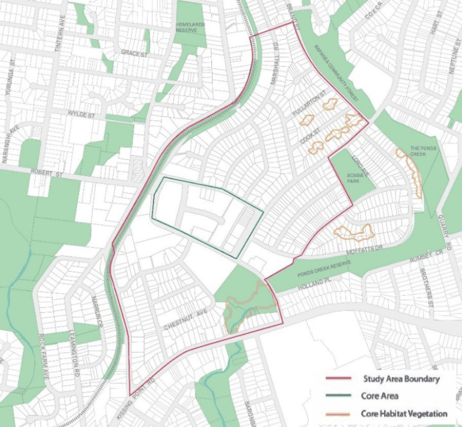
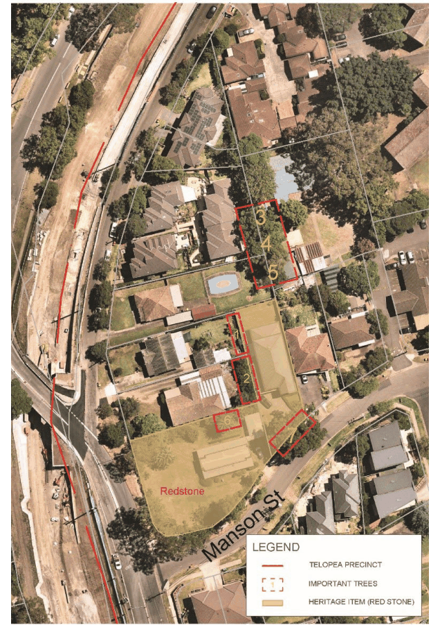

#### 8.2.7.4 NATURAL ENVIRONMENT AND HERITAGE

#### 8.2.7.4.1 TREE PRESERVATION AND ENHANCEMENT

This Section shall be read in conjunction with Part 5 – Environmental Management of this DCP. To the extent of any inconsistency in relation to tree provisions contained in other parts of this DCP, the provisions in this Section shall prevail.

Objectives

C.01 Maintain natural amenity, increase biodiversity and reduce urban heat through preservation and enhancement of tree canopy.

C.02 Ensure the longevity of the trees through minimising disturbance to their root zone and canopy, the disruption of the subterranean water table and the reduction of solar access.

Controls

C.03 Street layout and building location and design should demonstrate viable retention of existing trees of high significance, including clusters of significant trees.

C.04 To ensure the existing canopy tree character is maintained by planning for and implementing replacement tree planting to naturally replace the existing trees.

C.05 New street trees should be planted to maximise and enhance tree canopy cover and provide opportunities for wildlife corridors.

TELOPEA LOCAL CENTRE

C.06 Building setbacks and public domain should maximise deep soil zones to accommodate existing and newly planted large trees.

C.07 As part of any Development Application where a tree, as defined by Part 5 – Environmental Management in the Parramatta DCP 2023, is proposed to be removed, or directly impacted by the development, the following information may be required to be submitted with the application:

a) An Arboricultural Impact Assessment (AIA) report prepared by an AQF Level 5 consulting arborist and prepared in line with the Australian Standard AS4970- 2009 Protection of trees on development sites.

b) If there are trees to be retained, a detailed, site specific Tree Management Plan (TMP) should be provided to ensure that the design can be successfully implemented without detrimental impacts to the trees proposed for retention.

c) A Landscape Plan showing existing tree retention, protection zones and any additional trees to be planted, including in the public domain.

C.08 Where a tree is proposed to be removed, removal will only be granted where it is demonstrated that the removal of the tree will result in significant benefit in relation to built form, heritage or public domain outcomes.

C.09 If removal of a tree is required on private land, replacement trees are required to be provided as part of the Landscape Plan submitted with the Development Application as follows:

a) Approximately 1 canopy tree per 80m² of ground level landscaped area including natural deep soil area is required. Trees are to be capable of reaching a mature canopy height of 13 metres.

b) Additional trees can be provided on podium in set down slabs (not planter boxes) with minimum dimensions in accordance with Apartment Design Guide.

C.10 Tree species shall be in accordance with Council requirements as per the Parramatta DCP 2023, Section 5.3.1 – Biodiversity.

#### 8.2.7.4.2 NATURAL ENVIRONMENT

Two Endangered Ecological Communities, river-flat eucalypt forest and blue gum high forest, listed under the Biodiversity Conservation Act 2016 are located within the Telopea Precinct and are identified on Figure 8.2.7.4.2.1 as Core Habitat. Any impact to Core Habitat will require further assessment at Development Application stage, including any formal impact assessments required under the relevant New South Wales and Commonwealth legislation. In relation to tree preservation and enhancement, this Section should be read in conjunction with Part 5 – Environmental Management of this DCP.

Objectives

O.01 Protect and enhance natural areas to provide habitat to native flora and fauna, as well as for the enjoyment of the community.

TELOPEA LOCAL CENTRE

Controls

C.01 Future development will retain, protect and improve those areas nominated as Core Habitat in Figure 8.2.7.4.2.1.

C.02 Any enhancement of Sturt Park, where proposed, should be undertaken using native species characteristic of Alluvial Woodland and using local native provenance where possible.

C.03 The boundaries of impacted areas should be clearly delineated using fences or similar means to prevent encroachment of the works into the surrounding bushland and riparian areas.

C.04 Sediment and erosion control plans are to be submitted with each Development Application. Installation of sediment and runoff control measures are to be installed prior to any construction works commencing to prevent runoff entering adjacent riparian areas and watercourses.

C.05 Areas proposed for disturbance where noxious weeds are present should be managed according to the weed class.

> [Picture on page 374: a picture, saved as a picture (images/part-08-centres-precincts-special-character-areas-specific-page-374-15.gif, 150 dpi).]

Figure 8.2.7.4.2.1 – Core Habitat

TELOPEA LOCAL CENTRE

#### 8.2.7.4.3 HERITAGE

A State heritage site, known as known as Redstone, is located at the corner of Adderton Road and Manson Street. The building was designed by Sir Walter Burley Griffin in 1935 and the garden is an intact example of an interwar garden which contributes to the setting of the house. Adjacent to the Telopea Precinct is Acacia Park, which is listed as an archaeological site under the Parramatta LEP

2023\. The large tract of bushland known as the Rapanea Community Forest along the north-eastern edge of the Precinct is listed as a local heritage item under the Parramatta LEP 2023.

Objective

O.01 Any new development must demonstrate consideration of and response to minimising the impact on the heritage and archaeological significance of the listed items in Telopea.

Controls

C.01 A new development located within 200 metres of the heritage item ‘Redstone’ may require a specific heritage impact statement (HIS) to be submitted as part of a Development Application. This is to ensure that detailed design is sympathetic and responds appropriately to the heritage items in terms of design, form, materiality, setbacks. Council can provide advice, prior to the submission of a Development Application, if the nature and size of the development would require the preparation of the HIS.

C.02 There will be no removal or pruning of trees shown on Figure 8.2.7.4.3.1 unless the application is accompanied by a heritage impact statement demonstrating that the removal or pruning of the tree does not detrimentally impact on the contextual setting of Redstone.

C.03 Any future development located within the Telopea Precinct and located adjacent to or facing Acacia Park and the Rapanea Forest will require a specific heritage impact statement, including consideration of potential archaeological impacts, to be submitted as part of any Development Application.

TELOPEA LOCAL CENTRE

> [Picture on page 376: a picture, saved as a picture (images/part-08-centres-precincts-special-character-areas-specific-page-376-2.gif, 150 dpi).]

Figure 8.2.7.4.3.1 – Trees to be retained in relation to Redstone
