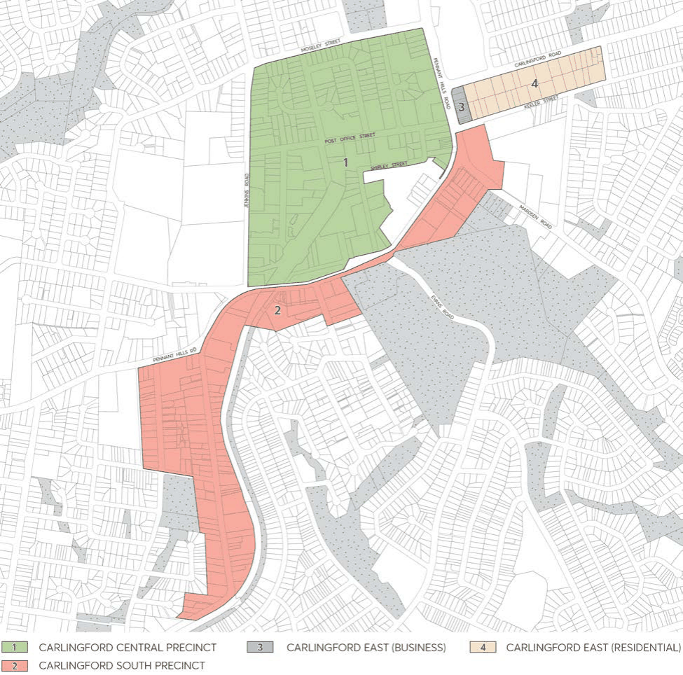

#### 8.2.8 CARLINGFORD LOCAL CENTRE

Carlingford Local Centre comprises of three precincts referred to as Carlingford Central, Carlingford South, and Carlingford East. The precinct has a notable history of Aboriginal, early colonial, agricultural, and educational uses. It has been identified as a precinct with opportunities for a range of built forms and allowing for a mix of housing styles, commercial, retail and community uses.

This Section outlines specific provisions for Carlingford Central, Carlingford South, and Carlingford East, as indicated in Figure 8.2.8.1, and must be read in conjunction with any relevant Parts of the Parramatta DCP 2023. Where there are inconsistencies between the controls contained within this Section and other controls within this DCP, these controls prevail to the extent of the inconsistency.

> [Picture on page 386: a picture, saved as a picture (images/part-08-centres-precincts-special-character-areas-specific-page-386-12.gif, 150 dpi).]

Figure 8.2.8.1 – Carlingford Local Centre

CARLINGFORD LOCAL CENTRE
