#### 8.2.8.1 CARLINGFORD CENTRAL

This plan applies to land bounded by Jenkins Road to the west, Pennant Hills Road to the south and east and Moseley Street to the north within the City as shown in Figure 8.2.8.1.1 and referred to in this Section of this DCP as the Carlingford Precinct.

The aim of this is to provide parameters to guide development in the Precinct for a range of built forms that allow for a mix of housing styles, commercial, retail and community uses. This Section of this DCP, in association with a development contributions plan for the Precinct also proposes upgrades of open space, vehicular and pedestrian access, public realm and upgrades of existing infrastructure for electricity, drainage and roads.

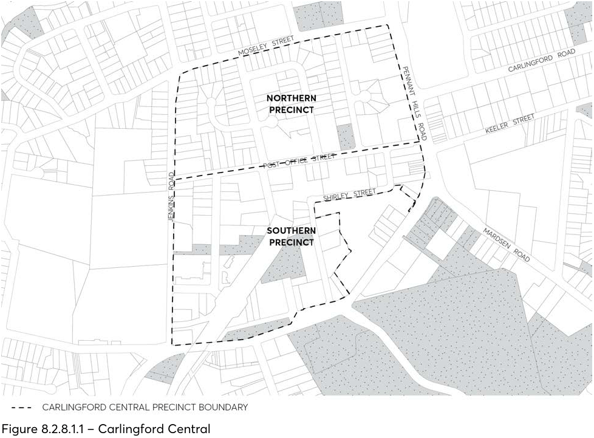

> [Picture on page 387: a picture, saved as a picture (images/part-08-centres-precincts-special-character-areas-specific-page-387-11.gif, 150 dpi).]

Figure 8.2.8.1.1 – Carlingford Central

#### 8.2.8.1.1 DESIRED FUTURE CHARACTER

Southern precinct

The character of the southern end of the Precinct in the vicinity of the light rail station will be largely determined by the development of landmark buildings on the key sites and their role in creating street oriented village built form and character, open spaces and a civic plaza linked to the station.

In key sites affected by electricity easements, developments can contribute to publicly accessible open space with strong connections to the local open space network and civic area.

CARLINGFORD LOCAL CENTRE

Buildings on key sites and in the southern side of the Precinct generally have been placed to provide transition in building scale and to provide natural ventilation, solar access, outlook from apartments and year round sunlight to communal open spaces.

Streetscapes are to be resident and visitor friendly in an urban landscaped setting associated with a street hierarchy that promotes a safe pedestrian and vehicular environment. The landscape works in the public realm help to define the character areas in the Precinct. These characters range from the more urban, civic and light rail station oriented village to the suburban character further from the light rail station.

North precinct

The northern end of the Precinct will comprise lower scale residential flat buildings interspersed with existing multi unit developments.

The built form of development will reflect a transition of scale between the larger residential flat buildings concentrated around the light rail station in the south of the Precinct and the smaller scale residential flat buildings proposed in the land north of Post Office Street.

Street setbacks are to complement the proposed garden setting in contrast to the strong street edge, activated urban village character of development closer to the light rail station.

Additional streets are proposed to complement this relationship of buildings to the public domain and establish a finer grained street hierarchy and built forms. Private and communal open space within developments is encouraged to visually compliment the public realm and where feasible, allow some public access.

General objectives

O.01 Provide a clear vision and the desired future character for the revitalization of the Carlingford Precinct.

O.02 Formulate structure plans and a Master plan in response to the opportunities and constraints identified and incorporating the following design concepts for the Carlingford Precinct:

• Streetscape character, particularly in the vicinity of Thallon and James Streets, including the concept of street level activity with living above and that adjacent public spaces be augmented and upgraded.

• Increased height and density, in targeted locations, will be used as a mechanism to ensure that the desired future character for the Precinct and public infrastructure can be achieved.

• Integration of floodplain management with adjoining development to achieve high-quality open spaces.

• Alternative development approaches/patterns to address site specific issues within the Precinct.

• Undergrounding of local and 132kv power lines to improve streetscape appearance and street lighting.

O.03 Create a high-quality, aesthetically pleasing, and functional Precinct for future residents.

CARLINGFORD LOCAL CENTRE

Where any provision of this Section of this DCP is inconsistent with any provision of any other Part of this DCP, the provisions of this Section of this DCP shall prevail to the extent of that inconsistency.

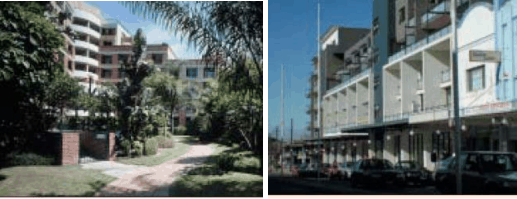

> [Picture on page 389: a picture, saved as a picture (images/part-08-centres-precincts-special-character-areas-specific-page-389-5.gif, 150 dpi).]

Figure 8.2.8.1.1.1 – Communal open space Figure 8.2.8.1.1.2 – Urban character around with controlled public access to light rail station with active retail on ground compliment developments (Source: floor (Source: Residential Flat Design Code, Residential Flat Design Code, 2002)

2002)

#### 8.2.8.1.2 URBAN CONTEXT

OPPORTUNITIES AND CONSTRAINTS

The Precinct’s opportunities and constraints are discussed in the supporting document for this Section of this DCP. The opportunities and constraints are synthesised in ways to provide for the development of the Precinct to the densities considered appropriate for the area while optimising urban design quality and environmental outcomes. See Figure 8.2.8.1.2.1 – Opportunities and Constraints.

There are a series of constraints that apply across the Precinct. These include the essentially immovable elements that tend to delineate, separate and punctuate the Precinct as a whole. These elements include the rail line with its station and heritage building, major roads and pedestrian routes, topography, drainage lines, existing overhead power lines and pylons. Land subject to overland flow paths occurs in both the northern and southern sides of the Precinct. Such land is both an opportunity and a constraint to development and has been influential in the structure planning for the Precinct.

Other constraints include the existing multi unit buildings that are unlikely to change due to their being under strata title, commercial developments and the fragmented pattern of land ownership.

The Precinct includes characteristics that are opportunities for development including amalgamated key sites, proximity to the railway station, topography, the relationship of sites to the road hierarchy, public open space, property boundaries, edges, nodes, slopes, drainage, roads, landmarks, existing developments, pedestrian desired lines and areas of potential high residential amenity or public activity and commercial opportunities.

CARLINGFORD LOCAL CENTRE

The integration of the opportunities and constraints determines the suitability of a locality for a particular combination of spatial organisation, land use, built form and unit density, design approach to public realm, landscape theme, and movement system including traffic management. In this way areas of the same desired future character and built form are reflected by appropriate controls.

This process has led to the identification of a range of development scales and densities that generally

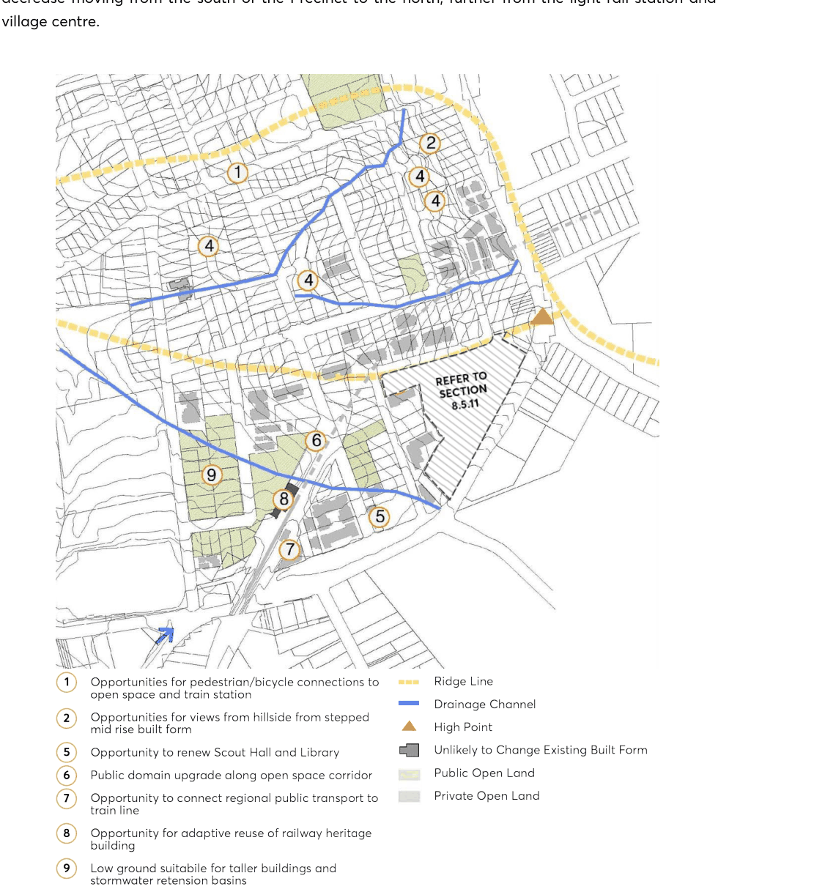

> [Picture on page 390: a picture, saved as a picture (images/part-08-centres-precincts-special-character-areas-specific-page-390-7.gif, 150 dpi).]

decrease moving from the south of the Precinct to the north, further from the light rail station and village centre.

Figure 8.2.8.1.2.1 – Opportunities and Constraints

CARLINGFORD LOCAL CENTRE

KEY SITES

The major opportunity to achieve a coordinated, holistic development of the Precinct is the existence of several ‘key sites’. These key sites comprise large land holdings that are mainly under single ownership, in locations critical to the establishment of a village centre and suitable for buildings containing a relatively large number of units. As a result, developments of a substantial size and complexity can be delivered promptly. In this way the development of these sites will be the catalyst for the redevelopment of the Precinct. These sites are identified as block numbers in Figure 8.2.8.1.2.2 – Key Sites and are described as follows:

Block 3 Jenkins Road and Thallon Street

Block 4 2-12 James Street

Block 6 1-7 Thallon Street

Block 5 The ‘Service station site’ on corner of Pennant Hills Road and Jenkins Road

Block 16 The ‘Bunnings site’ at the corner of Pennant Hills Road and Post Office Street

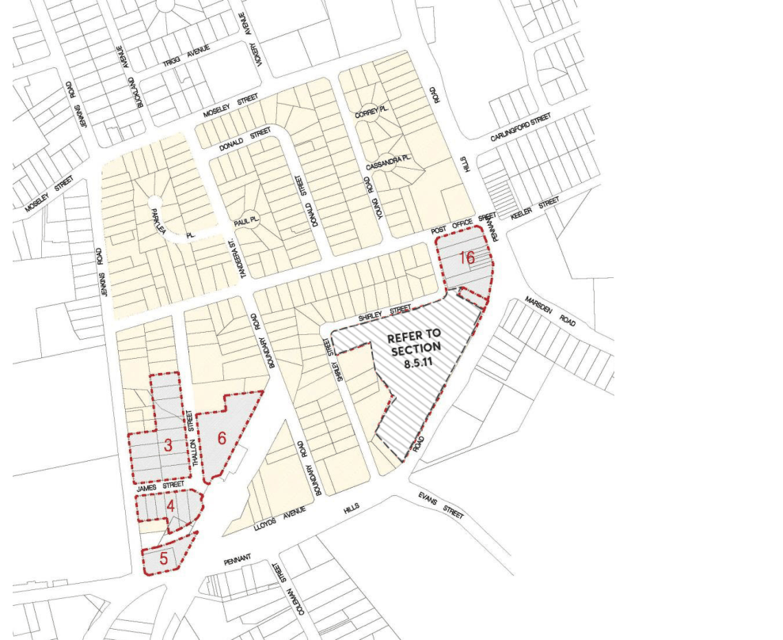

> [Picture on page 391: a picture, saved as a picture (images/part-08-centres-precincts-special-character-areas-specific-page-391-15.gif, 150 dpi).]

Figure 8.2.8.1.2.2 – Key Sites

CARLINGFORD LOCAL CENTRE

This Section of this DCP recognises the role of the key sites and proposes development controls to ensure their development will contribute to achieving the objectives of this plan. The urban design, functional and socioeconomic outcomes proposed for these sites are the expression of the opportunity to:

• Provide landmark buildings denoting the core of an urban village centred around the light rail station, open space, pedestrian and cycle connections, and community facilities.

• Provide street level active uses and human scale in the village centre.

• Provide a substantial number of residential units in close proximity to the light rail station.

• Contribute to the local open space network while ensuring development applies water sensitive urban design principles.

• Provide landmark buildings at key gateways to the Precinct on Pennant Hills Road including the Bunnings site and the service station site.

#### 8.2.8.1.3 STRUCTURE PLAN AND MASTERPLAN

STRUCTURE PLAN AND MASTERPLAN PROCESS

The interaction of the following parameters were analysed to inform the structure plans and masterplan:

• Access and transport.

• Stormwater management.

• Street hierarchy.

• Response of building bulk to topography.

• Design excellence (NSW Residential Flat Design Code).

• Open space and recreation.

• Public domain improvements.

• Pedestrian connections.

• Sustainability and water sensitive urban design.

• Infrastructure upgrades.

• Adaptive reuse of the railway heritage building and access to the light rail station.

• Streetscape.

URBAN DESIGN PRINCIPLES

For each of the above parameters a set of design principles were identified. These principles are based on best practice, such as the co-location of drainage reserves and public open space.

Other principles are based on efficiency of connections and access, convenience and the synergies of place making such as locating highest residential densities close to the light rail station and civic areas.

CARLINGFORD LOCAL CENTRE

These principles are to ensure the creation of a quality living environment with appropriate relationship between residential buildings, public infrastructure and public realm and in response to topography.

The light rail station, in association with the Council owned library, future community facilities, open space and increased residential densities near the light rail station provide a central focus and landmark for the Precinct and create a strong identity for the existing centre as a potential Town Centre. The following four layered series of structure plans show the major urban design proposals for the Precinct regarding:

• access and circulation.

• open space.

• public domain.

• building height and floor space ratio.

The desired future character statements for the Precinct outlined below are informed by the structure plans. Each structure plan includes a set of guiding urban design principles.

The structure plans inform the masterplan/indicative built form plans thus expressing the guiding principles. These plans show the distribution of the different built forms, the relationship of open space to built form, and the integration of outcomes to improve the public domain, open space, vehicle circulation and pedestrian links.

A set of development controls for each of the key sites are proposed as well as development standards for the whole of the Precinct and generic controls applying to all development. These provisions are set out in the following Sections of this DCP.

STRUCTURE PLAN – ACCESS AND CIRCULATION

Street Hierarchy and Permeability

• Extend the northern section of Boundary Road to connect with Tanderra Street.

• Arrange open space and pathways to focus on the light rail station and link to open space/community facilities to the east of the station also to connect to the James Ruse locality on the west of Jenkins Road (see Figure 8.2.8.1.3.2 – Structure Plan – Open Space Strategy).

• Establish a network of cycle/pedestrian access tracks throughout the open space network of the Precinct to connect with public transport links and routes beyond the Precinct (see Figure 8.2.8.1.3.3

– Structure Plan – Public Domain). Proximity to Transport

• Locate the proposed residential flat buildings with highest density closest to the light rail station to maximise infrastructure use, improve convenience for commuters and to contribute to a critical mass for a future civic/transport hub. Upgrade of existing road networks and footpath surfaces and traffic management works

• Provide progressively the road improvements and traffic management measures shown in Figure

8.2.8.1.3.1 in consultation and conjunction with Council, with possibilities for planning agreements.

CARLINGFORD LOCAL CENTRE

• Install new signalised traffic signals and traffic management structures such as kerb blisters, medians and lane treatments in accordance with recommendations of the Carlingford Precinct Plan Traffic Report (May 2008) prepared by Masson/Wilson/Twiney Traffic and Transport Consultants.

• Install high-quality pedestrian and cycle pathways in an efficient and coherent network designed to enhance the pedestrian experience.

• Improve local traffic management in accordance with the Carlingford Precinct Plan Traffic Report including the provision of a bus stop and ‘kiss and ride’ passenger set down area at the light rail station, intersection upgrades, roundabouts and signalisation.

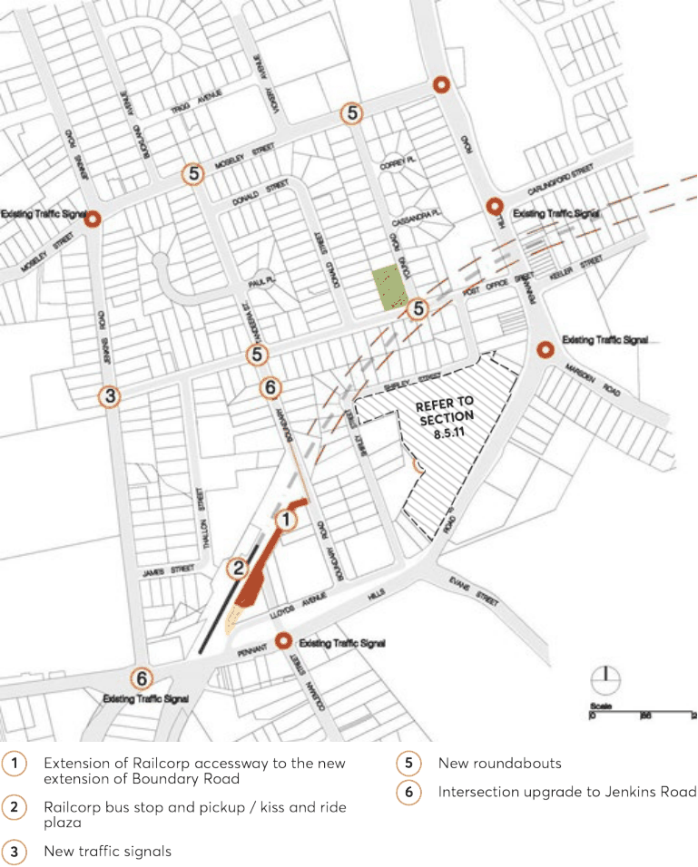

> [Picture on page 394: a picture, saved as a picture (images/part-08-centres-precincts-special-character-areas-specific-page-394-11.gif, 150 dpi).]

Figure 8.2.8.1.3.1 – Structure Plan – Access and Circulation

CARLINGFORD LOCAL CENTRE

STRUCTURE PLAN – OPEN SPACE STRATEGY

Linking of existing and potential open space areas

• The existing open space in the south of the Precinct is an opportunity to combine with the proposed open space “green spine” created by undergrounding of the electricity lines and dual use of flood prone land.

• The combination of the former easement with an overland stormwater flow path enhances the scenic and environmental outcomes of this element with the possibility of creating water features.

• Create a civic square addressing the entrance to the light rail station and connected to open space links associated with electricity easements.

• Install play equipment in safe and appropriate locations within open space. Open space and built form relationships

• Several key sites close to the light rail station have easements for the existing electricity pylons. Once the pylons are removed, the former overhead easement can contribute to publicly accessible open space surrounding new developments and linked to the open space adjacent to Council’s existing library building.

• In areas further from the light rail station, use key sites and flood prone land to create communal open spaces and new parks addressed by buildings. These parks help to impart a garden suburb character to complement residential buildings set in generous private/communal open space.

• In areas further from the light rail station, site planning for buildings could aim to amalgamate private green spaces to optimise deep soil planting areas, communal open space, shared views and landscape and contribute to the garden suburb theme. Quality residential open space areas

• Communal open space at ground or podium level for residents is to be provided. This open space should enhance the quality of the built environment by providing opportunities for landscaping in a parkland setting as well as providing a visual and activity focus for the new residential community created through this development.

• All communal open space areas are to accommodate appropriate facilities such as picnic and barbeque areas, children’s play area and grassed areas for passive recreational use. Developments are to include designated communal open space areas with year round solar access.

• Water Sensitive Urban Design (WSUD) guidelines and On-site Stormwater Detention (OSD) principles are to be incorporated in both private and communal open space design.

CARLINGFORD LOCAL CENTRE

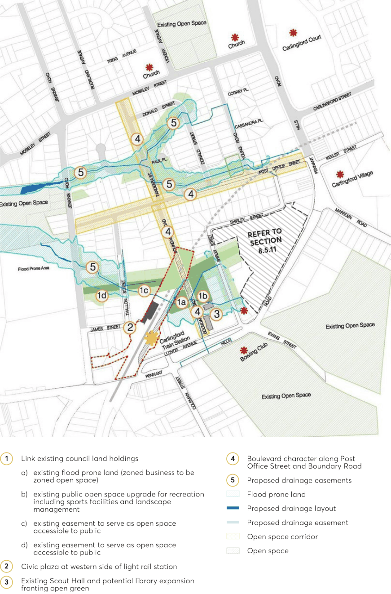

> [Picture on page 396: a picture, saved as a picture (images/part-08-centres-precincts-special-character-areas-specific-page-396-2.gif, 150 dpi).]

Figure 8.2.8.1.3.2 – Structure Plan – Open Space Strategy

CARLINGFORD LOCAL CENTRE

STRUCTURE PLAN – PUBLIC DOMAIN

Streetscape

• Street tree planting and landscaping is to be consistent with the Carlingford Precinct Public Domain Plan. Public domain improvements

• Embellish the existing public open space to the west of the rail reserve. The railway station, rail reserve and public open space near the scout hall are major organising elements in the Precinct. This is an opportunity to increase the pedestrian connections to the park and its attractiveness for recreation of the future residents of the Precinct.

• A public square on the west of the light rail station to act as a gateway entry point. Infrastructure upgrades

• It is proposed to underground both the street power lines and the high voltage power lines and pylons to remove the visual impact of the existing structure and provide public open space within the easement. Pedestrian connections

• Provide improved footpath connections and unified hardscape treatment of the public realm.

• Provide cycle and pedestrian paths responding to desired lines. Adaptive re–use of the railway heritage building

• The existing heritage building in the light rail station curtilage may have the potential for adaptive reuse. This would be an opportunity to add variety and activity to a future civic precinct that centres on the station and the public open space adjacent to the railway reserve. Stormwater management

• Site planning and development generally must respond to the recommendations of Council’s Carlingford Stormwater Study and Management Plan.

• On the southern side of Post Office Street a major opportunity arises from site amalgamation to provide a series of linked open spaces. These spaces could be combined with a stormwater capture system incorporating linked retention basins along the water course to form a “green spine” linking the upper Pennant Hills Road section of the Precinct to the lower section being the public open space adjacent to the railway line.

• Install a variety of bio-retention measures including grass depressions and swales on street edges and within open space. Sustainability and WSUD

• Development in the Precinct will be required to undertake sustainability initiatives: stormwater capture, bio-retention basins, integration of watercourses with open space and landscaping.

CARLINGFORD LOCAL CENTRE

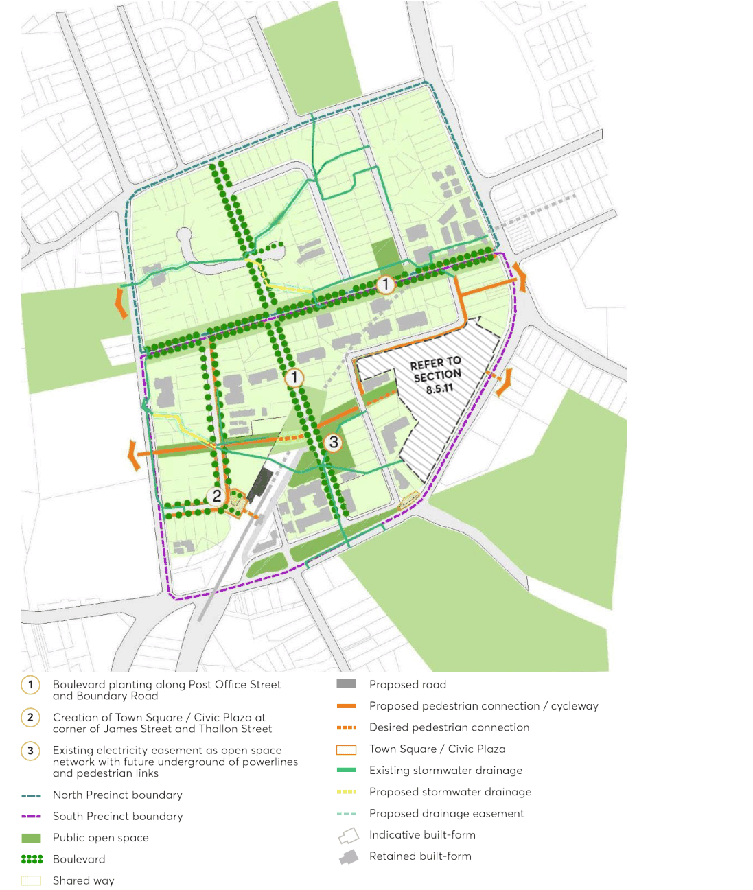

> [Picture on page 398: a picture, saved as a picture (images/part-08-centres-precincts-special-character-areas-specific-page-398-2.gif, 150 dpi).]

Figure 8.2.8.1.3.3 – Structure Plan – Public Domain

CARLINGFORD LOCAL CENTRE

STRUCTURE PLAN (INDICATIVE BUILDING HEIGHT AND FSR)

Building heights should increase the closer sites are to the light rail station

• Concentration of the residential density close to the station will maximise usage of the train service by the maximum number of people in the shortest, most convenient walking distance from the station.

• Concentration of high-rise buildings close to the station will provide an orienting landmark for the village centre. Built Form Should Address Open Space

• In areas further from the light rail station, building placement should address adjacent open space to allow interaction of residents with that space and for passive surveillance. Built Form Should Respond To Street Hierarchy

• In general, the low-rise buildings are proposed together with lower FSR limits on the local roads within the northern part of Precinct. This approach responds to the lower scale suburban desired future character for areas further from the light rail station.

• Maximum of 9 storeys is proposed for development fronting Pennant Hills Road. This is to achieve a presence associated with deep setbacks for major planting, footpath upgrades and pedestrian amenities.

ILLUSTRATIVE MASTERPLAN

Response of Building Bulk and Scale to Topography

• Site specific development controls are to be provided for Key Sites in the vicinity of the light rail station to minimise overshadowing and create pedestrian scale podiums containing retail and commercial uses and associated public open spaces.

• High rise developments are to be concentrated in the low ground close to the light rail station. This is an opportunity for the apparent height of high rise buildings to be diminished when viewed in their topographic context. The proposed building envelopes thus take up the opportunity for the prominence of tower buildings to be visually absorbed by the backdrop of the slopes leading up to the ridge lines along which runs Pennant Hills Road.

• Provide for home office and ancillary commercial and convenience retail uses on ground floor areas of developments on pedestrian routes to the light rail station.

• In areas further from the light rail station, the built form, site coverage, setbacks and composition of boundaries and building placement are to create a garden suburb character. This character should complement, in style and function, the public open space adjacent to the light rail station and community facilities to the east. This integrated approach is key to producing a synergy and coherence between private development and the public realm. This will be a unique place making force for a possible civic hub in the vicinity of the light rail station/scout hall. Design Excellence (NSW Residential Flat Design Code)

CARLINGFORD LOCAL CENTRE

• Buildings that are close to the light rail station should be in the form of a slender tower and positioned so as to minimise impacts on privacy and overshadowing of open space and adjacent development.

• Iconic buildings located at gateways, nodes and major intersections. Built Form and Setbacks are to Relate to Street Hierarchy

• On the axial boulevards of the Precinct, built form, height and landscaping is to be of a scale that signifies the importance of these major urban elements and their intersections.

• Setbacks in the Thallon Street area are to contribute to the urban village character. Setbacks in the remainder of the southern part of the Precinct are to contribute to the landscaped character while allowing flexibility in the siting of buildings. The setbacks of proposed buildings are designed to minimise adverse impacts such as overshadowing and privacy on adjacent and adjoining properties.

• Key sites are identified sites that can accommodate landmark buildings.

• Other key sites are identified in flood prone land that can act as dual usage parks and stormwater retention basins.

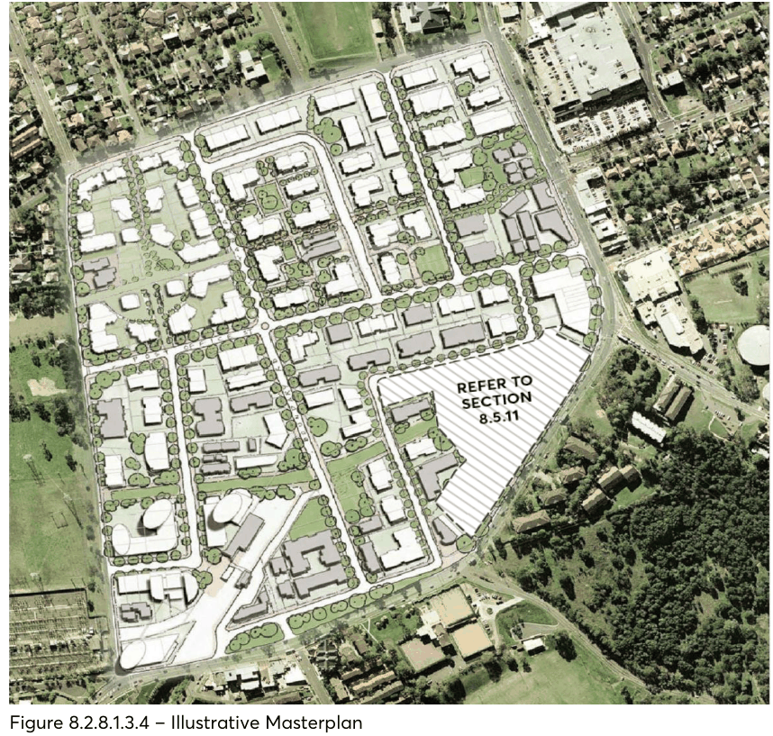

> [Picture on page 400: a picture, saved as a picture (images/part-08-centres-precincts-special-character-areas-specific-page-400-17.gif, 150 dpi).]

Figure 8.2.8.1.3.4 – Illustrative Masterplan

Note: This is indicative only. Refer to Section 8.5 – Specific Sites of this DCP for any site-specific provisions.

CARLINGFORD LOCAL CENTRE

#### 8.2.8.1.4 SITE COVEREGE AND REQUIREMENTS

Objectives

Site requirements O.01 Encourage the amalgamation of sites thus promoting the efficient use of land. O.02 Promote developments compatible with the desired Precinct character. O.03 Encourage orderly development in regular allotment patterns. Site coverage O.04 Ensure an appropriate balance of open space surrounding buildings within their site area, reflecting the different scales of development appropriate in the north and south of the Precinct.

O.05 Provide solar access. O.06 Control building bulk by working in conjunction with the FSR and height limits that help differentiate the desired future character appropriate in the north and south of the Precinct.

Controls

Site requirements C.01 The minimum site area of development sites shall be consistent with the site areas specified in the potential site amalgamation plan (Figure 8.2.8.1.4.1).

Site coverage C.02 Building site coverage shall not exceed of 35% of site area. “Building” for the purpose of this control is defined as the building footprint to the outside of the external walls excluding underground parking structures no more than 1.2 metres above ground and where roof of the parking structure is a private or communal open space.

CARLINGFORD LOCAL CENTRE

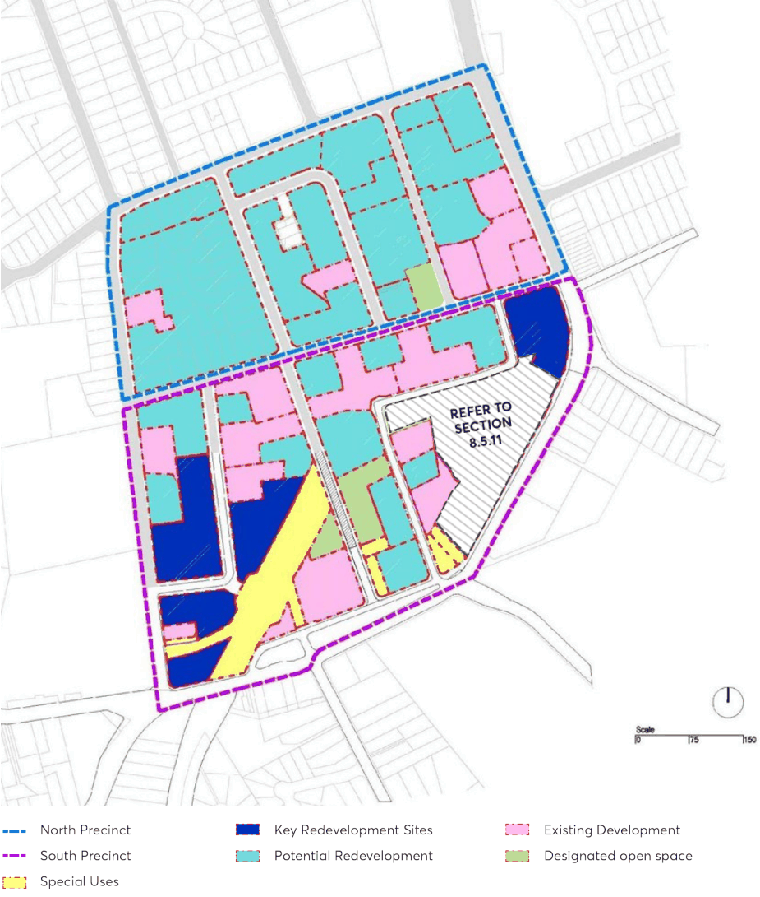

> [Picture on page 402: a picture, saved as a picture (images/part-08-centres-precincts-special-character-areas-specific-page-402-2.gif, 150 dpi).]

Figure 8.2.8.1.4.1 – Potential Site Amalgamation Guide Plans

#### 8.2.8.1.5 RESIDENTIAL DEVELOPMENT TYPES

Objectives

Residential flat buildings – apartment size O.01 Provide a diversity of residential flat building/apartment types, which cater for different household requirements now and in the future.

O.02 Maintain equitable access to new housing by cultural and socio-economic groups.

CARLINGFORD LOCAL CENTRE

Mixed use development O.03 Support the integration of appropriate retail and commercial uses with housing. O.04 Create more active lively streets and urban areas, which encourage pedestrian movement, service the needs of the residents and increase the area’s employment base.

O.05 Ensure that the design of mixed use developments maintains residential amenities and preserves compatibility between uses.

Ground floor apartments O.06 Contribute to the desired streetscape of the range of localities in the Precinct and to create active safe streets.

O.07 Increase the housing and lifestyle choices available in residential flat buildings.

Controls

Residential flat buildings – apartment size C.01 Single-aspect apartments should be limited in depth to 8 metres from a window. C.02 The back of a kitchen should be no more than 8 metres from a window. C.03 The width of cross-over or cross-through apartments over 15 metres deep should be 4 metres or greater to avoid deep narrow apartment layouts.

C.04 Buildings not meeting the minimum standards listed above, must demonstrate how satisfactory day lighting and natural ventilation can be achieved, particularly in relation to habitable rooms (see Daylight Access and Natural Ventilation).

Mixed use development C.05 Choose a mix of uses that complement and reinforce the character, economics and function of the local area, for example, food retail, small-scale commercial and residential.

C.06 Desired uses at ground floor level of eighteen (18) storey buildings near the station include small supermarkets, post office, chemist, newsagent, bank and other service retail and commercial to meet the day-to-day needs of the local community.

C.07 Ensure the building positively contributes to the public domain and streetscape by:

• Fronting onto major streets with active uses.

• Avoiding the use of blank walls at the ground level.

Ground floor apartments C.08 Optimise the number of ground floor apartments with separate entries. C.09 Provide ground floor apartments with access to private open space, preferably as a terrace or garden.

CARLINGFORD LOCAL CENTRE

#### 8.2.8.1.6 BUILDING FORM

Objectives

Floor space ratio O.01 Ensure that the bulk and scale of the development is in keeping with the site area and its surroundings in accordance with O.07 in Section 8.2.8.1.16 – Ecologically Sustainable Development of this DCP.

O.02 Ensure that the bulk and scale of development does not reduce the amenity of adjacent residential or other land uses.

O.03 Control the density of residential development. O.04 Prevent excessive site coverage. Building height O.05 Ensure that buildings reflect the existing landform of the neighbourhood, including ridgelines and drainage depressions.

O.06 Protect privacy and amenity of surrounding residential developments and allotments in accordance with O.07 in Section 8.2.8.1.16 – Ecologically Sustainable Development of this DCP.

O.07 Ensure that development responds to the desired scale and character of the street appropriate in different parts of the Precinct.

O.08 Allow reasonable daylight access to all developments and the public domain. Building depth O.09 Ensure that the scale of the development is consistent with the existing or desired future context.

O.10 Provide adequate amenity for building occupants in terms of solar access and natural ventilation.

O.11 Provide for dual aspect apartments. Building separation and treatment O.12 Ensure that new development is scaled to support the desired area character with appropriate massing and spaces between buildings.

O.13 Provide visual and acoustic privacy for existing and new residents. O.14 Control overshadowing of adjacent properties and private or shared open space. O.15 Allow for the provision of open space of an appropriate size and proportion for recreational activities for building occupants.

O.16 Provide deep soil zones for stormwater management and tree planting.

CARLINGFORD LOCAL CENTRE

Controls

Floor space ratio C.01 Floor space ratio of a proposed development within the Precinct must not exceed the maximum ratio specified for that development site in the Floor Space Ratio Map of Parramatta LEP 2023.

Building height C.02 The height of proposed development within the Precinct must not exceed the maximum height specified for that development site in the Building Height Map in Parramatta LEP 2023. The maximum height of the building at any point shall be measured from the natural ground level to the ridge of the roof or top of the flat roof slab or top of the parapet if there is parapet on the roof slab. Natural ground level means the actual physical level of the site as existing prior to development taking place.

C.03 For the purpose of this part of Parramatta DCP 2023, building heights as specified in the Building Height Map in the Parramatta LEP 2023 equal to number of storeys depicted in the following table: Table 8.2.8.1.6.1 – equivalent storeys relevant to building heights

| Building Height | Equivalent Storeys |
|---|---|
| 10 metres | 2 storeys |
| 16 metres | 4 storeys |
| 21 metres | 6 storeys |
| 27 metres | 9 storeys |
| 28 metres | 9 storeys, with retail at ground floor and commercial at first floor |
| 33 metres | 11 storeys |
| 57 metres | 18 storeys, with retail at ground floor and commercial at first floor |

C.04 Development on sloping sites is to be stepped so that the ground floor does not exceed one metre above natural ground level immediately below any point on the ground floor.

Building depth C.05 Building Depth: In general, a residential flat building depth of approximately 18 metres from glass line to glass line is appropriate. Developments that propose depths wider than 18 metres from glass line to glass line must demonstrate how satisfactory daylight and natural ventilation are to be achieved. The building envelope includes the articulation zone (balconies, bay windows, shading devices). Exceptions may be made to allow projections beyond the building where they are an appropriate minimum distance above the finished ground level. These exceptions do not include bay windows and balconies.

C.06 The 18 metre from glass line to glass line guideline generally applies to street wall buildings, buildings with dual aspects and buildings with minimal side setbacks.

C.07 Freestanding buildings (the big house or tower building types) may have greater depth than 18 metres only if can be demonstrated that they achieve satisfactory daylight and natural ventilation.

C.08 Building depth is to be in combination with other controls to ensure adequate amenity for building occupants. For example, a deeper plan may be acceptable where higher floor to ceiling heights allow solar access or where apartments have a wider frontage.

CARLINGFORD LOCAL CENTRE

C.09 Building Length: In general, a residential flat building length of approximately 50 metres is appropriate. Developments more than 50 metres in length must demonstrate how satisfactory day lighting and natural ventilation are to be achieved. Note: this parameter for buildings on key sites is subject to site specific controls.

Building separation and treatment C.10 The minimum dimensions within a development, for internal courtyards and between adjoining sites shall be: Buildings up to 4 storeys

• 12 metres between habitable rooms/balconies.

• 9 metres between habitable/balconies and non-habitable rooms.

• 6 metres between non-habitable rooms. Buildings from 5 to 8 storeys

• 18 metres between habitable rooms/balconies.

• 12 metres between habitable rooms/balconies and non-habitable rooms.

• 9 metres between non-habitable rooms. Buildings 9 storeys and above

• 24 metres between habitable rooms/balconies.

• 18 metres between habitable rooms/balconies and non-habitable rooms.

• 12 metres between non-habitable rooms.

#### 8.2.8.1.7 SETBACKS

Building setback requirements are shown in Figure 8.2.8.1.7.1 and for the Key Sites in Section 8.2.8.1.21 of this DCP. The objectives and development controls for each are set out below.

Objectives

Front setback O.01 6 metres setback:

• Allow for the higher buildings proposed in the Thallon/James Street area to relate closely to the street.

• Allow buildings fronting Boundary Road and Shirley Street to form the basis of a more regular streetscape/built form relationship.

O.02 8 metres setback:

• Allow for new buildings along Jenkins Road to match the setback of the existing multi unit developments along the street.

• Allow visual separation from the traffic on Jenkins Road and space to install road noise attenuation structures within each development.

CARLINGFORD LOCAL CENTRE

• Allow for buildings along Post Office Street sufficient space to provide substantial landscaping to create a boulevard character.

• In parts of the Precinct further from the light rail station, to allow privately owned land upon to be landscaped and embellished so as to complement the landscape themes of the public realm of the open space.

O.03 10 metres setback:

• Allow for new buildings along Jenkins Road to match the setback of the existing multi unit developments along the street.

• Allow visual separation from the traffic on Jenkins Road and space to install road noise attenuation structures within each development.

• Allow for buildings along Post Office Street sufficient space to provide substantial landscaping to create a boulevard character.

• In parts of the Precinct further from the light rail station, to allow privately owned land upon to be landscaped and embellished so as to complement the landscape themes of the public realm of the open space.

Side Setbacks O.04 Minimise the impact of development on light, air, sun, privacy, views and outlook for neighbouring properties, including future buildings.

O.05 Retain or create a rhythm or pattern of development that positively defines the streetscape so that space is not just what is left over around the building form.

O.06 Allow modulation of end walls for structures higher than 4 storeys. Rear Setbacks O.07 Maintain deep soil zones to maximise natural site drainage and protect the water table. O.08 Maximise the opportunity to retain and reinforce mature vegetation. O.09 Optimise the use of land at the rear and surveillance of the street at the front. O.10 Maximise building separation to provide visual and acoustic privacy.

Controls

Front setback C.01 6 metres setback: The front façade of buildings are to be set back a minimum of 6 metres from the front boundary of the site.

C.02 8 metres setback: The front façade of buildings are to be set back a minimum of 8 metres from the front boundary of the site.

C.03 10 metres setback: The front façade of the building is to be setback 10 metres from the front boundary of the site.

Side and rear setbacks C.04 Side and rear setbacks must comply with building separation, open space and deep soil zone controls in this Section of this DCP.

CARLINGFORD LOCAL CENTRE

C.05 Rear setback is to be a minimum of 8 metres. C.06 Side setbacks are to be a minimum of 4.5 metres to walls and 6 metres to windows from ground floor to fourth storey, and 6 metres for walls and windows above the fourth storey.

C.07 Primary and secondary setback lines must comply with building separation, open space and deep soil zone controls in this DCP.

C.08 Where setbacks are limited by lot size and adjacent buildings, internal courtyards that limit the length of walls facing boundaries may be proposed. This approach must comply with building separation, open space and deep soil zone controls in this DCP.

C.09 In general, no part of a building or above ground structure may encroach into a setback zone. Exceptions are access to underground parking structures.

C.10 A 450mm articulation zone is permitted for non floor space building elements such as fins louvres, shading devices and balconies.

C.11 Future development is to be located in accordance with the setbacks in Figure 8.2.8.1.7.1, and, for the Key Sites, in Section 8.2.8.1.21 of this DCP.

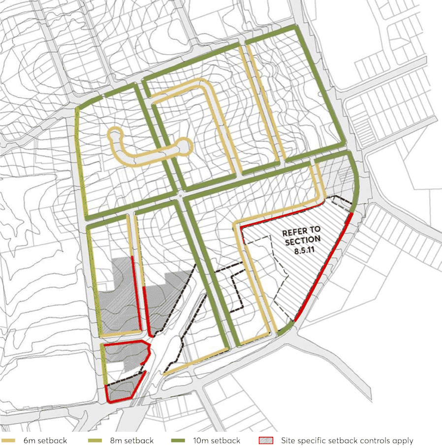

> [Picture on page 408: a picture, saved as a picture (images/part-08-centres-precincts-special-character-areas-specific-page-408-16.gif, 150 dpi).]

Figure 8.2.8.1.7.1 – Setback Controls

CARLINGFORD LOCAL CENTRE

#### 8.2.8.1.8 BUILDING DESIGN

Objectives

Facades O.01 Promote high architectural quality in residential flat buildings. O.02 Ensure that new developments have facades which define and enhance the public domain and desired street character.

O.03 Ensure that building elements are integrated into the overall building form and facade design. Roof design O.04 Provide quality roof designs, which contribute to the overall design and performance of residential flat buildings.

O.05 Integrate the design of the roof into the overall facade, building composition and desired contextual response.

O.06 Increase the longevity of the building through weather protection. Building entry O.07 Create entrances which provide a desirable residential identity for the development. O.08 Orient the visitor. O.09 Contribute positively to the streetscape and building facade design. O.10 Provide entrances that are legible, safe, accessible and well lit. Ceiling height O.11 Increase the sense of space in apartments and provide well proportioned rooms. O.12 Promote the penetration of daylight into the depths of the apartment. O.13 Contribute to flexibility of use. O.14 Achieve quality interior spaces while considering the external building form requirements. Balconies O.15 Provide all apartments with private open space. O.16 Ensure balconies are functional and responsive to the environment thereby promoting the enjoyment of outdoor living for apartment residents.

O.17 Ensure that balconies are integrated into the overall architectural form and detail of residential flat buildings.

O.18 Contribute to the safety and liveliness of the street by allowing for casual surveillance. Internal circulation O.19 Create safe and pleasant spaces for resident circulation. O.20 Facilitate quality apartment layouts, such as dual aspect apartments.

CARLINGFORD LOCAL CENTRE

O.21 Contribute positively to the form and articulation of the building facade and its relationship to the urban environment.

O.22 Encourage interaction and recognition between residents to contribute to a sense of community and improve perceptions of safety.

Acoustic and visual privacy O.23 Limit views into adjoining private open spaces and living rooms. O.24 Protect residents from external noise. O.25 Contain noise between dwellings without unreasonable transmission to adjoining dwellings. Site facilities O.26 Provide site facilities which are adequate and conveniently located for resident needs. O.27 Ensure facilities are practical, attractive and easily maintained. Storage O.28 Provide adequate storage for everyday household items within easy access of the apartment. O.29 Provide storage for sporting, leisure, fitness and hobby equipment.

Controls

Facades C.01 Compose facades with an appropriate scale, materials and finishes, rhythm, and proportion, which response to the building use and the desired contextual character. Design should include but are not limited to:

• defining a base, middle and top related to the overall proportion of the building.

• expressing the variation in floor to floor height particularly at the lower levels.

• articulating building entries with awnings, porticos, recesses, blade walls and rejecting bays.

• selecting balcony types which respond to the street context, building orientation and amenity of the locality.

• incorporating architectural features which give human scale to the design of the building at street level. These include entrance porches, awnings, colonnades, pergolas and fences.

C.02 High-quality materials and finishes for facades such as natural stone, granite or porcelain stoneware tiles must be used for the podium level of eighteen (18) storey buildings near the station.

C.03 Design facades to reflect the orientation of the site using elements such as sun shading, bay windows, as environmental controls depending on the façade orientation.

C.04 Express important corners by giving visual prominence to parts of the façade, for example, a change in building articulation, material or colour, roof expression or increased height.

Roof design C.05 Articulate the roof to break down its mass on larger buildings, to minimise the apparent bulk or to relate to a context of smaller building forms.

CARLINGFORD LOCAL CENTRE

C.06 Design the roof to relate to size and scale of the building, the building elevations and three dimensional building form.

C.07 Design roofs to respond to the orientation of the site, for example, by using eaves to respond to sun access.

C.08 Minimise the visual intrusiveness of service elements by integrating them into the design of the roof.

C.09 Facilitate the use or future use of the roof for sustainable functions, for example, water management and photovoltaic applications.

C.10 Where habitable space is provided within the roof optimise residential amenity in the form of attics or penthouse apartments.

C.11 The use of roof space to provide communal open space areas incorporating facilities such as swimming pools, BBQ areas and seating is encouraged.

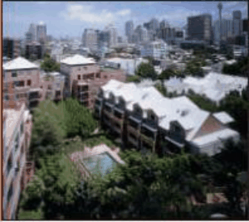

> [Picture on page 411: a picture, saved as a picture (images/part-08-centres-precincts-special-character-areas-specific-page-411-14.gif, 150 dpi).]

Figure 8.2.8.1.8.1 – Articulation of rooflines to break up roof mass. (Source: Residential Flat Design Code)

Building entry C.12 Provide as direct a physical and visual connection as possible between the street and the entry. C.13 Achieve clear lines of transition between the public street, the shared private circulation spaces and individual apartments.

C.14 Provide safe and secure access. Design solutions include:

• Avoid ambiguous and publicly accessible small spaces in entry areas.

• Provide a clear line of sight between one circulation space and the next.

• Provide sheltered, well lit and highly visible spaces to enter the building, meet and collect mail.

C.15 Generally provide separate entries from the street for:

• Pedestrians and cars.

• Different uses, for example, for residential and commercial users in a mixed-use development

• Ground floor apartments, where applicable.

C.16 Design entries and associated circulation space to be of an adequate size to allow movement of furniture between public and private spaces.

CARLINGFORD LOCAL CENTRE

Ceiling height C.17 Ceiling heights shall be measured from finished floor level (FFL) to finished ceiling level (FCL). These are minimums only and do not preclude higher ceilings, if desired.

C.18 In mixed use buildings: 3.3 metre minimum for ground floor retail or commercial and for first floor residential retail or commercial to promote future flexibility of use in residential flat buildings in mixed use areas: 3.3 metre minimum for ground floor to promote future flexibility of use.

C.19 In general, 2.7 metre minimum for all habitable rooms on all floors, 2.4 metres is the preferred minimum for all non-habitable rooms, however 2.25 metres is permitted.

C.20 For two storey units, 2.4 metre minimum for second storey if 50 percent or more of the apartment has 2.7 metre minimum ceiling heights.

C.21 For two storey units with a two storey void space, 2.4 metre minimum ceiling heights. C.22 Attic spaces shall have a 1.5 metre minimum wall height at edge of room with a 30 degree minimum ceiling slope.

Balconies C.23 Provide primary balconies for all apartments with a minimum depth of 2 metres. Developments which seek to vary the minimum standards must demonstrate that negative impacts from noise and wind cannot be satisfactorily mitigated with design solutions.

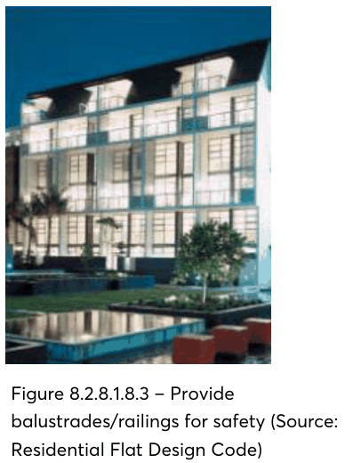

> [Picture on page 412: a picture, saved as a picture (images/part-08-centres-precincts-special-character-areas-specific-page-412-20.gif, 150 dpi).]

C.24 The minimum area for a balcony is 10m².

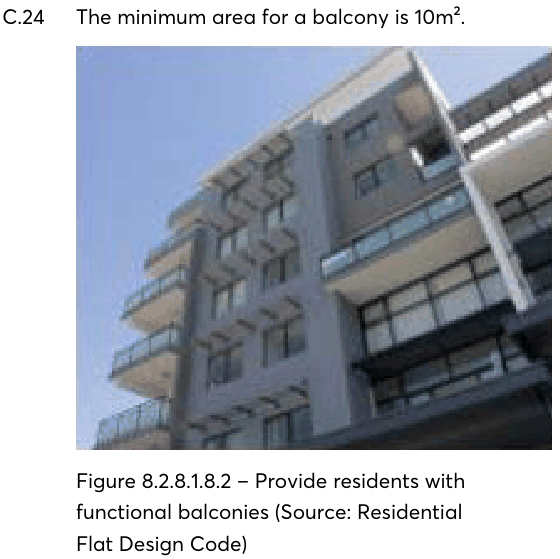

> [Picture on page 412: a picture, saved as a picture (images/part-08-centres-precincts-special-character-areas-specific-page-412-22.gif, 150 dpi).]

Figure 8.2.8.1.8.2 – Provide residents with

Figure 8.2.8.1.8.3 – Provide

functional balconies (Source: Residential

balustrades/railings for safety (Source:

Flat Design Code)

Residential Flat Design Code)

Internal circulation C.25 In general, where units are arranged off a double-loaded corridor, the number of units accessible from a single core/corridor should be limited to eight (8). Exceptions may be allowed:

• For adaptive reuse buildings.

• Where developments can demonstrate the achievement of the desired streetscape character and entry response.

CARLINGFORD LOCAL CENTRE

• Where developments can demonstrate a high level of amenity for common lobbies, corridors and units.

Acoustic and visual privacy C.26 The effective location of windows and balconies is preferred to the use of screening devices, high sills or obscured glass. Where these are used, they should have minimal negative effect on resident or neighbour amenity.

C.27 Direct views from the living rooms of dwellings into private open space or the interior of other dwellings should be obscured with landscaping, architectural detail and building design (refer to AMCORD).

C.28 Where minimum separation distances cannot be practically met, windows should be placed to minimise direct viewing between dwellings.

C.29 In general, dwellings are to be designed to limit the potential for noise transmission to living and sleeping areas of adjacent existing and future developments. Consideration should be given to minimising noise emissions from air conditioners, driveways and the like. This can be achieved by complying with the Building Code of Australia requirements.

C.30 Dwellings that adjoin Pennant Hills Road are to be designed to acceptable internal noise levels, based on AS 3671 – Road Traffic Noise Intrusion Guidelines.

C.31 Minimise direct overlooking of main internal living areas and private open space of dwellings both within and of adjoining development through building design, window locations and sizes, landscaping and screening devices.

C.32 Consider the location of potential noise sources within the development such as common open space, service areas, driveways, road frontage and provide appropriate measures to protect acoustic privacy by the careful location of noise- sensitive rooms (bedrooms, main living areas) and double glazed windows.

C.33 The location of the plant and equipment for residential flat buildings should be designed so that the noise level does not exceed the background noise level. This is to reduce background noise level creep.

C.34 In regard to the town houses and small lot integrated houses, ideal positions or specifically designed positions for any air conditioners should be provided in the plans at Development Application stage.

C.35 Air conditioners shall be located a minimum of three (3) metres from any property boundary and must not exceed 5dB(A) above the background noise level or alternatively if there is no other option and the air conditioner is located within three (3) metres of any property boundary it must not exceed the background noise level.

C.36 Private areas in a development are to be clearly recognisable. Site facilities C.37 Rubbish and recycling bin enclosures, letter boxes, and other site facilities should be adequate in size, durable, weather proofed and visually integrated with the development. Their location is to have regard to the protection of residential amenity, service vehicle access, visual impact and residential access.

Laundry Facilities

CARLINGFORD LOCAL CENTRE

C.38 All apartments are to be provided with internal laundry facilities and internal drying facilities. C.39 Laundries for town houses and small lot integrated housing shall be provided to each dwelling with a permanent or collapsible clothes line provided in a conveniently accessible courtyard.

Waste and recycling bins C.40 Waste management requirements are to be in accordance with 3.5 of this DCP. Waste Management Planning C.41 Demolition and construction works must maximise the reuse and recycling of building/construction materials in accordance with Section 8.2.8.1.16 – Ecologically Sustainable Development of this DCP and State and Federal Government waste minimisation targets.

C.42 All asbestos, hazardous and/or intractable wastes are to be disposed of in accordance with Workcover Authority and EPA requirements.

C.43 All Development Applications are to be accompanied by a Waste Management Plan that demonstrates appropriate project management and construction techniques for ensuring waste minimisation including the re-use of waste on-site and off-site recycling.

C.44 The Waste Management Plan must include the following information:

• Types of waste to be produced.

• Quantities of waste likely to be produced.

• On-site and/or off-site reuse and recycling methods for waste.

• Details as to the contractor and destination of all waste materials.

• Location of on-site separation and storage facilities for waste materials.

• Design of waste management facilities for use by residents following occupation.

C.45 A Waste Data File (a file containing the Waste Management Plan together with records-waste receipts or dockets) of recycling and disposal of demolition and construction materials must be kept by the Construction Contractor responsible for the site. A Waste Management Plan template is available in Appendix 2.

Mail Boxes C.46 Mail boxes are to be generally incorporated into front fences, landscaped areas or integrated with individual building entry design.

C.47 Mail boxes should be in close proximity to the pedestrian entrance of all housing types, and be easily identifiable for ease of use.

C.48 The location of mail boxes and mail drop-off points will need to be confirmed with Australia Post.

Storage C.49 In addition to kitchen cupboards and bedroom wardrobes, provide accessible storage facilities at the following rates:

a) Residential Flat Buildings

• Studio apartments – 6m3

CARLINGFORD LOCAL CENTRE

• One-bedroom apartments – 6m3

• Two-bedroom apartments – 8m3

• Three plus bedroom apartments – 10m3

b) Multi Dwelling Housing

• As per Part 3 – Residential Development of this DCP.

#### 8.2.8.1.9 LANDSCAPING AND PRIVATE DOMAIN

Objectives

Landscape design O.01 Ensure a high-quality public domain that is compatible with the achievable built forms and appropriate for the desired future character of the Precinct.

O.02 Add value to the quality of life of residents within the Precinct in the forms of privacy, outlook and views.

O.03 Improve stormwater quality and reduce quantity. O.04 Improve the microclimate and solar performance within the development. O.05 Improve urban air quality. O.06 Contribute to biodiversity. Deep soil zones O.07 Assist with the management of the water table. O.08 Assist with the management of water quality. O.09 Improve the amenity of developments through the retention and/or planting of large and medium size trees.

Planting on structures O.10 Contribute to the quality and amenity of communal open space on roof tops, podiums and internal courtyards.

O.11 Encourage the establishment and healthy growth of trees in urban areas. Private domain O.12 Provide residents with passive and active recreational opportunities. O.13 Provide an area on site that enables soft landscaping and deep soil planting. O.14 Ensure that communal open space is consolidated, configured and designed to be useable and attractive.

O.15 Provide a pleasant outlook. Provide high-quality design for communal open spaces to encourage outdoor activities.

CARLINGFORD LOCAL CENTRE

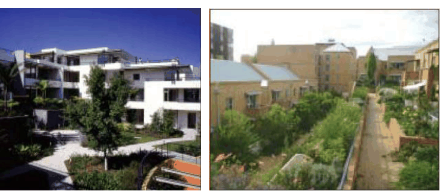

> [Picture on page 416: a picture, saved as a picture (images/part-08-centres-precincts-special-character-areas-specific-page-416-2.gif, 150 dpi).]

(Source: Residential Flat Design Code)

Controls

Landscape design C.01 Development is to provide landscaping in accordance with Part 2 – Design in Context of this DCP.

C.02 Landscaping of the public domain is to be undertaken in accordance with the provisions of the Carlingford Precinct Public Domain Plan. This includes, but is not limited to, kerb and gutter construction, paving, landscaping, street furniture, lighting and street tree planting.

Deep soil zones C.03 A minimum of 25% of the unbuilt upon area of a site is to be a deep soil zone. Alternatively, 15% of the total site area, whichever is greater.

Planting on structures C.04 Large trees such as figs (canopy diameter of up to 16 metres at maturity):

• minimum soil volume: 150 cubic metres

• minimum soil depth: 1.3 metre

• minimum soil area: 10 metre x 10 metre area or equivalent

C.05 Medium trees (8 metre canopy diameter at maturity):

• minimum soil volume: 35 cubic metres

• minimum soil depth: 1 metre

• approximate soil area: 6 metre x 6 metre or equivalent

C.06 Small trees (4 metre canopy diameter at maturity):

• minimum soil volume: 9 cubic metres

• minimum soil depth: 800mm

• approximate soil area: 3.5 metre x 3.5 metre or equivalent

C.07 Shrubs:

CARLINGFORD LOCAL CENTRE

• minimum soil depths: 500-600mm

C.08 Ground cover:

• minimum soil depths: 300-450m

C.09 Turf:

• minimum soil depths: 100-300mm

C.10 Any subsurface drainage requirements are in addition to the minimum soil depths quoted above.

Private domain C.11 The area of communal open space required should be at least 30 percent of the site area. (Larger sites may have potential for more than 30 percent.)

C.12 Provision of roof top communal open space will be considered when calculating the area of communal open space for mixed use developments with retail and commercial uses where it is not possible to provide 30 percent of the site area in communal open space at ground level.

C.13 Private open space must be readily accessible from living areas of dwelling units. C.14 The minimum area of private open space for each apartment at ground level must be 25m². The minimum dimension is 4 metres.

C.15 In order to provide useable open space to dwellings above ground level, any balcony or terrace shall have a minimum area of 10m² and a minimum depth of 2 metres.

8.2.8.1.10 SOLAR ACCESS, NATURAL VENTILATION AND BUILDING ORIENTATION

Objectives

O.01 Ensure that solar access is provided to all habitable rooms and encouraged in all other areas of residential flat development.

O.02 Provide adequate ambient lighting and minimise the need for artificial lighting during daylight hours.

O.03 Provide residents with the ability to adjust the quantity of daylight to suit their needs. Natural ventilation O.04 Ensure that apartments are designed to provide all habitable rooms with direct access to fresh air and to assist in promoting thermal comfort for occupants.

O.05 Provide natural ventilation in non-habitable rooms, where possible. O.06 Reduce energy consumption by minimizing the use of mechanical ventilation, particularly air conditioning.

Orientation O.07 Optimise solar access to residential apartments within the development and adjacent development.

O.08 Contribute positively to desired streetscape character.

CARLINGFORD LOCAL CENTRE

O.09 Protect the amenity of existing development. O.10 Improve the thermal efficiency of new buildings.

Controls

C.01 Buildings must be designed to ensure that adjoining residential buildings, and the major part of their landscape receive at least four hours of sunlight between 9am and 3pm on 21 June.

C.02 Living rooms and private open spaces for at least 70 percent of apartments in a development should receive a minimum of four hours direct sunlight between 9 am and 3 pm on 21 June.

C.03 Limit the number of single-aspect apartments with a southerly aspect (SW-SE) to a maximum of 10 percent of the total units proposed. Developments which seek to vary from the minimum standards must demonstrate how site constraints and orientation prohibit the achievement of these standards and how energy efficiency is addressed (see Orientation and Energy Efficiency).

C.04 Main windows should have suitable shading or other solar control to avoid discomfort

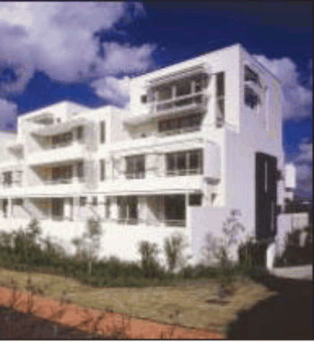

> [Picture on page 418: a picture, saved as a picture (images/part-08-centres-precincts-special-character-areas-specific-page-418-15.gif, 150 dpi).]

(shutters/blinds/screens/retractable awnings).

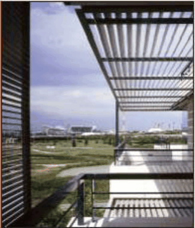

> [Picture on page 418: a picture, saved as a picture (images/part-08-centres-precincts-special-character-areas-specific-page-418-17.gif, 150 dpi).]

Figure 8.2.8.1.10.1 – Provide residents with Figure 8.2.8.1.10.2 – Articulate built form to means to adjust the quantity of daylight allow daylight access to habitable rooms (Source: Residential Flat Design Code)

(Source: Residential Flat Design Code)

Natural ventilation C.05 Sixty percent (60%) of residential units should be naturally cross ventilated. C.06 Twenty five percent (25%) of kitchens within a development should have access to natural ventilation.

C.07 Developments, which seek to vary the minimum standards must demonstrate how natural ventilation can be satisfactorily achieved, particularly in relation to habitable rooms.

Orientation C.08 Orient and design buildings to maximise the number of dwellings with direct sunlight where possible. Ideally, face the long axis of the development up to 30 degrees east and 20 degrees west of true north. This is illustrated in Figure 8.2.8.1.10.3.

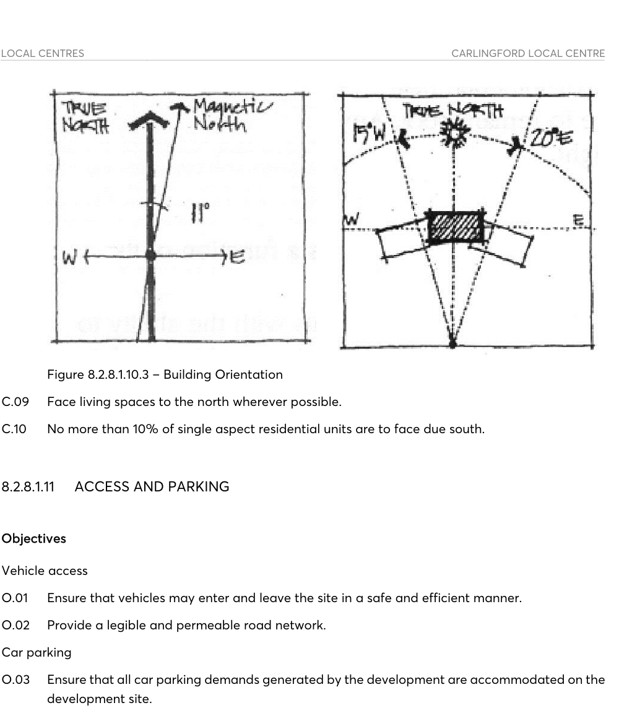

> [Picture on page 419: a picture, saved as a picture (images/part-08-centres-precincts-special-character-areas-specific-page-419-1.gif, 150 dpi).]
> Words printed on the picture (title and legend, copied from the PDF):
> CARLINGFORD LOCAL CENTRE
> 8.2.8.1.11 ACCESS AND PARKING
> Objectives

Figure 8.2.8.1.10.3 – Building Orientation

C.09 Face living spaces to the north wherever possible. C.10 No more than 10% of single aspect residential units are to face due south.

Vehicle access O.01 Ensure that vehicles may enter and leave the site in a safe and efficient manner. O.02 Provide a legible and permeable road network. Car parking O.03 Ensure that all car parking demands generated by the development are accommodated on the development site.

O.04 Minimise car dependency for commuting and recreational transport use and to promote alternative means of transport including public transport, bicycling, and walking.

O.05 Provide adequate car parking for building users and visitors, depending on building type and proximity to public transport.

O.06 Integrate the location and design of car parking with the design of the site and the building.

Controls

Vehicle access C.01 Access to the site is to be in accordance with the requirements within Part 6 – Traffic and Transport of this DCP.

C.02 Ensure vehicular ingress and egress to the site is in a forward direction at all times.

CARLINGFORD LOCAL CENTRE

C.03 Adequate provision shall be made for service vehicle access and service areas. C.04 Driveways are to have a minimum width of 6 metres at the property boundary for a distance of 6 metres within the development to ensure easy entry/exit of vehicles.

C.05 Access to multi-level basement car parks should be provided in the form of a two-way ramp (two lane width - minimum 5.5 metres wide) or two separate single lane (minimum 3 metres

wide) ramps.

C.06 The design and configuration of access ways and driveways shall be in accordance with Part 6

– Traffic and Transport of this DCP.

C.07 Locate vehicle entries away from main pedestrian entries and on secondary frontages. C.08 All car parking areas and spaces shall be designed in accordance with Part 6 – Traffic and Transport of this DCP.

C.09 Car parking space dimensions and gradient design shall be in accordance with the relevant Australian Standard. The relevant Australian Standard at present is Australian/New Zealand Standard AS/NZS 2890.1:2004 - “Parking Facilities - Part 1: Off-street car parking” (AS/NZS 2890.1:2004).

Car parking C.10 Parking for residents is to be provided at the rate of 1 space per 1 bedroom apartment, 2 spaces per 2 bedroom apartment, and 2 spaces per 3 bedroom apartment. These car parking rates do not apply to the Key Sites identified in Section 8.2.8.1.21 of this Part of this DCP.

C.11 Visitor parking is to be provided at the rate of 2 spaces per 5 apartments for all development within the Precinct.

C.12 All car parking required by Council shall be provided on-site in accordance with the requirements of Part 6 – Traffic and Transport of this DCP.

C.13 Car parking including visitor parking shall be located underground to minimise the height of buildings above natural ground level.

C.14 Visitor parking is to be located in easily accessible and identifiable areas.

#### 8.2.8.1.12 STORMWATER MANAGEMENT

Objectives

O.01 Control stormwater runoff and minimise discharge impacts on adjoining properties and into natural drainage systems before, during and after construction.

O.02 Minimise the impacts of residential flat development and associated infrastructure on the health and amenity of natural waterways.

O.03 Minimise the discharge of sediment and other pollutants to the urban stormwater drainage system during construction activity.

O.04 Provide for the disposal of stormwater from the site in efficient, equitable and environmentally sensible ways in accordance with O.03 in Section 8.2.8.1.16 – Ecologically Sustainable Development of this DCP.

CARLINGFORD LOCAL CENTRE

O.05 Provide for on-site detention of site drainage. O.06 Prevent flood damage to the built and natural environment, inundation of dwellings and stormwater damage to properties.

O.07 Ensure that proposed development does not adversely affect the operational capacity of the downstream stormwater system.

O.08 Encourage reuse, recycling and harvesting of stormwater to reduce wastage of water. O.09 Encourage a reduction in water consumption.

Controls

C.01 Drainage easements will be required where the development property does not drain directly into the existing stormwater drainage system or a public road. Development Consent will not be issued until the submission of documents demonstrating the creation of any necessary easements over downstream properties.

C.02 Developments must comply with any requirements of the Sydney Catchment Management Authority.

C.03 On-site detention, water recycling, or water quality management systems may be required to Council’s and/or the Sydney Catchment Management Authority requirements, to counteract an increase in stormwater runoff.

C.04 Drainage systems are to be designed and constructed in accordance with the design guidelines set out in Section 5.1 of this DCP.

C.05 Discharge points are to be controlled and treated to prevent soil erosion, and may require energy dissipating devices on steeper topography, to Council’s requirements.

C.06 Where necessary, downstream amplification of existing drainage facilities will be required including Council infrastructure if required.

C.07 Water Sensitive Urban Design (WSUD) principles shall be employed in the management of the site’s stormwater in terms of water retention, reuse and cleansing in accordance with the Water Sensitive Urban Design Technical Guidelines for Western Sydney published by the Upper Parramatta River Catchment Trust (May 2004). In this regard the drainage design is to include measures to manage the water quality of stormwater runoff. At a minimum the design is to integrate bio retention filters along roadways, driveways and within open space areas.

C.08 On-site detention tanks are only permitted in common areas within a proposed development (for example driveways, common open space and not within private courtyards).

C.09 Drainage systems are to be designed and constructed in accordance with the design guidelines set out in Part 6 – Traffic and Transport of this DCP and/or the Sydney Catchment Management Authority.

C.10 On-site detention systems, where required, are to be designed in accordance with (a) above. Note: Where land is identified as flood controlled land, please refer to Section 5.1.4 of this DCP.

CARLINGFORD LOCAL CENTRE

#### 8.2.8.1.13 FLEXIBILITY

Objectives

O.01 Encourage housing designs which meet the broadest range of the occupants’ needs possible. O.02 Encourage adaptive re-use. O.03 Save the embodied energy expended in building demolition.

Controls

C.01 Provide robust building configurations, which utilise multiple entries and circulation cores, especially in larger buildings over 15 metres long.

C.02 Utilise structural systems, which support a degree of future change in building use or configuration. Design solutions may include:

• A structural grid, which accommodates car parking dimensions, retail, commercial and residential uses vertically throughout the building.

• The alignment of structural walls, columns and services cores between floor levels.

• The minimisation of internal structural walls.

• Higher floor to floor dimensions on the ground floor and possibly the first floor.

#### 8.2.8.1.14 PUBLIC DOMAIN

Objectives

Fences and walls O.01 Define the edges between public and private land. O.02 Define the boundaries between areas within the development having different functions or owners.

O.03 Provide privacy and security. O.04 Contribute positively to the public domain. Awnings O.05 Provide shelter for public streets. O.06 In that part of the Precinct closer to the light rail station, to ensure signage is consistent with desired streetscape character and with the development in scale, detail and overall design.

Controls

Fences and walls

CARLINGFORD LOCAL CENTRE

C.01 The fencing materials chosen must protect the acoustic amenity and privacy of courtyards. Courtyard fences shall be constructed of masonry.

C.02 Where residential buildings are required to be set back 10 metres from the front boundary, fencing/walls fronting a street shall be setback a minimum of 2 metres. This is to allow for consistent street edge landscaping, and shall include recesses and other architectural features.

C.03 All fencing or walls shall be combined and integrated with site landscaping. C.04 The following fencing materials or finishes are not acceptable because of their poor visual appearance:

• Pre-painted, profiled metal sheeting.

• Rendered finishes when the entire fence is rendered.

C.05 The use of natural materials is encouraged. C.06 Front fences should not be of a height so as to prevent casual surveillance of the public realm and adjacent prosperities.

C.07 In mixed use developments containing non residential uses on the ground floor, front boundaries should be defined by accessible paved and landscaped areas to demarcate public from private realm.

C.08 Ground floor retail edges should have barrier free access and public amenities such as awnings.

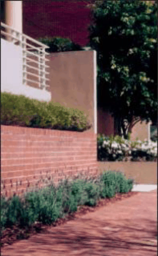

> [Picture on page 423: a picture, saved as a picture (images/part-08-centres-precincts-special-character-areas-specific-page-423-19.gif, 150 dpi).]

Combined wall/fencing materials with planting elements to soften the hard edge (Source: Residential Flat Design Code)

Awnings C.09 Encourage pedestrian activity on streets by providing awnings to retail strips, where appropriate.

C.10 Contribute to the legibility of the residential flat development and amenity of the public domain by locating local awnings over building entries.

C.11 Enhance safety for pedestrians by providing underawning lighting.

CARLINGFORD LOCAL CENTRE

#### 8.2.8.1.15 ADAPTABLE HOUSING

In order to provide for disabled people and the aging population, apartments must be capable of adaptation so as to accommodate residents who may have special needs, declining mobility and sight. This is in addition to being appropriately designed for everyday pedestrian use.

Objectives

O.01 Ensure that developments provide appropriate and improved access and facilities for all persons (consistent with the provisions of Australian Standard AS1428.1-1998).

O.02 Ensure designers/developers consider the needs of people who are mobility impaired and to provide greater than the minimum requirements for access and road safety.

O.03 Ensure that building design does not prevent access by people with disabilities. O.04 Incorporate design measures that are appropriate for people with disabilities.

Controls

C.01 Development to provide housing for a cross section of the community. C.02 All Development Applications for residential flat buildings should be accompanied by a report prepared by a suitably qualified Access Consultant addressing access and mobility provisions within the development.

C.03 All apartments required under this Section of this DCP to be adaptable dwellings and those which cannot be directly accessed from ground level are to be served by a lift.

C.04 Units with a floor level within 1.5 metres of the natural ground must be accessible to the front door of each unit.

C.05 At least 1 unit in each residential flat building with less than 20 units, or 5 percent of the units in any development of 20 or more units, must be either:

• An accessible unit to AS 1428 Part 2, suitable for occupation by a wheelchair user. or

• Meet Class B adaptability provisions under AS 4299.

C.06 Each unit so provided above shall have an accessible car parking bay complying with AS 2890 for people with a disability, and be accessible to a pick-up and drop-off point. An accessible route between the unit’s dedicated car parking spaces and unit shall be provided.

C.07 All stairs intended for circulation between levels, whether external or internal, shall comply with AS 1428 Part 1, if they are located on common property.

C.08 At least 10% of toilets (but not less than 1 male and 1 female toilet) provided on the common property must be wheelchair accessible.

C.09 At least one entry to any common facilities on the common property must be wheelchair accessible.

C.10 An accessible pick-up and drop-off point can be located on the public road (with Council or RMS permission) or on the site, but it must allow for vehicles up to a coaster size bus to pick up and drop off.

CARLINGFORD LOCAL CENTRE

C.11 Apartments are to be designed to permit adaptation of units so that they can change to meet future needs. Design features that might be included are:-

• Lightweight or non-load bearing walls that can be removed to re-configure rooms.

• Wall panels that can be easily removed to connect adjoining apartments and cater for largest extended families.

Development Applications should address provisions contained in Section 2.11 – Access for People with a Disability.

#### 8.2.8.1.16 ECOLOGICALLY SUSTAINABLE DEVELOPMENT

Ecologically Sustainable Development (ESD), as identified in the National ESD Strategy, refers to development that meets the needs of the present without compromising the ability of future generations to meet their own needs. It embodies the responsibility to maintain ecological processes (biodiversity and life support systems), quality of life and social interactions within a productive economic environment.

In order to fulfil Council’s statutory responsibilities as required by Schedule 2 of the Environmental Planning and Assessment Regulation 2000 and the Local Government Amendment (ESD) Act 1997 and to meet its adopted goals and objectives as defined in Council’s Environmental Management Plan development is required to comply with the Council’s Sustainability Objectives.

Objectives

O.01 Apply precautionary principles where development is likely to cause short or long-term irreversible or serious threats to the environment.

O.02 Address and allow for broad community involvement in respect to local issues of concern throughout the development process.

O.03 Ensure that during the design, construction and operation of the development, that water leaving the site is of a quality and quantity comparable to that which is received.

O.04 Ensure that biodiversity, and the integrity of ecological processes, are not compromised by the development.

O.05 Promote the following during the design, construction and operation of any development:

• The use of energy efficient materials and designs.

• Utilisation of renewable energy and materials.

• Energy efficient technology.

O.06 Follow the principles of the ‘Waste Hierarchy’ (reduce, reuse, recycle) in the use of materials and the design of waste recovery and disposal systems throughout the development process.

O.07 Protect neighbourhood amenity and safety in the design, construction and operation of the development.

CARLINGFORD LOCAL CENTRE

O.08 Encourage the long term economic viability and health of the community in the development process.

O.09 Encourage the use of public transport, use of bicycles and pedestrian trips in the development and design process.

Controls

C.01 As part of the Statement of Environmental Effects required to be submitted with all Development Applications a summary of the action taken in order to achieve these objectives must be included.

C.02 To improve the air quality of the locality, the installation of wood heaters is not permitted.

#### 8.2.8.1.17 ACCESS, SAFETY AND SECURITY

Objectives

O.01 Site and dwelling layouts are to ensure safe and convenient passage for residents and visitors.

Controls

C.01 Consideration should be given to the needs of residents in regard to prams, wheelchair access and people with disabilities.

C.02 Footpaths, landscaped areas and driveway designs are to provide opportunities for surveillance and allow for the safe movement of residents and visitors.

C.03 Apartments and town houses are to have adequate lighting in commonly accessible areas. C.04 Stairs and ramps are to have reasonable gradients and non-slip even surfaces. Refer to AS

1428.1 – 1988 Design for Access and Mobility and supplementary AS 1428.2 – 1992.

C.05 Access to dwellings is to be direct and without unnecessary barriers. For example, use ramps instead of stairs/steps, consider the height and length of handrails and eliminate changes in level between ground surfaces.

C.06 Development Applications should address provisions contained in Section 2.14 – Safety and Security.

C.07 Private areas in a development are to be clearly recognisable.

#### 8.2.8.1.18 GEOTECHNICAL

Objectives

O.01 Ensure the possibility of soil movement or slip does not adversely affect proposed development.

CARLINGFORD LOCAL CENTRE

Controls

C.01 All Development Applications submitted to Council shall be accompanied by geotechnical appraisal report from a suitably qualified experienced Geotechnical Engineer.

C.02 The geotechnical appraisal report must satisfy Council that the possibility of soil movement or slip will not affect the proposed development of the site and outline recommendations to ameliorate any geotechnical impacts.

#### 8.2.8.1.19 UNDERGROUNDING OF EXISTING POWER LINES

Objectives

O.01 Improve streetscape/public domain appearance. O.02 Utilise the former overhead easements for open space and drainage purposes.

Controls

C.01 The existing overhead high voltage power lines on a development site must be undergrounded in accordance with the requirements of the relevant power supply authority and respective controls in Parramatta LEP 2023.

C.02 A letter/correspondence from the relevant power supplying authority confirming that the applicant has consulted and made prior arrangements with the authority to underground the existing high voltage power lines within the site must be submitted with the Development Application.

C.03 Applicants are required to make satisfactory arrangements with Integral Energy for the provision of underground electricity to the site in accordance with Integral Energy’s Network Connection Contestable Works General Terms and Conditions Policy.

C.04 Applicants are required to make satisfactory arrangements with the relevant authority(s) for the provision of underground telecommunications services to the site.

C.05 A new easement for undergrounded electrical works satisfying the relevant authority must be provided on-site. This is to enable any future maintenance works for the undergrounded network.

#### 8.2.8.1.20 DEVELOPMENT NEAR LIGHT RAIL CORRIDORS

Objectives

O.01 Minimise adverse impacts on rail safety. O.02 Minimise impact of rail noise and vibration adjoining development.

CARLINGFORD LOCAL CENTRE

Controls

C.01 New development and structures adjacent or near Transport for NSW facilities shall allow continued access to the rail corridor for maintenance.

C.02 Buildings should be designed so that objects cannot be thrown from windows or balconies into the light rail corridor. This could be achieved through providing windows with a limited range of opening such as louvres, and by enclosing balconies.

C.03 All balcony and window design should meet the relevant BCA standards. C.04 If excavation is involved, a geotechnical or site stability report needs to be prepared as part of the application.

C.05 Sound level in any bedroom must not exceed 35db(A) at any time between 10.00pm and 7.00am, and anywhere in the building (other than a garage, kitchen, bathroom or hallway) – 40db(A) at any time.

C.06 If Council is of the view that development is likely to be affected by light rail noise or vibration, a consent shall not be granted unless it is satisfied that appropriate measures will be taken to ensure that above sound levels are not exceeded.

C.07 New development and structures adjacent or near Transport for NSW facilities must allow continued access to the rail corridor for maintenance.

#### 8.2.8.1.21 KEY SITES BUILT FORM CONTROL

The controls for the development on these sites are set out below in the form of objectives, development standards and diagrams. These controls prevail over the Precinct Built Form Controls to the extent of any inconsistency.

General controls

C.01 Refer to LEP Building Height Map – Carlingford Precinct C.02 Refer to LEP Floor Space Ratio Map – Carlingford Precinct C.03 Residential car parking requirements are as follows:

0.8 space/1 bedroom unit 1 space/2 bedroom unit

1.3 spaces/3 bedroom unit 2 visitor spaces/5 units

BLOCK 3: JENKINS ROAD AND THALLON STREET

Objectives

O.01 To ensure optimal mix of uses within buildings by specifying FSR components for residential and commercial uses.

CARLINGFORD LOCAL CENTRE

Controls

C.04 Retail and commercial uses are limited to ground floor. Building height C.05 By virtue of its location close to the light rail station, this site has the ability to provide development of substantial height to contribute to a landmark to denote the village centre. The eighteen (18) storey height limit for the tower on this site achieves this objective.

C.06 The placement of 2 x 18 storey towers maximises solar access to the ground level of the site and to the above ground units. also to minimise overshadowing of adjacent buildings and open spaces.

C.07 The six storey podium height for this key site provides street frontage development in a form and scale comfortable for civic life of the village centre and to allow for ground floor active

uses. The placement and orientation of the eight (8) storey tower on the corner of James and Thallon Streets minimises overshadowing of development to the south.

Floor space ratio C.08 The FSR limit for the key sites which are closer to the light rail station is higher than for sites further from the station. This is to encourage developments of substantial size thus creating a critical mass for the village centre.

Building footprint, site coverage, and deep soil cover C.09 Due to the electricity line/floodway easements, the building footprint is limited to 40% of the

site. This allows adequate deep soil provision.

C.10 Open space on the site is concentrated to its north side so as to maximise its amenity. This placement of open space maximises its ability to operate in conjunction with the open space of the former electricity easement to adjacent to the north.

C.11 Deep soil planting must be a minimum 15% of total site area. C.12 The building site coverage must be a maximum of 40%. Setbacks C.13 Setback from Thallon and Jenkins Streets: Eight (8) metre setback is required to ensure adequate solar access to the development and open space to the south. This setback also allows for landscaping and street tree planting. The setbacks from Thallon Street may be reduced to 6 metres for the first two storeys to encourage street level pedestrian activity.

C.14 Setback from James Street: Six (6) metre setback is required to allow for landscaping and street tree planting.

Vehicular access C.15 Vehicle access points must be provided as indicated in Figure 8.2.8.1.21.1.

CARLINGFORD LOCAL CENTRE

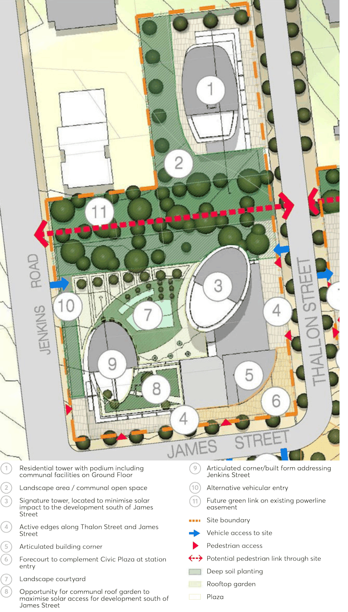

> [Picture on page 430: a picture, saved as a picture (images/part-08-centres-precincts-special-character-areas-specific-page-430-2.gif, 150 dpi).]

Figure 8.2.8.1.21.1 – Conceptual Built Form Controls: Block 3 Jenkins Road/Thallon Street

CARLINGFORD LOCAL CENTRE

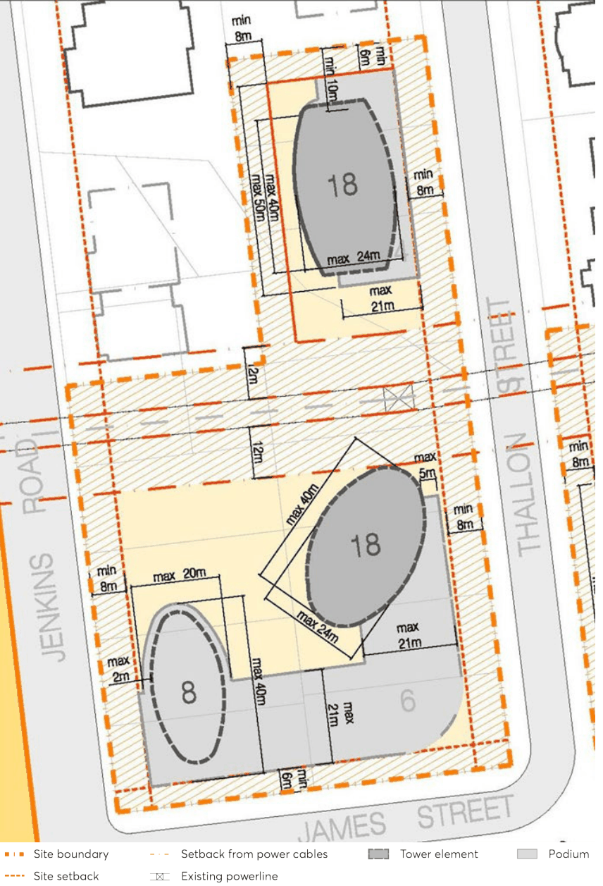

> [Picture on page 431: a picture, saved as a picture (images/part-08-centres-precincts-special-character-areas-specific-page-431-2.gif, 150 dpi).]

Figure 8.2.8.1.21.2 – Dimensional Built Form Controls: Block 3 Jenkins Road/Thallon Street

CARLINGFORD LOCAL CENTRE

BLOCK 4: 2-12 JAMES STREET

Objectives

O.01 To ensure an optimal mix of uses within buildings by specifying distribution of residential and commercial uses within the building.

Controls

C.16 Retail and commercial uses are limited to ground floor. Building height C.17 Nos. 2-12 James Street, by virtue of their location close to the light rail station, have the ability to provide development of substantial height to contribute a landmark to denote the village centre.

C.18 The development of Nos. 2-12 James Street should provide for orderly development by maximising opportunities for a shared basement layout and common open areas.

C.19 Using the above urban design principles, Nos. 2-12 James Street may achieve two 18 storey towers. Placement of the towers minimises overshadowing of adjacent buildings and open spaces to the south (Figure 8.2.8.1.21.3).

C.20 The six storey podium on Nos. 8-10 James Street provides development to the street frontage in a form and scale commensurate with the civic life of the village centre and to allow for ground floor active uses.

C.21 Nos. 2-6 James Street will be developed to a maximum height of six storeys to maintain sufficient solar access to the existing low rise buildings to the south.

Floor space ratio C.22 Due to its close proximity to the light rail station, the FSR limit for this key site is higher than sites further from the light rail station. This is to encourage developments of substantial size thus creating a critical mass for the village centre.

Building footprint, site coverage, and deep soil cover C.23 Due to the more urban context to the site, a greater site coverage is appropriate. The building footprint is limited to 55% of the site. This allows deep soil provision of a minimum 15% of the total site area.

C.24 Due to the more urban context to the site open space is provided on a rooftop podium. C.25 Deep soil planting must cover a minimum 15% of the total site area. C.26 The building site coverage must be a maximum of 55%. Setbacks C.27 Refer to Figure 8.2.8.1.21.4. The setbacks from the irregular boundaries of this key site vary in response to the need to provide solar access, pedestrian circulation space and to introduce modulation in the street wall.

Vehicular access

CARLINGFORD LOCAL CENTRE

C.28 Vehicle access points must be provided as indicated in Figure 8.2.8.1.21.3.

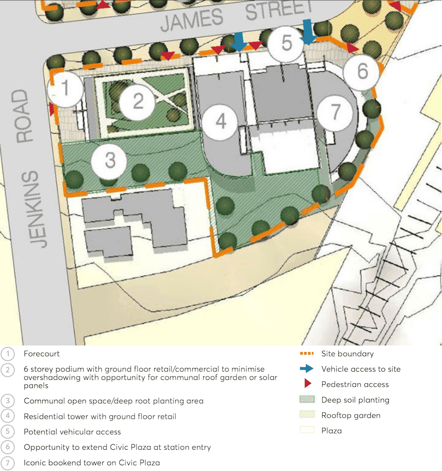

> [Picture on page 433: a picture, saved as a picture (images/part-08-centres-precincts-special-character-areas-specific-page-433-3.gif, 150 dpi).]

Figure 8.2.8.1.21.3 – Conceptual Built Form Controls: Block 4 2-12 James Street

CARLINGFORD LOCAL CENTRE

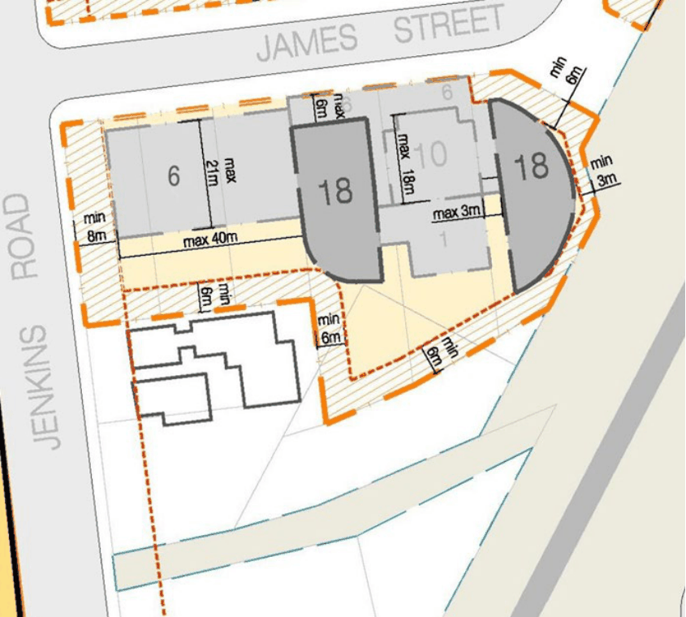

> [Picture on page 434: a picture, saved as a picture (images/part-08-centres-precincts-special-character-areas-specific-page-434-2.gif, 150 dpi).]

Figure 8.2.8.1.21.4 – Dimensional Built Form Controls: Block 4 2-12 James Street

BLOCK 6: 1-7 THALLON STREET

Objective

O.01 Ensure an optimal mix of uses within buildings by specifying FSR components for residential and commercial uses.

Controls

C.29 Retail and commercial uses are limited to ground floor. Building height C.30 Nos.1-7 Thallon Street by virtue of their location close to the light rail station have the ability to provide development of substantial height to contribute a landmark to denote the village centre. The eighteen (18) storey height limit for the elliptical shaped tower on this site achieves this objective.

CARLINGFORD LOCAL CENTRE

C.31 This key site contains both a higher rise landmark tower and a six storey rectangular building forming part of the podium aligned with Thallon Street.

C.32 A second six storey podium element that aligns with the railway reserve and faces the open space to the north of the main tower.

C.33 The two podium elements combine to create a courtyard area that addresses the retained railway heritage building.

Floor space ratio C.34 The FSR limit for the various components of this key site which is close to the light rail station is higher than for sites further from the station. This is to encourage developments of substantial size thus creating a critical mass for the village centre.

Building footprint, site coverage and deep soil cover C.35 Due to the electricity line/floodway easements, the building footprint is limited to 40% of the

site. This allows adequate deep soil provision.

C.36 Open space on the site is concentrated to its north side so as to maximise its amenity. This placement of open space maximises its ability to operate in conjunction with the open space of the former electricity easement to adjacent to the north.

C.37 Deep soil planting must cover a minimum 15% of the total site area. C.38 The building site coverage must be a maximum of 40%. Setbacks C.39 Setback from Thallon Street: There is an eight (8) metre setback requirement for the rectangular building fronting Thallon Street. This allows for street landscaping and outdoor activities such as cafes that will benefit from solar access to the north.

Vehicular access C.40 Vehicle access points must be provided as indicated in Figure 8.2.8.1.21.5.

CARLINGFORD LOCAL CENTRE

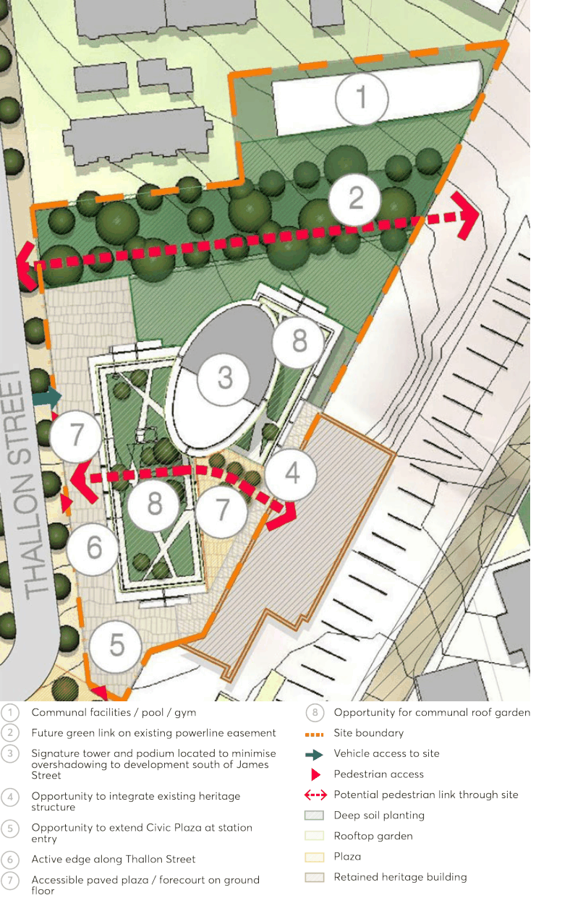

> [Picture on page 436: a picture, saved as a picture (images/part-08-centres-precincts-special-character-areas-specific-page-436-2.gif, 150 dpi).]

Figure 8.2.8.1.21.5 – Conceptual Built Form Controls: Block 6 1-7 Thallon Street

CARLINGFORD LOCAL CENTRE

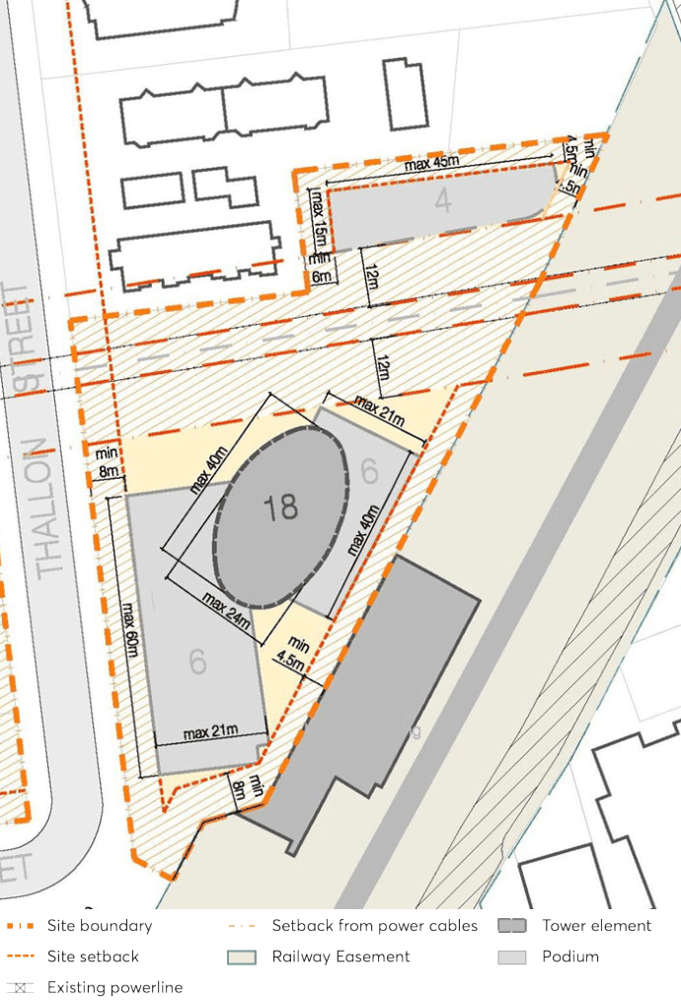

> [Picture on page 437: a picture, saved as a picture (images/part-08-centres-precincts-special-character-areas-specific-page-437-2.gif, 150 dpi).]

Figure 8.2.8.1.21.6 – Dimensional Built Form Controls: Block 6 1-7 Thallon Street

BLOCK 5: SERVICE STATION SITE ON CORNER OF PENNANT HILLS ROAD AND JENKINS ROAD

This is a key site because of its highly prominent location. It is ideal for a landmark development denoting the southern gateway to the Precinct.

Controls

C.41 Development must provide uses as follows: Ground floor – commercial

CARLINGFORD LOCAL CENTRE

First, second and third storeys – home office Fourth to 18th storeys – residential

Building height C.42 The eighteen (18) storeys are proposed for the tower element of the building due to its close proximity to the light rail station.

C.43 The tower proposed on this key site is aligned to minimise its overshadowing of land to the south.

C.44 The tower element is to have a similar axial alignment to the tower elements on the key sites in the Thallon Street area. This is a compatible contribution to the more prominent urban form of the village centre close to the station.

C.45 The four storey podium proposed is to impart a comfortable scale to the street frontage that is compatible with the podiums containing active uses in the Thallon Street area.

Floor space ratio C.46 The FSR limit for this site has been determined due to the limiting effect of site constraints and the lack of opportunity to amalgamate with other sites.

Building footprint, site coverage and deep soil cover C.47 No restrictions apply to building footprint, building site coverage, and deep soil planting due to the highly constrained nature of the site.

Setbacks C.48 Minimum setbacks are required to be: 6 metres from the site’s northern and eastern boundaries. 3 metres from Pennant Hills Road and Jenkins Street. 0 metres for the tower façade at the apex of the street corner.

Vehicular access C.49 Vehicle access points must be provided as indicated in Figure 8.2.8.1.21.7. C.50 Vehicular access is prohibited from Pennant Hills Road.

CARLINGFORD LOCAL CENTRE

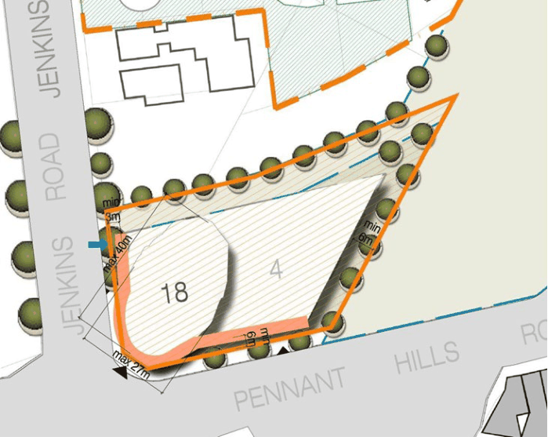

> [Picture on page 439: a picture, saved as a picture (images/part-08-centres-precincts-special-character-areas-specific-page-439-2.gif, 150 dpi).]

Figure 8.2.8.1.21.7 – Dimensional Built Form Controls: Block 5 Corner of Pennant Hills Road and Jenkins Road

BLOCK 16: BUNNINGS SITE AT CORNER OF POST OFFICE STREET AND PENNANT HILLS ROAD

This is a key site because of its highly prominent location. It is ideal for a landmark development denoting the northern gateway to the Precinct.

Controls

C.51 Retail and commercial uses are limited to ground floor. Level 1 and above must be allocated as residential use.

Building height C.52 The nine (9) storey tower element of the building proposed on this key site is located parallel to Pennant Hills Road.

C.53 Two storey podium proposed is to impart a comfortable scale to the street frontage that is compatible with the podiums containing active uses in the Pennant Hills Road area.

Floor space ratio C.54 The FSR limit is appropriate for a landmark building at a gateway to the Precinct. Site coverage and deep soil cover C.55 No restrictions apply to deep soil planting.

CARLINGFORD LOCAL CENTRE

C.56 The building site coverage must be a maximum of 50%. Setbacks C.57 Minimum 10 metres setback from Post Office Street and Pennant Hills Road to allow for pedestrian circulation space and active uses on the street frontage.

C.58 Minimum 6 metre setback from Shirley Street and side boundaries. Vehicular access and parking C.59 Vehicle access points must be provided as indicated in Figure 8.2.8.1.21.8. C.60 Vehicular access is prohibited from Pennant Hills Road. C.61 Parking requirements for residential uses must comply with the general controls outlined in C.03 of Section 8.2.8.1.21.

C.62 Parking requirements for commercial uses must comply with Part 6 – Traffic and Transport of this DCP.

CARLINGFORD LOCAL CENTRE

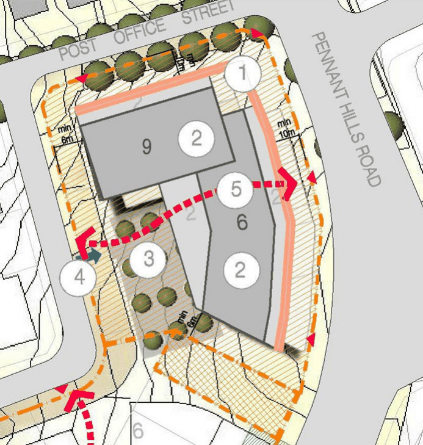

> [Picture on page 441: a picture, saved as a picture (images/part-08-centres-precincts-special-character-areas-specific-page-441-2.gif, 150 dpi).]

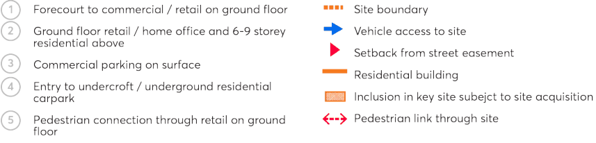

> [Picture on page 441: a picture, saved as a picture (images/part-08-centres-precincts-special-character-areas-specific-page-441-3.gif, 150 dpi).]

Figure 8.2.8.1.21.8 – Dimensional Built Form Controls: Block 16 Corner of Pennant Hills Road and Post Office Street

Further Information

Carlingford Precinct Plan Traffic Report (May 2008), prepared by Masson/Wilson/Twiney Traffic and Transport Consultants.

Faculty of the Constructed Environment, RMIT University et al, Australia’s Guide to Good Design – Residential, prepared on behalf of the National Office for Local Government.

CARLINGFORD LOCAL CENTRE

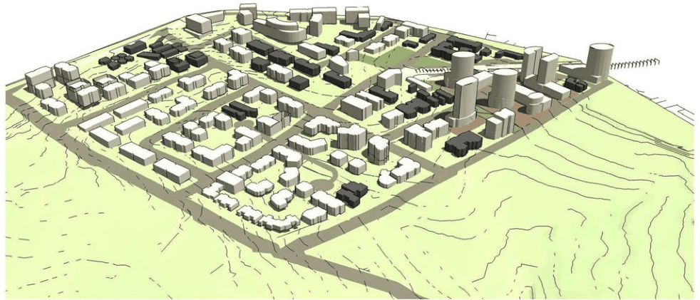

> [Picture on page 442: a picture, saved as a picture (images/part-08-centres-precincts-special-character-areas-specific-page-442-2.gif, 150 dpi).]

Note: This is indicative only. Refer to Section 8.5 – Specific Sites of this DCP for any site-specific provisions.
