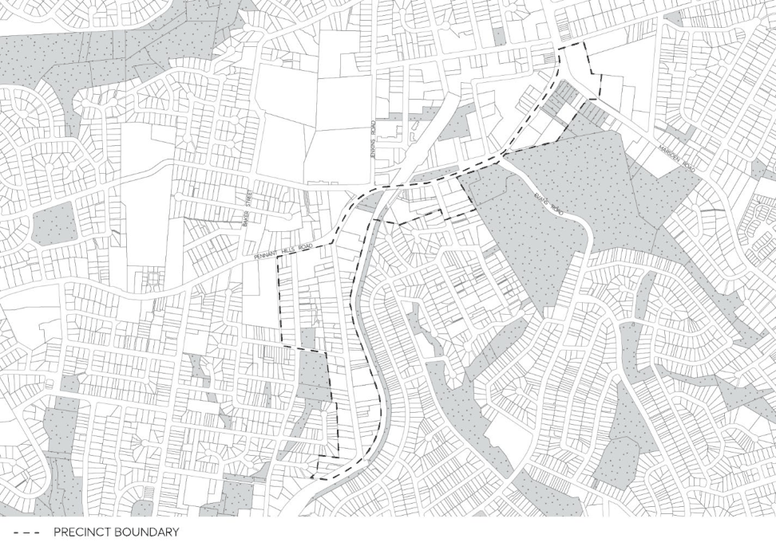
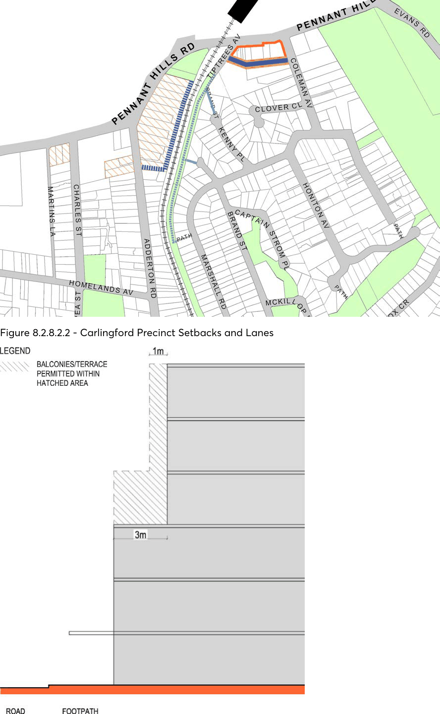
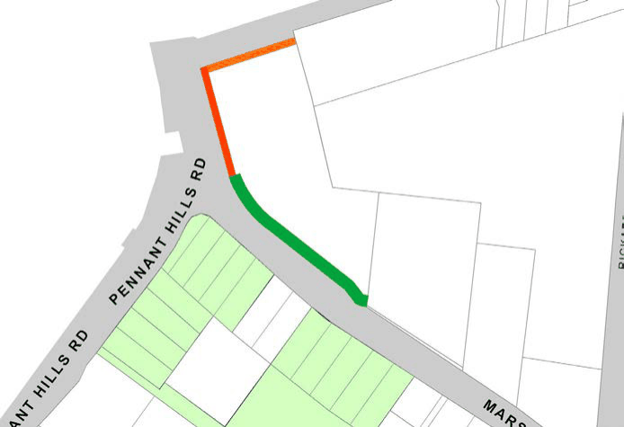
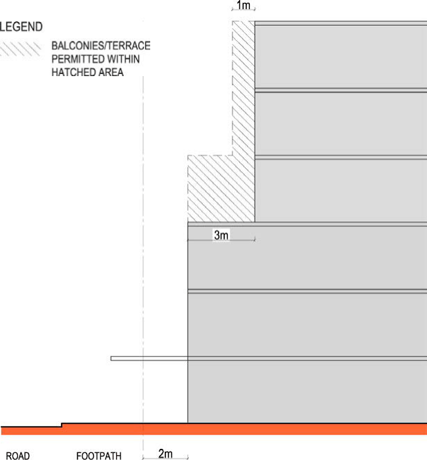

#### 8.2.8.2 CARLINGFORD SOUTH

#### 8.2.8.2.1 DESIRED FUTURE CHARACTER

New development is concentrated along Pennant Hills Road and Adderton Road, with connections to Carlingford and Telopea Train Stations via existing pedestrian networks. A mix of residential, retail and business uses are present the precinct to encourage a mix of housing types including residential flat buildings, multi dwelling housing and shop top housing.

Renewed business and mixed use development opportunities are provided opposite Carlingford Train Station, and at the intersection of Marsden and Pennant Hills Roads, improving the local centre at the western end of the precinct. Redevelopment of the Carlingford Village site provide an improved pedestrian retail interface along Pennant Hills Road and Keeler Street while encouraging residential development away from major roads. Development of this site provides an appropriate interface to adjoining heritage items, educational establishment and low density housing to the east.

Building heights generally respond to topography and existing development. New taller buildings are located along the ridgelines of Pennant Hills Road and Adderton Road to reinforce natural topography, to optimise views, access to sunlight and breezes, and to maximise efficiency of existing pedestrian networks. New development are required to have regard to existing built and natural heritage items, and to consider noise impacts from Pennant Hills Road, Marsden Road and the railway line.

CARLINGFORD LOCAL CENTRE

> [Picture on page 443: a picture, saved as a picture (images/part-08-centres-precincts-special-character-areas-specific-page-443-2.gif, 150 dpi).]

Figure 8.2.8.2.1 – Carlingford South

Objectives

In addition to general objectives listed in Part 8 of this DCP, specific objectives of this precinct are identified below. O.01 Ensure that new development at the intersection of Pennant Hills and Marsden Roads recognises this location as an important gateway and responds to its hilltop location.

O.02 Ensure that new development responds well to the topography of land. O.03 Ensure that new development is sympathetic to existing built and natural heritage items.

Controls

Pedestrian Connections and Laneways C.01 New pedestrian connections and laneways should be provided in accordance with Figure 8.2.8.2.1. Where a development provides for public access connections, a variation to Council’s floor space ratio control can be sought in accordance with C.02 below.

C.02 Where a development provides for dedication of land to Council for the purposes of providing public access and the construction of the access way, Council may consider increasing the maximum floor space ratio. As a guide, the maximum floor space ratio may be increased by the equivalent area represented by 50% of the land area to be dedicated to Council for the public access. The site area may include the area of land to be dedicated to Council for the

CARLINGFORD LOCAL CENTRE

purpose of the floor space ratio calculation. The proposed variation to floor space is to be addressed under Clause 4.6 ‘Exceptions to development standards’ in the Parramatta LEP 2023.

C.03 The existing laneway to the rear of the E1 Local Centre zone is to be formalised to maintain the vehicular access and servicing needs of development.

C.04 A new vehicular lane or right of carriageway is to be provided to the rear of properties fronting Pennant Hills Road and Adderton Road as shown on Figure 8.2.8.2.1. This laneway is to provide for vehicular access to these sites.

C.05 Vehicular lanes, including any right of ways are to have a minimum width of 6 metres. C.06 Existing pedestrian connections are to be retained and enhanced. Setbacks C.07 Building setbacks are to be in accordance with Figure 8.2.8.2.1 and Figure 8.2.8.2.3, and any additional controls set out below:

a) The nil setback shown along Pennant Hills Road and Keeler Street applies to the first 3 storeys of development. Additional storeys shall be setback a minimum of 3 metres from the boundary as shown in Figure 8.2.8.2.2. Balconies may encroach the upper level setback area as shown on Figure 8.2.8.2.3 as follows:

• An unroofed terrace area permitted to the 4th storey. Balustrade can extend from building line of storey below.

• Balconies may extend 1 metre into the setback area for the upper 2 storeys.

b) The 2 metre setback shown along Pennant Hills Road, between Keeler Street and Marsden Road, applies to the first 3 storeys of development. Additional storeys shall be setback a minimum of 5 metres from the boundary as shown in Figure 8.2.8.2.4. Balconies may encroach the upper level setback area as shown on Figure 8.2.8.2.4 as follows:

• An unroofed terrace area permitted to the 4th storey. Balustrade can extend from building line of storey below.

• Balconies may extend 1 metre into the setback area for the upper 2 storeys.

C.08 Where a nil front setback is shown on Figure 8.2.8.2.1 in the E1 Local Centre Zone, development should have a nil side setback where it will not have a detrimental impact upon adjoining development, to achieve a continuous street edge.

C.09 Building setbacks to existing and desired laneways should be designed to promote activation of the laneway while still allowing for the servicing needs of development.

Minimum Site Frontage C.10 Development for the purpose of residential flat buildings or multi dwelling housing in the R4 High Density Residential Zone on land fronting Pennant Hills Road and Adderton Road, as shown in Figure 8.2.8.2.1 is to have a minimum site frontage of 40 metres.

C.11 Redevelopment of the existing service station site on the corner of Pennant Hills Road and Adderton Road, for the purpose of a residential flat building or multi dwelling housing is to be redeveloped as one site and may require the amalgamation of the 2 existing land parcels.

CARLINGFORD LOCAL CENTRE

> [Picture on page 445: a picture, saved as a picture (images/part-08-centres-precincts-special-character-areas-specific-page-445-2.gif, 150 dpi).]

Figure 8.2.8.2.2 - Carlingford Precinct Setbacks and Lanes

Figure 8.2.8.2.3 - Upper Level Setbacks and balcony locations

CARLINGFORD LOCAL CENTRE

Redevelopment of Carlingford Village Shopping Centre Site – Bound by Marsden Road, Pennant Hills Road and Keeler Street

• The 2 metre front setback area to Pennant Hills Road is to be suitably treated to form an extension of the adjoining footway. Landscaping may also be provided in this area.

• New development should provide suitable corner treatments at the intersection of Marsden and Pennant Hills Roads and Keeler Street and Pennant Hills Road.

• New development shall provide an active and continuous pedestrian frontage along Pennant Hills Road with active ground level uses accessible from the roadway.

• A dense landscape setback shall be provided to Marsden Road to create a landscape corridor linking to existing vegetation on the adjoining property to the east and the existing parklands on the southern side of Marsden Road.

• New development must provide an appropriate height transition to adjoining residential development in Keeler Street.

> [Picture on page 446: a picture, saved as a picture (images/part-08-centres-precincts-special-character-areas-specific-page-446-15.gif, 150 dpi).]

Figure 8.2.8.2.4 - Ground Level Setbacks

CARLINGFORD LOCAL CENTRE

> [Picture on page 447: a picture, saved as a picture (images/part-08-centres-precincts-special-character-areas-specific-page-447-2.gif, 150 dpi).]

Figure 8.2.8.2.5 - Upper Level Setbacks and Balconies

CARLINGFORD LOCAL CENTRE
