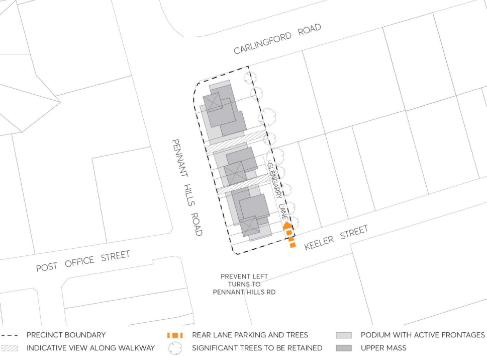

#### 8.2.8.3 CARLINGFORD EAST (BUSINESS)

#### 8.2.8.3.1 DESIRED FUTURE CHARACTER

The locality is characterised by 5 storey mixed use buildings with at grade car parking for retail customers and underground car parking for employees and residents.

Business uses are located on the lower 2 storeys providing a broad podium for dwellings above to be setback from, creating a pedestrian friendly scale. Visible and active shops and street frontages with continuous awnings enhance streetscape character.

Low level business facades incorporate ribbons of shopfront windows and contrasting panels of light cladding, face brick or painted masonry. Mid-level and upper-storey residential facades incorporate indentations or projections in the alignment of exterior walls, balconies that are indented behind and/or project forward of exterior walls and steel framed balconies and balustrades of steel or glass that contrast the weight of masonry walls, with operable louvres for privacy, shade and glare control.

> [Picture on page 448: a picture, saved as a picture (images/part-08-centres-precincts-special-character-areas-specific-page-448-15.gif, 150 dpi).]

Figure 8.2.8.3.1 – Carlingford East Key Principles Diagram

CARLINGFORD LOCAL CENTRE

Objective

O.01 Well-articulated building forms with a pedestrian-friendly scale that encourages commercial activity and provides for landscaping, open space and separation between buildings.

Controls

Strategy

C.01 Redevelopment of up to five storeys should accommodate residential flats, offices, business or retail premises, serviced by basement parking.

C.02 Expand the existing public domain in order to encourage high levels of pedestrian activity plus a variety of new businesses and local employment.

C.03 Refer all Development Applications to Transport Asset Holding Entity to confirm any requirements in relation to the Parramatta – Epping railway.

Servicing C.04 Establish a rear laneway to provide kerbside parking for customers and deliveries, access to basement parking, screened by trees and hedges to protect the amenity of residential neighbours.

C.05 Prevent left turns from Keeler Street to Pennant Hills Road. Public frontages C.06 Divide this street block by at least two broad outdoor walkways to encourage new pedestrian and business activities in locations which are commercially visible and sunny.

C.07 Maximise activity facing all streets and walkways by siting lower storeys without any setback from footpaths and accommodating a nearly continuous mix of shopfronts, building entrances and balconies.

C.08 Consolidate entries to basements and service areas via the new rear laneway to protect desired levels of activity facing all streets and new walkways.

Built form C.09 Provide a continuous podium of up to two storeys facing all streets, and shape each podium to address major street corners.

C.10 Avoid extensive sheer vertical facades by setting upper storeys back from their podium. C.11 Achieve a varied skyline by providing different heights, profiles and roof forms for successive buildings.

C.12 Design quality of facades should consider visibility from all quarters. C.13 Siting and design of apartment storeys should provide at least two hours sunlight daily for living areas in 70% of new dwellings.

Setbacks C.14 The minimum setbacks of all buildings and structures are prescribed in Table 8.2.8.3.1 and Table

8.2.8.3.2 below.

CARLINGFORD LOCAL CENTRE

Table 8.2.8.3.1 – Minimum Setbacks for 2 storey podium

| Setback | Minimum Building Setback |
|---|---|
| Primary and Secondary Front Boundary | 0 metres |
| Rear Boundary | 16 metres - 22 metres to provide a rear laneway accommodating 90 degree parking, 1 or 2 way traffic movements, the turning circle for a medium rigid delivery vehicle, a 2 metre wide footpath and a 2 metre wide deep soil verge |

Table 8.2.8.3.2 – Minimum setbacks for 3rd storey and above (tower element)

| Setback | Minimum Building Setback |
|---|---|
| Primary and Secondary Front Boundary | 3 metres from commercial podium façade |
| Rear Boundary | 0 metres from commercial podium façade |
| Top-Storey Setback | 3 metres additional setback for exterior walls of the top-most two storeys, measured from the walls of the lowest storey above the podium |

CARLINGFORD LOCAL CENTRE
