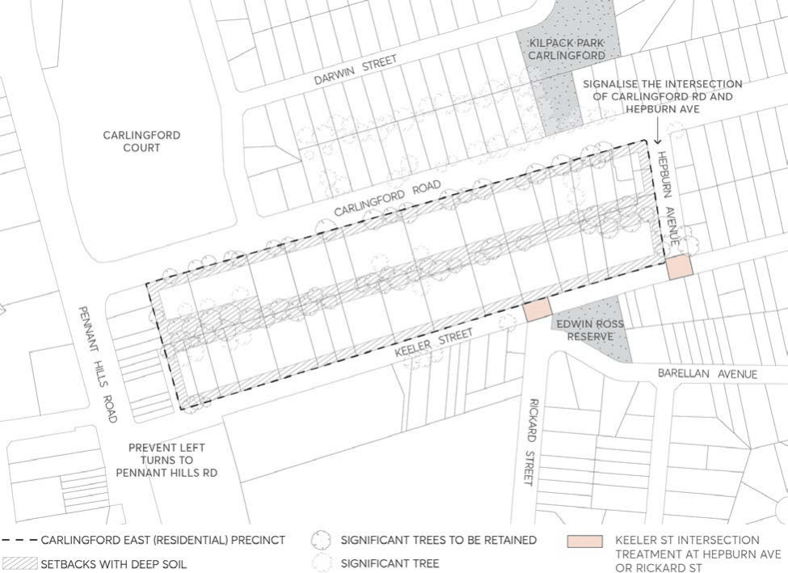

#### 8.2.8.4 CARLINGFORD EAST (RESIDENTIAL)

> [Picture on page 451: a picture, saved as a picture (images/part-08-centres-precincts-special-character-areas-specific-page-451-3.gif, 150 dpi).]

Figure 8.2.8.4.1 – Key principles diagram, Carlingford Road residential precinct

Controls

Strategy

C.01 Redevelopment should be predominantly five storey residential flat buildings in garden settings, with parking in basements.

C.02 Refer all development applications to RailCorp to confirm any requirements in relation to Parramatta – Epping railway.

Servicing C.03 Promote access from local streets. C.04 If access is not available from local streets, consolidate existing vehicle entrances from Carlingford Road.

C.05 Prevent left turns from Keeler Street to Pennant Hills Road. C.06 Signalise the intersection fo Carlingford Road and Hepburn Avenue. C.07 Install traffic calming devices in Keeler Street.

CARLINGFORD LOCAL CENTRE

C.08 Provide intersectional treatment/roundabout on Keeler Street at Hepburn Avenue or Rickard Street.

Landscape setting C.09 Provide broad setbacks along street frontages and rear boundaries and local communal open spaces in order to retain remnants of blue Gum High Forest and existing trees that are prominent streetscape features.

C.10 Surround and screen new buildings with canopy trees and shrubs. Built form C.11 To reflect the established pattern of detached dwellings:

a) limit the width of new facades that would be visible from any street, and

b) divide the floorspace of every new building into well-articulated pavilion forms that are separated by courtyards with canopy trees.

C.12 Siting and design should provide at least two hours sunlight daily for living areas in 70& of new dwellings.

C.13 Employ setbacks and building forms that retain reasonable sunlight and privacy for existing neighbours.

CENTRES, PRECINCTS, SPECIAL CHARACTER AREAS & SPECIFIC SITES

NEIGHBOURHOOD PRECINTS
