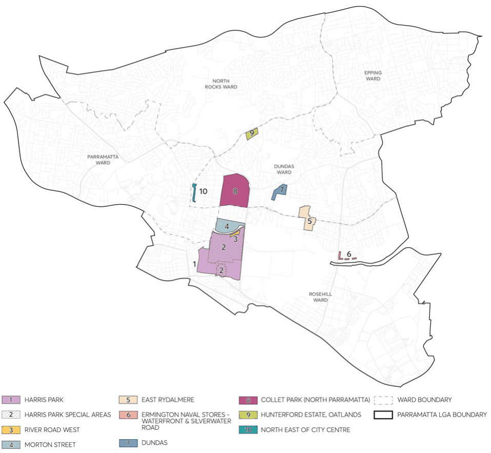

### 8.3 NEIGHBOURHOOD PRECINTS

This Section contains development controls for areas that are identified as Neighbourhood Precincts which are characterised as areas with concentrated residential, retail, and business growth. These precincts generally contain lower-scale types of development that will provide a mix of housing types and densities and will seek to improve the vibrancy and viability of business and retail developments serving the surrounding community. Each of these precincts are distinct with complementary functions.

This Section of this DCP is to be read in conjunction with other Parts of the Parramatta DCP 2023 and the Parramatta Local Environmental Plan (LEP) 2023. The consent authority, in considering a Development Application for land in a neighbourhood precinct must have regard to the specific provisions. If there is any inconsistency between this Part of this DCP and other Parts of the Parramatta DCP 2023, this Part of this DCP will prevail.

> [Picture on page 453: a picture, saved as a picture (images/part-08-centres-precincts-special-character-areas-specific-page-453-15.gif, 150 dpi).]

Figure 8.3.1 – Neighbourhood precincts

CENTRES, PRECINCTS, SPECIAL CHARACTER AREAS & SPECIFIC SITES

NEIGHBOURHOOD PRECINTS

| 8.3 | NEIGHBOURHOOD PRECINTS...................................................................................................450 |  |
|---|---|---|
|  | 8.3.1 | HARRIS PARK ................................................................................................................................ 452 |
|  | 8.3.2 | HARRIS PARK SPECIAL AREAS ................................................................................................460 |
|  | 8.3.3 | RIVER ROAD WEST ...................................................................................................................... 471 |
|  | 8.3.4 | MORTON STREET ........................................................................................................................ 485 |
|  | 8.3.5 | EAST RYDALMERE ....................................................................................................................... 498 |
|  | 8.3.6 | ERMINGTON NAVAL STORES– WATERFRONT AND SILVERWATER ROAD............. 501 |
|  | 8.3.7 | DUNDAS ......................................................................................................................................... 504 |
|  | 8.3.8 | COLLET PARK (NORTH PARRAMATTA) ................................................................................ 507 |
|  | 8.3.9 | HUNTERFORD ESTATE, OATLANDS ...................................................................................... 510 |
|  | 8.3.10 | NORTH EAST OF CITY CENTRE PRECINCT .......................................................................... 513 |

NEIGHBOURHOOD PRECINTS

HARRIS PARK
