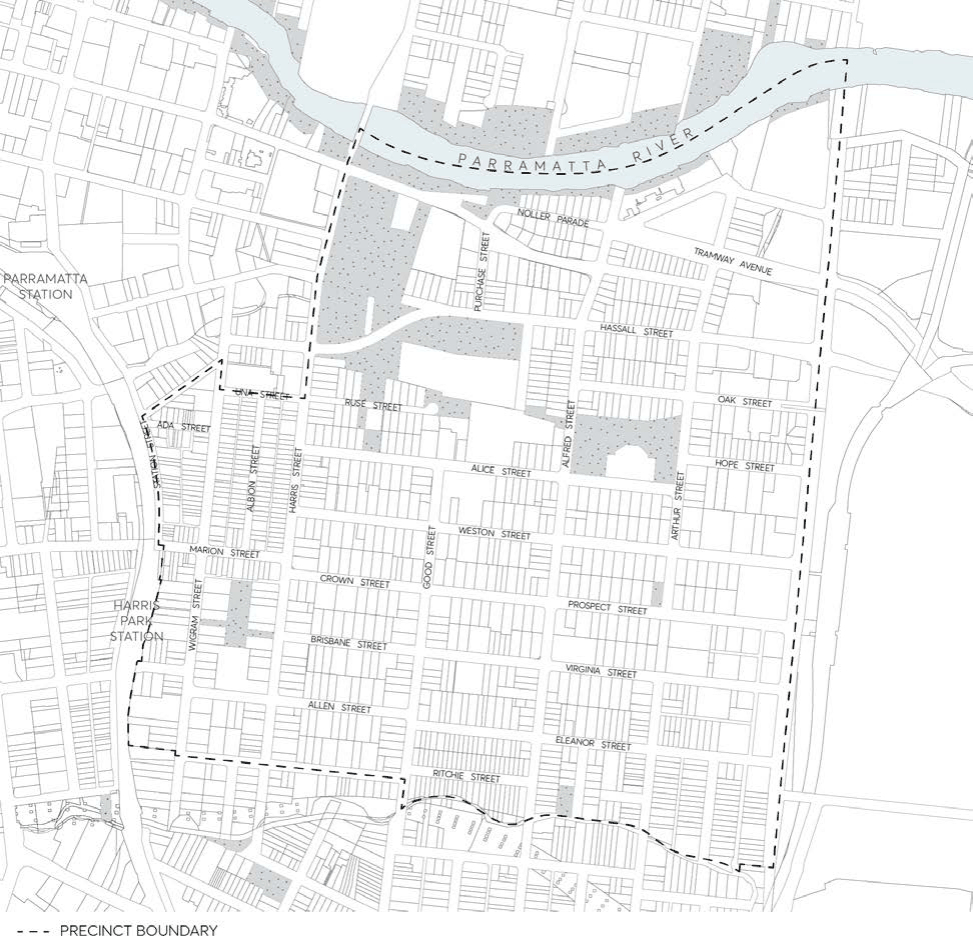

#### 8.3.1 HARRIS PARK

> [Picture on page 455: a picture, saved as a picture (images/part-08-centres-precincts-special-character-areas-specific-page-455-4.gif, 150 dpi).]

Figure 8.3.1.1 – Harris Park Precinct
