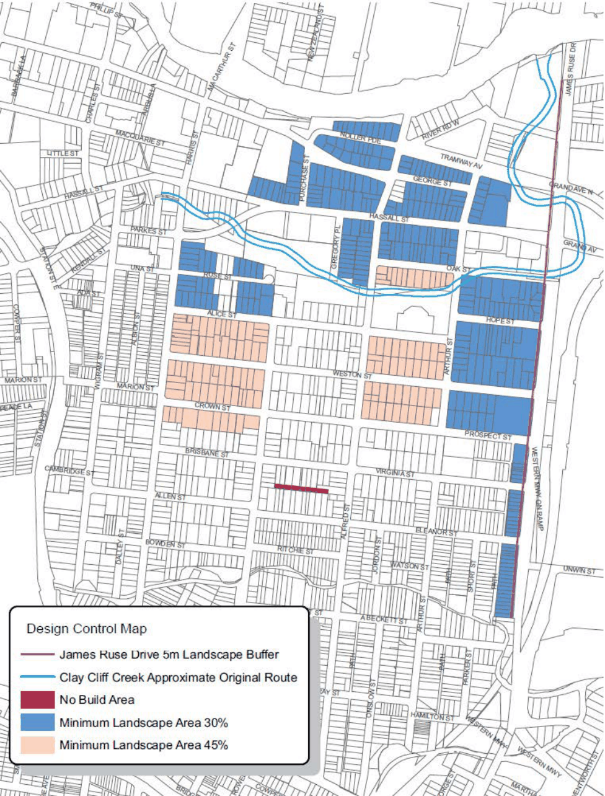

#### 8.3.1.1 DESIRED FUTURE CHARACTER

Harris Park is bounded by the Parramatta River to the north, James Ruse Drive to the east, A’Becketts Creek, the M4 motorway to the south, and the railway line to the west. It lies immediately to the east of the commercial centre of Parramatta, with the northern and western parts of the suburb within easy walking distance of the City Centre.

Harris Park contains some of the most important parts of Parramatta’s heritage. It has an extensive collection of nineteenth and early twentieth century houses, shops, public buildings and landscapes. Of particular note are Australia’s first land grant and oldest European building, Elizabeth Farm House, as well as two other important colonial houses, Experiment Farm and Hambledon Cottage.

NEIGHBOURHOOD PRECINTS

HARRIS PARK

The preservation and enhancement of Harris Park’s historic fabric is essential. The area also has an important strategic role in providing residential development because of its location on the fringe of the Parramatta City Centre. All new development are to be at a scale that is consistent with the existing character of the streets, not impede view corridors to major landscapes and the escarpment north of the Parramatta River, and provide opportunities to connect with the foreshore. Future development along James Ruse Drive are to have a strong, unified, and visually attractive presence to reflect its status as a “gateway” to the Parramatta City Centre.

Objectives

O.01 Conserve the heritage character of the locality and preserve those areas and sites that present as important cultural/tourist attractions.

O.02 Retain the character and amenity of the area. O.03 Protect and enhance of the unique visual qualities of the Parramatta River with foreshore development that is of a scale and character in keeping with its location. Maximised public access to, and use of, foreshore land.

O.04 Ensure new development in Harris Park is compatible with the scale of existing development and represents high-quality urban design.

O.05 Protect and enhance the local and regional biodiversity, maximising the extent and integrity of aquatic and natural land areas, particularly the Parramatta River and Clay Cliff Creek corridors.

O.06 Ensure roof designs are compatible with existing roofs in the area in terms of their pitch, form and design detail.

O.07 Ensure development fronting James Ruse Drive is unified, has a strong presence to the street and facilitates pedestrian connectivity.

O.08 Ensure new residential development has front and side setbacks similar to the majority of existing buildings with that street.

O.09 Control the extent of building footprints where there is no floor space ratio. O.10 Protect and maintain the specific attributes and qualities of each of the Special Areas.

Controls

Height of Buildings

C.01 Existing view corridors shown in Appendix 1 are to be protected, maintained or reinstated in the planning and design of the development.

C.02 Align buildings to maximise and frame view corridors between buildings. C.03 The maximum height of buildings or structures on land south of Clay Cliff Creek between Parkes Street and Alfred Street, as shown on the Design Control Map, shall only be achieved where it can be demonstrated that the building or structure will not dominate the topographical features of the River landscape.

NEIGHBOURHOOD PRECINTS

HARRIS PARK

C.04 Regardless of any other control, height of buildings must enable compliance with all controls about views and vistas.

Building Design

C.05 The main entries of buildings are to address the street, and multi-unit residential buildings are to maximise the number of entrances to the street.

C.06 Any facade of a building which is clearly visible from a major public place such as a street, a park or the river shall be designed to address that place.

C.07 Buildings are to be designed with regard to the features of adjoining buildings and works with transitions of height, massing and scale where appropriate.

C.08 New buildings shall sit parallel to the street. C.09 Building bulk created by large unbroken expanses of wall is to be reduced by articulation and modulation, particularly where facing a public place such as a street, a park, or the river.

C.10 All new dwelling houses and new multi unit housing shall have roofs which are similar to those in the vicinity in terms of their pitch and form, with recognition being given to the predominance of roofs in many areas which are pitched between 25 and 45 degrees.

C.11 For new buildings or extensions to existing buildings which include an attic, the roof in which the attic is contained must be pitched from the top of the external wall at a maximum of 45 degrees.

C.12 Where windows and skylights are used to allow ventilation and natural light into an attic, these must be flat and sit parallel to the roof where they are located on the front and side elevations of the building. Consent may be granted for dormer windows and the like where located to the rear of the building only.

C.13 Where attics are created within an existing roof shape, the shape of the roof must not be altered, except in accordance with the paragraph above.

C.14 Door and window openings are to enhance the architectural character of the building. C.15 Some of the following articulation elements are to be provided in residential buildings: expressed entries, bay windows, glazed balcony enclosures, balconies, terraces, verandahs, pergola loggias, decks, porches.

C.16 Existing lot structure is to influence building articulation: development on amalgamated sites is to respond to the existing or prevalent lot structure.

C.17 Despite any other provision of this DCP, no part of any building may be constructed to intrude onto the area identified as the ‘no build area’ on the Design Control Map.

Landscaping

C.18 The consent authority must not consent to development on land shown on the Design Control Map which will result in a landscaped area of less than 45% of the site area, or 30% of the site area, whichever minimum is shown for the land.

C.19 Where there is no minimum requirement shown on the Design Control Map, a minimum landscaped area of 30% will apply. This requirement may be negotiable in some cases. Nevertheless, the applicant is expected to take all reasonable steps in the circumstances to maximise the landscaped area.

NEIGHBOURHOOD PRECINTS

HARRIS PARK

C.20 For all development directly facing James Ruse Drive, a 5 metre wide landscaped buffer is to be provided.

C.21 At least 50% of the landscaped area shall be in one continuous area located at the rear of the property.

C.22 At least 50% of the ‘landscaped area’ shall be capable of deep soil planting; that is, soil that is at least 2 metres deep and capable of sustaining large trees.

C.23 Areas less than 1.5 metres wide in any direction shall not be counted towards ‘landscaped area’. C.24 The most preferred species for use within the James Ruse Drive landscaped buffer zone are as follows:

• Angophora costata (Sydney Red Gum)

• Angophora floribunda (Rough Barked Apple)

• Syncarpia glomulifera (Turpentine)

C.25 Landscaping facing Parramatta River or Clay Cliff Creek shall be compatible with the riverine ecosystem.

NEIGHBOURHOOD PRECINTS

HARRIS PARK

> [Picture on page 459: a picture, saved as a picture (images/part-08-centres-precincts-special-character-areas-specific-page-459-3.gif, 150 dpi).]

Figure 8.3.1.1.1 – Design Control Map: Landscape treatment to Clay Cliff Creek

NEIGHBOURHOOD PRECINTS

HARRIS PARK

Transport and Accessibility

C.26 Except in low-density residential zones, underground car parking is preferred in most cases because it reduces site coverage and ensures that car parking access and garage requirements do not dominate the street.

C.27 Generally, driveways should be designed to avoid a straight long gun-barrel appearance by using appropriate landscaping and variations in alignment, however, in some cases (notably the Experiment Farm and Elizabeth Farm conservation areas), long straight driveways are part of the historical pattern of development and are encouraged. In such cases, separate wheel tracks are preferred.

C.28 Vehicular access is not permitted on land fronting James Ruse Drive unless there is no other alternative.

C.29 Space allocated for vehicular entrances is to be minimised, with those entrances provided, if possible, from laneways.

C.30 The width and surface area of driveways and other hard surfaces associated with the movement and parking of vehicles shall be minimised.

C.31 Garages and other structures designed to accommodate vehicles in the R2 Low Density zone shall not be dominant in their scale and siting and shall be located behind the building line.

C.32 The visual impact of car parking is to be minimised. Outside the R2 Low Density residential zones, this shall be achieved by the use of underground carparking, and by screening above-ground parking from the street by locating the parking behind other active uses on street, park or river frontages.

C.33 The retention (and widening where possible) of existing laneways and public accessways is to be encouraged.

View Corridors

The Harris Park Precinct is located on the southern side of the Parramatta River valley. Although development has obscured some key views, the topographical setting is still apparent today from many vantage points. In particular, there are significant views from places such as Elizabeth Farm, north to the Parramatta River and the hills beyond. Conversely, there are views from the north side of the river looking south where significant sites such as Elizabeth Farm can still be identified. These views and vistas contribute significantly to the sense of place for the Harris Park Precinct and for Parramatta in general. C.34 Significant views must be protected from development. Consent must not be granted to development on land identified as being within a historic view corridor unless it has take into account the impact that the development may have on any such historic corridor.

C.35 The height and bulk of proposed development shall be modified as necessary in order to ensure that significant views are protected. NOTE: Refer to Appendix 2 for the key views and vistas that must be protected in Harris Park.

Multi Dwelling Housing and Residential Flat Buildings

General

NEIGHBOURHOOD PRECINTS

HARRIS PARK

C.36 Minimum width of the allotment shall be 18 metres in any direction. C.37 Front setbacks should be compatible with neighbouring buildings or, where new development predominates or is likely to predominate, shall be between 5 and 9 metres for all forms except attached dwellings, in which case front setbacks shall be between 1.5 and 3 metres.

C.38 Unless otherwise stated, side setbacks shall be at least 1.5 metres., greater where there is a need to increase solar access, although carports and garages may have a nil setback provided no adverse amenity impacts result.

C.39 Driveway width shall be a minimum of 3.5 metres. Two rows of dwellings

C.40 A second row of dwellings is only permissible where the overall depth of the allotment is a minimum of 56 metres.

C.41 The minimum separation between rows of buildings shall be 12 metres. The second row of buildings shall be set back a minimum of 3 metres from any ‘car zone’; that is, any area used to accommodate cars or the movement of cars.

East-west orientation, mid-block

C.42 Side setbacks shall be a minimum of 6 metres, with vehicular access on the southern side. C.43 Two street frontages (this includes allotments with a lane to the rear) C.44 Buildings must address both frontages, whether they be a street or a lane. C.45 Setback from rear lanes and/or secondary streets shall be a minimum of 3 metres. C.46 The wall height of any development facing rear lanes shall be no higher than 5.5 metres, measured above the kerb height of the lane.

Attached dwellings

C.47 Attached dwellings are only permitted where: C.48 occurring as ‘infill’ development adjacent to other existing terraces; or C.49 indicated as a preferred form of development in the ‘key block’ section of this Harris Park section.

C.50 Shall not be greater than 15 metres in depth without open ‘internal’ courtyard. C.51 Windows to streets shall be vertically proportioned. C.52 All parking must be accommodated to the rear of the site and/or underground unless specific provision is made in the street.

Commercial Development

C.53 Land uses on the ground floor are to be non-residential, with any residential development to be located on floors above ground level.

C.54 Where a residential component is included above ground level, an appropriate level of amenity and safety must be assured for the residents.

C.55 Buildings on the street frontage are to provide pedestrian amenity in the form of active street frontages, building entrances and awnings.

NEIGHBOURHOOD PRECINTS

HARRIS PARK

C.56 Shop entries are to be recessed from the public footpath by at least 1 metre. C.57 Colours and materials should reinforce the existing character of nearby buildings and achieve a unity of building background above awning level.

C.58 Limited rooftop structures may be incorporated in the design of buildings providing they do not detract from the streetscape or the enjoyment of residents in nearby premises.

C.59 Signs for individual non-residential land-uses are restricted to 1 top-hamper sign, 1 underawning sign and 1 wall sign.

C.60 Space for signs should be incorporated in building design. C.61 Awnings and verandahs are encouraged to define the edge of the footpath and reduce the apparent visual bulk of the building.

C.62 The background colour on awning fascias should be consistent providing a visual unification of the street.

C.63 Sun blinds should be designed to minimise interference to pedestrians and vehicles and complement the colour and signage scheme of the building.

C.64 Vehicle access and service areas should be located away from prime pedestrian areas, preferably with access from side and rear streets.

NEIGHBOURHOOD PRECINTS

HARRIS PARK SPECIAL AREAS
