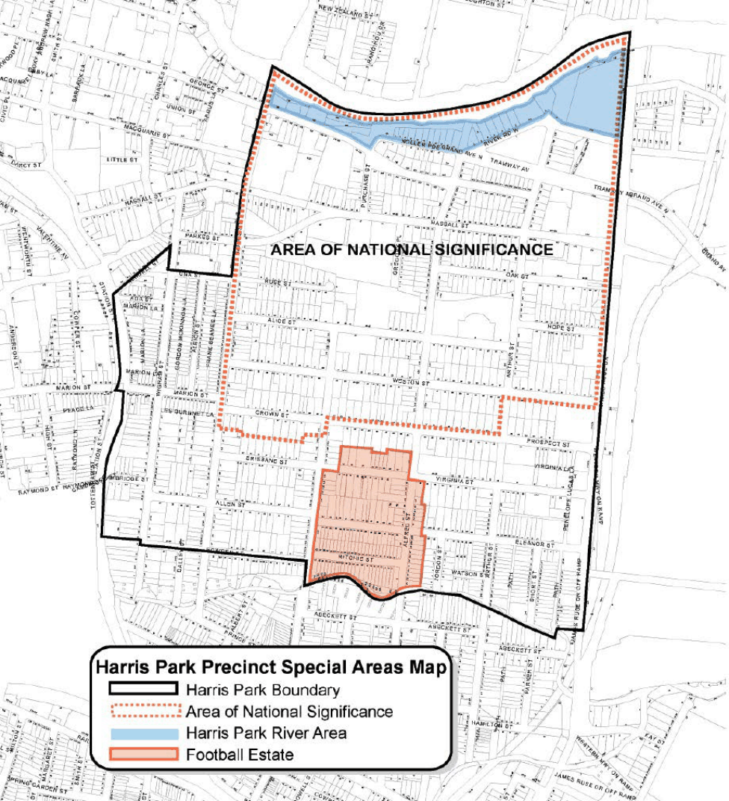
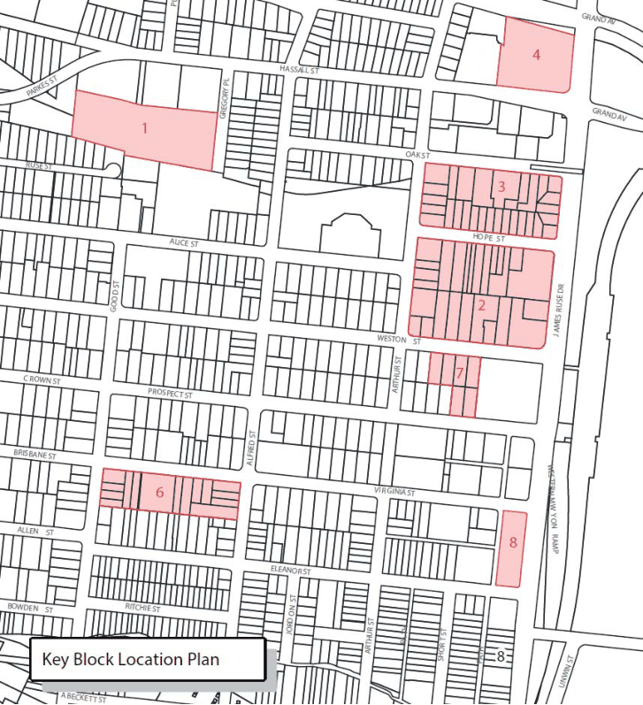

#### 8.3.2 HARRIS PARK SPECIAL AREAS

The Harris Park Precinct contains several Special Areas as shown on the Harris Park Precinct Special Areas Map. The primary purpose of this Section of this DCP is to preserve the overall integrity of the Special Areas, by ensuring all development protects, maintains and improves the particular character and significance of each area.

> [Picture on page 463: a picture, saved as a picture (images/part-08-centres-precincts-special-character-areas-specific-page-463-8.gif, 150 dpi).]

Figure 8.3.2.1 – Harris Park Special Areas Map

NEIGHBOURHOOD PRECINTS

HARRIS PARK SPECIAL AREAS

#### FOOTBALL ESTATE

This area demonstrates an early 20th century (1907-30s) residential re-subdivision of part of John and Elizabeth MacArthur’s land grant, one of the most important agricultural enterprises in the colony, which at its greatest extent covered 1,000 acres. It demonstrates subdivision and speculation of modest workers’ housing to serve the growing industrial area of Granville. It retains a consistency of narrow lots and small scale, simple form timber cottages built close together. The use of timber was typical of many parts of Sydney, but is now rare.

#### KEY DEVELOPMENT BLOCKS

Key Blocks are identified on the Key Block Location Plan. These are areas where redevelopment is likely to occur, but where some guidance is required in order to achieve the best outcome. The objective is to ensure an ordered, integrated and sustainable approach to development. Development on land within a Key Block is to be developed in accordance with the visions, strategies and detailed issue requirements specified in this clause.

> [Picture on page 464: a picture, saved as a picture (images/part-08-centres-precincts-special-character-areas-specific-page-464-16.gif, 150 dpi).]

Figure 8.3.2.2 – Harris Park Key Blocks Location Plan

NEIGHBOURHOOD PRECINTS

HARRIS PARK SPECIAL AREAS

Controls

Area of National Significance C.01 Before granting consent for development within the Area of National Significance, the consent authority must be satisfied that:

a) the scale, form, siting, materials and use of new development will not adversely affect the heritage significance of the Area of National Significance,

b) the existing allotment and development pattern, and the natural landform of the Area of National Significance will be maintained,

c) the original course of Clay Cliff Creek (as shown on the Harris Park Precinct Design Control Map) will be re-established or, if that is not reasonably practicable, permanent evidence of its original course will be provided by way of signs or other interpretative aids, and

d) that development does not impact upon or adversely affect the existing views into and out of the sites of Elizabeth Farm House, Experiment Farm Cottage and Hambledon Cottage, the Female Orphan School (University of Western Sydney Rydalmere Campus), the Parramatta River corridor and the Pennant Hills open space ridge line.

Harris Park River Area C.02 Before granting consent for development within the Harris Park River Special Area, the consent authority must consider:

a) whether all reasonable opportunities to re-establish foreshore public land are taken up,

b) whether the development retains and enhances open space links along the Parramatta River foreshore,

c) whether the development retains and enhances open space links between Elizabeth Farm House, Experiment Farm Cottage, Hambledon Cottage and the Parramatta River foreshore, and facilitates or enhances the views and public access between the historic places in the Harris Park Precinct,

d) whether buildings adjacent to the River address the River with high-quality facades and entrances,

e) whether the scale of buildings along the River will not dominate the topographical features of the River landscape,

f) whether the proposal maintains and re-establishes building setbacks along the River, and

g) whether the development improves foreshore landscaping and makes apparent the settings of the important historic places and views along the river, such as the Queens Wharf. NOTE: See also Section 8.3.3 relating to land at 2-12 River Road West, Parramatta.

C.03 Before granting consent for development within the Football Estate Special Area, the consent authority must be satisfied that the existing character and heritage significance of the area is retained, including consideration of the following:

a) the scale, form, siting, materials and use of new development,

b) the existing allotment and development pattern, and the natural landform of the area, and

NEIGHBOURHOOD PRECINTS

HARRIS PARK SPECIAL AREAS

c) whether any new buildings in the R3 Medium Density Residential zone are stepped down with the slope of the site.
