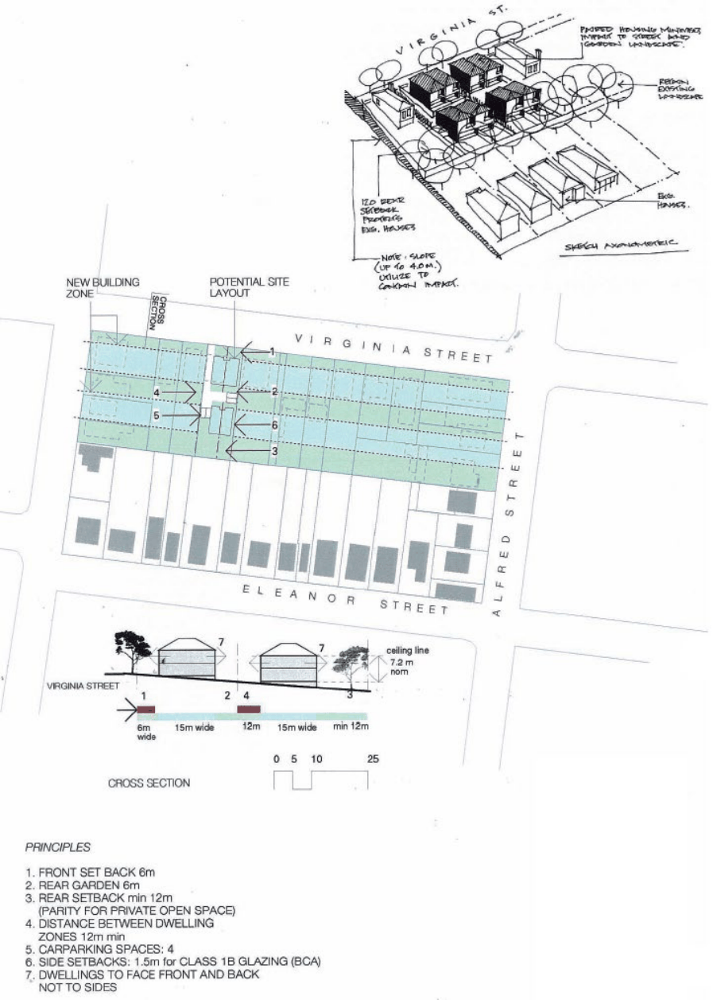
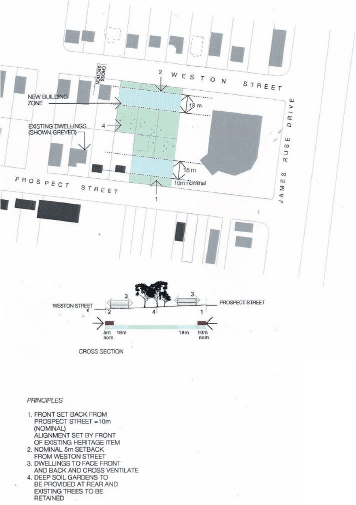
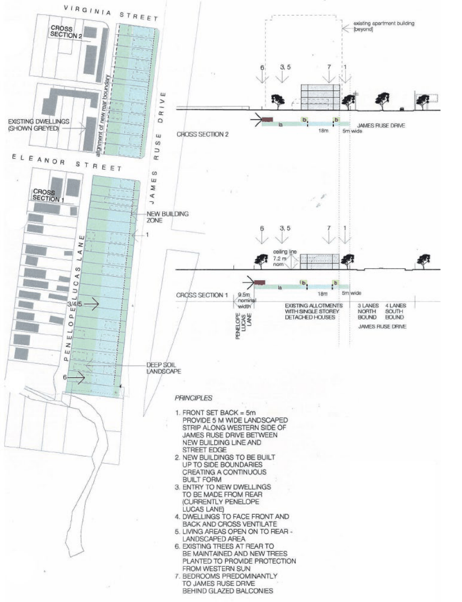

#### 8.3.2.6 KEY BLOCKS SIX TO EIGHT

Key Blocks Six to Eight are identified in this DCP as areas where redevelopment is likely, and where some guidance is required in order to achieve the best outcome.

Controls

C.01 All development on land within Key Blocks Six to Eight is expected to be in accordance with the preferred pattern of development and identified controls shown on the following diagrams.

NEIGHBOURHOOD PRECINTS

HARRIS PARK SPECIAL AREAS

> [Picture on page 471: a picture, saved as a picture (images/part-08-centres-precincts-special-character-areas-specific-page-471-3.gif, 150 dpi).]

Figure 8.3.2.6.1 – Key Block 6

NEIGHBOURHOOD PRECINTS

HARRIS PARK SPECIAL AREAS

> [Picture on page 472: a picture, saved as a picture (images/part-08-centres-precincts-special-character-areas-specific-page-472-3.gif, 150 dpi).]

Figure 8.3.2.6.2 – Key Block 7

NEIGHBOURHOOD PRECINTS

HARRIS PARK SPECIAL AREAS

> [Picture on page 473: a picture, saved as a picture (images/part-08-centres-precincts-special-character-areas-specific-page-473-3.gif, 150 dpi).]

Figure 8.3.2.6.3 – Key Block 8

NEIGHBOURHOOD PRECINTS

RIVER ROAD WEST
