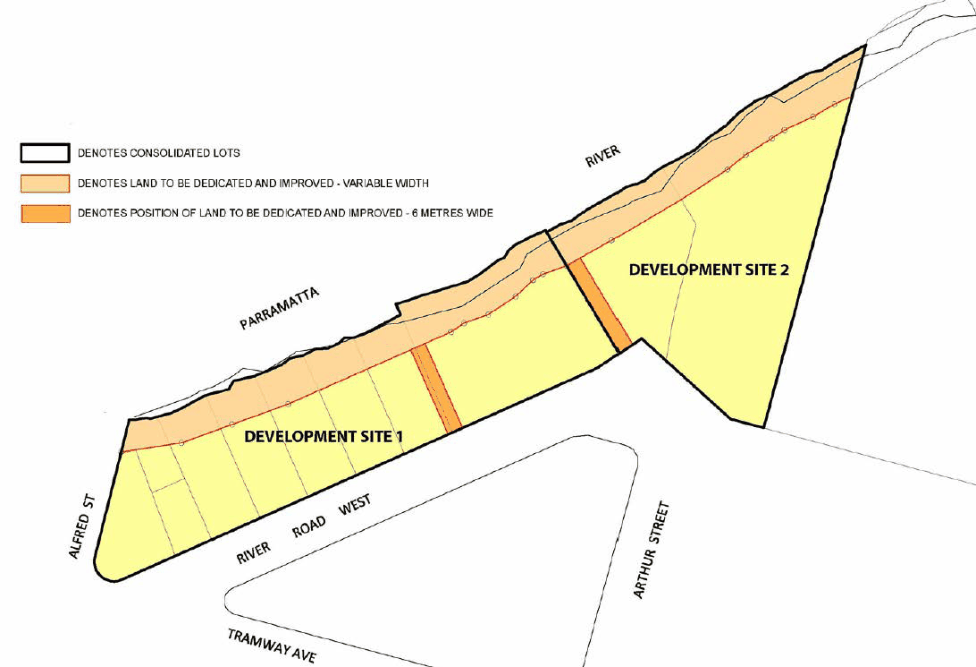
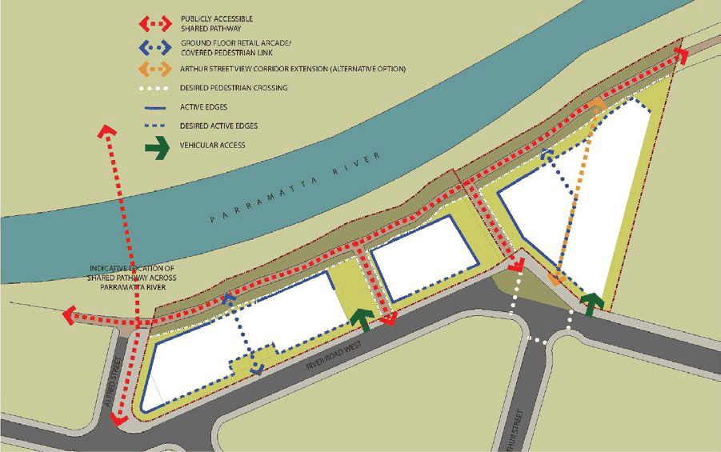

#### 8.3.3.1 DESIRED FUTURE CHARACTER

The River Road West Precinct applies to 2-12 River Road West, Parramatta which is located at the eastern gateway to the Parramatta City Centre. On the southern foreshore of the Parramatta River, the site calls for urban renewal of residential and mixed use buildings addressing both the foreshore and street frontages and revitalising this section of the Parramatta River foreshore. Future redevelopment ensure that the site responds to its riverside location through substantial improvements to the foreshore and public domain and well designed buildings.

The provision of a foreshore open space corridor within this precinct open up a fundamental linkage along the Parramatta River between the Parramatta City Centre to the west and the University of Western Sydney and Rosehill Racecourse to the east. This facilitates the connection for both pedestrians and cyclists between the City Centre and the eastern gateway to the City.

Buildings are located on the site to enable through-site linkages and public spaces between River Road West and the river foreshore to improve permeability between the road network and the foreshore. The orientation and layout of future development activate pedestrian edges to the foreshore, street frontages and through site links, as well as maximising opportunities for passive surveillance.

Building separation are designed to create visual linkages between the northern and southern sides of the foreshore, and between items of historical significance. Building height are stepped from west to east to ensure that the built form is responsive to its existing and potential future context. Tower elements of varying height provide visual interest and are designed to reduce the visual bulk of

NEIGHBOURHOOD PRECINTS

RIVER ROAD WEST

development. Building articulation and modulation ensure that buildings suitably address both the street frontages and the Parramatta River.

Objectives

O.01 Ensure that new development:

a) provides a well designed interface that relates strongly to the river foreshore and responds well to existing land use types and built form on surrounding sites.

b) provides appropriate noise amelioration for residential uses to protect against existing noise generating industrial uses in the surrounding precinct and nearby James Ruse Drive and any future non-residential uses on and off the site.

c) provides well articulated/modulated buildings and an attractive composition of building elements that results in high-quality design outcomes.

d) results in minimal overshadowing within the site, surrounding properties and public open spaces, to ensure that adequate levels of amenity are achieved.

e) provides building separation that supports amenity and privacy, while also responding appropriately to important historic view corridors, and linkages across the Parramatta River.

f) that provides active ground floor uses along street frontages, through site links and the river frontage to create an active pedestrian edge as well as maximising opportunities for passive surveillance.

g) provides opportunity for new commercial and or retail uses.

h) provides open spaces that are publicly accessible and provide opportunities for passive and active recreation.

O.02 Provide new public open space adjacent to the Parramatta River foreshore, and new pedestrian and cycling connections between the river foreshore and the local road network.

O.03 Ensure that new development provides a suitable interface to any future pedestrian bridge over Parramatta River where that bridge adjoins Alfred Street.

NEIGHBOURHOOD PRECINTS

RIVER ROAD WEST

> [Picture on page 476: a picture, saved as a picture (images/part-08-centres-precincts-special-character-areas-specific-page-476-3.gif, 150 dpi).]

Figure 8.3.3.1.1 – Land to be dedicated

Voluntary Planning Agreements

Voluntary Planning Agreements (VPA) were made in respect of the planning proposal that sought rezoning, amended height, FSR and foreshore building line of the land at 2-12 River Road West, Parramatta. The VPAs provide for the dedication of foreshore land and through site links, provision of public domain works including landscaping, shared paths, public art/interpretive signage, lighting, seating, and the like along those spaces to be dedicated, along with monetary contributions toward other public domain improvements. Figure 8.3.3.1.1 denotes the area of the land to be dedicated and improved by the VPAs. Any future redevelopment of the land must be consistent with the requirements of the VPA.

The voluntary planning agreements are to be registered to the title of the land. Where all relevant parties agree, the VPAs may be modified subject to appropriate process which may include public exhibition of an amended VPA/s.

S94 or S94A Development Contributions are payable on any future Development Application and are not to be reduced or excluded on the grounds of the VPA/s made in respect of the rezoning of the land.

NOTE: In calculating FSR for the site, the area to be dedicated along the foreshore is NOT to be included in the site area. However, the 6 metre through site links between River Road West and the Foreshore are to be included in the site area.

NEIGHBOURHOOD PRECINTS

RIVER ROAD WEST

Controls

Consolidated Development Sites C.01 2-12 River Road West comprises a maximum of two development sites, the first being Nos. 2- 8 River Road West and the second being Nos. 10-12 River Road West as shown in Figure 8.3.3.1.1. Development Applications for individual buildings on either of the development sites will not be considered in the absence of a concept proposal for the redevelopment of the development site as a whole in accordance with Section 83B of the Environmental Planning & Assessment Act 1979.

C.02 Building design, form, material finishes and colours need to present as a contiguous development across the two development sites. Design excellence and building diversity are to be achieved across the entire precinct. NOTE: Where approval is required for works to the foreshore and through site links as required by the VPAs, it is recommended that consent be sought as part of the future Development Applications for building works on the site.

Land Use Mix C.03 Ground level uses shall be predominantly non-residential and where appropriate shall create active frontages to the river foreshore, through site links and road frontages as shown in Figure 8.3.3.1.2.

C.04 Council may consider permitting residential development at ground level where it will not reduce desired pedestrian activation; where site specific constraints, including flood affectation, can be overcome; and where residents will be provided with suitable amenity and privacy.

C.05 Suitability of land uses at ground level need to have regard to the sensitivity to flooding impacts and ability to meet the requirements of Council’s Flood Plain Risk Management Plan, Parramatta LEP 2023 and Part 5 – Environmental Management of this DCP.

C.06 Where large non-residential uses floor plates are proposed, information is to be provided at the Development Application stage detailing the types of uses likely to occupy the spaces, the demand for such facilities in the locality and justification for volume of non-residential floor space sought.

Pedestrian Connections and Laneways

C.07 New pedestrian connections are to be provided in accordance with Figure 8.3.3.1.2 and the Voluntary Planning Agreements prepared for the site.

C.08 New pedestrian connections are to be provided along the Parramatta River foreshore, and between the buildings, linking the foreshore and River Road West. All connections shall be suitably designed to integrate with adjoining road and pedestrian networks, including potential future pedestrian bridge over Parramatta River at Alfred Street.

C.09 Pedestrian links must be dedicated to Council in accordance with the VPA and are to be clearly delineated as public space and not privatised within the development.

C.10 New development is to be designed and sited to appropriately integrate with and address pedestrian links ensuring activation and casual surveillance. Solid fencing is not to be provided adjacent to the pedestrian links.

NEIGHBOURHOOD PRECINTS

RIVER ROAD WEST

C.11 New pedestrian links are to include constructed shared paths with a minimum width of 3 metres, being consistent in width for its full length.

C.12 It is desirable that future building envelopes enable an extension of Arthur Street, as a view corridor, extending to Parramatta River.

> [Picture on page 478: a picture, saved as a picture (images/part-08-centres-precincts-special-character-areas-specific-page-478-7.gif, 150 dpi).]

Figure 8.3.3.1.2 – Pedestrian Links and Laneways

NEIGHBOURHOOD PRECINTS

RIVER ROAD WEST
