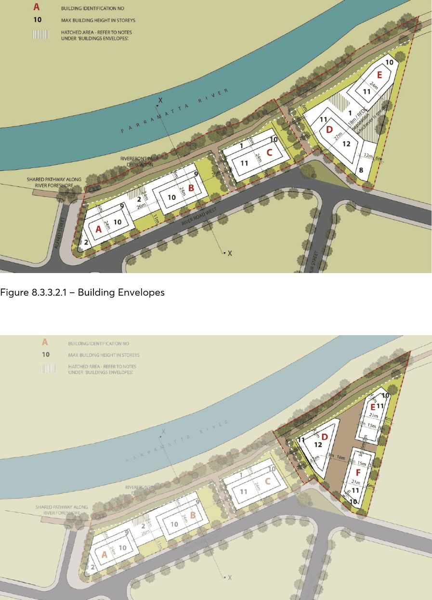
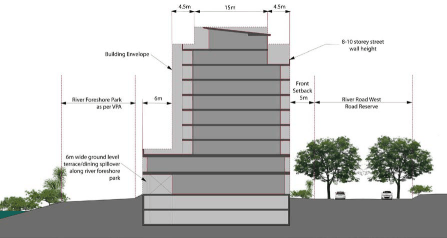

#### 8.3.3.2 BUILDING FORM

Objectives

In addition to general objectives listed in this DCP, specific objectives for this site in relation to built form are detailed below.

O.01 Ensure design excellence and to provide for redevelopment that addresses the desired future character of the precinct.

O.02 Ensure that new buildings reflect and recognise the existing and proposed road and pedestrian networks.

O.03 Ensure that new development responds well to the topography of the land, the context of surrounding development and the visual setting of the site as a gateway approach to the Parramatta City Centre along the River.

O.04 Ensure that new development provides for new connections and views to Parramatta River, including a desired extension of Arthur Street as a view corridor to Parramatta River.

O.05 Ensure that new development will respond appropriately to historic view corridors 5 and 6 as shown in Appendix 1.

Controls

C.01 Designs of buildings are to address both the river foreshore and all road frontages and pedestrian networks.

C.02 Ensure that buildings are articulated using an appropriate mix of design elements to provide visual interest and high-quality building design.

C.03 New buildings should provide active spaces at the ground floor level as detailed in Figure 8.3.3.1.2. This should include retail and commercial spaces, as well as building entrances to the residential parts of each building.

C.04 The ground floor of each building shall have flexible floor plates to accommodate a diversity of uses and respond to changing market conditions over time.

C.05 The buildings should ensure that their presentation to the street has:

a) clearly defined edges and corners, and

b) architectural treatments that are interesting and relate to the design and human scale of built form. NOTE: Regarding Historic View Corridors: It is noted that in developing the building envelopes shown in Figures 8.3.3.2.1, 8.3.3.2.2 and 8.3.3.2.3. It was recognised that not all view corridors shown in Appendix 1 will be retained as a result of future redevelopment of the site. Any significant change to the building envelopes proposed will need to have regard to views 5 and 6 shown at Appendix 1.

Building Envelopes

NEIGHBOURHOOD PRECINTS

RIVER ROAD WEST

C.06 Future built form should provide a high-quality design solution and correlate with the indicative building envelopes shown at Figures 8.3.3.2.1 (or Figure 8.3.3.2.2 where relevant) and 4.1.10.4. NOTE: Figure 8.3.3.2.2 provides an alternate solution to Figure 8.3.3.2.1, for 10-12 River Road West, enabling a desired extension of Arthur Street as a view corridor toward Parramatta River.

NOTE: The building envelopes are indicative only and will be subject to further analysis and design responses relating to flooding, overshadowing, urban design and the like.

C.07 With the exception of Building D, building envelopes (for the tower element) should not exceed 24 metres, including balcony zone. The uppermost level building envelope shall not exceed 15 metres, including balcony zone.

C.08 For Building D the building envelope (tower element) should not exceed 27 metres, with a preferred maximum building depth of 24 metres including balcony zone. The uppermost level building envelope shall not exceed 18 metres, including balcony zone.

C.09 For the alternate solution for Buildings D, E & F, the building envelopes and setbacks should be as dimensioned in Figure 8.3.3.2.2.

C.10 All balconies are to meet the minimum dimensions required in Part 2 – Residential Development of this DCP.

C.11 Council may consider allowing greater building depths where this will not unnecessarily add to the bulk of the building and where a high-quality building design, massing and articulation is achieved, particularly when viewed from the building ends.

C.12 Ground level podium floor plates are to be designed having regard to:

a) flood affectation, including the need to allow for overland flow paths between and around buildings;

b) commercial/retail floor space demand in this locality and the types of uses likely to occupy the spaces;

c) the built form objectives and controls outlined above.

C.13 Large ground level floor plates/podiums will not be permitted where those areas will largely be used to provide for building service areas and/or car parking unless an appropriate design solution demonstrates that the objectives and controls outlined for the land are achieved to a high level of design excellence.

C.14 Where hatched areas are shown in Figure 8.3.3.2.1 it is desirable that these areas be used as a courtyard/landscaped area (and may be above basement but otherwise unenclosed). Council may permit the area east Buildings D and E to be used as service area where it can adequately screened and/or landscaped particularly when viewed from proposed units above and/or the public domain.

NEIGHBOURHOOD PRECINTS

RIVER ROAD WEST

> [Picture on page 481: a picture, saved as a picture (images/part-08-centres-precincts-special-character-areas-specific-page-481-3.gif, 150 dpi).]

Figure 8.3.3.2.1 – Building Envelopes

Figure 8.3.3.2.2 – Building Envelopes

Building Height

NEIGHBOURHOOD PRECINTS

RIVER ROAD WEST

C.15 Maximum building heights shall be in accordance with Figure 8.3.3.2.1 (or 8.3.3.2.2 where relevant) to respond to the context of surrounding buildings and to provide visual interest with tower elements of variable heights.

C.16 Height of new buildings are to ensure positive and cohesive relationships with other buildings both on the site and off the site and are to respond to the desired scale and character of the local area.

C.17 Building height shall respond appropriately to the historic view corridors 5 and 6 detailed in Appendix 1 of this DCP (see Note regarding historic view corridors).

C.18 Storey heights shown in Figures 8.3.3.2.1 and 8.3.3.2.2 should generally not exceed the maximum height shown in metres below: Table 8.3.9.1 – Storeys and heights in metres

| Number of storeys | Maximum height in metres (m) |
|---|---|
| 1 | 6 |
| 2 | 9 |
| 8 | 28 |
| 9 | 31 |
| 10 | 34 |
| 11 | 37 |
| 12 | 40 |

Building Setbacks

C.19 Building setbacks are to be in accordance with Figures 8.3.3.2.1 (or 8.3.3.2.2 where relevant) and 4.3.2.2.7.

> [Picture on page 482: a picture, saved as a picture (images/part-08-centres-precincts-special-character-areas-specific-page-482-18.gif, 150 dpi).]

Figure 8.3.3.2.3 – Building Setbacks

NEIGHBOURHOOD PRECINTS

RIVER ROAD WEST

Building Separation

C.20 Minimum separation between buildings should be in accordance with Figure 8.3.3.2.1 (or

8.3.3.2.2 where relevant).

C.21 Separation between each of the buildings should enable a strong visual connection between River Road West and the river foreshore and provide new sight lines to the River.

C.22 Adequate building separation should be provided between buildings to respond appropriately to Historic View Corridors 5 and 6 as referred to in Appendix 1 of this DCP (see Note regarding historic view corridors).

C.23 Areas between buildings should allow for pedestrians to comfortably move between the buildings, and promote the principles of passive surveillance. These areas should provide a sense of public, as opposed to private space.

C.24 Where appropriate areas provided between buildings should be used to provide for overland flow in flood events. However, any such overland flow path must not conflict with emergency evacuation paths.

Residential Development

C.25 Where applicable, new residential development is to be designed to meet the requirements of State Environmental Planning Policy (SEPP) No. 65 – Design Quality of Residential Flat Development and the Residential Flat Design Code.

C.26 Development should provide secure access to the residential component of each building, separate from access to any commercial development, such that there is a clear sense of building address for residents and their visitors.

Solar Access, Ventilation & Acoustic Amelioration

C.27 Buildings are to be designed to ensure that solar access and cross ventilation requirements detailed in SEPP 65 and Part 3 – Residential Development of this DCP are achieved for residential development both on and off the site. Solar access must also be reasonably provided/retained within the existing and future public domain areas and on adjoining non-residential sites.

C.28 The design of buildings must take account of the need for adequate acoustic amelioration measures for new development, particularly where buildings have an interface with industrial development or other non residential uses either on or off the site. Consideration must also be given to the acoustic impacts of James Ruse Drive when designing new developments.

C.29 Where non-residential uses are proposed on the site, consideration must be given to ensure appropriate amelioration measures are considered with regard to noise, odours and the like to reduce conflict with residential development.

Flooding

C.30 In order to minimise impacts associated with flood inundation, the buildings are to accommodate the 20 year and 100 year flood levels. New development should also consider the PMF event.

NEIGHBOURHOOD PRECINTS

RIVER ROAD WEST

C.31 Any future redevelopment of the site is to meet the flooding controls contained within Parramatta LEP 2023, Part 5 – Environmental Management of this DCP and the Lower Parramatta River Floodplain Risk Management Plan (and any other relevant legislation and/or guidelines).

C.32 In determining the flood affectation of the site, consideration must be given to the impacts of climate change and sea level rise on the Lower Parramatta River Catchment and Clay Cliff Creek, including any changes to the 100 year flood level.

C.33 Before final building envelopes are approved an Engineers Report is to be provided to accompany a Development Application for new structures certifying that:

a) any structure can withstand the forces of floodwater, debris and buoyancy up to and including a probable maximum flood (PMF) level.

b) Development will not increase flood affectation elsewhere having regard to:

• loss of flood storage;

• changes in flood levels and velocities caused by alterations to the flood conveyance;

• the cumulative impact of multiple potential developments in the same catchment.

C.34 The above sub-clause (b) includes the undertaking of appropriately detailed hydraulic modelling of the passage of Clay Cliff Creek catchment runoff/floodwaters through the site where issues including confirmation of the magnitude of those spill flows from the Clay Cliff Creek channel and associated blockage issues have been considered. The modelling is to include consideration of 100 year and PMF event modelling with and without concurrent Parramatta River flooding. Due to the complexity of those flood regimes the modelling shall be undertaken with either 2 Dimensional or quasi 2 Dimensional modelling software.

C.35 Where basement parking is proposed, this shall be designed to prevent the 100 year flood waters from entering basement levels. The basement walls and entry/exits in any future development should eliminate the risk of entry of flood waters up to and including the 100 year flood event. It is desirable that the PMF event also be considered, and where possible the basement be designed to eliminate the entry of flood waters in the PMF event.

C.36 A Site Specific Flood Evacuation Response Plan is to accompany any future Development Application. This plan is to be compliant with any relevant flood evacuation strategy and is to consider the full range of potential flood events. Consideration must also be given to the range of land uses on the site, including any non residential uses at ground level. Particular emphasis must also be given to the appropriate emergency evacuation of the basement including and up to the PMF flood event.

C.37 Emergency Service Authorities are to be consulted in the preparation of any Site Specific Flood Evacuation Response Plan for the site.

C.38 The flowpath along the bank of the river, between the Parramatta River itself and the proposed buildings is to remain clear of any obstructions which could impede the flow of flood waters.

C.39 Building facades shall be designed so as not to obstruct flood flows in extreme flood events. C.40 Access and egress points to all buildings are to be positioned away from overland flow paths and above 100 year flood level plus freeboard.

C.41 Adequate signage is to be installed that identifies the flood risks between the buildings and the Parramatta River and Clay Cliff Creek.

NEIGHBOURHOOD PRECINTS

RIVER ROAD WEST

C.42 Landscaping is to be designed to slope and/or direct flows towards Parramatta River and any increase in planting densities between the buildings and the river is to be certified as to not having adverse impact on the passage of the 100 year flood associated with both the Parramatta River and Clay Cliff Creek regimes. It is expected that such certification will be based on interrogation of the results of specific flood modelling.

C.43 Any fencing or property security should be ‘flood friendly’ allowing flood waters to easily pass through.

Landscaping and Deep Soil

C.44 Landscaping and deep soil planting shall be provided in accordance with Part 2 – Design in Context of this DCP.

C.45 Street trees are to be provided to all frontages of the development to the Council’s specifications. Appropriate landscaping, including trees, shall be provided adjacent to the foreshore and along through site links. Endemic species shall be utilised throughout the site include the riparian corridor and foreshore area.

C.46 Proposed landscape design is to be compatible with the Voluntary Planning Agreements made for the land.

C.47 Roof gardens may be permitted. These should however provide adequate visual and acoustic privacy to other buildings within the development and on adjoining sites and are not to increase the height or bulk of buildings.

Traffic, Access, Parking & Services

C.48 All car parking is to be provided at basement level to ensure that the visual appearance of car parking structures does not dominate the street frontage.

C.49 In the event that basement car parking cannot be provided on the grounds of flood affectation, any at grade or above ground parking area must be adequately screened by way of public art, or other forms of architectural treatment to Council’s satisfaction.

C.50 Pedestrian and vehicle conflict are to be minimised with limited vehicle crossings to the public domain. Crossings are to be generally in accordance with Figure 8.3.3.1.2 or as otherwise agreed by Council, and also having regard to flood affectation and the logical staging of development.

C.51 Vehicle crossings must not provide conflict with pedestrian through site links or any pedestrian crossing.

C.52 Vehicle crossings are to be provided where appropriate to enable emergency and/or maintenance vehicle access to the foreshore/through site links.

C.53 The width and surface area of driveways and other hard surfaces associated with the movement and parking of vehicles shall be minimised, but shall be adequate to enable 2 vehicles likely to be associated with the land uses proposed to pass.

C.54 Provision of loading bays or service vehicle areas, building service/plant areas, and building services (such as substation) must be adequately screened from any public domain areas, including the street, through site links and the river foreshore.

C.55 The kerb and gutter adjacent the boundary of Nos. 8, 10 and 12 River Road West is to be realigned as indicated in Figure 8.3.3.1.2. The remaining verge is to be appropriately landscaped

NEIGHBOURHOOD PRECINTS

RIVER ROAD WEST

to complement the development site. This matter should be further investigated in consultation Council’s Traffic Engineer at the Development Application stage.

Public Domain

C.56 Foreshore open space, through site links and public domain works are to be provided in accordance with the Voluntary Planning Agreements for the land.

C.57 Public domain areas to be dedicated to Council in accordance with the Voluntary Planning Agreements are to be integrated with the design of future redevelopment of the land. These areas shall be appropriately activated at ground level and are to be clearly distinguishable as public areas.

C.58 Fencing within the public domain area is not desired. However, where fencing is required, it is to be transparent and must not exceed 1 metre in height and must not reduce passive surveillance of the adjoining public domain.

C.59 The foreshore area and through site links shall incorporate a range of treatments including grassed areas, planting, paving, seating areas, public art and interpretive heritage signage.

C.60 New development is to ensure that public open spaces can be casually surveyed from new buildings on the site.

C.61 New shared paths along the foreshore and through site links shall provide an attractive river foreshore area increasing connections along the Parramatta River and throughout the local road network. All shared paths shall be adequately connected to the existing road/pedestrian network.

C.62 Works to the foreshore shall contribute to a rich and varied promenade experience, which draws people to, and along, the waterfront.

C.63 Buildings shall be designed to maximise solar access to pubic domain areas. C.64 Water Sensitive Urban Design principles shall be implemented within the public domain areas. Heritage & Archaeology

C.65 The design of the proposed buildings are to ensure that the historic view corridors 5 and 6 identified at Appendix 1 of this DCP are responded to appropriately. This is to be achieved through careful consideration of building siting, separation height, bulk and scale. (see Note regarding historic view corridors).

C.66 Future redevelopment must ensure that all reasonable opportunities to re-establish public foreshore connections are provided.

C.67 Due to the possibility of remnants of the former gas works site and wharf being present, a monitoring program or test excavations may be required. An appropriate strategy is to be provided as part of any future Development Application.

C.68 A heritage interpretation strategy is to be implemented within the 2-12 River Road West Precinct. This is to identify historical associations of this precinct and ‘tell a story’ about the significance of this site within the Harris Park and broader Parramatta context. The setting of Queens Wharf, site of a former gasworks, and early association as part of the Macarthur land grant should be considered as part of this interpretation strategy.

NEIGHBOURHOOD PRECINTS

C.69 Due to the possibility of the site containing part of the Parramatta sand body, an appropriate exploratory test excavation strategy is to be devised in conjunction with any future Development Application to determine whether any such remains are evident within the precinct. Archaeological testing is to be undertaken in accordance with the Code of Practice for Archaeological investigation of Aboriginal Objects in Australia. Appropriate consultation should also be undertaken in accordance with the Aboriginal community.

Flora & Fauna

C.70 Prior to the redevelopment of the site a terrestrial and aquatic flora and fauna investigation is to be undertaken and is to accompany any future Development Application. This investigation should be extended to include environmental assessments of bat and migratory bird habitat in the adjoining river corridor, including documentation of impacts and recommend appropriate mitigation measures.

C.71 Consultation should be undertaken with NSW Office of Environment and Heritage with regard to migratory bird and bat habitat and flight paths prior to undertaking environmental assessments.

C.72 Future redevelopment should provide for a rehabilitation and restoration strategy for flora and fauna, particularly along the river foreshore. Such a strategy should be provided at the Development Application stage and is to address (but is not limited to) the following matters:

a) Commitments provided for in the voluntary planning agreements;

b) Weed removal and control of noxious weeds;

c) Bank stabilisation to halt bank erosion and undermining of existing mangroves;

d) Conservation and protection of mangroves, mature Swamp Oak and other endemic riverine species, having particular regard for their ability to stabilise the river bank;

e) Re-establishment the elements of Swamp Sclerophyll Forest along the bank; and

f) On-going management and protection of the riparian corridor.

C.73 Lighting in any future development to be designed to minimise light spill into the ecologically sensitive river riparian corridor to prevent disturbance of bat and migratory bird foraging and roosting habitat.

C.74 Provision of construction noise limits and time restrictions to reduce noise emissions into the ecologically sensitive river riparian corridor to prevent disturbance of bat and migratory bird foraging and roosting habitat.

Contamination & Acid Sulfate Soil

C.75 Future redevelopment of the site is to meet the requirements of Parramatta LEP 2023, Parramatta DCP 2023, State Environmental Planning Policy No. 55 (Remediation of Land) and any other relevant legislation and guidelines.

NEIGHBOURHOOD PRECINTS

MORTON STREET
