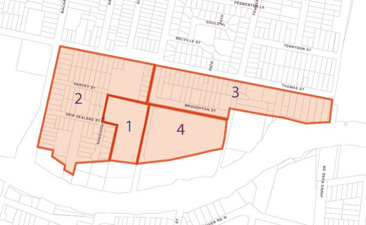
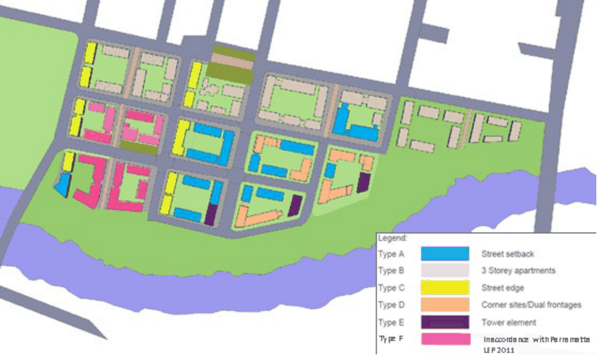
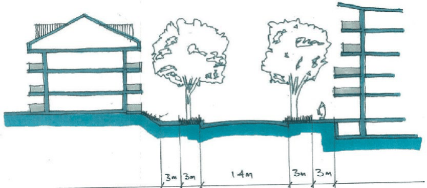
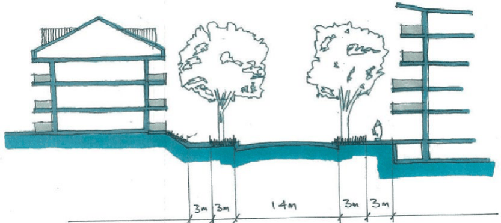
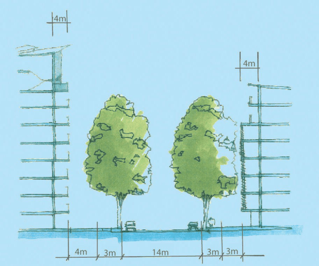
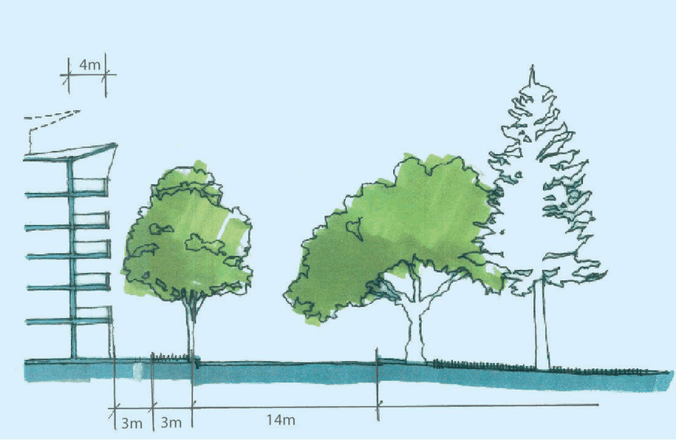
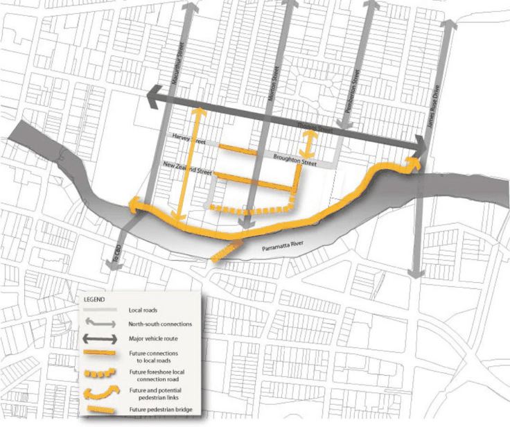

#### 8.3.4.1 DESIRED FUTURE CHARACTER

The Morton Street Precinct is located adjacent to the Parramatta City Centre with the capacity to accommodate more residential growth and supporting infrastructure. It will undergo managed growth and change in its urban form with anticipation of a mix of housing types with mixed use community activity centred on Morton Street.

New pedestrian and vehicular links create better connections within the precinct and access to the Parramatta River. The river foreshore provides a strong recreational and communal focus for the precinct and beyond. It includes an important riverside pedestrian and bike link between the Parramatta City Centre and the University of Western Sydney. In the short term, the precinct’s larger sites are prioritised for renewal. This renewal sets the design and quality benchmark for other development within the precinct.

The built form includes some taller building elements along north/south orientated sites to reduce visual bulk, encourage more modulation, reduce overshadowing, and encourage dual aspect apartments for enhanced access to sunlight and breezes. The building form for east/west sites are lower in height to optimise solar access to private and public open space and allow view corridors from the south. Taller, slender ‘statement’ buildings are located along the foreshore to enable a

NEIGHBOURHOOD PRECINTS

MORTON STREET

strong visual relationship between the precinct and the City Centre, mark the entry to Parramatta, and provide a punctuated built edge to the river.

New pedestrian and vehicular links create better connections between the site and the Parramatta River foreshore. The river foreshore provides a strong recreational and communal focus. It includes an important riverside pedestrian and cycleway to facilitate the link between the Parramatta City Centre and the University of Western Sydney.

The development of the precinct allows for a greater emphasis and recognition of the riverside location and the opportunity for enhancing the foreshore and public domain with development that is both well-designed and strongly related to the river. The connection of the north and south banks of the river with a pedestrian bridge are explored to provide better linked communities across the river.

Redevelopment preserves views and vistas, particularly views of historical significance and other important views as described in Section 2.8 – Views and Vistas of this DCP.

Objectives

O.01 Ensure that new development:

a) Provides buildings with articulation and an attractive composition of building elements.

b) Results in minimal overshadowing of adjoining development, particularly windows of living areas, solar collectors and outdoor recreation areas.

c) Provides building separation that supports private amenity.

d) Provides active ground floor uses along Morton Street to increase the safety, use and interest of the street.

e) Provides open space areas by way of an internal common area courtyard and/or private open space being an extension of the main living areas of individual apartments.

O.02 Encourage perimeter block development with a strong relationship between buildings and the streetscape, and providing a central common open space for the benefit of residents.

O.03 Ensure development fronting the public domain and foreshore provides a visual and physical connection to this area to improve surveillance and safety.

The Morton Street Precinct is split into three areas, as follows:

• Area 1 - Riverfront

• Area 3 - Morton Street – East

• Area 2 - Morton Street – West

• Area 4 - No. 2 Morton Street

NEIGHBOURHOOD PRECINTS

> [Picture on page 490: a picture, saved as a picture (images/part-08-centres-precincts-special-character-areas-specific-page-490-2.gif, 150 dpi).]

MORTON STREET

Figure 8.3.4.1.1 - Morton Street Areas

Areas 1 and 4 are to be developed as large single parcels, without further subdivision prior to their development, to ensure that development occurs in an integrated manner, resulting in perimeter style arrangement of buildings, defining the streets, facilitating the provision of communal open space and pedestrian connections.

Areas 2 and 3 shall also adopt a perimeter style of development but building typologies are likely to be more diverse with land along Thomas Street responding more closely to the suburban environment to the north and north-west towards Victoria Road. The areas are shown in Figure 8.3.4.1.1.

Controls

Indicative Building Envelopes C.01 Development in Area 1 - Riverfront must be in accordance with the indicative building envelopes as shown in Figure 8.3.4.1.2.

C.02 Development in Areas 2 and 3 - Morton Street East and West must explore and assess the context of the site in relation to the indicative building envelopes, as shown in Figure 8.3.4.1.2. However, alternative design solutions to that of the indicative building envelopes may be acceptable in Areas 2 and 3 if it can be shown that the design will:

a) achieve a positive and cohesive relationship with other buildings;

b) achieve optimum solar access and overshadowing does not affect functional open space, or habitable rooms of adjoining development; and

c) respond to the principles embedded in the desired future character statement for Morton Street.

C.03 Development in Area 4 must be in accordance with the indicative building envelopes as shown in Figure 8.3.4.1.2. Development must provide an appropriate design response to the management of environmental and flood characteristics of the site.

Building Height

NEIGHBOURHOOD PRECINTS

MORTON STREET

C.04 In Area 4, the Parramatta LEP 2023 sets a maximum height limit of 40 metres (equal to 12 Storeys). However, the built form principles for the development will not result in 40 metre buildings being dispersed across the entire site. The site has the potential to be developed for mixed use and high-density development with the height of buildings ranging from 6-8 storeys with two tower elements of 10 and 12 storeys to achieve the desired future character.

Building Form C.05 The built form controls correlate with the indicative building envelopes shown in Figure 8.3.4.1.2. The design of buildings must comply with the relevant standards for each building type.

C.06 Building typologies have been specified to ensure that new buildings are consistent with the orientation of streets. This will achieve a more orderly pattern of development that is distinguishable, reflects the level of density while maximising solar access and minimising overshadowing impacts to all forms of open space.

C.07 The different typologies respond to different street conditions, for example new development along Macarthur Street responds to its location as a gateway by encouraging strongly defined vertical elements with no upper level setbacks to mimic the prominence of buildings within the City Centre whereas in Morton Street, buildings are set back to encourage active street frontages.

C.08 Buildings should be designed to create streetscapes that are characterised by:

a) Clearly defined edges and corners, and

b) architectural treatments that are interesting and relate to the design and human scale of existing buildings.

C.09 Development is to establish a scale in the immediate vicinity of heritage items that does not overwhelm the item, and is sensitive to its curtilage and historic setting, and makes a transition to higher development in the precinct.

C.10 Opportunities for views to the City, northern escarpment and across the river are to be realised in the design of new buildings.

C.11 Buildings fronting the off-road pedestrian network are to be designed to provide for casual surveillance.

C.12 Building circulation cores are to be glazed with entrances/windows recessed into the structural form.

C.13 Balconies are to be a combination of projected and enclosed forms. C.14 Buildings fronting the proposed public open space area along the riverfront are to be modulated to create interest as viewed from the river and foreshores.

NEIGHBOURHOOD PRECINTS

MORTON STREET

> [Picture on page 492: a picture, saved as a picture (images/part-08-centres-precincts-special-character-areas-specific-page-492-3.gif, 150 dpi).]

Figure 8.3.4.1.2 - Indicative Building Envelopes

Building Form Type A Description

This building typology is formed with the view of creating activate street frontages with emphasis on setbacks that facilitate pedestrian interaction. The placement and design of buildings should ensure that there is a high degree of integration between buildings and the street through the use of substantial areas of door, window and display space at ground and possibly upper levels. Roof designs are to incorporate flat and mono-pitch roof lines with over-sailing eave lines and curved noses.

Table 8.3.4.1.1 - Controls for Form Type A

| Control | Building Form Type A |
|---|---|
| Street Setbacks | 3 metres from the property boundary, which is to be dedicated to Council for the purposes of the construction of a footpath. |
| Street Frontage Height | • 9 metres for a 4-storey building • 14 metres for a 6-storey building • 20 metres for a 8-storey building |
| Upper Level Setbacks | The two uppermost storeys of the building are to be setback 4 metres. |
| Depth of Building | Maximum of 18 metres. |
| Site Frontage | Minimum 24 metres in Areas 2 and 3. |

NEIGHBOURHOOD PRECINTS

MORTON STREET

> [Picture on page 493: a picture, saved as a picture (images/part-08-centres-precincts-special-character-areas-specific-page-493-3.gif, 150 dpi).]

Figure 8.3.4.1.3 - Building Type A in Morton Street

Building Form Type B

Description

These building typologies are to have very strong vertical elements divided into units of equal proportion. There should be a variety of projected and recessed balconies. A small setback to the street is required to enable incorporation of small landscaped courtyards and to ensure a suburban character, with individual entries to dwellings. Gabled roofs are encouraged, with the potential for dormer windows and attic rooms. This will blend new development with the adjoining residential area.

Table 8.3.4.1.2 - Controls for Form Type B

| Control | Building Form Type B |
|---|---|
| Street Setbacks | Minimum 4 metres and maximum of 6 metres from property boundary. |
| Street Frontage Heights | Frontage height is to be 11 metres for a 3 storey building and 14 metres for a 4 storey building. |
| Depth of Building | Minimum of 16 metres and maximum 18 metres. |
| Site Frontage | Minimum 24 metres in Areas 2 and 3. |

NEIGHBOURHOOD PRECINTS

> [Picture on page 494: a picture, saved as a picture (images/part-08-centres-precincts-special-character-areas-specific-page-494-2.gif, 150 dpi).]

MORTON STREET

Figure 8.3.4.1.4 - Building Type A and B building as viewed from Broughton Street

Building Form Type C

Description

This building typology is to encourage a street edge pattern, a variety of roof forms to provide visual interest to the skyline and rear setbacks to preserve privacy. These buildings need to ensure the privacy and safety of ground floor units by stepping up the ground floor from the level of the footpath, including balustrades and establishing window sill heights to minimise site lines into apartments.

Table 8.3.4.1.3 - Controls for Form Type C

| Control | Building Form Type C |
|---|---|
| Street Setbacks | 3 metres from the property boundary. |
| Street Frontage Height | 11 metres for a 3-storey building. 14 metres for a 4-storey building. |
| Rear Level Setbacks | The upper storey of the building is to be set back 4 metres. |
| Upper Level Setback | The two uppermost storeys of the building are to be setback 4 metres. |
| Depth of Building | Maximum of 18 metres. |
| Site Frontage | Minimum 24 metres in Area 2. |

Building Form Type D

Description

The key element in this building typology is emphasis on the treatment of corners. Corner elements should portray a street theme and be unique in design. Each element should be tailored with prominent

NEIGHBOURHOOD PRECINTS

MORTON STREET

entrances and windows as well as an opportunity for the integration of public art (particularly for land located within Areas 1 and 4). These spaces should act as core elements and rely on building materials that are contemporary and different from other elements within the overall building facade.

Table 8.3.4.1.4 - Controls for Form Type D

| Control | Building Form Type D |
|---|---|
| Street Setbacks | 3 metres from the property boundary. |
| Street Frontage Height | Maximum of 20 metres for an 8-storey building and 14 metres for a 6- storey building. |
| Upper Level Setbacks | The second and third storey of the building is to be set back 4 metres. |
| Depth of Building | Minimum 16 metres to a maximum of 18 metres. |
| Site Frontage | Minimum 24 metres within Area 2. |

Type E – Tower Elements

Description

Towers should be architecturally integrated with the perimeter block architecture at the base, differentiated by a change in plane, material and/or fenestration. While setbacks are appropriate to create a building base vertical expression of the tower is encouraged. Towers should be designed to provide an interesting silhouette, profile and volumetric form on the skyline through variation of building material, building shape, plane and setbacks.

Table 8.3.4.1.5 - Controls for Form Type E

| Control | Building Form Type E |
|---|---|
| Street Setbacks | 4 metres from the property boundary |
| Street Frontage Height | 28 metres for a ten storey building 34 metres for a twelve storey building |
| Upper Level Setbacks | Upper two storeys to be setback 4 metres on all sides |
| Depth of Building | Minimum 16 metres to a maximum 18 metres |

NEIGHBOURHOOD PRECINTS

> [Picture on page 496: a picture, saved as a picture (images/part-08-centres-precincts-special-character-areas-specific-page-496-2.gif, 150 dpi).]

MORTON STREET

Figure 8.3.4.1.5 - Type E tower element building as viewed from Morton Street looking north

> [Picture on page 496: a picture, saved as a picture (images/part-08-centres-precincts-special-character-areas-specific-page-496-5.gif, 150 dpi).]

Figure 8.3.4.1.6 - Cross Section of development that has an interface with the riverfront.

Note the emphasis on creating an interesting roof from that can contribute to the visual interest of the building

NEIGHBOURHOOD PRECINTS

MORTON STREET

Urban Design (Area 4 only)

C.15 Buildings should be designed to create streetscapes that are characterised by:

a) clearly defined edges and corners, and

b) architectural treatments that are interesting and relate to the design and human scale of existing buildings.

C.16 Opportunities for views to the City, northern escarpment and across the river are to be realised in the design of new buildings.

C.17 Buildings fronting the off-road pedestrian network are to be designed to provide for casual surveillance.

C.18 Building circulation cores are to be glazed with entrances/windows recessed into the structural form.

C.19 Buildings fronting the proposed public open space area along the riverfront are to be modulated to create interest as viewed from the river and foreshores.

C.20 Where development is proposed that requires the management of flood impacts, the following urban design considerations apply:

a) Where a building is raised, the design of the building is to facilitate an address and connection to the foreshore.

b) Mixed Use development is encouraged at the western end of the river foreshore interface and design techniques are to facilitate connectivity and an outlook between the river foreshore and the development. Consideration should include the use of outdoor terraces, stairs and boardwalks as a means of creating connectivity and surveillance.

Development within the MU1 Mixed Use Zone (Area 4 only) C.21 Entrances to buildings are to be clearly defined and well lit. C.22 Active frontages are required at the ground level within the MU1 Mixed Use zone. C.23 Buildings are to be designed to have flexible ground floor uses to accommodate a diversity of living arrangements and potential future commercial uses.

C.24 Development should provide secure access to the residential component of mixed use development, separate from access to any commercial development, such that there is a clear sense of building address for residents and their visitors.

C.25 For mixed use development, special consideration must be given to noise attenuation measures, privacy issues, parking and vehicular access arrangements including the location and design of vehicular access points to be integrated into the building design and to reduce pedestrian and vehicular conflict.

C.26 Vehicular crossings are to be minimised to reduce disruption of pedestrian flow and safety. Landscaping and Deep Soil C.27 Street trees are to be provided on all new streets to Council’s specifications. C.28 Landscaping is to increase safety and security, and the perception of safety and security, with clear sight lines and minimal opportunities for concealment.

NEIGHBOURHOOD PRECINTS

MORTON STREET

C.29 Landscaping is to retain mature stands of trees (eg. large eucalypts on the Council site) where these contribute to area character and a canopied skyline.

C.30 New development is required to provide a landscaped quality to front gardens and setbacks. Landscaping should reinforce the public realm without secluding and hiding areas where surveillance is limited.

a) In the MU1 Mixed Use zone, the rear setback is to be a deep soil landscaped zone.

b) No car parking areas will be permitted in areas designated as landscaped areas.

c) In the MU1 Mixed Use zone not less than 40% of the site is to be landscaped. NOTE: Landscaped area in the MU1 Mixed Use zone may include roof gardens with dimensions greater than 2 metres x 4 metres.

C.31 For land within Area 1, perimeter-style development is to define the streets and facilitate the provision of largely communal open space. This communal open space should enhance the quality of the built environment by providing opportunities for landscaping in a parkland setting as well as provide a visual and active focus for the new residential community created through this the development. All communal open space areas are to accommodate appropriate facilities such as picnic and barbecue areas, children’s play areas and grassed areas for passive recreational use. Consideration should be given to the provision of a community building with recreational facilities such as a swimming pool, gymnasium and functional space to allow for resident meetings.

C.32 Where balconies are enclosed, consideration should be given to installing planting beds within the building for the purposes of deep soil planting. These planting beds will not becounted as landscape area.

Traffic, Access and Parking C.33 All car parking to be provided at basement level. C.34 Pedestrian and vehicle conflict are to be minimised with limited vehicle crossings to the public domain.

C.35 Provide new vehicular links within the precinct as shown in Figure 8.3.4.1.7. C.36 The width of the road reserve of Morton Street south of Broughton Street is to be increased to be consistent with its width north of Broughton Street.

C.37 Create a foreshore street/loop road to provide new development on the foreshore with a sense of address, to ensure new buildings are focused on the river and to increase the safety of the area.

NEIGHBOURHOOD PRECINTS

> [Picture on page 499: a picture, saved as a picture (images/part-08-centres-precincts-special-character-areas-specific-page-499-2.gif, 150 dpi).]

MORTON STREET

Figure 8.3.4.1.7 - Pedestrian and vehicle connections

Public Domain C.38 A sequence of foreshore open spaces of different size, shape and character is to be provided to contribute to a rich and varied promenade experience that draws people along the waterfront.

C.39 The promenade is to be enhanced with generous pedestrian and cycle ways, an integrated suite of urban elements (lighting, seating, signage), and planting.

C.40 Two major open spaces are to be provided: a park area; and a more structured area incorporating active recreation including for children and young people.

C.41 A new foreshore park/plaza area is to be provided focused at the termination of Morton Street and linked to the foreshore promenade.

C.42 Large Australian native signature trees are to be planted along the foreshore, to make a transition to urban scale buildings of 4-5 storeys.

C.43 Pedestrian connections between the public open spaces on the northern and southern banks of the river are to be considered.

C.44 Consideration is to be given to ways in which to improve visual/physical connections to the foreshore. This approach would need to be explored in partnership with the relevant State authorities.

C.45 A new link between the University of Western Sydney and the existing foreshore multi purpose path is to be created.

NEIGHBOURHOOD PRECINTS

MORTON STREET

C.46 Establish Morton Street as a major north-south street, terminating in an attractive, interesting and inviting public space at the river foreshore.

C.47 New pedestrian and road connections are shown in Figure 8.3.4.1.7. C.48 The following specifications apply to road reserves within the precinct:

a) Morton Street

• Road reserve: 20 metres (widened from 16 metres south of Broughton Street).

• Carriageway 14 metres. Verge between 3, with grassed edge to street, 3 metre wide footpath.

b) Extension to New Zealand Street

• Road reserve: 17 metres

• Carriageway: 12 metres

• Verge: 1 metre with grass edge to street and 1.5 metre footpath

c) Proposed Foreshore Road

• Road reserve: 15 metres

• Carriageway 10 metres

• Verge: 3 metre footpath and 2 metre grass verge with street trees on north side.

• Footpaths to be extended to 4 metres where Type E buildings (Tower elements) are proposed.

C.49 Where a development provides for dedication of land to Council for the purposes of providing public access and the construction of the access way (as shown in Figure 8.3.4.1.7, Council may consider increasing the maximum floor space ratio. As a guide, the maximum floor space ratio may be increased by the equivalent area represented by 50% of the land area to be dedicated to Council for the public access. The site area may include the area of land to be dedicated to Council for the purpose of the floor space ratio calculation. The proposed variation to floor space is to be addressed under Clause 4.6 ‘Exception to development standards’ in the Parramatta LEP 2023. NOTE: All new road extensions as described in Figure 8.3.4.1.7 are to be constructed to public road standard and dedicated to Council.

NEIGHBOURHOOD PRECINTS

EAST RYDALMERE
