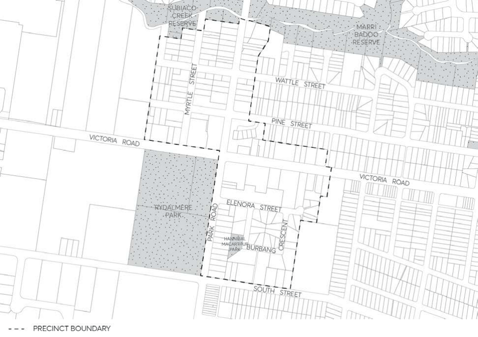

#### 8.3.5 EAST RYDALMERE

> [Picture on page 501: a picture, saved as a picture (images/part-08-centres-precincts-special-character-areas-specific-page-501-4.gif, 150 dpi).]

Figure 8.3.5.1 – (East) Rydalmere Precinct Map
