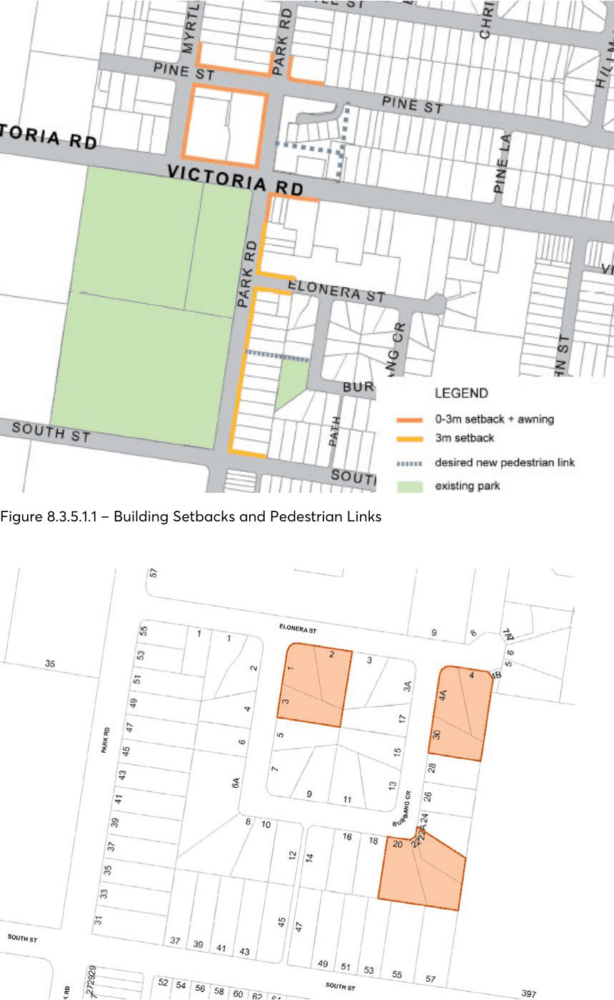

#### 8.3.5.1 DESIRED FUTURE CHARACTER

A mix of residential, retail and business development in the precinct encourage a mix of housing types including residential flat buildings, multi dwelling housing and shop top housing. Retail and business uses are concentrated around the intersection of Pine Street and Park Road, and on the south eastern corner of Victoria and Park Roads. New residential development are concentrated in close proximity to existing transport services on Victoria and Park Roads and Rydalmere Ferry Wharf.

New development are required to have regard to sensitive environmental areas and heritage items, and to consider noise impacts from Victoria Road and adjacent industrial development. Developments provide passive surveillance to existing public open spaces including public reserves and pedestrian laneways. Where sites directly adjoin existing creek corridors new development retain and/or enhance the indigenous vegetation corridor.

NEIGHBOURHOOD PRECINTS

EAST RYDALMERE

Objectives

In addition to general objectives listed in Part 8 of this DCP, specific objectives of this precinct are identified below. O.01 Ensure that redevelopment south of Victoria Road will occur on regular shaped development sites.

O.02 Encourage retail and business activity at the intersection of Park Road and Pine Street. O.03 Ensure that new residential development is suitably treated to reduce noise impacts associated with Victoria Road and surrounding industrial uses.

O.04 Ensure that new development adjacent to existing creeks and waterways retains and enhances the indigenous vegetation corridor.

Controls

Pedestrian Connections and Laneways C.01 New pedestrian connections and laneways should be provided in accordance with Figure 8.3.5.1.1. Where a development provides for public access connections, a variation to Council’s floor space ratio control can be sought in accordance with C.02 below.

C.02 Where a development provides for dedication of land to Council for the purposes of providing public access and the construction of the access way, Council may consider increasing the maximum floor space ratio. As a guide, the maximum floor space ratio may be increased by the equivalent area represented by 50% of the land area to be dedicated to Council for the public access. The site area may include the area of land to be dedicated to Council for the purpose of the floor space ratio calculation. The proposed variation to floor space is to be addressed under Clause 4.6 ‘Exception to development standards’ in the Parramatta LEP 2023.

C.03 New pedestrian links are to improve through block connections and access to existing public open spaces, and are to have a minimum width of 3 metres being consistent in width for its full length.

C.04 Existing pedestrian connections are to be retained and enhanced. Setbacks C.05 Building setbacks are to be in accordance with Figure 8.3.5.1.1, and any additional controls set out below.

C.06 Development in the E1 Local Centre zone should have a nil side setback where it will not have a detrimental impact upon adjoining development, to achieve a continuous street edge.

C.07 Development at the intersection of Park and Victoria Roads is to provide splay corners to the satisfaction of Council/TfNSW.

Land Amalgamation C.08 Land amalgamation is to result in regular shaped development sites throughout the precinct, particularly within the R4 High Density Residential south of Victoria Road. Examples of preferred amalgamation patterns are shown in Figure 8.3.5.1.2.

NEIGHBOURHOOD PRECINTS

EAST RYDALMERE

> [Picture on page 503: a picture, saved as a picture (images/part-08-centres-precincts-special-character-areas-specific-page-503-3.gif, 150 dpi).]

Figure 8.3.5.1.1 – Building Setbacks and Pedestrian Links

Figure 8.3.5.1.2 – Preferred amalgamation patterns

NEIGHBOURHOOD PRECINTS

ERMINGTON NAVAL STORES– WATERFRONT AND SILVERWATER

ROAD
