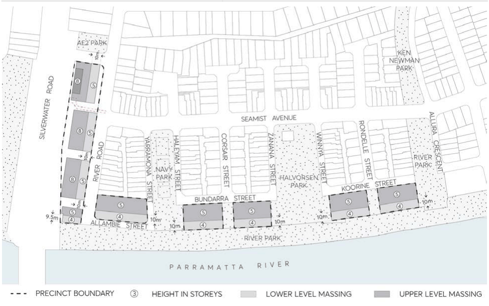

#### 8.3.6 ERMINGTON NAVAL STORES– WATERFRONT AND SILVERWATER

#### ROAD

#### 8.3.6.1 DESIRED FUTURE CHARACTER

The Ermington Naval Stores Precinct applies to the waterfront lots known as Lots 301 to 305, and the lot adjacent to Silverwater Road known as Lot 306.

The precinct is located on the northern side of the Parramatta River and lies at a junction between a low density residential neighbourhood to the north, industrial uses to the west, Silverwater Correctional Complex to the south across the River, the generous George Kendall Riverside Park to the east, and the recreational facilities of Sydney Olympic Park to the south-east.

The Commonwealth purchased the site in 1943 and used it for the purposes of storage by the US Army during World War II. At the end of the war and from 1947 the site continued to be used for storage purposes by the Royal Australian Navy until it was no longer required by the Commonwealth in 1990.

The precinct provides the opportunity for urban renewal with new residential and mixed use buildings addressing the foreshore, internal streets and Silverwater Road which revitalises this section of the Parramatta River foreshore. Future redevelopment ensures that the site responds to its riverside location through substantial improvements to the foreshore and public domain and well-designed buildings.

The activation of the lots adjacent to the foreshore open space corridor within this precinct introduces an integrated relationship which improves functionality and enjoyment of the foreshore area by residents.

The location of buildings within the lots frame views between the lots to the foreshore. Basement levels between buildings on Lots 301 to 302 and Lots 303 to 304 are designed to ensure that visual connections between the buildings to the foreshore are maintained. The orientation and layout of future development activate pedestrian edges to the foreshore, and street frontages, as well as maximise opportunities for passive surveillance.

Building height step down from north to south with all buildings adjacent to the foreshore having a 4 storey scale and fifth floor setback from the foreshore, to ensure that the built form is responsive to the amenity of the foreshore and its existing and potential future context. Building articulation and modulation ensures that buildings suitably address both the street frontages and the Parramatta River.

Buildings on Lot 306, other than adjacent to the foreshore, respond to both the Silverwater Road context to the west and the lower scale context to the east, with 8 storeys presenting to Silverwater Road to provide a suitable buffer from visual and acoustic impacts of Silverwater Road, and a 5 storey height facing to the lower scale housing to the east.

The design of buildings ensures that solar access is achieved within the development to enable a suitable level of amenity to be achieved for occupants. The design incorporates opportunities for natural ventilation to contribute to the environmental efficiency of the development.

NEIGHBOURHOOD PRECINTS

ERMINGTON NAVAL STORES– WATERFRONT AND SILVERWATER

ROAD

> [Picture on page 505: a picture, saved as a picture (images/part-08-centres-precincts-special-character-areas-specific-page-505-4.gif, 150 dpi).]

Figure 8.3.6.1 – Site Plan

Objectives

In addition to general objectives listed in Section 8 of this DCP, specific objectives for this precinct are identified below. O.01 Ensure that new development:

a) provides a well-designed interface that relates strongly to the river foreshore.

b) provides appropriate noise amelioration for residential uses to protect against existing noise generating industrial uses to the west and the adjacent Silverwater Road.

c) provides well-articulated/modulated buildings and an attractive composition of building elements that results in high-quality design outcomes.

d) provides buildings with appropriate levels of amenity while also responding appropriately to important view corridors.

e) is capable of providing the necessary quantum of vistor parking for Lots 301 to 306 within the collective basement levels of the development, rather than on street, as a result of allowing basement levels between Lots 301 to 302 and Lots 303 to 304.

f) promotes a scale and density of planting that softens the visual impact of buildings.

O.02 Development must comply with the controls and principles set out in Parts 2, 3, 4 and 5 of this DCP.

NEIGHBOURHOOD PRECINTS

ERMINGTON NAVAL STORES– WATERFRONT AND SILVERWATER

ROAD

Controls

Building Heights

C.01 Future built form must provide high-quality design solution and comply with the building height controls shown in Figure 8.3.6.

C.02 Height of new buildings is to ensure positive and cohesive relationships with other buildings both on the site and off the site and are to respond to the desired scale and character of the local area.

Building Setbacks C.03 The setback of the fifth storey from the southern boundary must be 10 metres for Lots 301 to 305 and 9.5 metres for Lot 306 as shown in Figure 8.3.6.1.

C.04 The set back of the storeys above the fifth storey for Lot 306 must be 10 metres from the eastern face of the buildings adjacent to River Road as shown in Figure 8.3.6.1.

Landscaped Area and Deep Soil C.05 Landscaped area and deep soil provisions of Part 2 of this DCP apply to the Ermington Naval Stores Precinct - Waterfront and Silverwater Road. The following controls, however, apply to this Precinct:

a) Communal open space area (which comprises hard and soft landscaping) must be provided equivalent to 25% of the total site area.

b) A minimum 25% of the communal open space area is to be deep soil zone (deep soil is defined as soil having a minimum depth of 600mm).

c) A minimum soil depth of 600mm – 1,000mm is to be provided to a minimum of 50% of the pockets parks between Lots 301 to 302 and also 303 to 304.

Car Parking C.06 Council may support basement car parking under the pocket parks between Lots 301 to 302 and Lots 303 to 304 subject to Council’s satisfaction of the following matters: ongoing operation; traffic and access; legal and property arrangements; flood mitigation; and landscaping and deep soil provision.

C.07 The minimum visitor car parking requirements of Part 6 – Traffic and Transport of the Parramatta DCP 2023 do not apply to the Ermington Naval Stores Precinct - Waterfront and Silverwater Road.

C.08 Notwithstanding C.08 above, where basement levels extend under the pockets parks between Lots 301 to 302 and 303 to 304, visitor parking should be provided for all lots within the Ermington Naval Stores Precinct - Waterfront and Silverwater Road at a minimum rate of 0.25 visitor spaces per dwelling.

NEIGHBOURHOOD PRECINTS

DUNDAS
