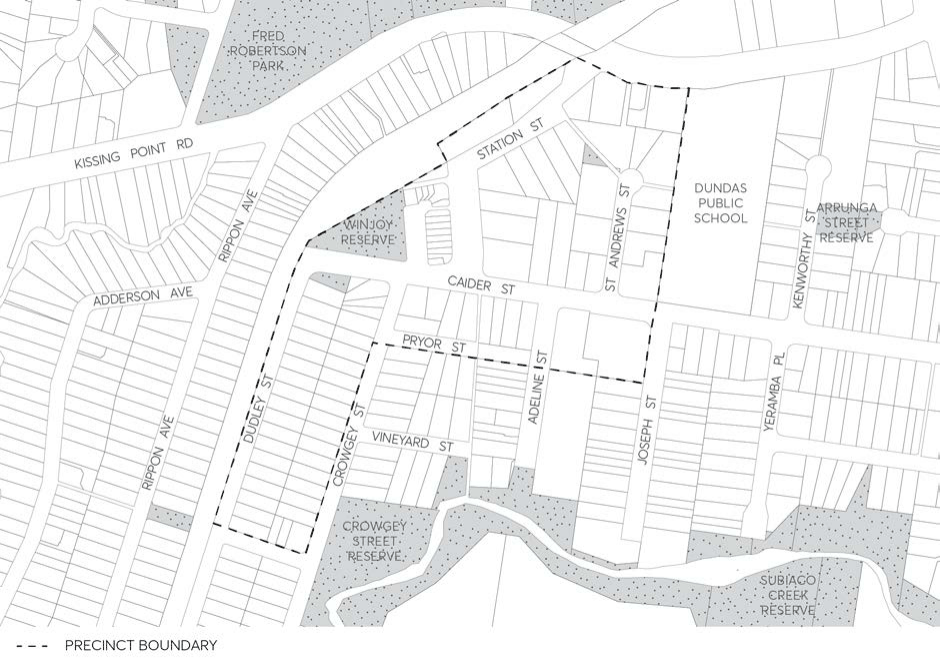

#### 8.3.7 DUNDAS

> [Picture on page 507: a picture, saved as a picture (images/part-08-centres-precincts-special-character-areas-specific-page-507-4.gif, 150 dpi).]

Figure 8.3.7.1 - Dundas Precinct Map
