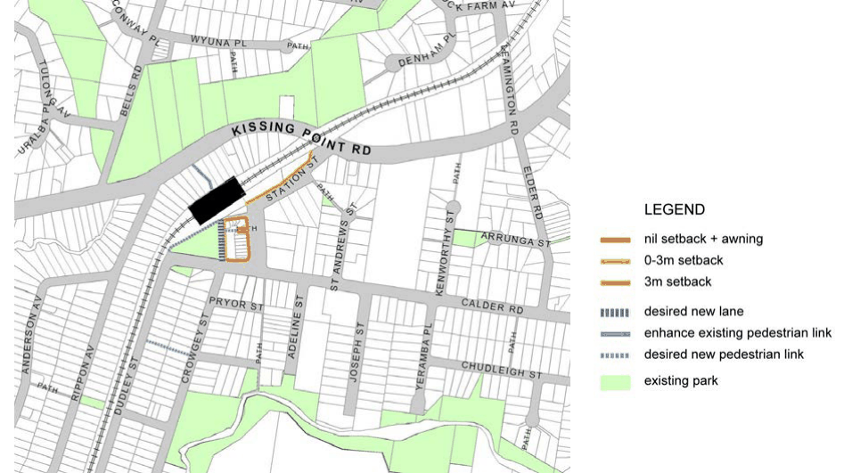
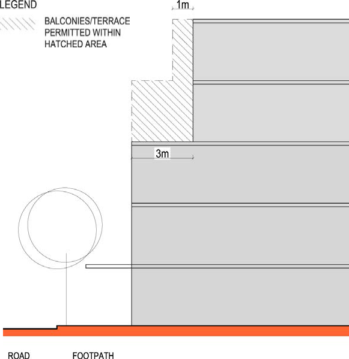

#### 8.3.7.1 DESIRED FUTURE CHARACTER

Residential density in the Dundas Precinct is concentrated close to the existing shops, train station and school. A mix of housing, including residential flat buildings, multi dwelling housing and detached housing occur within the precinct.

Opportunities for redevelopment of the existing shops provide better orientation and address to the adjoining park (Winjoy Reserve), providing improved safety and surveillance. Development also maintains an address to Station Street as the primary frontage.

Objectives

O.01 Ensure that new development provides a strong interface to existing parks, the railway station and surrounding streets.

O.02 Ensure that new development adjacent to Winjoy Reserve provides opportunities to activate the public open space.

NEIGHBOURHOOD PRECINTS

DUNDAS

Controls

Pedestrian Connections and Laneways C.01 New pedestrian connections and laneways should be provided in accordance with Figure 8.2.7.1.1. Where a development provides for public access connections, a variation to Council’s floor space ratio control can be sought in accordance with C.02 below.

C.02 Where a development provides for dedication of land to Council for the purposes of providing public access and the construction of the access way, Council may consider increasing the maximum floor space ratio. As a guide, the maximum floor space ratio may be increased by the equivalent area represented by 50% of the land area to be dedicated to Council for the public access. The site area may include the area of land to be dedicated to Council for the purpose of the floor space ratio calculation. The proposed variation to floor space is to be addressed under Clause 4.6 ‘Exception to development standards’ in the Parramatta LEP 2023.

C.03 A new shared vehicular and pedestrian laneway adjoining Winjoy Reserve should be provided over the E1 Local Centre zone to ensure a formal relationship between the public open space and the adjoining retail shops. New development addressing the laneway will activate the park edge.

C.04 The shared vehicular and pedestrian lane fronting Winjoy Reserve is to have a minimum width of 4 metres to allow for one-way vehicular movements and shared pedestrian access.

C.05 New pedestrian links are to improve through block connections and permeability and are to have a minimum width of 3 metres, being consistent in width for its full length.

C.06 Existing pedestrian connections are to be retained and enhanced. Setbacks C.07 Building setbacks are to be in accordance with Figure 8.2.7.1.1, and any additional controls set out below:

a) The nil setback in the E1 Local Centre zone applies to the first 3 storeys of development. Additional storeys shall be setback a minimum of 3 metres from the boundary as shown in Figure 8.2.7.1.2. Balconies may encroach the upper level setback area as shown on Figure 8.2.7.1.2 as follows:

• An unroofed terrace area permitted to the 4th storey. Balustrade can extend from building line of storey below.

• Balconies may extend 1 metre into the setback area for the upper 2 storeys.

b) The setback shown on the western side of the E1 Local Centre zone is to the desired laneway rather than the park edge.

C.08 Where a nil front setback is shown on Figure 8.2.7.1.1 in the E1 Local Centre zone, development should have a nil side setback where it will not have a detrimental impact upon adjoining development, to achieve a continuous street edge.

NEIGHBOURHOOD PRECINTS

DUNDAS

> [Picture on page 509: a picture, saved as a picture (images/part-08-centres-precincts-special-character-areas-specific-page-509-3.gif, 150 dpi).]

Figure 8.2.7.1.1 – Setbacks, pedestrian links and laneways

> [Picture on page 509: a picture, saved as a picture (images/part-08-centres-precincts-special-character-areas-specific-page-509-5.gif, 150 dpi).]

Figure 8.2.7.1.2 - Upper Level Setbacks and balcony locations

NEIGHBOURHOOD PRECINTS

COLLET PARK (NORTH PARRAMATTA)
