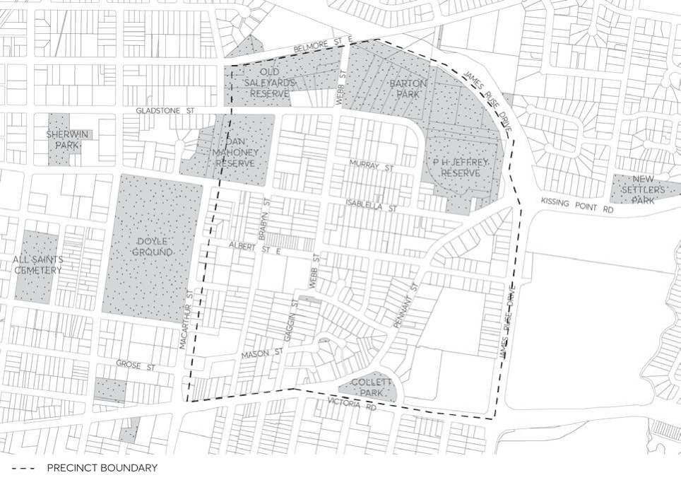

#### 8.3.8 COLLET PARK (NORTH PARRAMATTA)

> [Picture on page 510: a picture, saved as a picture (images/part-08-centres-precincts-special-character-areas-specific-page-510-4.gif, 150 dpi).]

Figure 8.3.8.1 – Collet Park Precinct (North Parramatta) Map
