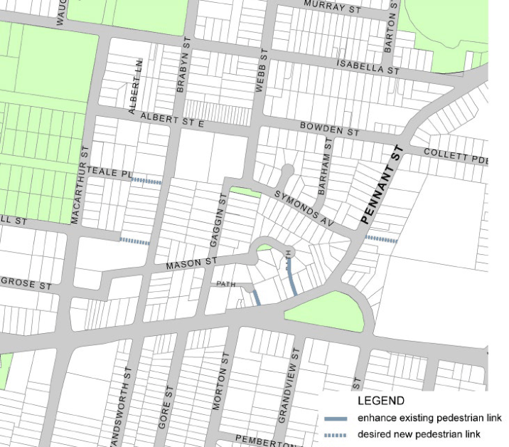

#### 8.3.8.1 DESIRED FUTURE CHARACTER

The Collett Park Precinct increases opportunities for new housing focused around retail shops, community facilities, local primary school, university and public open space. New residential development are in the form of residential flat building, multi dwelling housing. and shop top housing. Some higher buildings are located along Victoria Road and Pennant Street. Building heights are predominantly low in scale, responding to existing development.

Better pedestrian connections are created by requiring new links, and pedestrian safety is enhanced by designing buildings that have natural surveillance of pathways, laneways, parks, open space corridors or other elements of the public domain.

Street trees and the surrounding open space network contribute significantly to the character of the neighbourhood, including the row of large trees on the western side of Webb Street opposite the school. This character is reinforced and enhanced in new developments with landscaped settings.

NEIGHBOURHOOD PRECINTS

COLLET PARK (NORTH PARRAMATTA)

Objectives

In addition to general objectives listed in Section 8 of this DCP, specific objectives of this precinct are identified below.

O.01 Provide for high and medium density housing development that responds to existing development.

O.02 Provide improved pedestrian links throughout the precinct, particularly to and from the primary school, university and public open spaces.

Controls

C.01 New pedestrian connections and laneways should be provided in accordance with Figure 8.3.8.1.1. Where a development provides for desired public access connections, a variation to Council’s floor space ratio control can be sought in accordance with C.02 below.

C.02 Where a development provides for dedication of land to Council for the purposes of providing public access and the construction of the access way, Council may consider increasing the maximum floor space ratio. As a guide, the maximum floor space ratio may be increased by the equivalent area represented by 50% of the land area to be dedicated to Council for the public access. The site area may include the area of land to be dedicated to Council for the purpose of the floor space ratio calculation. The proposed variation to floor space is to be addressed under Clause 4.6 ‘Exception to development standards’ in the Parramatta LEP 2023.

C.03 New pedestrian links are to improve through block connections and permeability of the precinct. Particularly better connectivity is to be provided to the existing university, primary school and public open spaces.

C.04 New pedestrian links are to have a minimum width of 3 metres, being consistent in width for its full length.

C.05 Existing pedestrian connections are to be retained and enhanced.

NEIGHBOURHOOD PRECINTS

COLLET PARK (NORTH PARRAMATTA)

> [Picture on page 512: a picture, saved as a picture (images/part-08-centres-precincts-special-character-areas-specific-page-512-3.gif, 150 dpi).]

Figure 8.3.8.1.1 – Pedestrian Links

NEIGHBOURHOOD PRECINTS

HUNTERFORD ESTATE, OATLANDS
