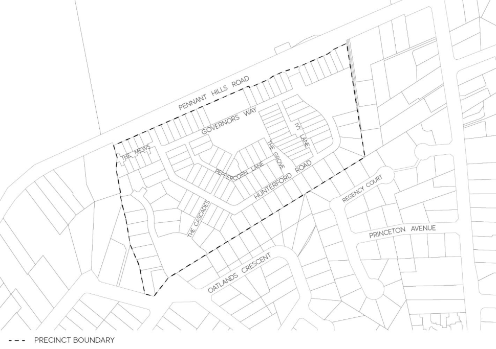

#### 8.3.9 HUNTERFORD ESTATE, OATLANDS

> [Picture on page 513: a picture, saved as a picture (images/part-08-centres-precincts-special-character-areas-specific-page-513-4.gif, 150 dpi).]

Figure 8.3.9.1 – Hunterford Estate Oatlands

Controls

Streetscape and character C.01 The design of buildings should reflect and complement the streetscape and avoid monotonous or symmetrical design.

C.02 Development should contribute to an attractive residential environment with clear character and identity.

C.03 Variation in the location and height of buildings along streets through varied building setbacks and heights.

C.04 Other quantitative controls relating to streetscape are those established by this plan relating to landscaping, height and building setbacks.

Building platform and views C.05 The site layout should take into account the views available from the southeast corner of the site.

C.06 Dwelling orientation should take advantage of views. C.07 Building form and design should where possible allow for view sharing.

NEIGHBOURHOOD PRECINTS

HUNTERFORD ESTATE, OATLANDS

Building setbacks Front C.08 The minimum front setback shall be 7.5 metres from the adjusted boundary following excision of the land required by the TfNSW, for all buildings fronting Pennant Hills Road, providing noise attenuation measures are put in place to reduce traffic noise in accordance with EPA Standards for the future inhabitants of the development. A 3 metre setback shall be provided for all other roads in the development. If a stacked car parking space is required to meet the car parking requirements the setback to the garage is to a minimum of 5.5 metres.

Side and Rear Setbacks C.09 The minimum setback shall be 4.5 metres to the boundary of an existing adjoining property for one storey developments, and 6 metres to the boundary of an adjoining property for two storey developments, except for that part of the site that adjoins properties Lot 9-13 in DP 229301 Regency Court where the minimum setback shall be 8.5 metres. Zero setbacks are permissible as part of the small lot housing development.

C.10 Residential flat buildings should have a minimum side setback of 3 metres and should have due regard for overlooking and overshadowing of adjacent dwellings within the integrated scheme. The side setback will be increased to reduce any impact of overlooking and overshadowing on adjacent dwellings within the small lot housing scheme.

C.11 Where front verandahs or patios are provided, they may project forward of the building line to within 2 metres of the front property boundary.

C.12 With respect to roads and adjoining properties, up to 25% variation in setback may be considered where there will be no detrimental impact on the streetscape and there is no significant overlooking or overshadowing of adjoining properties.

Landscaping and open space Trees and other plantings should be used to achieve an improved level of privacy between units while allowing casual surveillance for safety.

C.13 High-quality landscape design which includes significant tree planting, well defined entrances, play areas and kerbside planting are considered important elements for the creation of a good urban setting for urban housing, and should be encouraged.

C.14 Landscaping design should incorporate species indigenous to the area and those which will not cause damage to adjacent buildings or driveways.

C.15 Fencing in or adjacent to communal open space areas is to be minimised. Where provided, such fencing is to be of a height, design and construction which reflects the landscape character of the site. Reference should be made to the relevant category of development listed below. For all dwellings (except residential flat buildings) with a site density of 40 dwellings per ha or less.

a) The minimum private open space area required is 20% of the site area, with a minimum dimension of 3 metres.

b) The private open space should have a maximum gradient of 1 in 10 metres.

NEIGHBOURHOOD PRECINTS

HUNTERFORD ESTATE, OATLANDS

c) Screening (minimum 1.8 metres) should be provided where necessary to ensure privacy to users of the open space. For all dwellings (except residential flat buildings) with a site density more than 40 dwellings per ha.

a) Dwellings should be provided with a total minimum area of 35m² (minimum 20% of the site area for site densities greater than 60 dwellings per ha), with a minimum dimension of 2.5 metres.

b) The private open space should have a maximum gradient of 1 in 10 metres.

c) One part of the private open space should comprise an area of 16m², with a minimum dimension of 4 metres and which is directly accessible from a living area of the dwelling.

d) Screening (minimum 1.8 metres) should be provided where necessary

Dwelling design and construction C.16 Pitched roofs are the preferred choice of roof form for the development, particularly for dwellings adjoining the existing residential area.

C.17 Dwellings should be orientated to maximise solar access and enjoy views. Privacy C.18 Outlooks from windows of habitable rooms, balconies, terraces and the like should be obscured or screened where a direct view is available into the principal area of private open space of an existing dwelling.

C.19 If screening is used, the view of the area overlooked must be restricted within 9 metres and beyond a 45° angle from the plane of the wall containing the opening, measured from a height of 1.7 metres above floor level.

C.20 No screening is required where windows are in non-habitable rooms. Windows in bathrooms, toilets, laundries and storage rooms which have a direct view into adjoining properties should have either translucent glazing or sill heights of at least 1.7 metres.

C.21 Building designs which mirror the reverse on adjoining lots, so that windows are directly opposite each other, should be avoided.

C.22 Any dwellings located close to Pennant Hills Road or affected by traffic noise from Pennant Hills Road are to comply with the criteria for road and traffic noise contained in the NSW Road Noise Policy 2011, prepared by the Environmental Protection Agency.

C.23 Achievement of LA10 (20 minute) noise level or less than 50d BA in habitable rooms with windows and doors ‘normally’ open (i.e. at least 50 % of the flow area of the room), and less than 50d BA with the windows closed.

C.24 An acceptable acoustic environment can be achieved within noise sensitive rooms and also at outdoor recreation space by means of correct building orientation and height, appropriate internal layout and increase in the mass of the external facade.

C.25 Wherever possible, bedrooms of one dwelling should not share walls with living rooms or garages of adjacent dwellings.

NEIGHBOURHOOD PRECINTS

NORTH EAST OF CITY CENTRE PRECINCT
