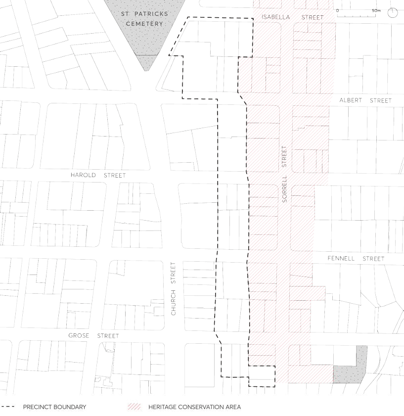

#### 8.3.10 NORTH EAST OF CITY CENTRE PRECINCT

> [Picture on page 516: a picture, saved as a picture (images/part-08-centres-precincts-special-character-areas-specific-page-516-4.gif, 150 dpi).]

Figure 8.3.10.1 – North East of City Centre Precinct
