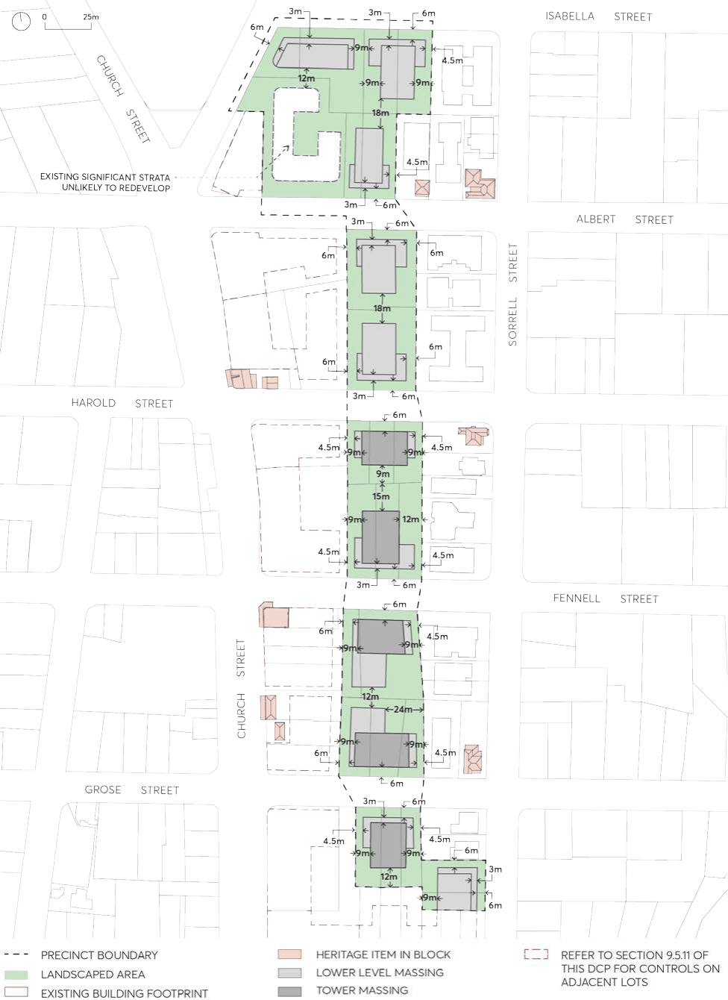

#### 8.3.10.1 DESIRED FUTURE CHARACTER

The North East of City Centre Precinct applies to land that sits between the northern periphery of the Parramatta City Centre and Sorrell Street Heritage Conservation Area (HCA). The adjacent Sorrell Street HCA is a residential precinct comprised mainly of 3- to 4-storey apartment buildings interspersed with smaller heritage houses. Established streetscapes where apartments have greater street setbacks and often mature tree planting, frame views of smaller heritage houses along the street. Historic buildings exist mostly on corners and in rows, with an important role in marking intersections and permitting views west up to the ridge of Church Street. Future development in this precinct is to respond to this prevalent heritage siting by ensuring that no building is built forward of well-established heritage alignments.

Future development within the North East of City Centre Precinct will play a critical part in creating a transitional edge between larger scale development along the Church Street spine and the Sorrell Street HCA. Methods for transition include a combination of stepped building height, mid-block courtyards with tree planting, mid-block views to sky between towers along Church Street and

NEIGHBOURHOOD PRECINTS

NORTH EAST OF CITY CENTRE PRECINCT

upper-level setbacks in proximity to Sorrell Street properties. Transition ensures future built form is in response to both the existing and potential future context. The materiality and definition of podiums contribute to the streetscape, create human scale street edge and frame lower scale heritage buildings.

The wider context of North Parramatta is characterised by mature, large canopy trees within both the private and public domain. Future development should enhance this vegetated character and preserve trees on site as a priority.

The following controls acknowledge this is a precinct with a well-established residential character that will change over time. Controls are designed to recognise the potential higher density residential development within the North East of City Centre Precinct and maximise opportunities for communal courtyards at ground that are collocated with deep soil, tree planting and increased canopy cover. Building podiums and towers are proportioned for residential uses with generous tower separation.

The specific objectives and controls for this precinct detailed below are to be applied in conjunction with the general objectives and controls in Part 2, 3, 5, 6 and 7 of this DCP. Where there is any inconsistency with any other part of the DCP, the objectives and controls of this Section will prevail.

Objectives

O.01 Transition building forms and types to mediate between the future context of towers along the Church Street spine and the low scale residential neighbourhood within the Sorrell Street Heritage Conservation Area.

O.02 Define the visual setting of the heritage conservation area by ensuring views of sky from Sorrell Street over buildings within the North East of City Centre Precinct and between towers.

O.03 Orientate building forms to create consistent spacing between towers that align with tower development along Church Street increasing views to sky.

O.04 Utilise building materiality and form to accentuate the lower levels of buildings in proximity to heritage buildings and along streets.

O.05 Enhance the vegetated character of North Parramatta through consistent setbacks that preserve existing trees and enable further large canopy tree planting in the street, front setback, and rear setback zones.

O.06 Ensure deep soil spaces with large canopy trees are delivered in a location where they also function as a background setting to the Sorrell Street Heritage Conservation Area.

O.07 Allow heritage items to be the dominant features of the streetscape, forward of any future development.

O.08 Support detached residential apartment buildings with good amenity.

NEIGHBOURHOOD PRECINTS

NORTH EAST OF CITY CENTRE PRECINCT

> [Picture on page 518: a picture, saved as a picture (images/part-08-centres-precincts-special-character-areas-specific-page-518-3.gif, 150 dpi).]

Figure 8.3.10.2 – North East of City Centre Precinct Setbacks and Built Form

NOTE: The building envelopes are indicative only and will be subject to further analysis and design refinement relating to flooding, overshadowing, heritage transition and the like.

NEIGHBOURHOOD PRECINTS

NORTH EAST OF CITY CENTRE PRECINCT
