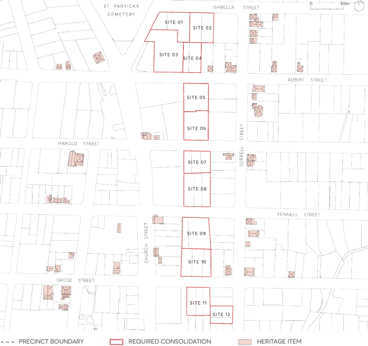

#### 8.3.10.2 MINIMUM SITE REQUIREMENTS

Objectives

O.01 Ensure sites are of sufficient width to achieve:

a) the necessary standard of amenity in relation to privacy, solar access, ventilation, outlook, deep soil, and landscaped area,

b) desired tower alignment and orientation to create space between buildings and views to sky,

c) adequate building separation in accordance with this section of this dcp,

d) a sense of address and passive surveillance of the street, and

e) safe and efficient access and servicing.

O.02 Ensure development does not isolate or compromise the amenity or development potential on adjacent sites.

Controls

C.01 Site consolidation must comply with Figure 8.3.10.3 – Preferred Lot Amalgamation for Redevelopment to meet all of the objectives of Section 8.3.10 – North East of City Centre Precinct.

> [Picture on page 519: a picture, saved as a picture (images/part-08-centres-precincts-special-character-areas-specific-page-519-19.gif, 150 dpi).]

Figure 8.3.10.3 – Preferred Lot Amalgamation for Redevelopment

NEIGHBOURHOOD PRECINTS

NORTH EAST OF CITY CENTRE PRECINCT

C.02 A development lot must have a minimum site frontage width of 40 metres, except for development lots identified as Site 04 and Site 12 in Figure 8.3.10.3 – Preferred Lot Amalgamation for Redevelopment.

C.03 Lots identified as Site 04 and Site 12 in Figure 8.3.10.3 – Preferred Lot Amalgamation for Redevelopment must have a minimum site frontage width of 24 metres.

C.04 Where a site has the minimum frontage width or more, it must nonetheless be demonstrated that objective O.01 and O.02 of this control can be satisfied.
