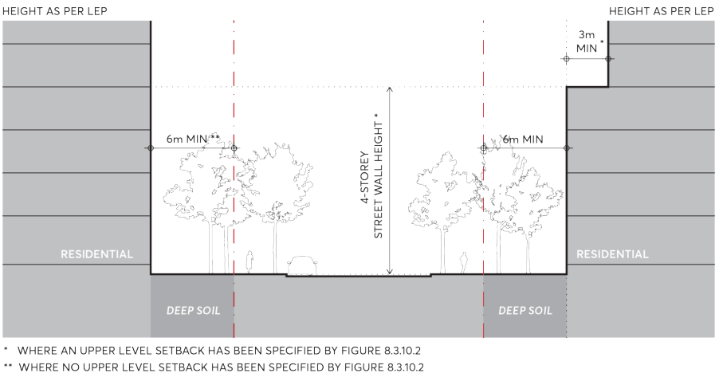
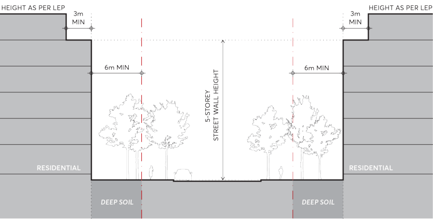
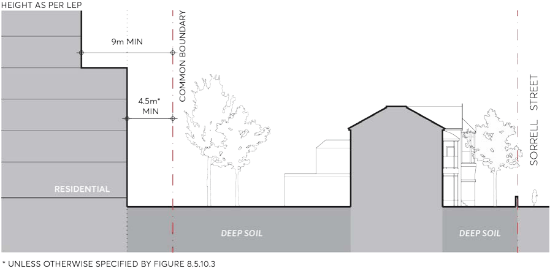
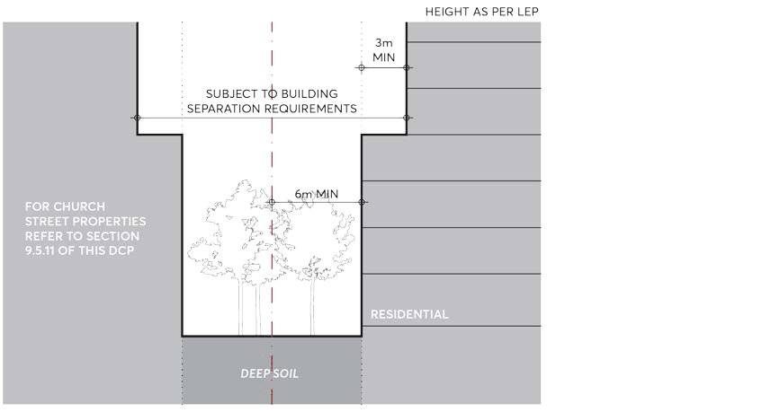
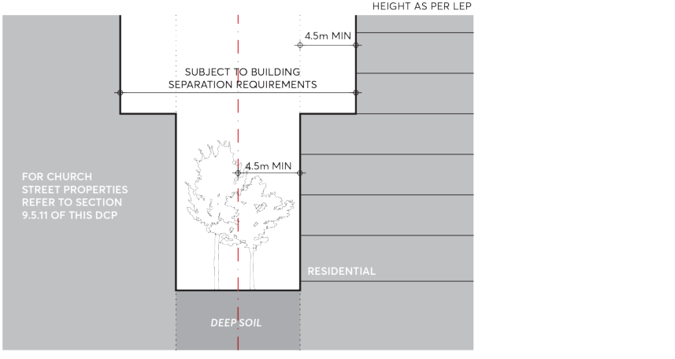
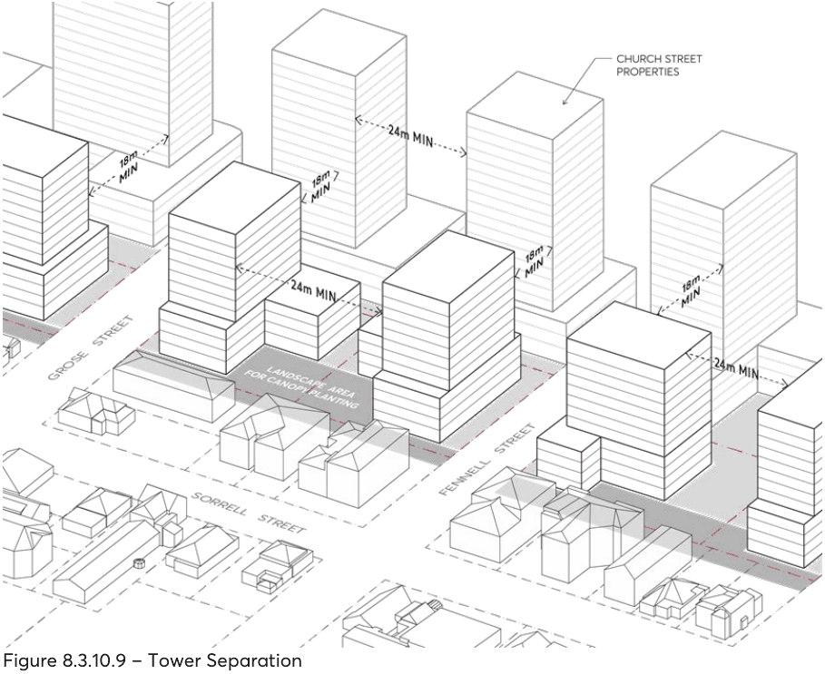
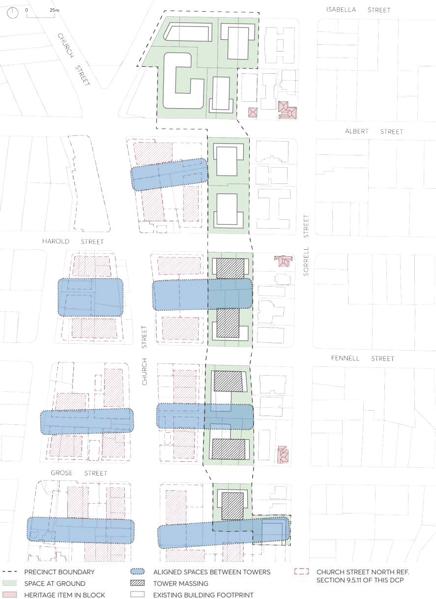
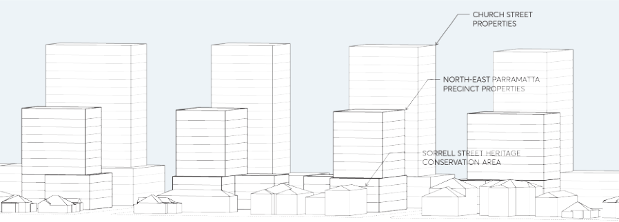

#### 8.3.10.3 THE BUILDING ENVELOPE

Objectives

O.01 Provide space for landscape amenity and canopy tree planting that also contributes to the public domain.

O.02 Align and orientate future development in a way that creates space between towers that align with tower development along Church Street and enables views to sky when observed from the Sorrell Street Heritage Conservation Area.

O.03 Provide adequate privacy, access to light, air and outlook for the occupants of buildings, neighbouring properties and future buildings.

O.04 Ensure building form achieves comfortable public domain conditions for pedestrians, with adequate daylight, appropriate scale and mitigation of urban heat and wind effects of tower buildings.

O.05 Utilise building form and site layout to achieve a transitional relationship between Church Street properties and properties within the Sorrell Street Heritage Conservation Area.

Controls

Building setbacks C.01 Development within the precinct must comply with the setbacks and envelope controls specified in Figure 8.3.10.2 – North East of City Centre Precinct Setbacks and Built Form.

C.02 All building setbacks must be measured perpendicular to the boundary and extend to the outer faces of the building including balconies, sunscreens and the like.

C.03 For sites with a 40 metre height limit as per the Parramatta LEP 2023, buildings must be set back a minimum of 6 metres from the street boundary as shown in Figure 8.3.10.4. Tower setbacks must comply with Figure 8.3.10.2 – North East of City Centre Precinct Setbacks and Built Form.

C.04 For sites with a 40 metre height limit, the street wall must be designed to be of predominantly masonry character and articulated with depth, relief and shadow on the street façade. Where no upper level setback is required by Figure 8.3.10.2 - North East of City Centre Precinct Setbacks and Built Form, the lower 4 storeys of the development must still be designed with the

NEIGHBOURHOOD PRECINTS

NORTH EAST OF CITY CENTRE PRECINCT

same materiality and character as the street wall, and be clearly distinct from the tower element.

> [Picture on page 521: a picture, saved as a picture (images/part-08-centres-precincts-special-character-areas-specific-page-521-5.gif, 150 dpi).]

Figure 8.3.10.4 – Street setbacks and street wall height for sites with a 40m height limit

C.05 For sites with a 24 metre height limit as per the Parramatta LEP 2023, buildings must be set back a minimum of 6 metres from the street boundary, and upper level set back a minimum of 3 metres from the street wall, as shown in Figure 8.3.10.5. The lower 5 storeys must be designed to be of predominantly masonry character and articulated with depth, relief and shadow on the street façade.

> [Picture on page 521: a picture, saved as a picture (images/part-08-centres-precincts-special-character-areas-specific-page-521-12.gif, 150 dpi).]

Figure 8.3.10.5 – Street setbacks and street wall height for sites with a 24m height limit

C.06 A 1 metre articulation zone is permitted forward of the street setback, in which building elements may occupy a maximum of one third of the area of the façade. Services or lift shafts are not permitted in the articulation zone.

NEIGHBOURHOOD PRECINTS

NORTH EAST OF CITY CENTRE PRECINCT

C.07 For sites with a 40 metre height limit, buildings must provide a minimum 4.5 metre setback from the common boundary shared with any lot in the Sorrell Street Heritage Conservation Area and towers set back a minimum of 9 metres from the common boundary, as per Figure 8.3.10.6.

> [Picture on page 522: a picture, saved as a picture (images/part-08-centres-precincts-special-character-areas-specific-page-522-6.gif, 150 dpi).]

Figure 8.3.10.6 – Setback to properties within the Sorrell Street Heritage Conservation Zone

C.08 Buildings on Site 05, Site 06 and Site 12 must provide a minimum 6 metre setback from the common boundary shared with any lot in the Sorrell Street Heritage Conservation Area and the upper level must be set back a minimum of 9 metres from the common boundary.

C.09 Buildings on Site 01, Site 02 and Site 04 must provide a minimum 4.5 metre setback from side boundaries and the upper level must be set back a minimum of 9 metres from side boundaries.

C.10 Development Site 05, Site 06, Site 09 and Site 10 must provide a minimum of 6 metre setback from the common boundary shared with lots fronting Church Street, as per Figure 8.3.10.7. Towers/upper levels must be set back a minimum of 3 metres from the podium, subject to building separation requirements.

> [Picture on page 522: a picture, saved as a picture (images/part-08-centres-precincts-special-character-areas-specific-page-522-17.gif, 150 dpi).]

Figure 8.3.10.7 – Setbacks and separation with properties fronting Church Street (site 05, site 06, site 09, and site 10)

NEIGHBOURHOOD PRECINTS

NORTH EAST OF CITY CENTRE PRECINCT

C.11 Development on Site 07, Site 08, and Site 11 must provide a minimum of 4.5 metre setback from the common boundary shared with lots fronting Church Street, as per Figure 8.3.10.8. Towers must be set back a minimum of 4.5 metres from the podium, subject to building separation requirements.

> [Picture on page 523: a picture, saved as a picture (images/part-08-centres-precincts-special-character-areas-specific-page-523-7.gif, 150 dpi).]

Figure 8.3.10.8 – Setbacks and separation with properties fronting Church Street (site 07, site 08 and site 11)

C.12 The rear setback to any part of the building up to 4 storeys must be a minimum of 6 metres. For any part of the building above 4 storeys, the rear setback must be a minimum of 20% of the site length or 12 metres, whichever is greater.

C.13 Only one step in the built form between the street wall and tower is permissible. C.14 Basements must be contained within the building envelope and not encroach into minimum setback zones.

Building separation C.15 For all sites with a 40m height limit as per the Parramatta LEP 2023, towers must have a minimum separation of:

a) 18 metres between lots in the North East of City Centre Precinct and lots on Church Street for any part of the development over 4 storeys.

b) 24 metres between lots in the North East of City Centre Precinct for any part of the development over 4 storeys. Refer to Figure 8.3.10.9 – Tower Separation.

C.16 Any existing adjacent building, including heritage listings, cannot be used to justify reduced separation or setbacks.

C.17 Separation between each of the buildings should enable generous views to sky from the Sorrell Street Heritage Conservation Area towards Church Street, as per Figure 8.3.10.10 and Figure 8.3.10.11.

NEIGHBOURHOOD PRECINTS

NORTH EAST OF CITY CENTRE PRECINCT

> [Picture on page 524: a picture, saved as a picture (images/part-08-centres-precincts-special-character-areas-specific-page-524-3.gif, 150 dpi).]

Figure 8.3.10.9 – Tower Separation

Building proportion and height C.18 Height of new buildings are to ensure positive and cohesive relationships with other buildings both on the site and off the site and are to respond to the scale and character of the Sorrell Street Heritage Conservation Area.

C.19 The maximum number of storeys permitted within the height limit specified by the Parramatta LEP 2023 must be consistent with the table below:

| Height in metres | Height in storeys |
|---|---|
| 24 metres | 6 storeys |
| 40 metres | 12 storeys |

C.20 The maximum floorplate length for any tower must be 35 metres and maximum floorplate area for any tower must be 800m2.

C.21 Where possible, buildings should be designed so that the short edge of towers may be orientated to the Sorrell Street Heritage Conservation Area to create generous views to sky between towers when observed from the HCA, as per Figure 8.3.10.10 and Figure 8.3.10.11.

NEIGHBOURHOOD PRECINTS

NORTH EAST OF CITY CENTRE PRECINCT

> [Picture on page 525: a picture, saved as a picture (images/part-08-centres-precincts-special-character-areas-specific-page-525-3.gif, 150 dpi).]

Figure 8.3.10.10 – Aligned spaces between towers to enable views to sky

NEIGHBOURHOOD PRECINTS

NORTH EAST OF CITY CENTRE PRECINCT

> [Picture on page 526: a picture, saved as a picture (images/part-08-centres-precincts-special-character-areas-specific-page-526-3.gif, 150 dpi).]

Figure 8.3.10.11 – Views to sky between towers
