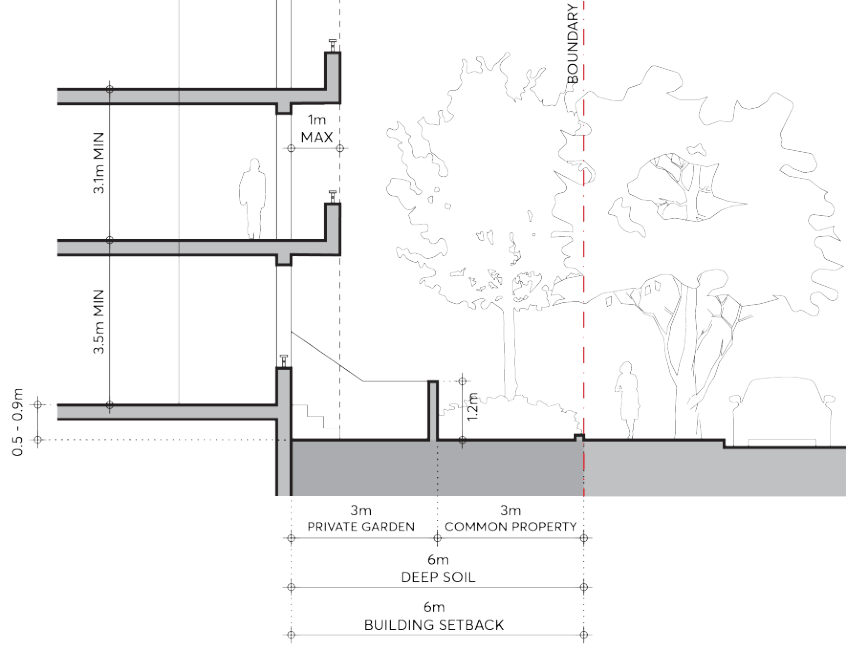

#### 8.3.10.4 RESIDENTIAL APARTMENT DESIGN QUALITY

Objectives

O.01 Provide for the amenity, interest and liveliness of the street environment. O.02 Appropriately define and design the street edge and setback area to achieve amenity and privacy for residents as well as engagement with and passive surveillance of the street.

O.03 Ensure development achieves good amenity standards for residents in relation to daylight, ventilation, outlook, and privacy.

Controls

C.01 Buildings are to be designed to ensure that solar access and cross ventilation requirements of the Apartment Design Guide and Part 3 – Residential Development of this DCP are achieved for residential development both on and off the site.

C.02 Solar access must be reasonably provided and retained within the existing and future public domain areas and on adjoining sites.

C.03 The minimum floor to floor height must be 3.5 metres for the ground floor level and 3.1 metres for any level above the ground floor level as per Figure 8.3.10.11 – Ground floor interface and floor to floor heights.

C.04 High level windows must not be used as the primary source of light, ventilation and outlook for habitable rooms.

C.05 Daylight and natural ventilation must be provided to all common circulation spaces and windows must be visible from any lift core, as well as the ends of corridors.

C.06 To balance privacy and street activation, ground floor apartment levels must be a minimum of 500mm and maximum of 900mm above footpath level as per Figure 8.3.10.11 – Ground floor interface and floor to floor heights.

NEIGHBOURHOOD PRECINTS

NORTH EAST OF CITY CENTRE PRECINCT

> [Picture on page 527: a picture, saved as a picture (images/part-08-centres-precincts-special-character-areas-specific-page-527-3.gif, 150 dpi).]

Figure 8.3.10.11 – Ground floor interface and floor to floor heights

C.07 The setback area must allocate the front 3 metres adjacent to the footpath as common property for landscaping. Canopy trees must be planted in this area, a minimum 3.5 metres from any structure, to enable a tree with greater than 13 metres mature height and spread, at the rate of 1 canopy tree for every 15 lineal metres of frontage.

C.08 A wall setback 3 metres from the street boundary must articulate the front areas in private ownership. The wall must be a maximum 1.2 metres high and of masonry construction, integrated with dividing masonry walls for private open spaces.

C.09 Where individual apartment entries from the street serve as a primary address, a ground floor balcony space between the entry and private garden, and a hinged front door with a distinct entry space within the apartment, must be provided. Sliding glass doors for ground floor apartments fronting the street are discouraged. If the entries are only for the use of residents they must be understated, with post boxes and street numbers located at the common entry.

C.10 All stairs and ramps providing access to lobbies must be internalised where necessary to ensure the street interface is not compromised.

C.11 A fully illustrated and co-ordinated ground floor design, showing all the necessary levels and detail, must accompany development applications. Drawings must include:

a) A detailed ground level plan and sections as part of the architectural submission which illustrates the relationships between the interior and the exterior spaces of the setback area, including the landscape and hydraulic detail, and extends into the public domain.

b) Any required services must be discreetly integrated into the design.

NEIGHBOURHOOD PRECINTS

NORTH EAST OF CITY CENTRE PRECINCT

c) The architectural drawings must be fully co-ordinated with the landscape and hydraulic drawings.

d) Elevations and sections at minimum 1:50 scale of all built elements in the setback area must be provided.
